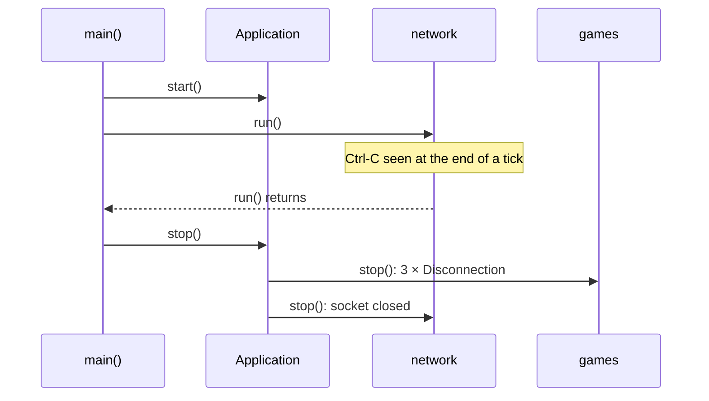

# Plan: the server assembled from modules (RTY-196)

## Context

Today `src/server/main.cpp` (231 lines) builds every part of the server by hand: the logger, the game, the connection acceptor, the broadcaster of the game events, the waves file, and the tick function `runTick()`. The order of the tick, the rule "a new player joins the first game" and the forgetting of departed players live there, and nothing tests them. The server and its tick depend on each other, so `main.cpp` declares `ServerApplication* serverPointer = nullptr` and assigns it after the server is built. The engine has had a module framework (`Application`, `IModule`, `InstallContext`, loop stages, services) since #124 and #134, but no program uses it yet. Ctrl-C kills the server outright: nothing tells the players.

## Summary

The server becomes four modules handed to `rtype::engine::Application`: `journal` (`LoggingModule`), `network` (`NetworkModule`), `games` (`GamesModule`) and `lobby` (`LobbyModule`). `main.cpp` only reads the options, lists the modules, starts them, runs the loop and stops them. The network module provides a send service (`IServerLink`) during its install, so the null pointer disappears. Ctrl-C and SIGTERM (Ctrl-C, Ctrl-Break and closing the console on Windows) end the loop. The modules then stop in reverse order, each player gets `Disconnection` three times 50 ms apart, as the protocol table asks, and the socket closes.

## Acceptance criteria

| Criterion of the issue | How this plan meets it | Checked by |
|---|---|---|
| Modules `journal`, `réseau`, `parties`, `lobby`; `main.cpp` only reads the options and gives the list to `Application` | `LoggingModule` ("journal"), `NetworkModule` ("network"), `GamesModule` ("games"), `LobbyModule` ("lobby"); `main.cpp` keeps `listeningEndpoint()`, `serverModules()` and `runServer()` (start, run, stop) | reading `main.cpp` (step 9) |
| The order of the tick, the "first game" rule, the wiring of the broadcaster, the reading of the waves file and the forgetting of departed players leave `main.cpp` | tick order: stage works (`games` in `simulation`, then `lobby` in `simulation`, then `games` in `outputs`); first game: `GameList::joinable()`; broadcaster and waves: `GamesModule::open()`; forgetting: `GamesModule::playTick()` | `GameListTest`, `GamesModuleTest`, `LobbyModuleTest` |
| The null pointer that breaks the server/tick cycle disappears; `réseau` publishes a send service at install | `NetworkModule::install()` provides `IServerLink` (a `ServerLink` it owns) and the datagrams of the tick; the stages run through the `IStageRunner` the `Application` provides | `git grep -n serverPointer -- src` prints nothing; `NetworkModuleTest` |
| Ctrl-C, SIGTERM and the Windows equivalent start the stop phase: reverse order, a `Disconnection` to each player, socket closed | `StopSignals` (POSIX: `std::signal`; Windows: `SetConsoleCtrlHandler`, Microsoft docs read, see Assumptions); `GamesModule::stop()` sends the `Disconnection`s through `ServerApplication::sendQueuedAfterRun()`; `NetworkModule::stop()` closes the socket last | `StopSignalsTest`, `NetworkModuleTest`, `ServerApplicationAfterRunTest`, `GamesModuleTest`, procedure for the user |
| No other change of behavior; the existing tests pass, changed only in how they are built | no existing `*Test.cpp` changes (only `tests/CMakeLists.txt` gains sources and targets); `GameInstance`, `ConnectionAcceptor`, `GameEventBroadcaster` and `TickLoop` keep their API; `ServerApplication` gains one method | `cmake --workflow --preset test`, `guard-tests.sh` |
| `architecture.md` and `server.md` describe the modules | documentation step (step 11), which also fixes the sentence in `engine.md:148` (see Assumptions, gap 3) | `npm run build` in `docs/` |
| `cmake --workflow --preset test` green, zero warnings | gates of step 12 | output and exit code read |

## Out of scope

- **The client reading the server's `Disconnection`.** The client has no handler for it today (`protocol.mdx:323`: "the `Disconnection` of the server, which the server does not send when it shuts down and the client does not read"). After this change the server sends it, but the client still ignores it and keeps its screen until the player quits. That is a client feature for a separate issue; this pull request updates the protocol page to say the server now sends it.
- Several games at once (RTY-59), the link with the master, the administration console: the modules make room for them, nothing more.
- Moving the nested types of `ServerApplication` (`ReceivedDatagrams`, `TickHandler`): reported, not reworked (see "Pre-existing inconsistencies").

## Assumptions

Each gap between the issue and the code (from `.cezar-work/context.md`) and each design decision the issue does not settle:

1. **`Application` has no blocking `run()`.** The loop is `ServerApplication::run()`: the network on the calling thread, the ticks on a `std::jthread`. `main.cpp` therefore keeps a reference to the `NetworkModule` it builds (`NetworkModule& pacer = *network;`, valid while the `Application` that owns it lives). It calls `application.start()`, then `pacer.run()`, then `application.stop()`. *Alternative considered*: `NetworkModule::start()` starting the loop on a thread of its own. Rejected because `Application::stop()` stops `lobby` and `games` before `network`, so ticks would still run on the simulation thread while `games` destroys its game: a data race.
2. **How the network module runs the stages.** The tick handler of `ServerApplication` must call `Application::runStages()`, but the `Application` is built after its modules. The engine gains an interface `IStageRunner` (`runStages(Duration) const`). `Application` implements it and provides itself as that service in its constructor, so the module that paces the loop requires it during `install()`. No pointer is assigned after construction. `runStages()` still runs nothing until every module started, and nothing after `stop()`. In this program the simulation thread starts after `start()` returned and is joined before `stop()`, so `running_` is never read and written at the same time.
3. **The sentence the issue names is in `engine.md`, not `architecture.md`.** `architecture.md:109` already says the tick "runs the systems of each game". The false sentence is `engine.md:148`: "its tick only advances the timers and delivers the events of the bus: no tick runs systems yet". Both pages are updated.
4. **The `Disconnection` is part of the protocol already**: type 4, empty payload, `rtype_network_disconnection`. The server receives it today (`GameInstance` closes the session with `PlayerDeparture (Left)`); this plan makes the server send it. The protocol table (`protocol.mdx:123`) says "when the server shuts down, three times 50 ms apart". The plan follows it with the existing `REPEATED_MESSAGE_COPIES` (3) and `REPEATED_MESSAGE_INTERVAL` (50 ms) of `GameEventConstants.hpp`, so the shutdown takes 100 ms more when at least one player is connected (none otherwise). Each copy carries the next session header (token and sequence) of its player, from `sessionDatagram()`.
5. **Sending once the loop stopped.** After `ServerApplication::run()` returned, nothing runs the network context any more, so the `sendWaiting()` the last tick posted may never run. `ServerApplication::sendQueuedAfterRun()` calls `relay_.sendWaiting()` on the calling thread. That is allowed because no thread runs the context, which `DatagramRelay`'s contract requires. Asio 1.32.0 (vcpkg) hands each datagram to the system within `async_send_to`. Verified in the installed headers: `reactive_socket_service.hpp:308` passes `allow_speculative = true`, `kqueue_reactor.ipp:225` and `epoll_reactor.ipp:262` call `op->perform()` at once when no write is waiting, and `win_iocp_socket_service_base.ipp:424` calls `WSASendTo` in the initiation. A datagram the system cannot take at once (full send buffer) is lost; four players × 25 bytes do not fill it.
6. **Windows signals, from the Microsoft documentation read for this plan.**
   - "signal" (C runtime): "SIGINT is not supported for any Win32 application. When a CTRL+C interrupt occurs, Win32 operating systems generate a new thread to specifically handle that interrupt", and "The SIGILL and SIGTERM signals aren't generated under Windows."
   - "SetConsoleCtrlHandler": a console process gets `CTRL_C_EVENT`, `CTRL_BREAK_EVENT` and `CTRL_CLOSE_EVENT` (the user closes the console, or End Task in Task Manager); handlers are called last registered first until one returns `TRUE`.
   - "HandlerRoutine": the handler runs on a new thread; after `CTRL_CLOSE_EVENT`, "Return TRUE. In this case, no other handler functions are called and the system terminates the process"; the timeout of `CTRL_CLOSE_EVENT` is 5000 ms; `CTRL_C` and `CTRL_BREAK` have no timeout; `CTRL_LOGOFF_EVENT` and `CTRL_SHUTDOWN_EVENT` reach services only.
   - So on Windows `StopSignals` handles Ctrl-C, Ctrl-Break and the closing of the console, the console close standing in for SIGTERM. On `CTRL_CLOSE_EVENT` the handler records the request and then waits (`Sleep(INFINITE)`), so the program stops by itself and the process ends when `main()` returns, or after the 5 s Windows allows. The same page warns that console functions "may not work reliably" during that event, so the lines written to standard error then may be lost; the log file still gets them.
7. **POSIX signals use `std::signal`, not `sigaction`.** With `sigaction`, `misc-include-cleaner` wanted `<signal.h>` on macOS (it maps `sigaction` to `<sys/signal.h>`), and `modernize-deprecated-headers` then refuses `<signal.h>`. Measured locally with clang-tidy 20 and 22 and the repository's `.clang-tidy`. `std::signal` from `<csignal>` passes both. glibc and macOS give `signal()` BSD semantics (the handler stays installed, interrupted system calls restart; Linux man page signal(2)).
8. **The stop is polled once per tick**: the handler only stores into a lock-free `std::atomic<bool>`. At the end of each tick, the network module calls `ServerLink::stop()` when the flag is set. So `run()` returns at most one tick (16.7 ms) after the signal, plus the end of the simulation thread's current sleep (one more tick at most).
9. **The waves file is read in `GamesModule::start()`, not in `install()`.** `install()` may read a file (`fix-architecture-a-module-install-keeps-nothing-open.md`), but every `install()` runs before every `start()`, so the log file, opened by `LoggingModule::start()`, would not be open yet. The line "waves file …" and a waves error would then go to standard error only, while they reach the log file today. Two visible consequences, both on error paths only:
   - the error text gains the prefix of `ModuleStartFailedException`: `server stopped: The module "games" failed to start: <the same reason as today>`, exit code 1 as today;
   - the socket is bound before the waves are read, and closed again by `Application` when the games fail to start.
10. **Order of the log lines kept.** "listening on UDP port N" moves from after the build of the server to `NetworkModule::run()`, so the lines stay "server starting", "waves file …", "listening on UDP port N", then "server stopped".
11. **Ctrl-C now ends with exit code 0** and the line "server stopped", where the system used to kill the process. This is the change the issue asks for.
12. **Module names in English** in the code: "journal", "network", "games", "lobby" (the issue writes `réseau` and `parties`). They are constants in `ServerConstants.hpp`. `games` depends on `network` only, since `network` already depends on `journal`.
13. **Tests**: no existing `*Test.cpp` changes (the issue allows changing their construction only, and `guard-tests.sh` fails on any change to them). New behavior gets new test files.
14. **Folders follow the project map** (`project-layout.md:133-146`): `Application/` "starts and stops the threads" holds `ServerLink`, `NetworkModule`, `LoggingModule` and `IServerLink.hpp`; `Instances/` holds `GameList`, `GamesModule` and `GameListSettings.hpp`; `Lobby/` holds `LobbyModule`; `Platform/` "what differs between Windows, macOS and Linux" holds `StopSignals`. No new top-level folder. Link directions checked: no target of `Application/` or `Platform/` links `Instances/` or `Lobby/` (`git grep` exit 1); `Lobby/` already links `Instances/` (`rtype_server_player_roster`), and `Instances/` already links `Replication/`.
15. **The event subscriptions of the game.** `GameInstance` and `GameEventBroadcaster` subscribe in their constructors and keep no handle (pre-existing), so `GamesModule::stop()` cannot unsubscribe one by one. It owns the bus and the timers through `std::unique_ptr` and destroys them after the game and the broadcaster, which drops every subscription.
16. **No interface per module** (question raised on the first version of this plan): each module implements `engine::IModule` only; the contracts between modules are the services `IStageRunner`, `IServerLink` (interfaces), `ServerApplication::ReceivedDatagrams` and `GameList` (concrete). See "Interfaces: one per contract between modules, not one per module".
17. **How a module knows another module's functions** (second question on this plan): through the header of the service it uses (`#include "IServerLink.hpp"`), the CMake target that exposes it, and `InstallContext::require<Service>()`, which returns a reference of that type; a module never includes the header of another module. See "How a module knows the functions of the module it needs".
18. **The engine carries the services but does not declare them** (third question on this plan): the engine gives the generic `provide`/`require`/`find` templates, `IModule` and `IStageRunner`; the interface of each service (`IServerLink`) lives on the server side, since it names network types the engine may not link. See "What the engine gives, and what the server declares".

## Design at a glance

What each module holds and what each step opens:

| Module (`name()`) | Holds | `install()` | `start()` opens | `stop()` closes | Stage work |
|---|---|---|---|---|---|
| `LoggingModule` ("journal") | the logging options | nothing | applies the options (the log file), logs "server starting" | nothing (the `Logger` keeps its file until exit) | none |
| `NetworkModule` ("network") | `ServerLink`, the datagrams of the tick, `StopSignals` | requires `IStageRunner`; provides `IServerLink` and `ServerApplication::ReceivedDatagrams` | the socket (`ServerLink::open`), then `StopSignals` | `StopSignals`, then the socket | none: it paces the loop |
| `GamesModule` ("games") | `GameList`, bus, timers, broadcaster | requires the link and the datagrams; provides `GameList` | reads the waves, builds bus, timers, the game, the broadcaster | 3 × `Disconnection` to every player, then destroys broadcaster, games, timers, bus | `simulation`: each game ticks, departed players forgotten; `outputs`: timers advance, bus dispatches |
| `LobbyModule` ("lobby") | `ConnectionAcceptor`, `SystemClock` | requires link, datagrams, `GameList` | builds the acceptor on the roster of `GameList::joinable()` | destroys the acceptor | `simulation` (after `games`): answers the connection requests |

The works run in this order each tick: `games` simulation, `lobby` simulation, `games` outputs. That is today's `runTick()`: each game's `onTick` then `forget`, then `answerConnectionRequests`, then `timers.advance`, then `events.dispatch`.

### Interfaces: one per contract between modules, not one per module

No module has an interface of its own: there is no `INetworkModule` (`IReseau`), `IGamesModule` or `ILobbyModule`. Every module implements the one interface the engine already has, `engine::IModule` (`name`, `dependencies`, `install`, `start`, `stop`), and that is the only type through which `Application` sees it. What a module offers the others is a **service**, found by type during `install()`. A service is an interface when a second implementation exists or a test must replace it, and a concrete type otherwise:

| Contract | Type | Interface? | Implemented by | Used by | Why this shape |
|---|---|---|---|---|---|
| a program's module | `engine::IModule` | yes, already in the engine | the four modules and the test doubles (`PacingModule`, `TickCountingModule`, `ServerTrafficModule`) | `Application` | `Application` holds a list of different modules |
| running the stages of the loop | `engine::IStageRunner` (new) | yes | `Application` | `NetworkModule`, `PacingModule` | the engine cannot name the server's `Application` user; a module must not depend on `Application` itself |
| sending, admitting, forgetting | `IServerLink` (new) | yes | `ServerLink` (production), `RecordingServerLink` (tests) | `GamesModule`, `LobbyModule` | the module tests replace the socket and the threads with a recording double |
| the datagrams of the tick | `ServerApplication::ReceivedDatagrams` (existing struct) | no: plain data | filled by `NetworkModule`, by the fixture in tests | `GamesModule`, `LobbyModule` | two spans, nothing to implement |
| the games and the joinable one | `GameList` (new class) | no | `GamesModule` provides it | `LobbyModule` | one implementation; the tests run the real games module with the lobby |

`main.cpp` names one concrete module, `NetworkModule`, to call `run()` on it (Assumption 1); it is the only place a module is used through its own type.

*Alternative considered*: an interface per module (`INetworkModule`, `IGamesModule`, …). Rejected:
- no code would hold a module through it, since `Application` only uses `IModule` and the other modules only use services;
- each such interface would have exactly one implementation and no test double;
- `fix-architecture-inherit-interfaces-compose-implementations.md` asks for inheritance "only to implement an interface" that callers use. An interface nobody calls adds a file and a second name per module, with no caller.

When RTY-59 brings a second way to hold games (one process per game), `GameList` is the service that would become an interface, because the lobby would then talk to two implementations.

### How a module knows the functions of the module it needs

A module never sees the class of another module. It sees the **header of the service** that module provides, the way any C++ class sees the class it calls. Three things carry it, at three moments:

| Moment | What carries it | Example: `games` uses the network |
|---|---|---|
| Compile time | the service's header, `#include`d by the user; it declares the functions with their exact signatures | `GamesModule.cpp` includes `IServerLink.hpp`, which declares `send(network::OutgoingDatagram)`, `admit(const network::Endpoint&, std::uint64_t)`, `forget(…)`, `sendQueuedAfterRun()`. It never includes `NetworkModule.hpp` |
| Link time | the CMake target of the folder that exposes the header, in the user's `target_link_libraries` | `rtype_server_games_module` links `rtype_server_application_interfaces`, the INTERFACE target that exposes `src/server/Application/`, where `IServerLink.hpp` sits |
| Install time | `InstallContext::require<Service>()`, which looks the object up by its C++ type and returns a typed reference | `link_ = &context.require<IServerLink>();` gives an `IServerLink&`, so `link_->forget(departed.endpoint, departed.sessionToken)` is checked by the compiler like any call |

The lookup by type is how the engine already works (`ServiceRegistry`, `src/engine/Modules/Services/ServiceRegistry.hpp`):
- `provide<Service>(service)` keeps a `Service*` under the key `std::type_index(typeid(Service))`;
- `require<Service>()` finds that key and returns `Service&` (`InstallContext.hpp:62`).

So `NetworkModule::install()` provides with `context.provide<IServerLink>(link_)`, and the users require `IServerLink`. The key is the interface type, never the concrete `ServerLink`.

What each side checks, and when:

| Mistake | Caught |
|---|---|
| a call to a function the service does not declare, or with the wrong arguments | at compile time: the header declares the only signatures |
| a user module listed before its provider, or the provider missing from the list | when `Application` is built: `MissingDependencyException`, from `dependencies()`, before anything is installed |
| a provider listed but not providing the service | in `Application::start()`, during the user's `install()`: `MissingServiceException` names the module and the type, before anything is opened |

The names in `dependencies()` (`"network"`, `"games"`) only fix the order of the list. They do not give access to anything: the functions come from the header, the object from `require<>()`.

Who includes what in this plan:

| Module | Includes, from other folders | Gets at install |
|---|---|---|
| `NetworkModule` | `IStageRunner.hpp` (engine) | `require<engine::IStageRunner>()`; provides `IServerLink`, `ServerApplication::ReceivedDatagrams` |
| `GamesModule` | `IServerLink.hpp`, `ServerApplication.hpp` (for the struct of the datagrams) | `require<IServerLink>()`, `require<const ServerApplication::ReceivedDatagrams>()`; provides `GameList` |
| `LobbyModule` | `IServerLink.hpp`, `ServerApplication.hpp`, `GameList.hpp` | `require<IServerLink>()`, `require<const ServerApplication::ReceivedDatagrams>()`, `require<GameList>()` |
| `LoggingModule` | nothing of another module | nothing |

### What the engine gives, and what the server declares

The engine does not declare the interfaces of the services. It declares the **mechanism** that carries any service, plus two interfaces of its own:

| Lives in | What | Kind | Role |
|---|---|---|---|
| engine, existing | `InstallContext::provide<Service>()`, `require<Service>()`, `find<Service>()`, over `ServiceRegistry` | templates, generic over any type | carry a service from the module that provides it to the modules that use it, keyed by its C++ type; the engine never knows which types go through |
| engine, existing | `engine::IModule` | interface | what `Application` installs, starts and stops |
| engine, new in this plan | `engine::IStageRunner` | interface | the one service the engine itself provides: the `Application`, to the module that paces the loop |
| server, new in this plan | `IServerLink` (`src/server/Application/IServerLink.hpp`) | interface | the network's service to the games and the lobby |
| server, new or existing | `GameList`, `ServerApplication::ReceivedDatagrams` | concrete class, struct | the games' and the network's other services |

The interface of a service lives with the program or library whose concepts it names, never in the engine:
- `IServerLink` names `network::OutgoingDatagram` and `network::Endpoint`, and the engine may not link the network library (root `CMakeLists.txt:79`: `rtype_forbid_links(rtype_engine "SFML::" "asio::" "rtype_game" "rtype_network" "rtype_client")`);
- the engine knows nothing of R-Type (`engine.md`, first paragraph).

So a service the client's modules will share goes in `src/client/`, and a service two programs share goes in the library both link. Only a service that any game would need unchanged belongs in `src/engine/` (map rule 4 of `project-layout.md`), as `IStageRunner` does.

The life of the program, when Ctrl-C arrives:



## Areas of the code concerned

| Area | Files |
|---|---|
| Engine | `src/engine/Modules/Stages/IStageRunner.hpp` (new), `src/engine/Modules/Application/Application.{hpp,cpp}` |
| Server, network and loop | `src/server/Application/IServerLink.hpp` (new), `ServerLink/` (new), `NetworkModule/` (new), `LoggingModule/` (new), `ServerApplication/ServerApplication.{hpp,cpp}`, `src/server/Application/CMakeLists.txt` |
| Server, platform | `src/server/Platform/StopSignals/` (new), `src/server/Platform/CMakeLists.txt` |
| Server, games | `src/server/Instances/GameListSettings.hpp` (new), `GameList/` (new), `GamesModule/` (new), `src/server/Instances/CMakeLists.txt` |
| Server, lobby | `src/server/Lobby/LobbyModule/` (new), `src/server/Lobby/CMakeLists.txt` |
| Server, shared | `src/server/ServerConstants.hpp`, `src/server/Exceptions/ServerException/ServerException.{hpp,cpp}`, `src/server/main.cpp`, `src/server/CMakeLists.txt`, root `CMakeLists.txt` (link fences) |
| Tests | `tests/CMakeLists.txt`; new files in `tests/engine/Modules/`, `tests/server/`, `tests/server/Application/`, `tests/server/Platform/`, `tests/server/Instances/`, `tests/server/Lobby/`, `tests/doubles/` |
| Documentation | `docs/src/content/docs/{server,engine,architecture,project-layout}.md`, `docs/src/content/docs/protocol.mdx` |

## Rules and skills to apply

- `architecture/`: one folder per concrete class and per `.hpp`/`.cpp` pair; `.hpp` declarations only; pure virtual interfaces (`IStageRunner`, `IServerLink`); at most ten member functions and three parameters; no nested type; exceptions of the module (`ServerException`); magic values as constants; a module's `install()` keeps nothing open, and a `start()` that throws closes what it opened.
- `code-style/`: full names, trailing `_`, file named after its class, Given / When / Then, a test file holds only tests, designated initializers, constants in `…Constants.hpp`.
- `fix/architecture/`: one `CMakeLists.txt` per folder; a link never points back at a folder that links it.
- `fix/execution/`: zsh pipestatus, zero warnings proven on a recompiling build, clang-tidy before push (headers as main files, Windows-only file linted by the CI), check the index before committing, the duplicate-library check on link lines.
- `fix/process/`: branch already `cez/d2dbe530` from `origin/main` at `c166393`; green test locking a defect (red proofs below); no co-author trailer; PR opened as a draft with `Closes RTY-196`.
- `fix/reasoning/fix-reasoning-an-error-type-is-not-a-diagnosis.md` and the network section of `core/code-review.md`: the change adds no packet parsing. It sends one more message, empty, to addresses already admitted, under their own session header, so it amplifies nothing and an outside sender cannot trigger it.
- Skill `document-feature` for step 11; `fix-process-grep-every-page-for-what-the-feature-replaced.md`.

## Implementation steps

The code of every step below was written to scratch files outside the repository, formatted with **clang-format 20.1.8** (Homebrew; the CI runs `clang-format-20`) through standard input with `--assume-filename=<future path>`. It was then checked as follows:

- **Compilation**: AppleClang 21.0.0 (`/usr/bin/c++`, the compiler `build/CMakeCache.txt` names), `-fsyntax-only -Wall -Wextra -Wpedantic -Wshadow`, with the include folders of `build/compile_commands.json`: 0 errors, 0 warnings. The Windows file was not compiled.
- **Lint**: clang-tidy 22 (the CI's major version) with the repository's `.clang-tidy`, `--header-filter` on the new headers: 0 findings, 0 "Error parsing". The same command had first reported 9 findings, one of them in a header, all fixed since.

GCC, MSVC and the Windows file (`StopSignalsWindows.cpp`, linted by the CI only) remain for the CI.

### Step 1 — The engine lets the module that paces the loop run its stages

#### `src/engine/Modules/Stages/IStageRunner.hpp` (new)

**Why.** The server's loop is driven by the network module's own thread, and that thread must run the stages of the `Application` that owns the module. The module is built before the `Application`, so it cannot be handed the `Application` in its constructor.

**What we do.** An interface with one function, `runStages(elapsed)`, which `Application` implements and provides as a service.

**What it does.** A module requires it during `install()`, keeps the reference, and calls it at each pass of its loop.

**How it is used.** In `NetworkModule::install()` (step 5): `stages_ = &context.require<engine::IStageRunner>();`, then in `NetworkModule::runTick()`: `stages_->runStages(engine::SIMULATION_TICK_DURATION);`.

`src/engine/Modules/Stages/IStageRunner.hpp`

```cpp
#pragma once

#include "TimeConstants.hpp"

namespace rtype::engine {

/**
 * @brief Runs the stages of a program's loop once: what the module that paces
 * the loop calls at each pass, with the time that pass stands for.
 *
 * An Application provides itself as this service before it installs its
 * modules, so the module whose thread or window paces the loop requires it
 * during its install() and calls it from then on.
 */
class IStageRunner {
 public:
  virtual ~IStageRunner() = default;

  /**
   * @brief Runs every stage in declared order, each work with @p elapsed;
   * runs nothing while the modules of the program are not all started.
   */
  virtual void runStages(Duration elapsed) const = 0;
};

}  // namespace rtype::engine
```

**Reading the code, symbol by symbol.**
- `Duration`: `rtype::engine::Duration`, `src/engine/Time/TimeConstants.hpp`, exposed by `rtype_engine_time`, which `rtype_engine_stages` links.
- `runStages()` returns nothing; it is `const` like `Application::runStages()` already is.
- The header sits in `Stages/`, next to `StageWork.hpp`: an interface is header-only and stays in the parent folder, exposed by `rtype_engine_stages` (INTERFACE).

#### `src/engine/Modules/Application/Application.hpp` and `.cpp` (changed)

**Why.** `Application` is the only object that knows when the modules are all started; the module that paces the loop must go through it so that nothing runs before `start()` returned or after `stop()`.

**What we do.** `Application` derives from `IStageRunner`. `runStages()` becomes its override, and so does the destructor, since the class now has a virtual base. The constructor provides `*this` as the `IStageRunner` service, before any module is installed.

**What it does.** A module that calls `context.require<engine::IStageRunner>()` gets the `Application`. A module that provides its own `IStageRunner` throws `DuplicateServiceException` naming that module.

**How it is used.** By `NetworkModule` (step 5) and by the test double `PacingModule` (step 10).

```diff
--- a/src/engine/Modules/Application/Application.hpp
+++ b/src/engine/Modules/Application/Application.hpp
@@ -4,6 +4,7 @@
 #include <memory>
 #include <vector>
 #include "IModule.hpp"
+#include "IStageRunner.hpp"
 #include "LoopStages.hpp"
 #include "ServiceRegistry.hpp"
 #include "TimeConstants.hpp"
@@ -19,9 +20,10 @@
  * stops the started modules in the reverse order. A module comes after every
  * module it depends on, so its dependencies are installed and started before
  * it, and stopped after it. A module finds, during its install(), the services
- * of the modules installed before it.
+ * of the modules installed before it, and the Application itself as the
+ * IStageRunner, which the module that paces the loop requires.
  */
-class Application {
+class Application : public IStageRunner {
  public:
   /**
    * @brief Builds an application whose loop has no stage, as a program that
@@ -52,7 +54,7 @@
    * modules, the last listed first, so a module is destroyed before the
    * modules whose services it holds.
    */
-  ~Application();
+  ~Application() override;
 
   Application(const Application&) = delete;
   Application& operator=(const Application&) = delete;
@@ -87,8 +89,12 @@
    * @brief Runs every stage of the loop in declared order, each work with
    * @p elapsed, while every module is started; runs nothing before start()
    * returned, after a failed start() and after stop().
+   *
+   * Call it from one thread at a time, and never while start() or stop()
+   * runs: the server calls it from its simulation thread, which starts after
+   * start() returned and ends before stop() is called.
    */
-  void runStages(Duration elapsed) const;
+  void runStages(Duration elapsed) const override;
 
  private:
   void installModules();
```

```diff
--- a/src/engine/Modules/Application/Application.cpp
+++ b/src/engine/Modules/Application/Application.cpp
@@ -10,6 +10,7 @@
 #include <vector>
 #include "EngineException.hpp"
 #include "IModule.hpp"
+#include "IStageRunner.hpp"
 #include "InstallContext.hpp"
 #include "LoopStages.hpp"
 #include "TimeConstants.hpp"
@@ -58,6 +59,7 @@
     : stages_(std::move(stages)), modules_(std::move(modules)) {
   requireNoNullModule(modules_);
   requireDependenciesListedBefore(modules_);
+  services_.provide<IStageRunner>(*this);
 }
 
 Application::~Application() {
```

**Reading the code, symbol by symbol.**
- `services_.provide<IStageRunner>(*this)`: `ServiceRegistry::provide<Service>(Service&)` (`ServiceRegistry.hpp`) keeps a pointer keyed by `typeid(IStageRunner)`. It returns `false` only when that type is already kept, which cannot happen in a registry built a line earlier, so the result is not read (the function is not `[[nodiscard]]`).
- `Application` is neither copyable nor movable (deleted members, unchanged), so the pointer to `*this` stays valid while modules hold it. The modules are destroyed in the destructor body, before `services_`.
- `running_`: the flag `runStages()` reads, unchanged.

### Step 2 — The server can still send once its loop stopped

#### `src/server/Application/ServerApplication/ServerApplication.hpp` and `.cpp` (changed)

**Why.** The players must get their `Disconnection` after the loop stopped, while the modules stop. At that point no thread runs the network any more, so a queued datagram would never leave.

**What we do.** One member function, `sendQueuedAfterRun()`, that sends the outgoing queue on the calling thread.

**What it does.** It drains `outgoing_` through `DatagramRelay::sendWaiting()`, oldest first, including what the last tick queued if its posted send never ran. It is valid only once `run()` returned.

**How it is used.** Through `ServerLink::sendQueuedAfterRun()` (step 4), which `GamesModule::stop()` calls after queueing each round of `Disconnection`s (step 7).

```diff
--- a/src/server/Application/ServerApplication/ServerApplication.hpp
+++ b/src/server/Application/ServerApplication/ServerApplication.hpp
@@ -102,6 +102,21 @@
   void queueDatagram(network::OutgoingDatagram datagram);
 
   /**
+   * @brief Sends, on the calling thread, every datagram queued and not sent
+   * yet, oldest first, so a program can still tell its players it stops
+   * once run() returned. Call it only after run() returned: no other thread
+   * may run the network then.
+   *
+   * The system takes each datagram within the call: Asio 1.32 tries the
+   * send at once on the kqueue and epoll reactors and calls WSASendTo on
+   * Windows, so nothing has to run afterwards. A datagram the system cannot
+   * take at once, because the send buffer of the socket is full, is lost.
+   * @throws DatagramTooLargeException or InvalidAddressException, from the
+   * socket, for a datagram it cannot send; the ones after it are not sent.
+   */
+  void sendQueuedAfterRun();
+
+  /**
    * @brief From now on, the datagrams @p player sends with @p sessionToken
    * reach the tick handler in ReceivedDatagrams::players, and those it sends
    * with another token are dropped. Call it from any thread, once the player
```

```diff
--- a/src/server/Application/ServerApplication/ServerApplication.cpp
+++ b/src/server/Application/ServerApplication/ServerApplication.cpp
@@ -90,6 +90,8 @@
   outgoing_.push(std::move(datagram));
 }
 
+void ServerApplication::sendQueuedAfterRun() { relay_.sendWaiting(); }
+
 network::Endpoint ServerApplication::localEndpoint() const {
   return socket_.localEndpoint();
 }
```

**Reading the code, symbol by symbol.**
- `relay_`: the `network::DatagramRelay` member, `DatagramRelay.hpp`. `sendWaiting()` drains the outgoing queue and calls `IDatagramSocket::send()` for each datagram. Its contract says "every call must run on the thread that runs the socket's NetworkContext, or before that thread starts", and after `run()` returned no thread runs it.
- The method count of `ServerApplication` goes from 8 to 9.
- The header is touched, so its nested `ReceivedDatagrams` and `TickHandler` fall under `fix-architecture-no-type-nested-in-a-class.md` point 5. They stay, reported: `ServerApplicationTest.cpp` names both, and this change may not edit an existing test.

### Step 3 — Catching the stop signals

#### `src/server/Platform/StopSignals/StopSignals.hpp` (new)

**Why.** Ctrl-C and SIGTERM end the process at once today; the server must notice them and stop cleanly instead.

**What we do.** An RAII class: its constructor installs the handlers, its destructor gives the signals back, `received()` says whether one arrived.

**What it does.** Each handler only stores `true` into a lock-free `std::atomic<bool>`. Truth table of `received()`: no signal since construction → `false`; SIGINT or SIGTERM (POSIX), or Ctrl-C, Ctrl-Break or console close (Windows), since construction → `true`. A new object starts at `false` even if an earlier one received a signal.

**How it is used.** `NetworkModule::start()` builds it with `stopSignals_.emplace();`, `NetworkModule::runTick()` reads `stopSignals_->received()`, and `NetworkModule::stop()` destroys it (step 5).

`src/server/Platform/StopSignals/StopSignals.hpp`

```cpp
#pragma once

#include <atomic>

namespace rtype::server {

/**
 * @brief While it lives, records that the program was asked to stop, instead
 * of letting the system end it: Ctrl-C and SIGTERM on Linux and macOS; Ctrl-C,
 * Ctrl-Break and the closing of the console on Windows. Destroying it gives
 * them back to the system, which ends the program again.
 *
 * On Linux and macOS it installs a std::signal handler for SIGINT and
 * SIGTERM; glibc and macOS keep it installed after a signal and restart the
 * system calls the signal interrupts (Linux man page signal(2), BSD
 * semantics).
 * Windows generates no SIGTERM and runs a SIGINT handler on a thread of its
 * own (Microsoft, "signal"), so there it adds a console control handler
 * (SetConsoleCtrlHandler) for CTRL_C_EVENT, CTRL_BREAK_EVENT and
 * CTRL_CLOSE_EVENT, the closing of the console being how Windows asks a
 * console program to end. After CTRL_CLOSE_EVENT, Windows ends the process
 * once the handler returns, or 5 s after the event (Microsoft,
 * "HandlerRoutine"): on that event the handler records the request then
 * waits, so the program stops by itself and the process ends when main()
 * returns, or at the end of those 5 s.
 *
 * Each handler only stores into a lock-free flag, which is all a signal
 * handler may do. Build one at a time: they share that flag. Giving the
 * signals back is not checked: the system only refuses it for a signal number
 * or a handler it does not know, and the destructor removes exactly what the
 * constructor installed.
 */
class StopSignals {
 public:
  /**
   * @brief Clears the flag, then installs the handlers.
   * @throws StopSignalsRefusedException when the system refuses a handler; the
   * ones already installed are removed first.
   */
  StopSignals();

  /** @brief Gives the signals back to the system's default handling. */
  ~StopSignals();

  StopSignals(const StopSignals&) = delete;
  StopSignals& operator=(const StopSignals&) = delete;
  StopSignals(StopSignals&&) = delete;
  StopSignals& operator=(StopSignals&&) = delete;

  /**
   * @returns Whether a stop was asked for since the object was built. Safe
   * from any thread.
   */
  [[nodiscard]] bool received() const;

 private:
  const std::atomic<bool>* requested_;
};

}  // namespace rtype::server
```

#### `src/server/Platform/StopSignals/StopSignalsPosix.cpp` (new)

`src/server/Platform/StopSignals/StopSignalsPosix.cpp`

```cpp
#include <atomic>
#include <csignal>
#include "ServerException.hpp"
#include "StopSignals.hpp"

namespace rtype::server {

namespace {

/** @brief Whether a stop was asked for: a global, since a signal handler
 * reaches nothing else. */
// NOLINTNEXTLINE(cppcoreguidelines-avoid-non-const-global-variables)
std::atomic<bool> stopRequested{false};

static_assert(std::atomic<bool>::is_always_lock_free,
              "a signal handler may only store into a lock-free atomic");

/** @brief The handler of SIGINT and SIGTERM: records the request, nothing
 * else. */
void recordStopRequest([[maybe_unused]] int signalNumber) {
  stopRequested.store(true);
}

/** @brief Gives @p signalNumber back to its default handling, which ends the
 * program. */
void restoreDefaultHandling(int signalNumber) {
  static_cast<void>(std::signal(signalNumber, SIG_DFL));
}

}  // namespace

StopSignals::StopSignals() : requested_(&stopRequested) {
  stopRequested.store(false);
  if (std::signal(SIGINT, recordStopRequest) == SIG_ERR) {
    throw StopSignalsRefusedException();
  }
  if (std::signal(SIGTERM, recordStopRequest) == SIG_ERR) {
    restoreDefaultHandling(SIGINT);
    throw StopSignalsRefusedException();
  }
}

StopSignals::~StopSignals() {
  restoreDefaultHandling(SIGTERM);
  restoreDefaultHandling(SIGINT);
}

bool StopSignals::received() const { return requested_->load(); }

}  // namespace rtype::server
```

#### `src/server/Platform/StopSignals/StopSignalsWindows.cpp` (new)

`src/server/Platform/StopSignals/StopSignalsWindows.cpp`

```cpp
#include <windows.h>
#include <atomic>
#include "ServerException.hpp"
#include "StopSignals.hpp"

namespace rtype::server {

namespace {

/** @brief Whether a stop was asked for: a global, since a console control
 * handler reaches nothing else. */
// NOLINTNEXTLINE(cppcoreguidelines-avoid-non-const-global-variables)
std::atomic<bool> stopRequested{false};

static_assert(std::atomic<bool>::is_always_lock_free,
              "a signal handler may only store into a lock-free atomic");

/**
 * @brief The console control handler: records the request on Ctrl-C,
 * Ctrl-Break and the closing of the console, and leaves the other events to
 * the next handler. After the closing of the console it waits, so Windows
 * does not end the process before the program stopped by itself.
 */
BOOL WINAPI recordStopRequest(DWORD controlType) {
  switch (controlType) {
    case CTRL_C_EVENT:
    case CTRL_BREAK_EVENT:
      stopRequested.store(true);
      return TRUE;
    case CTRL_CLOSE_EVENT:
      stopRequested.store(true);
      Sleep(INFINITE);
      return TRUE;
    default:
      return FALSE;
  }
}

}  // namespace

StopSignals::StopSignals() : requested_(&stopRequested) {
  stopRequested.store(false);
  if (SetConsoleCtrlHandler(recordStopRequest, TRUE) == 0) {
    throw StopSignalsRefusedException();
  }
}

StopSignals::~StopSignals() {
  static_cast<void>(SetConsoleCtrlHandler(recordStopRequest, FALSE));
}

bool StopSignals::received() const { return requested_->load(); }

}  // namespace rtype::server
```

**Reading the code, symbol by symbol.**
- `stopRequested`: the one flag, a global of the anonymous namespace of each platform file, since a handler has no other way to reach state. The `NOLINTNEXTLINE(cppcoreguidelines-avoid-non-const-global-variables)` is the only suppression; its reason is the doc comment above it.
- `requested_`: a pointer to that flag, so `received()` reads a member. Otherwise `readability-convert-member-functions-to-static` asks for a static function.
- `std::signal`, `SIG_ERR`, `SIG_DFL`, `SIGINT`, `SIGTERM`: `<csignal>`. `std::signal` returns `SIG_ERR` on failure (checked in the constructor). Its result is cast to `void` in the destructor: `cert-err33-c` lists `::signal` with `AllowCastToVoid: true`, and `bugprone-unused-return-value` does not list it (read from `clang-tidy --dump-config`, version 20).
- `SetConsoleCtrlHandler(handler, TRUE/FALSE)`, `BOOL`, `WINAPI`, `DWORD`, `CTRL_C_EVENT`, `CTRL_BREAK_EVENT`, `CTRL_CLOSE_EVENT`, `Sleep`, `INFINITE`: `<windows.h>`. `SetConsoleCtrlHandler` returns nonzero on success; neither unused-result check lists it.
- `StopSignalsRefusedException`: new in `ServerException.hpp` (step 8).
- The folder holds a `.hpp` and two platform `.cpp` files, like `FineTimerResolution/`; the folder check of `fix-architecture-a-cpp-hpp-pair-has-its-own-folder.md` point 5 skips a `.cpp` without a `.hpp` of its name.

#### `src/server/Platform/StopSignals/CMakeLists.txt` (new) and `src/server/Platform/CMakeLists.txt` (changed)

```cmake
if(WIN32)
  set(RTYPE_STOP_SIGNALS_SOURCE StopSignalsWindows.cpp)
else()
  set(RTYPE_STOP_SIGNALS_SOURCE StopSignalsPosix.cpp)
endif()

add_library(rtype_server_stop_signals STATIC ${RTYPE_STOP_SIGNALS_SOURCE})

target_include_directories(rtype_server_stop_signals PUBLIC ${CMAKE_CURRENT_SOURCE_DIR})

target_link_libraries(rtype_server_stop_signals PRIVATE rtype_server_exceptions)

target_compile_definitions(rtype_server_stop_signals
  PRIVATE
    $<$<PLATFORM_ID:Windows>:NOMINMAX>
)

rtype_enable_warnings(rtype_server_stop_signals)
```

```cmake
add_subdirectory(FineTimerResolution)
add_subdirectory(StopSignals)
```

### Step 4 — The send service of the network: `IServerLink` and `ServerLink`

#### `src/server/Application/IServerLink.hpp` (new)

**Why.** The games and the lobby must send datagrams, admit and forget players from their `install()` on, before the socket exists. Today that is the `serverPointer` lambda of `main.cpp`.

**What we do.** An interface with the four operations the modules use.

**What it does.** `send` queues a datagram for the end of the tick, `admit`/`forget` change the addresses the network thread lets through, and `sendQueuedAfterRun` sends at once once the loop stopped.

**How it is used.** In `GamesModule::install()`: `link_ = &context.require<IServerLink>();`, then `link_->forget(departed.endpoint, departed.sessionToken)` each tick. In `LobbyModule::start()`: `link.admit(player, sessionToken)` inside the acceptor's callback (steps 7 and 8).

`src/server/Application/IServerLink.hpp`

```cpp
#pragma once

#include <cstdint>
#include "Endpoint.hpp"
#include "OutgoingDatagram.hpp"

namespace rtype::server {

/**
 * @brief What the modules of the server send to the players and tell the
 * network thread through: the service the network module provides during its
 * install(), so every module holds it before the socket is open.
 *
 * send(), admit() and forget() are called from the work of a loop stage, on
 * the simulation thread, while the server runs; sendQueuedAfterRun() from the
 * stop() of a module, once the loop stopped.
 */
class IServerLink {
 public:
  virtual ~IServerLink() = default;

  /**
   * @brief Queues @p datagram, sent at the end of the current tick, as
   * ServerApplication::queueDatagram() does.
   */
  virtual void send(network::OutgoingDatagram datagram) = 0;

  /**
   * @brief From now on, the datagrams @p player sends with @p sessionToken
   * reach the games, as ServerApplication::admit() says.
   */
  virtual void admit(const network::Endpoint& player,
                     std::uint64_t sessionToken) = 0;

  /**
   * @brief From now on, the datagrams @p player sends are dropped like a
   * stranger's, as ServerApplication::forget() says.
   */
  virtual void forget(const network::Endpoint& player,
                      std::uint64_t sessionToken) = 0;

  /**
   * @brief Sends at once what send() queued, once the loop stopped and before
   * the network module closes the socket, as
   * ServerApplication::sendQueuedAfterRun() does.
   */
  virtual void sendQueuedAfterRun() = 0;
};

}  // namespace rtype::server
```

**Reading the code, symbol by symbol.**
- `network::OutgoingDatagram`, `network::Endpoint`: `src/network/Transport/`, exposed by `rtype_network_transport`.
- It sits in `Application/`, next to the folders of the classes, as an interface (header-only). The new INTERFACE target `rtype_server_application_interfaces` exposes that folder (step 9).

#### `src/server/Application/ServerLink/ServerLink.hpp` and `.cpp` (new)

**Why.** The service must exist at install, but the socket, opened by the `ServerApplication` constructor, must be opened in `start()` (`fix-architecture-a-module-install-keeps-nothing-open.md`).

**What we do.** `ServerLink` implements `IServerLink` and holds a `std::optional<ServerApplication>` that `open()` builds and `close()` destroys. It also forwards `run()`, `stop()` and `localEndpoint()` for the network module.

**What it does.** Each call forwards to the open `ServerApplication`. A call while the link is closed throws `ServerLinkClosedException`, except `stop()` and `close()`, which do nothing then.

| Call | Link open | Link closed |
|---|---|---|
| `send`, `admit`, `forget`, `sendQueuedAfterRun`, `run`, `localEndpoint` | forwards to `ServerApplication` | throws `ServerLinkClosedException` |
| `stop`, `close` | stops / closes | nothing |

**How it is used.** Owned by `NetworkModule` (`link_`), provided as `IServerLink` in its `install()`, opened in its `start()`, run in its `run()`, closed in its `stop()` (step 5).

`src/server/Application/ServerLink/ServerLink.hpp`

```cpp
#pragma once

#include <cstdint>
#include <optional>
#include "Endpoint.hpp"
#include "IServerLink.hpp"
#include "OutgoingDatagram.hpp"
#include "ServerApplication.hpp"

namespace rtype::server {

/**
 * @brief The IServerLink of the network module: the ServerApplication it opens
 * in its start() and closes in its stop(), reached by the other modules from
 * their install() on.
 *
 * The other modules only use it while the loop runs, or from their stop(),
 * which the Application calls before the stop() of the network module: the
 * link is open then. A call while it is closed is a defect of the program and
 * throws ServerLinkClosedException.
 */
class ServerLink : public IServerLink {
 public:
  /**
   * @brief Opens the UDP socket on @p localEndpoint, as the constructor of
   * ServerApplication does; a link already open is closed first.
   * @throws What the constructor of ServerApplication throws.
   */
  void open(const network::Endpoint& localEndpoint,
            ServerApplication::TickHandler handleTick);

  /**
   * @brief Closes the socket; does nothing when the link is closed. Call it
   * once run() returned.
   */
  void close();

  /**
   * @brief Runs the network and the ticks until stop(), as
   * ServerApplication::run() does.
   * @throws ServerLinkClosedException when the link is closed.
   * @throws The error that stopped either thread.
   */
  void run();

  /**
   * @brief Makes run() return, from any thread; does nothing when the link is
   * closed.
   */
  void stop();

  /**
   * @returns The address and port the socket is bound to.
   * @throws ServerLinkClosedException when the link is closed.
   */
  [[nodiscard]] network::Endpoint localEndpoint() const;

  void send(network::OutgoingDatagram datagram) override;
  void admit(const network::Endpoint& player,
             std::uint64_t sessionToken) override;
  void forget(const network::Endpoint& player,
              std::uint64_t sessionToken) override;
  void sendQueuedAfterRun() override;

 private:
  /**
   * @returns The server of the open link.
   * @throws ServerLinkClosedException when the link is closed.
   */
  [[nodiscard]] ServerApplication& openServer();

  std::optional<ServerApplication> server_;
};

}  // namespace rtype::server
```

`src/server/Application/ServerLink/ServerLink.cpp`

```cpp
#include "ServerLink.hpp"
#include <cstdint>
#include <utility>
#include "Endpoint.hpp"
#include "OutgoingDatagram.hpp"
#include "ServerApplication.hpp"
#include "ServerException.hpp"

namespace rtype::server {

void ServerLink::open(const network::Endpoint& localEndpoint,
                      ServerApplication::TickHandler handleTick) {
  server_.emplace(localEndpoint, std::move(handleTick));
}

void ServerLink::close() { server_.reset(); }

void ServerLink::run() { openServer().run(); }

void ServerLink::stop() {
  if (server_.has_value()) {
    server_->stop();
  }
}

network::Endpoint ServerLink::localEndpoint() const {
  if (!server_.has_value()) {
    throw ServerLinkClosedException();
  }
  return server_->localEndpoint();
}

void ServerLink::send(network::OutgoingDatagram datagram) {
  openServer().queueDatagram(std::move(datagram));
}

void ServerLink::admit(const network::Endpoint& player,
                       std::uint64_t sessionToken) {
  openServer().admit(player, sessionToken);
}

void ServerLink::forget(const network::Endpoint& player,
                        std::uint64_t sessionToken) {
  openServer().forget(player, sessionToken);
}

void ServerLink::sendQueuedAfterRun() { openServer().sendQueuedAfterRun(); }

ServerApplication& ServerLink::openServer() {
  if (!server_.has_value()) {
    throw ServerLinkClosedException();
  }
  return *server_;
}

}  // namespace rtype::server
```

**Reading the code, symbol by symbol.**
- `server_.emplace(localEndpoint, std::move(handleTick))`: builds the `ServerApplication` in place. It is neither copyable nor movable, which `emplace` does not need. A link already open is destroyed first, which closes its socket.
- `openServer()`: the check, kept apart from the forwarding; returns the server or throws.
- `localEndpoint() const` repeats the check instead of calling a `const` overload of `openServer()`, which would be an eleventh member function. The class has 10.
- `ServerApplication::TickHandler`: the nested alias, see step 2.

#### `src/server/Application/ServerLink/CMakeLists.txt` (new)

```cmake
add_library(rtype_server_server_link STATIC ServerLink.cpp)

target_include_directories(rtype_server_server_link PUBLIC ${CMAKE_CURRENT_SOURCE_DIR})

target_link_libraries(rtype_server_server_link
  PUBLIC
    rtype_network_transport
    rtype_server_application
    rtype_server_application_interfaces
  PRIVATE
    rtype_server_exceptions
)

rtype_enable_warnings(rtype_server_server_link)
```

### Step 5 — The `network` module

#### `src/server/Application/NetworkModule/NetworkModule.hpp` and `.cpp` (new)

**Why.** The socket, the two threads and the pace of the loop belong to one module, which the other modules depend on; the stop signals end that loop.

**What we do.**
- `install()` takes the `IStageRunner` and provides the link and the datagrams of the tick.
- `start()` opens the socket, then catches the signals, and closes the socket if the second step throws.
- `stop()` does the reverse.
- `run()` logs the port and runs the server.
- Each tick (`runTick`) holds the datagrams, runs the stages, empties the datagrams again, and stops the server once a signal arrived.

**What it does.** The stages run once per tick with `SIMULATION_TICK_DURATION`, on the simulation thread; between ticks, the provided `ReceivedDatagrams` holds two empty spans. Truth table of the end of `runTick`: a signal received → `link_.stop()`, so `run()` returns; none → nothing.

**How it is used.** In `main.cpp` (step 9):

```cpp
auto network = std::make_unique<rtype::server::NetworkModule>(
    listeningEndpoint(launchOptions));
rtype::server::NetworkModule& pacer = *network;
// … the Application takes it in its list of modules
application.start();
pacer.run();
application.stop();
```

`src/server/Application/NetworkModule/NetworkModule.hpp`

```cpp
#pragma once

#include <optional>
#include <string>
#include <vector>
#include "Endpoint.hpp"
#include "IModule.hpp"
#include "IStageRunner.hpp"
#include "InstallContext.hpp"
#include "Logger.hpp"
#include "ServerApplication.hpp"
#include "ServerLink.hpp"
#include "StopSignals.hpp"

namespace rtype::server {

/**
 * @brief The network of the server and the pace of its loop: the socket, the
 * network thread and the simulation thread of a ServerApplication, and the
 * stop signals.
 *
 * During its install() it provides the IServerLink the other modules send
 * through, and the datagrams of the current tick
 * (ServerApplication::ReceivedDatagrams, empty between two ticks), and it
 * requires the IStageRunner. Its start() opens the socket, then catches the
 * stop signals; its stop() gives the signals back, then closes the socket.
 *
 * Each tick of the simulation thread holds the datagrams received since the
 * previous tick, runs the stages of the loop with SIMULATION_TICK_DURATION,
 * then, when a stop signal arrived, makes run() return: the stop is seen at
 * the end of the first tick after the signal, at most one tick later.
 */
class NetworkModule : public engine::IModule {
 public:
  /**
   * @param localEndpoint Where the socket listens; port 0 lets the system pick
   * a free port.
   */
  explicit NetworkModule(network::Endpoint localEndpoint);

  /** @returns NETWORK_MODULE_NAME. */
  [[nodiscard]] std::string name() const override;
  /** @returns JOURNAL_MODULE_NAME: the log file is open before the socket. */
  [[nodiscard]] std::vector<std::string> dependencies() const override;
  /**
   * @throws MissingServiceException if no IStageRunner is provided, which an
   * Application always is.
   */
  void install(engine::InstallContext& context) override;
  /**
   * @throws InvalidAddressException, SocketOpenException when the socket
   * cannot be opened; StopSignalsRefusedException when the signals cannot be
   * caught, after the socket was closed again.
   */
  void start() override;
  void stop() override;

  /**
   * @brief Writes the port the server listens on, then runs the network on
   * the calling thread and the ticks on a thread of their own, until a stop
   * signal or until either thread fails. Call it once, after the start() of
   * every module returned, and stop the modules after it returned.
   * @throws The error that stopped either thread, such as an exception a stage
   * work threw.
   */
  void run();

 private:
  void runTick(const ServerApplication::ReceivedDatagrams& received);

  network::Endpoint localEndpoint_;
  ServerLink link_;
  ServerApplication::ReceivedDatagrams received_{};
  const engine::IStageRunner* stages_{nullptr};
  std::optional<StopSignals> stopSignals_;
  logging::Logger logger_;
};

}  // namespace rtype::server
```

`src/server/Application/NetworkModule/NetworkModule.cpp`

```cpp
#include "NetworkModule.hpp"
#include <string>
#include <utility>
#include <vector>
#include "Endpoint.hpp"
#include "IServerLink.hpp"
#include "IStageRunner.hpp"
#include "InstallContext.hpp"
#include "ServerApplication.hpp"
#include "ServerConstants.hpp"
#include "TimeConstants.hpp"

namespace rtype::server {

NetworkModule::NetworkModule(network::Endpoint localEndpoint)
    : localEndpoint_(std::move(localEndpoint)),
      logger_(std::string{SERVER_LOGGER_NAME}) {}

std::string NetworkModule::name() const {
  return std::string{NETWORK_MODULE_NAME};
}

std::vector<std::string> NetworkModule::dependencies() const {
  return {std::string{JOURNAL_MODULE_NAME}};
}

void NetworkModule::install(engine::InstallContext& context) {
  stages_ = &context.require<engine::IStageRunner>();
  context.provide<IServerLink>(link_);
  context.provide(received_);
}

void NetworkModule::start() {
  link_.open(localEndpoint_,
             [this](const ServerApplication::ReceivedDatagrams& received) {
               runTick(received);
             });
  try {
    stopSignals_.emplace();
  } catch (...) {
    link_.close();
    throw;
  }
}

void NetworkModule::stop() {
  stopSignals_.reset();
  link_.close();
}

void NetworkModule::run() {
  logger_.info("listening on UDP port ", link_.localEndpoint().port);
  link_.run();
}

void NetworkModule::runTick(
    const ServerApplication::ReceivedDatagrams& received) {
  received_ = received;
  stages_->runStages(engine::SIMULATION_TICK_DURATION);
  received_ = ServerApplication::ReceivedDatagrams{};
  if (stopSignals_.has_value() && stopSignals_->received()) {
    link_.stop();
  }
}

}  // namespace rtype::server
```

**Reading the code, symbol by symbol.**
- `context.require<engine::IStageRunner>()`: `InstallContext::require` returns a reference or throws `MissingServiceException`; the `Application` of step 1 always provides it.
- `context.provide<IServerLink>(link_)`: keys the service by the interface, so the users require `IServerLink`. `context.provide(received_)` keys it by `ServerApplication::ReceivedDatagrams`, and the users require `const ServerApplication::ReceivedDatagrams`, which `ServiceRegistry::find` supports (`std::remove_const_t`).
- `received_ = received;`: copies two `std::span`s pointing into the buffers of `ServerApplication`, valid during the call of the tick handler only. That is why they are emptied right after the stages.
- `stopSignals_.has_value() &&`: required by `bugprone-unchecked-optional-access`. The optional is engaged from `start()` to `stop()`, which is whenever a tick runs.
- `SERVER_LOGGER_NAME` ("Server"): the logger name `main.cpp` used for "listening on UDP port", so the line reads the same.
- `JOURNAL_MODULE_NAME`, `NETWORK_MODULE_NAME`: step 8.
- Member functions: 7.

#### `src/server/Application/NetworkModule/CMakeLists.txt` (new)

```cmake
add_library(rtype_server_network_module STATIC NetworkModule.cpp)

target_include_directories(rtype_server_network_module PUBLIC ${CMAKE_CURRENT_SOURCE_DIR})

target_link_libraries(rtype_server_network_module
  PUBLIC
    rtype_engine_modules
    rtype_logging
    rtype_network_transport
    rtype_server_application
    rtype_server_application_interfaces
    rtype_server_server_link
    rtype_server_stop_signals
  PRIVATE
    rtype_engine_time
    rtype_server_constants
)

rtype_enable_warnings(rtype_server_network_module)
```

### Step 6 — The `journal` module

#### `src/server/Application/LoggingModule/LoggingModule.hpp` and `.cpp` (new)

**Why.** The log file must be open before the other modules write; today `runServer()` calls `logOptions.apply()` first.

**What we do.** `start()` applies the options and logs "server starting". `install()` and `stop()` do nothing: the options were checked when read, and the `Logger` has no teardown (static state).

**What it does.** The same two first effects as today's `runServer()`. A `LogFileOpenException` becomes `ModuleStartFailedException` "The module "journal" failed to start: …", still exit code 1.

**How it is used.** First in the list of `serverModules()` (step 9): `modules.push_back(std::make_unique<rtype::server::LoggingModule>(logOptions));`.

`src/server/Application/LoggingModule/LoggingModule.hpp`

```cpp
#pragma once

#include <string>
#include <vector>
#include "IModule.hpp"
#include "InstallContext.hpp"
#include "LogLaunchOptions.hpp"
#include "Logger.hpp"

namespace rtype::server {

/**
 * @brief The journal of the server, listed first: its start() opens the log
 * file and sets the level the launch options ask for, so every module started
 * after it writes there.
 *
 * Its stop() closes nothing: the Logger keeps its file until the program
 * ends, so the lines written while the other modules stop, and the last line
 * of main(), still reach it.
 */
class LoggingModule : public engine::IModule {
 public:
  explicit LoggingModule(logging::LogLaunchOptions options);

  /** @returns JOURNAL_MODULE_NAME. */
  [[nodiscard]] std::string name() const override;
  /** @returns No module: the journal is the first one. */
  [[nodiscard]] std::vector<std::string> dependencies() const override;
  /** @brief Prepares nothing: the options were read and checked at launch. */
  void install(engine::InstallContext& context) override;
  /**
   * @brief Applies the logging options, then writes that the server starts.
   * @throws LogFileOpenException when the log file cannot be opened.
   */
  void start() override;
  void stop() override;

 private:
  logging::LogLaunchOptions options_;
  logging::Logger logger_;
};

}  // namespace rtype::server
```

`src/server/Application/LoggingModule/LoggingModule.cpp`

```cpp
#include "LoggingModule.hpp"
#include <string>
#include <utility>
#include <vector>
#include "InstallContext.hpp"
#include "LogLaunchOptions.hpp"
#include "ServerConstants.hpp"

namespace rtype::server {

LoggingModule::LoggingModule(logging::LogLaunchOptions options)
    : options_(std::move(options)), logger_(std::string{SERVER_LOGGER_NAME}) {}

std::string LoggingModule::name() const {
  return std::string{JOURNAL_MODULE_NAME};
}

std::vector<std::string> LoggingModule::dependencies() const { return {}; }

void LoggingModule::install([[maybe_unused]] engine::InstallContext& context) {}

void LoggingModule::start() {
  options_.apply();
  logger_.info("server starting");
}

void LoggingModule::stop() {}

}  // namespace rtype::server
```

**Reading the code, symbol by symbol.**
- `logging::LogLaunchOptions::apply()`: `src/logging/LogLaunchOptions/LogLaunchOptions.hpp`; throws `LogFileOpenException` and then leaves the `Logger` unchanged. The options keep `std::string_view`s into `argv`, which outlives the program's modules.
- The class is named `LoggingModule`, not `JournalModule`: `tests/doubles/JournalModule.hpp` already exists, and the two headers would collide in a test target that includes both folders.

#### `src/server/Application/LoggingModule/CMakeLists.txt` (new)

```cmake
add_library(rtype_server_logging_module STATIC LoggingModule.cpp)

target_include_directories(rtype_server_logging_module PUBLIC ${CMAKE_CURRENT_SOURCE_DIR})

target_link_libraries(rtype_server_logging_module
  PUBLIC
    rtype_engine_modules
    rtype_logging
  PRIVATE
    rtype_server_constants
)

rtype_enable_warnings(rtype_server_logging_module)
```

#### `src/server/Application/CMakeLists.txt` (changed)

```cmake
add_library(rtype_server_application_interfaces INTERFACE)

target_include_directories(rtype_server_application_interfaces INTERFACE ${CMAKE_CURRENT_SOURCE_DIR})

target_link_libraries(rtype_server_application_interfaces INTERFACE rtype_network_transport)

add_subdirectory(TickLoop)
add_subdirectory(DatagramSorter)
add_subdirectory(ServerApplication)
add_subdirectory(ServerLink)
add_subdirectory(LoggingModule)
add_subdirectory(NetworkModule)
```

### Step 7 — The `games` module

#### `src/server/Instances/GameListSettings.hpp` (new)

**Why.** The games need the seed of the launch options and the path of the waves file; a test reads the waves file from the repository's assets.

**What we do.** A plain struct of the two values, header-only in `Instances/`, exposed by `rtype_server_instances` (INTERFACE).

**What it does.** Holds `seed` (empty to draw one at random) and `waveFile`.

**How it is used.** In `serverModules()` (step 9): `GameListSettings{.seed = launchOptions.seed(), .waveFile = std::filesystem::path{rtype::server::WAVE_FILE_PATH}}`.

`src/server/Instances/GameListSettings.hpp`

```cpp
#pragma once

#include <cstdint>
#include <filesystem>
#include <optional>

namespace rtype::server {

/** @brief What the games of the server are built from. */
struct GameListSettings {
  /** @brief The seed the random draws of the games start from; nothing to
   * draw one at random when the games start. */
  std::optional<std::uint32_t> seed;
  /** @brief The waves file the games read their DEFAULT_DIFFICULTY from, when
   * they start. */
  std::filesystem::path waveFile;
};

}  // namespace rtype::server
```

**Reading the code, symbol by symbol.** `LaunchOptions::seed()` returns `std::optional<std::uint32_t>` (`LaunchOptions.hpp:49`); `WAVE_FILE_PATH` is `"assets/waves/waves.toml"` (`ServerConstants.hpp:46`), read from the folder the server starts in, as today.

#### `src/server/Instances/GameList/GameList.hpp` and `.cpp` (new)

**Why.** The rule "every new player joins the first game" lived in `main.cpp` (`*parts.games.get().front()`) and was tested nowhere. It belongs to whoever holds the games.

**What we do.** A class holding the games in order, with `joinable()` naming the first.

**What it does.** `add` appends; `joinable()` returns the first game, or throws `NoGameException` when there is none; `all()` lists them; `clear()` destroys them, the last added first.

**How it is used.** `GamesModule` provides it and fills it; `LobbyModule::start()` calls `games_->joinable()` to seat the new players; `LobbyModule::answerRequests()` reads `games_->joinable().state()`.

`src/server/Instances/GameList/GameList.hpp`

```cpp
#pragma once

#include <memory>
#include <span>
#include <vector>
#include "GameInstance.hpp"

namespace rtype::server {

/**
 * @brief The games the server runs, in the order they were added, and the
 * rule that says which one a new player joins: the first one.
 *
 * The games module provides it during its install() and fills it in its
 * start(); the lobby seats every new player in joinable(). Not thread-safe:
 * only the simulation thread reads it while the server runs.
 */
class GameList {
 public:
  /** @brief Lists @p game after the games already listed. */
  void add(std::unique_ptr<GameInstance> game);

  /**
   * @returns The game every new player joins: the first one listed.
   * @throws NoGameException when no game is listed.
   */
  [[nodiscard]] GameInstance& joinable() const;

  /** @returns The games, in the order they were added. */
  [[nodiscard]] std::span<const std::unique_ptr<GameInstance>> all() const;

  /** @brief Destroys every game, the last added first. */
  void clear();

 private:
  std::vector<std::unique_ptr<GameInstance>> games_;
};

}  // namespace rtype::server
```

`src/server/Instances/GameList/GameList.cpp`

```cpp
#include "GameList.hpp"
#include <memory>
#include <span>
#include <utility>
#include "GameInstance.hpp"
#include "ServerException.hpp"

namespace rtype::server {

void GameList::add(std::unique_ptr<GameInstance> game) {
  games_.push_back(std::move(game));
}

GameInstance& GameList::joinable() const {
  if (games_.empty()) {
    throw NoGameException();
  }
  return *games_.front();
}

std::span<const std::unique_ptr<GameInstance>> GameList::all() const {
  return games_;
}

void GameList::clear() {
  while (!games_.empty()) {
    games_.pop_back();
  }
}

}  // namespace rtype::server
```

**Reading the code, symbol by symbol.** `GameInstance`: `src/server/Instances/GameInstance/`, unchanged. `std::span<const std::unique_ptr<GameInstance>>` converts from the vector implicitly. `NoGameException`: step 8.

#### `src/server/Instances/GamesModule/GamesModule.hpp` and `.cpp` (new)

**Why.** Everything `main.cpp` built around the game moves here: the bus, the timers, the waves, the game, the broadcaster of the events, the per-tick `onTick` and forgetting, the advance and dispatch. The `Disconnection` on shutdown belongs here too, since this module knows the players and their session headers.

**What we do.**
- `install()`: requires the link and the datagrams of the tick, provides the `GameList`, adds `playTick` to `simulation` and `deliverEvents` to `outputs`.
- `start()`: calls `open()`, and calls `close()` if `open()` throws.
- `stop()`: says goodbye when a player is connected, then calls `close()`.

**What it does.**
- `open()`: reads the waves (`wavesOf`, the former `wavesOfTheGames`, same log line), builds the bus and the timers, adds the `GameInstance` with the same seed rule as today (`seed.value_or(std::random_device{}())`), then the `GameEventBroadcaster` with today's wiring: the recipients are the roster of the game, the header function is `nextSessionHeaderFor`.
- `playTick()`: for each game, `onTick(players)`, then `forget` of each departed player, as `runTick()` did.
- `deliverEvents(elapsed)`: `timers.advance(elapsed)` then `events.dispatch()`. The network module passes `SIMULATION_TICK_DURATION`, the duration `runTick()` used.
- `sayGoodbye()`: queues one `Disconnection` per connected player and calls `sendQueuedAfterRun()`, `REPEATED_MESSAGE_COPIES` times, waiting `REPEATED_MESSAGE_INTERVAL` between rounds. An exception (for example `InvalidAddressException` from the socket) is logged as a warning and never leaves `stop()`, which must not throw.

**How it is used.** Third in `serverModules()` (step 9): `modules.push_back(std::make_unique<rtype::server::GamesModule>(rtype::server::GameListSettings{…}));`.

`src/server/Instances/GamesModule/GamesModule.hpp`

```cpp
#pragma once

#include <memory>
#include <string>
#include <vector>
#include "EventBus.hpp"
#include "GameEventBroadcaster.hpp"
#include "GameList.hpp"
#include "GameListSettings.hpp"
#include "IModule.hpp"
#include "IServerLink.hpp"
#include "InstallContext.hpp"
#include "Logger.hpp"
#include "ServerApplication.hpp"
#include "TimeConstants.hpp"
#include "TimerScheduler.hpp"

namespace rtype::server {

/**
 * @brief The games of the server, one today, with their event bus, their
 * timers and the broadcaster of their events.
 *
 * During its install() it requires the IServerLink and the datagrams of the
 * tick, provides the GameList, and adds two works to the loop: in
 * SIMULATION_STAGE, each game reads the datagrams of its players and moves on,
 * then the players whose session closed are forgotten by the network; in
 * OUTPUT_STAGE, the timers advance and the bus delivers the events of the
 * tick. The lobby, listed after it, adds its own work to SIMULATION_STAGE, so
 * the connection requests are answered after the games ticked and before the
 * events are delivered, as the tick always ran.
 *
 * Its start() reads the waves of DEFAULT_DIFFICULTY from the waves file, then
 * builds the bus, the timers, the game and the broadcaster, which subscribe to
 * the bus; a start() that fails destroys what it built. Its stop() first sends
 * every connected player a Disconnection, REPEATED_MESSAGE_COPIES times
 * REPEATED_MESSAGE_INTERVAL apart, as the protocol asks of a server that shuts
 * down, then destroys the broadcaster, the games, the timers and the bus, the
 * subscriptions with it.
 */
class GamesModule : public engine::IModule {
 public:
  explicit GamesModule(GameListSettings settings);

  /** @returns GAMES_MODULE_NAME. */
  [[nodiscard]] std::string name() const override;
  /** @returns NETWORK_MODULE_NAME, whose services it requires. */
  [[nodiscard]] std::vector<std::string> dependencies() const override;
  /**
   * @throws MissingServiceException if no module listed before provides the
   * IServerLink or the datagrams of the tick.
   */
  void install(engine::InstallContext& context) override;
  /**
   * @throws ServerException when the waves file cannot be read, does not
   * describe the difficulties as the server expects them, or has no
   * DEFAULT_DIFFICULTY.
   */
  void start() override;
  /**
   * @brief Tells the players the server stops, then destroys the games. Call
   * it once the loop stopped, before the network module stops: it sends
   * through the link. A Disconnection that cannot be sent is logged, never
   * thrown.
   */
  void stop() override;

 private:
  void open();
  void close();
  void playTick();
  void deliverEvents(engine::Duration elapsed);
  void sayGoodbye();

  GameListSettings settings_;
  IServerLink* link_{nullptr};
  const ServerApplication::ReceivedDatagrams* received_{nullptr};
  GameList games_;
  std::unique_ptr<engine::EventBus> events_;
  std::unique_ptr<engine::TimerScheduler> timers_;
  std::unique_ptr<GameEventBroadcaster> broadcaster_;
  logging::Logger logger_;
};

}  // namespace rtype::server
```

`src/server/Instances/GamesModule/GamesModule.cpp`

```cpp
#include "GamesModule.hpp"
#include <cstddef>
#include <exception>
#include <filesystem>
#include <memory>
#include <random>
#include <string>
#include <thread>
#include <utility>
#include <vector>
#include "ConnectedPlayer.hpp"
#include "ConnectedPlayers.hpp"
#include "Disconnection.hpp"
#include "Endpoint.hpp"
#include "EventBus.hpp"
#include "GameEventBroadcaster.hpp"
#include "GameEventConstants.hpp"
#include "GameInstance.hpp"
#include "GameList.hpp"
#include "GameListSettings.hpp"
#include "GameSettings.hpp"
#include "IServerLink.hpp"
#include "InstallContext.hpp"
#include "Logger.hpp"
#include "OutgoingDatagram.hpp"
#include "PlayerRoster.hpp"
#include "ServerApplication.hpp"
#include "ServerConstants.hpp"
#include "SessionDatagram.hpp"
#include "TimeConstants.hpp"
#include "TimerScheduler.hpp"
#include "WaveCatalog.hpp"
#include "WavePlan.hpp"

namespace rtype::server {

namespace {

/**
 * @returns The waves of DEFAULT_DIFFICULTY, read from @p waveFile; the file and
 * how many difficulties it describes are logged.
 * @throws ServerException when the file cannot be read, does not describe the
 * difficulties as the server expects them, or has no DEFAULT_DIFFICULTY: the
 * message names the file, the line and the key.
 */
WavePlan wavesOf(const std::filesystem::path& waveFile,
                 const logging::Logger& logger) {
  const WaveCatalog catalog = WaveCatalog::fromFile(waveFile);
  WavePlan waves = catalog.planOf(DEFAULT_DIFFICULTY);
  logger.info("waves file ", waveFile.string(), ": ",
              catalog.difficulties().size(), " difficulties, games play ",
              DEFAULT_DIFFICULTY);
  return waves;
}

/** @returns What a game calls to send a datagram: send() of @p link. */
GameInstance::Send sendingThrough(IServerLink& link) {
  return [&link](network::OutgoingDatagram datagram) {
    link.send(std::move(datagram));
  };
}

/**
 * @brief Makes @p link forget the address of every player of @p game whose
 * session closed in this tick.
 */
void forgetDepartedPlayers(GameInstance& game, IServerLink& link) {
  for (const ConnectedPlayer& departed : game.takeDepartedPlayers()) {
    link.forget(departed.endpoint, departed.sessionToken);
  }
}

/** @returns How many players the games of @p games hold. */
std::size_t connectedPlayerCount(const GameList& games) {
  std::size_t count = 0;
  for (const std::unique_ptr<GameInstance>& game : games.all()) {
    count += game->roster().connected().size();
  }
  return count;
}

/**
 * @brief Queues a Disconnection for every player of @p games, under its
 * session header, then has @p link send them at once.
 */
void sendDisconnections(const GameList& games, IServerLink& link) {
  for (const std::unique_ptr<GameInstance>& game : games.all()) {
    for (ConnectedPlayer* player : game->roster().connected()) {
      link.send(sessionDatagram(*player, network::Disconnection{}));
    }
  }
  link.sendQueuedAfterRun();
}

}  // namespace

GamesModule::GamesModule(GameListSettings settings)
    : settings_(std::move(settings)),
      logger_(std::string{SERVER_LOGGER_NAME}) {}

std::string GamesModule::name() const { return std::string{GAMES_MODULE_NAME}; }

std::vector<std::string> GamesModule::dependencies() const {
  return {std::string{NETWORK_MODULE_NAME}};
}

void GamesModule::install(engine::InstallContext& context) {
  link_ = &context.require<IServerLink>();
  received_ = &context.require<const ServerApplication::ReceivedDatagrams>();
  context.provide(games_);
  context.addWork(
      SIMULATION_STAGE,
      [this]([[maybe_unused]] engine::Duration elapsed) { playTick(); });
  context.addWork(OUTPUT_STAGE,
                  [this](engine::Duration elapsed) { deliverEvents(elapsed); });
}

void GamesModule::start() {
  try {
    open();
  } catch (...) {
    close();
    throw;
  }
}

void GamesModule::stop() {
  if (connectedPlayerCount(games_) > 0) {
    sayGoodbye();
  }
  close();
}

void GamesModule::open() {
  WavePlan waves = wavesOf(settings_.waveFile, logger_);
  events_ = std::make_unique<engine::EventBus>();
  timers_ = std::make_unique<engine::TimerScheduler>();
  const GameInstance::Send send = sendingThrough(*link_);
  games_.add(std::make_unique<GameInstance>(
      send,
      GameSettings{.seed = settings_.seed.value_or(std::random_device{}()),
                   .waves = std::move(waves)},
      *events_));
  GameInstance& game = games_.joinable();
  broadcaster_ =
      std::make_unique<GameEventBroadcaster>(GameEventBroadcaster::Wiring{
          .events = *events_,
          .timers = *timers_,
          .recipients = [&game] { return game.roster().endpoints(); },
          .headerFor =
              [&game](const network::Endpoint& recipient) {
                return game.nextSessionHeaderFor(recipient);
              },
          .send = send});
}

void GamesModule::close() {
  broadcaster_.reset();
  games_.clear();
  timers_.reset();
  events_.reset();
}

void GamesModule::playTick() {
  for (const std::unique_ptr<GameInstance>& game : games_.all()) {
    game->onTick(received_->players);
    forgetDepartedPlayers(*game, *link_);
  }
}

void GamesModule::deliverEvents(engine::Duration elapsed) {
  timers_->advance(elapsed);
  events_->dispatch();
}

void GamesModule::sayGoodbye() {
  try {
    sendDisconnections(games_, *link_);
    for (std::size_t copy = 1; copy < REPEATED_MESSAGE_COPIES; ++copy) {
      std::this_thread::sleep_for(REPEATED_MESSAGE_INTERVAL);
      sendDisconnections(games_, *link_);
    }
  } catch (const std::exception& error) {
    logger_.warn("the players were not all told the server stops: ",
                 error.what());
  }
}

}  // namespace rtype::server
```

**Reading the code, symbol by symbol.**
- `REPEATED_MESSAGE_COPIES` (3) and `REPEATED_MESSAGE_INTERVAL` (50 ms): `src/server/Replication/GameEventConstants.hpp:27,33`, exposed by `rtype_server_replication_constants`. They are the copies and interval the protocol table gives for the server's `Disconnection`.
- `sessionDatagram(ConnectedPlayer&, const Message&)`: `src/server/Replication/SessionDatagram.hpp`. It writes the player's session token and next sequence, and moves the sequence on, so each of the three copies is newer than the previous one for the client.
- `network::Disconnection{}`: empty struct, `TYPE = MessageType::Disconnection` (4).
- `PlayerRoster::connected()`: a copy of at most four pointers, allocation-free. `occupiedSeatCount()` is private, so the count goes through `connected().size()`.
- `GameInstance::takeDepartedPlayers()`: hands each departed player over once, unchanged.
- `GameEventBroadcaster::Wiring`: the nested struct of the broadcaster, used as `main.cpp` used it (pre-existing nesting, reported).
- `events_`, `timers_` are `std::unique_ptr` rather than `std::optional`: `bugprone-unchecked-optional-access` would require a check at each use in the stage works. `close()` resets them so the subscriptions of the game and the broadcaster die with the bus (Assumption 15).
- Member functions: 10 (`name`, `dependencies`, `install`, `start`, `stop`, `open`, `close`, `playTick`, `deliverEvents`, `sayGoodbye`); the helpers that only read are free functions of the `.cpp`.
- `stop()` reads as check (a player connected?), then the notification (`sayGoodbye`), then the release (`close`).

#### `src/server/Instances/GameList/CMakeLists.txt`, `src/server/Instances/GamesModule/CMakeLists.txt` (new) and `src/server/Instances/CMakeLists.txt` (changed)

```cmake
add_library(rtype_server_game_list STATIC GameList.cpp)

target_include_directories(rtype_server_game_list PUBLIC ${CMAKE_CURRENT_SOURCE_DIR})

target_link_libraries(rtype_server_game_list
  PUBLIC
    rtype_server_game_instance
  PRIVATE
    rtype_server_exceptions
)

rtype_enable_warnings(rtype_server_game_list)
```

```cmake
add_library(rtype_server_games_module STATIC GamesModule.cpp)

target_include_directories(rtype_server_games_module PUBLIC ${CMAKE_CURRENT_SOURCE_DIR})

target_link_libraries(rtype_server_games_module
  PUBLIC
    rtype_engine_event_bus
    rtype_engine_modules
    rtype_engine_time
    rtype_engine_timer_scheduler
    rtype_logging
    rtype_server_application
    rtype_server_application_interfaces
    rtype_server_game_event_broadcaster
    rtype_server_game_list
    rtype_server_instances
  PRIVATE
    rtype_network_disconnection
    rtype_server_constants
    rtype_server_replication_constants
    rtype_server_session_datagram
    rtype_server_wave_catalog
)

rtype_enable_warnings(rtype_server_games_module)
```

In `src/server/Instances/CMakeLists.txt`, after `add_subdirectory(GameInstance)`:

```cmake
add_subdirectory(GameList)
add_subdirectory(GamesModule)
```

### Step 8 — The `lobby` module, the module names and the new exceptions

#### `src/server/Lobby/LobbyModule/LobbyModule.hpp` and `.cpp` (new)

**Why.** The connection acceptor, its wiring to the joinable game and to `admit`, and `answerConnectionRequests()` leave `main.cpp`.

**What we do.**
- `install()`: requires the link, the datagrams and the `GameList`, and adds `answerRequests` to `simulation`, after the work of the games since `lobby` is listed after `games`.
- `start()`: builds the `ConnectionAcceptor` on the roster of `joinable()`, with today's three callbacks (send, admit, `onPlayerJoined`).
- `stop()`: destroys the acceptor.

**What it does.** Each tick: `setGameInProgress(joinable.state() != WaitingForPlayers)`, then `receive(connectionRequests, clock.now())`, as `answerConnectionRequests()` did. The cookies only need the same clock origin across calls; the module's own `SystemClock` (steady clock) gives it, as `main.cpp`'s did.

**How it is used.** Last in `serverModules()` (step 9): `modules.push_back(std::make_unique<rtype::server::LobbyModule>());`.

`src/server/Lobby/LobbyModule/LobbyModule.hpp`

```cpp
#pragma once

#include <memory>
#include <string>
#include <vector>
#include "ConnectionAcceptor.hpp"
#include "GameList.hpp"
#include "IModule.hpp"
#include "IServerLink.hpp"
#include "InstallContext.hpp"
#include "ServerApplication.hpp"
#include "SystemClock.hpp"

namespace rtype::server {

/**
 * @brief The lobby of the server: the ConnectionAcceptor that answers the
 * connection requests and seats each new player in the game GameList names
 * joinable, the first one.
 *
 * During its install() it requires the IServerLink, the datagrams of the tick
 * and the GameList, and adds its work to SIMULATION_STAGE, after the work of
 * the games: it tells the acceptor whether the joinable game is in progress,
 * then hands it the connection requests of the tick, with the time of the
 * SystemClock for their cookies. A player it lets in is admitted by the
 * network, and the joinable game gives it a ship.
 *
 * Its start() builds the acceptor on the roster of the joinable game, which
 * exists once the games module started; its stop() destroys it.
 */
class LobbyModule : public engine::IModule {
 public:
  /** @returns LOBBY_MODULE_NAME. */
  [[nodiscard]] std::string name() const override;
  /** @returns NETWORK_MODULE_NAME and GAMES_MODULE_NAME, whose services it
   * requires. */
  [[nodiscard]] std::vector<std::string> dependencies() const override;
  /**
   * @throws MissingServiceException if no module listed before provides the
   * IServerLink, the datagrams of the tick or the GameList.
   */
  void install(engine::InstallContext& context) override;
  /** @throws NoGameException when the games module started no game. */
  void start() override;
  void stop() override;

 private:
  void answerRequests();

  IServerLink* link_{nullptr};
  const ServerApplication::ReceivedDatagrams* received_{nullptr};
  GameList* games_{nullptr};
  engine::SystemClock clock_;
  std::unique_ptr<ConnectionAcceptor> acceptor_;
};

}  // namespace rtype::server
```

`src/server/Lobby/LobbyModule/LobbyModule.cpp`

```cpp
#include "LobbyModule.hpp"
#include <cstdint>
#include <memory>
#include <string>
#include <utility>
#include <vector>
#include "ConnectedPlayer.hpp"
#include "ConnectionAcceptor.hpp"
#include "Endpoint.hpp"
#include "GameInstance.hpp"
#include "GameList.hpp"
#include "GameState.hpp"
#include "IServerLink.hpp"
#include "InstallContext.hpp"
#include "OutgoingDatagram.hpp"
#include "ServerApplication.hpp"
#include "ServerConstants.hpp"
#include "TimeConstants.hpp"

namespace rtype::server {

std::string LobbyModule::name() const { return std::string{LOBBY_MODULE_NAME}; }

std::vector<std::string> LobbyModule::dependencies() const {
  return {std::string{NETWORK_MODULE_NAME}, std::string{GAMES_MODULE_NAME}};
}

void LobbyModule::install(engine::InstallContext& context) {
  link_ = &context.require<IServerLink>();
  received_ = &context.require<const ServerApplication::ReceivedDatagrams>();
  games_ = &context.require<GameList>();
  context.addWork(
      SIMULATION_STAGE,
      [this]([[maybe_unused]] engine::Duration elapsed) { answerRequests(); });
}

void LobbyModule::start() {
  GameInstance& joinable = games_->joinable();
  IServerLink& link = *link_;
  acceptor_ = std::make_unique<ConnectionAcceptor>(
      joinable.roster(),
      [&link](network::OutgoingDatagram datagram) {
        link.send(std::move(datagram));
      },
      [&link](const network::Endpoint& player, std::uint64_t sessionToken) {
        link.admit(player, sessionToken);
      },
      [&joinable](ConnectedPlayer& player) {
        joinable.onPlayerJoined(player);
      });
}

void LobbyModule::stop() { acceptor_.reset(); }

void LobbyModule::answerRequests() {
  acceptor_->setGameInProgress(games_->joinable().state() !=
                               GameState::WaitingForPlayers);
  acceptor_->receive(received_->connectionRequests, clock_.now());
}

}  // namespace rtype::server
```

**Reading the code, symbol by symbol.**
- `ConnectionAcceptor(PlayerRoster&, Send, Admit, OnPlayerJoined)`: unchanged. It takes four parameters (pre-existing; reported, not extended).
- `GameState::WaitingForPlayers`: `src/server/Instances/GameState.hpp`.
- `engine::SystemClock::now()`: `steady_clock` time since its epoch (`SystemClock.cpp`).
- `acceptor_` is a `std::unique_ptr`, built in `start()`; the stage work runs only while every module is started, so it is set then.

#### `src/server/Lobby/LobbyModule/CMakeLists.txt` (new) and `src/server/Lobby/CMakeLists.txt` (changed)

```cmake
add_library(rtype_server_lobby_module STATIC LobbyModule.cpp)

target_include_directories(rtype_server_lobby_module PUBLIC ${CMAKE_CURRENT_SOURCE_DIR})

target_link_libraries(rtype_server_lobby_module
  PUBLIC
    rtype_engine_modules
    rtype_engine_system_clock
    rtype_server_application
    rtype_server_application_interfaces
    rtype_server_connection_acceptor
    rtype_server_game_list
  PRIVATE
    rtype_engine_time
    rtype_server_constants
    rtype_server_instances
)

rtype_enable_warnings(rtype_server_lobby_module)
```

```cmake
add_library(rtype_server_lobby_constants INTERFACE)

target_include_directories(rtype_server_lobby_constants INTERFACE ${CMAKE_CURRENT_SOURCE_DIR})

add_subdirectory(ConnectionAcceptor)
add_subdirectory(LobbyModule)
```

#### `src/server/ServerConstants.hpp` (changed)

**Why.** Modules depend on each other by name; a name written twice is a magic string.

**What we do.** Four constants after the stages of the loop.

**What it does.** `JOURNAL_MODULE_NAME` "journal", `NETWORK_MODULE_NAME` "network", `GAMES_MODULE_NAME` "games", `LOBBY_MODULE_NAME` "lobby".

**How it is used.** In each module's `name()` and `dependencies()`, for example `return {std::string{NETWORK_MODULE_NAME}};` in `GamesModule::dependencies()`, and by the test doubles that stand for a module.

```diff
--- a/src/server/ServerConstants.hpp
+++ b/src/server/ServerConstants.hpp
@@ -168,4 +168,14 @@
 constexpr std::array<std::string_view, 3> SERVER_LOOP_STAGES{
     INPUT_STAGE, SIMULATION_STAGE, OUTPUT_STAGE};
 
+/**
+ * @brief The names the modules of the server are listed and depended on
+ * under, in the order main() lists them: the journal, the network, the
+ * games, then the lobby.
+ */
+constexpr std::string_view JOURNAL_MODULE_NAME = "journal";
+constexpr std::string_view NETWORK_MODULE_NAME = "network";
+constexpr std::string_view GAMES_MODULE_NAME = "games";
+constexpr std::string_view LOBBY_MODULE_NAME = "lobby";
+
 }  // namespace rtype::server
```

#### `src/server/Exceptions/ServerException/ServerException.hpp` and `.cpp` (changed)

**Why.** The new errors are errors of the server program; the rule asks for its own exception classes, never a raw `throw std::`.

**What we do.** Three subclasses of `ServerException`, each building its message in its constructor.

**What it does.** `ServerLinkClosedException` reports a module that used the link outside `start()`…`stop()` of the network module. `NoGameException` reports a lobby with no game to seat players in. `StopSignalsRefusedException` reports a system that refused the signal handler.

**How it is used.** `throw ServerLinkClosedException();` in `ServerLink::openServer()`, `throw NoGameException();` in `GameList::joinable()`, `throw StopSignalsRefusedException();` in both `StopSignals` constructors; `GameListTest` expects `NoGameException`.

```diff
--- a/src/server/Exceptions/ServerException/ServerException.hpp
+++ b/src/server/Exceptions/ServerException/ServerException.hpp
@@ -96,4 +96,25 @@
   EmptyEnemyCycleException();
 };
 
+/**
+ * @brief A module used the link to the network while the network module
+ * had not opened it, or had closed it: a defect in the order of the modules.
+ */
+class ServerLinkClosedException : public ServerException {
+ public:
+  ServerLinkClosedException();
+};
+
+/** @brief A new player has no game to join: the games module started none. */
+class NoGameException : public ServerException {
+ public:
+  NoGameException();
+};
+
+/** @brief The system refused the handler of the stop signals. */
+class StopSignalsRefusedException : public ServerException {
+ public:
+  StopSignalsRefusedException();
+};
+
 }  // namespace rtype::server
```

```diff
--- a/src/server/Exceptions/ServerException/ServerException.cpp
+++ b/src/server/Exceptions/ServerException/ServerException.cpp
@@ -85,4 +85,15 @@
 EmptyEnemyCycleException::EmptyEnemyCycleException()
     : ServerException("A wave plan must name at least one enemy") {}
 
+ServerLinkClosedException::ServerLinkClosedException()
+    : ServerException(
+          "the link to the network is not open: the network module is not "
+          "started") {}
+
+NoGameException::NoGameException()
+    : ServerException("no game is running, so a new player has none to join") {}
+
+StopSignalsRefusedException::StopSignalsRefusedException()
+    : ServerException("the system refused the handler of the stop signals") {}
+
 }  // namespace rtype::server
```

**Reading the code, symbol by symbol.** `ServerException(const std::string&)` is the root, deriving from `std::runtime_error` (`ServerException.hpp`). None of the three existed (`git grep` for each name).

### Step 9 — `main.cpp` lists the modules

#### `src/server/main.cpp` (rewritten)

**Why.** This is the goal of the issue: `main.cpp` reads the options and gives the list of modules to `Application`; it decides no rule of the game.

**What we do.** `TickParts`, `eventBroadcasterWiring`, `wavesOfTheGames`, `forgetDepartedPlayers`, `answerConnectionRequests`, `runTick` and `serverPointer` go. They live on in `GamesModule`, `LobbyModule` and `NetworkModule`. `listeningEndpoint` stays: it reads an option. `serverModules()` lists the modules. `runServer()` starts, runs and stops them.

**What it does.** Same exit codes as today: 0 once stopped (now also after Ctrl-C or SIGTERM), 1 after an error, logged and printed as "server stopped: …". `main()` is unchanged.

**How it is used.** It is the entry point of `r-type_server`.

`src/server/main.cpp`

```cpp
#include <exception>
#include <filesystem>
#include <iostream>
#include <memory>
#include <string>
#include <utility>
#include <vector>
#include "Application.hpp"
#include "Endpoint.hpp"
#include "GameListSettings.hpp"
#include "GamesModule.hpp"
#include "IModule.hpp"
#include "LaunchArguments.hpp"
#include "LaunchOptions.hpp"
#include "LobbyModule.hpp"
#include "LogLaunchOptions.hpp"
#include "Logger.hpp"
#include "LoggingConstants.hpp"
#include "LoggingModule.hpp"
#include "LoopStages.hpp"
#include "NetworkConstants.hpp"
#include "NetworkModule.hpp"
#include "ServerConstants.hpp"

namespace {

/**
 * @returns The address and port the server listens on: every IPv4 interface,
 * on the port of @p launchOptions.
 */
rtype::network::Endpoint listeningEndpoint(
    const rtype::server::LaunchOptions& launchOptions) {
  return rtype::network::Endpoint{
      .address = std::string{rtype::network::ANY_IPV4_ADDRESS},
      .port = launchOptions.port()};
}

/**
 * @returns The modules of the server, in the order they install and start:
 * the journal, @p network, the games, then the lobby that seats the new
 * players in them.
 */
std::vector<std::unique_ptr<rtype::engine::IModule>> serverModules(
    const rtype::logging::LogLaunchOptions& logOptions,
    const rtype::server::LaunchOptions& launchOptions,
    std::unique_ptr<rtype::server::NetworkModule> network) {
  std::vector<std::unique_ptr<rtype::engine::IModule>> modules;
  modules.push_back(std::make_unique<rtype::server::LoggingModule>(logOptions));
  modules.push_back(std::move(network));
  modules.push_back(std::make_unique<rtype::server::GamesModule>(
      rtype::server::GameListSettings{
          .seed = launchOptions.seed(),
          .waveFile = std::filesystem::path{rtype::server::WAVE_FILE_PATH}}));
  modules.push_back(std::make_unique<rtype::server::LobbyModule>());
  return modules;
}

/**
 * @brief Starts the modules of the server, runs it until a stop signal, then
 * stops the modules in the reverse order: the players are told the server
 * stops, then the socket closes.
 * @returns the exit code: 0 once the server stopped, 1 after an error, which
 *          is logged and printed. No exception leaves it.
 */
int runServer(const rtype::logging::LogLaunchOptions& logOptions,
              const rtype::server::LaunchOptions& launchOptions) {
  try {
    auto network = std::make_unique<rtype::server::NetworkModule>(
        listeningEndpoint(launchOptions));
    rtype::server::NetworkModule& pacer = *network;
    rtype::engine::Application application{
        rtype::engine::LoopStages(rtype::server::SERVER_LOOP_STAGES),
        serverModules(logOptions, launchOptions, std::move(network))};
    application.start();
    pacer.run();
    application.stop();
    const rtype::logging::Logger logger{
        std::string{rtype::server::SERVER_LOGGER_NAME}};
    logger.info("server stopped");
  } catch (const std::exception& error) {
    const rtype::logging::Logger logger{
        std::string{rtype::server::SERVER_LOGGER_NAME}};
    logger.error("server stopped: ", error.what());
    std::cerr << "server stopped: " << error.what() << '\n';
    return 1;
  }
  return 0;
}

}  // namespace

int main(int argumentCount, char** arguments) {
  try {
    const rtype::logging::LogLaunchOptions logOptions =
        rtype::logging::LogLaunchOptions::readFromProcess(
            argumentCount, arguments, rtype::logging::SERVER_LOG_FILE_NAME);
    const rtype::server::LaunchOptions launchOptions =
        rtype::server::LaunchOptions::read(logOptions.otherArguments());
    if (launchOptions.helpRequested()) {
      std::cout << rtype::server::LaunchOptions::usage();
      return 0;
    }
    return runServer(logOptions, launchOptions);
  } catch (const std::exception& error) {
    std::cerr << rtype::engine::launchErrorText(rtype::server::PROGRAM_NAME,
                                                error.what());
    return 1;
  }
}
```

The whole file as it was, for comparison:

```diff
--- a/src/server/main.cpp
+++ b/src/server/main.cpp
@@ -1,55 +1,30 @@
-#include <cstdint>
 #include <exception>
 #include <filesystem>
-#include <functional>
 #include <iostream>
 #include <memory>
-#include <random>
-#include <span>
 #include <string>
 #include <utility>
 #include <vector>
-#include "ConnectedPlayer.hpp"
-#include "ConnectionAcceptor.hpp"
+#include "Application.hpp"
 #include "Endpoint.hpp"
-#include "EventBus.hpp"
-#include "GameEventBroadcaster.hpp"
-#include "GameInstance.hpp"
-#include "GameSettings.hpp"
-#include "GameState.hpp"
-#include "IncomingDatagram.hpp"
+#include "GameListSettings.hpp"
+#include "GamesModule.hpp"
+#include "IModule.hpp"
 #include "LaunchArguments.hpp"
 #include "LaunchOptions.hpp"
+#include "LobbyModule.hpp"
 #include "LogLaunchOptions.hpp"
 #include "Logger.hpp"
 #include "LoggingConstants.hpp"
+#include "LoggingModule.hpp"
+#include "LoopStages.hpp"
 #include "NetworkConstants.hpp"
-#include "OutgoingDatagram.hpp"
-#include "ServerApplication.hpp"
+#include "NetworkModule.hpp"
 #include "ServerConstants.hpp"
-#include "SystemClock.hpp"
-#include "TimeConstants.hpp"
-#include "TimerScheduler.hpp"
-#include "WaveCatalog.hpp"
-#include "WavePlan.hpp"
 
 namespace {
 
-using Games = std::vector<std::unique_ptr<rtype::server::GameInstance>>;
-
 /**
- * @brief What each tick of the server works on. Everything must outlive the
- * server; the first game of the list is the one new players join.
- */
-struct TickParts {
-  std::reference_wrapper<Games> games;
-  std::reference_wrapper<rtype::server::ConnectionAcceptor> acceptor;
-  std::reference_wrapper<rtype::engine::EventBus> events;
-  std::reference_wrapper<rtype::engine::TimerScheduler> timers;
-  std::reference_wrapper<const rtype::engine::SystemClock> clock;
-};
-
-/**
  * @returns The address and port the server listens on: every IPv4 interface,
  * on the port of @p launchOptions.
  */
@@ -61,143 +36,46 @@
 }
 
 /**
- * @returns What the broadcaster of the game events is built from: the bus and
- * the timers of @p parts, and as recipients the players of @p game, each under
- * its own session header; @p send puts a datagram in the outgoing queue.
+ * @returns The modules of the server, in the order they install and start:
+ * the journal, @p network, the games, then the lobby that seats the new
+ * players in them.
  */
-rtype::server::GameEventBroadcaster::Wiring eventBroadcasterWiring(
-    const TickParts& parts, rtype::server::GameInstance& game,
-    const rtype::server::GameInstance::Send& send) {
-  return rtype::server::GameEventBroadcaster::Wiring{
-      .events = parts.events,
-      .timers = parts.timers,
-      .recipients = [&game] { return game.roster().endpoints(); },
-      .headerFor =
-          [&game](const rtype::network::Endpoint& recipient) {
-            return game.nextSessionHeaderFor(recipient);
-          },
-      .send = send};
+std::vector<std::unique_ptr<rtype::engine::IModule>> serverModules(
+    const rtype::logging::LogLaunchOptions& logOptions,
+    const rtype::server::LaunchOptions& launchOptions,
+    std::unique_ptr<rtype::server::NetworkModule> network) {
+  std::vector<std::unique_ptr<rtype::engine::IModule>> modules;
+  modules.push_back(std::make_unique<rtype::server::LoggingModule>(logOptions));
+  modules.push_back(std::move(network));
+  modules.push_back(std::make_unique<rtype::server::GamesModule>(
+      rtype::server::GameListSettings{
+          .seed = launchOptions.seed(),
+          .waveFile = std::filesystem::path{rtype::server::WAVE_FILE_PATH}}));
+  modules.push_back(std::make_unique<rtype::server::LobbyModule>());
+  return modules;
 }
 
 /**
- * @returns The waves of DEFAULT_DIFFICULTY, read from WAVE_FILE_PATH in the
- * folder the server is started in; the file and how many difficulties it
- * describes are logged.
- * @throws ServerException when the file cannot be read, does not describe the
- * difficulties as the server expects them, or has no DEFAULT_DIFFICULTY: the
- * message names the file, the line and the key.
- */
-rtype::server::WavePlan wavesOfTheGames(const rtype::logging::Logger& logger) {
-  const rtype::server::WaveCatalog catalog =
-      rtype::server::WaveCatalog::fromFile(
-          std::filesystem::path{rtype::server::WAVE_FILE_PATH});
-  rtype::server::WavePlan waves =
-      catalog.planOf(rtype::server::DEFAULT_DIFFICULTY);
-  logger.info("waves file ", rtype::server::WAVE_FILE_PATH, ": ",
-              catalog.difficulties().size(), " difficulties, games play ",
-              rtype::server::DEFAULT_DIFFICULTY);
-  return waves;
-}
-
-/**
- * @brief Makes @p server forget the address of every player of @p game whose
- * session closed in this tick.
- */
-void forgetDepartedPlayers(rtype::server::GameInstance& game,
-                           rtype::server::ServerApplication& server) {
-  for (const rtype::server::ConnectedPlayer& departed :
-       game.takeDepartedPlayers()) {
-    server.forget(departed.endpoint, departed.sessionToken);
-  }
-}
-
-/**
- * @brief Answers @p requests, refused with GameInProgress unless the game new
- * players join waits for players.
- */
-void answerConnectionRequests(
-    const TickParts& parts,
-    std::span<const rtype::network::IncomingDatagram> requests) {
-  const rtype::server::GameInstance& joinableGame = *parts.games.get().front();
-  rtype::server::ConnectionAcceptor& acceptor = parts.acceptor.get();
-  acceptor.setGameInProgress(joinableGame.state() !=
-                             rtype::server::GameState::WaitingForPlayers);
-  acceptor.receive(requests, parts.clock.get().now());
-}
-
-/**
- * @brief Runs one tick of the server: each game reads the datagrams of its
- * players and moves on, the players whose session closed are forgotten, the
- * connection requests are answered, then the timers advance and the bus
- * delivers the events of the tick.
- */
-void runTick(
-    const TickParts& parts, rtype::server::ServerApplication& server,
-    const rtype::server::ServerApplication::ReceivedDatagrams& received) {
-  for (const std::unique_ptr<rtype::server::GameInstance>& game :
-       parts.games.get()) {
-    game->onTick(received.players);
-    forgetDepartedPlayers(*game, server);
-  }
-  answerConnectionRequests(parts, received.connectionRequests);
-  parts.timers.get().advance(rtype::engine::SIMULATION_TICK_DURATION);
-  parts.events.get().dispatch();
-}
-
-/**
- * @brief Applies the logging options, then runs the server on the port of
- * @p launchOptions until it stops.
+ * @brief Starts the modules of the server, runs it until a stop signal, then
+ * stops the modules in the reverse order: the players are told the server
+ * stops, then the socket closes.
  * @returns the exit code: 0 once the server stopped, 1 after an error, which
  *          is logged and printed. No exception leaves it.
  */
 int runServer(const rtype::logging::LogLaunchOptions& logOptions,
               const rtype::server::LaunchOptions& launchOptions) {
   try {
-    logOptions.apply();
+    auto network = std::make_unique<rtype::server::NetworkModule>(
+        listeningEndpoint(launchOptions));
+    rtype::server::NetworkModule& pacer = *network;
+    rtype::engine::Application application{
+        rtype::engine::LoopStages(rtype::server::SERVER_LOOP_STAGES),
+        serverModules(logOptions, launchOptions, std::move(network))};
+    application.start();
+    pacer.run();
+    application.stop();
     const rtype::logging::Logger logger{
         std::string{rtype::server::SERVER_LOGGER_NAME}};
-    logger.info("server starting");
-    rtype::engine::EventBus events;
-    rtype::engine::TimerScheduler timers;
-    const rtype::engine::SystemClock clock;
-    rtype::server::ServerApplication* serverPointer = nullptr;
-    const rtype::server::GameInstance::Send queueDatagram =
-        [&serverPointer](rtype::network::OutgoingDatagram datagram) {
-          serverPointer->queueDatagram(std::move(datagram));
-        };
-    Games games;
-    games.push_back(std::make_unique<rtype::server::GameInstance>(
-        queueDatagram,
-        rtype::server::GameSettings{
-            .seed = launchOptions.seed().value_or(std::random_device{}()),
-            .waves = wavesOfTheGames(logger)},
-        events));
-    rtype::server::GameInstance& joinableGame = *games.front();
-    rtype::server::ConnectionAcceptor connectionAcceptor{
-        joinableGame.roster(), queueDatagram,
-        [&serverPointer](const rtype::network::Endpoint& player,
-                         std::uint64_t sessionToken) {
-          serverPointer->admit(player, sessionToken);
-        },
-        [&joinableGame](rtype::server::ConnectedPlayer& player) {
-          joinableGame.onPlayerJoined(player);
-        }};
-    const TickParts parts{.games = games,
-                          .acceptor = connectionAcceptor,
-                          .events = events,
-                          .timers = timers,
-                          .clock = clock};
-    const auto gameEventBroadcaster =
-        std::make_unique<rtype::server::GameEventBroadcaster>(
-            eventBroadcasterWiring(parts, joinableGame, queueDatagram));
-    rtype::server::ServerApplication server{
-        listeningEndpoint(launchOptions),
-        [&parts, &serverPointer](
-            const rtype::server::ServerApplication::ReceivedDatagrams&
-                received) { runTick(parts, *serverPointer, received); }};
-    serverPointer = &server;
-    logger.info("listening on UDP port ", server.localEndpoint().port);
-    server.run();
     logger.info("server stopped");
   } catch (const std::exception& error) {
     const rtype::logging::Logger logger{
```

**Reading the code, symbol by symbol.**
- `rtype::engine::LoopStages(rtype::server::SERVER_LOOP_STAGES)`: `LoopStages(std::span<const std::string_view>)`; `SERVER_LOOP_STAGES` is the `std::array` of `inputs`, `simulation`, `outputs` (`ServerConstants.hpp:168`).
- `pacer`: a reference to the module the `Application` owns. The `Application` lives until the end of the `try` block, after the last use of `pacer`.
- If `pacer.run()` throws, the destructor of `Application` stops the modules in reverse order while the exception leaves the block, so the players still get their `Disconnection`. The `catch` then logs and prints the error, as today.
- `launchErrorText`, `PROGRAM_NAME`, `SERVER_LOG_FILE_NAME`: unchanged.

#### `src/server/CMakeLists.txt` (changed)

```cmake
add_executable(r-type_server main.cpp)

target_link_libraries(r-type_server
  PRIVATE
    rtype_engine_application
    rtype_logging
    rtype_network_constants
    rtype_server_constants
    rtype_server_games_module
    rtype_server_launch_options
    rtype_server_lobby_module
    rtype_server_logging_module
    rtype_server_network_module
)

rtype_enable_warnings(r-type_server)
```

(The lines above `add_executable` do not change.)

#### Root `CMakeLists.txt` (changed)

After the existing `rtype_forbid_links(rtype_server_world_state_sender …)` line, the new server targets join the fence that keeps SFML and Asio out of the server's own code:

```cmake
rtype_forbid_links(rtype_server_server_link "SFML::" "asio::" "rtype_network_asio" "rtype_client")
rtype_forbid_links(rtype_server_network_module "SFML::" "asio::" "rtype_network_asio" "rtype_client")
rtype_forbid_links(rtype_server_stop_signals "SFML::" "asio::" "rtype_network_asio" "rtype_client")
```

### Step 10 — Tests

#### Test strategy

| Behavior | Kind | Test | Prediction without the code under test (to measure, see below) |
|---|---|---|---|
| The pacing module runs the stages through `IStageRunner` | nominal | `ApplicationStageRunner.LetsTheModuleThatPacesTheLoopRunTheStages` | without `services_.provide<IStageRunner>(*this)`, `start()` throws `MissingServiceException`: red |
| Nothing runs once the modules stopped | edge | `ApplicationStageRunner.RunsNothingOnceTheModulesStopped` | without the `running_` guard, `"simulation second"` is written: red |
| A datagram queued after `run()` returned still leaves | nominal | `ServerApplicationAfterRunFixture.SendsWhatWasQueuedOnceRunReturned` | with an empty `sendQueuedAfterRun()`, the client receives nothing within 5 s: red |
| No stop before a signal | edge | `StopSignals.ReceivesNoStopBeforeASignal` | with `received()` returning `true`: red |
| SIGINT, SIGTERM record a stop and the process goes on | nominal | `StopSignals.ReceivesAStopOnSigint`, `ReceivesAStopOnSigterm` | without the handlers, the test process is killed: red |
| A new object does not inherit an earlier stop | edge | `StopSignals.StartsWithoutTheStopOfAnEarlierOne` | without `stopRequested.store(false)` in the constructor: red |
| Each tick runs the stages | nominal | `NetworkModule.RunsTheStagesAtEachTick` | without `stages_->runStages(…)`: no pass counted within 5 s, red |
| SIGINT makes `run()` return | nominal | `NetworkModule.ReturnsFromRunOnSigint` | without the check in `runTick`, `run()` does not return within 5 s: red. The `jthread` then waits for the ctest timeout (60 s), which fails the test as well |
| New players join the first game | nominal | `GameList.SeatsNewPlayersInTheFirstGame` | `joinable()` returning the last game: red |
| No game to join | error | `GameList.RefusesToNameAGameWhenItHoldsNone` | without the check: undefined behavior on `front()`; under ASan a report, otherwise a crash or a missing exception, red |
| Shutdown: 3 × `Disconnection`, sent once the loop stopped, nothing else | nominal | `ServerModulesFixture.TellsEveryPlayerTheServerStops` | without `sayGoodbye()`: an empty list; without `sendQueuedAfterRun()` in `sendDisconnections`: an empty list; red |
| A departed player is forgotten by the network | nominal | `ServerModulesFixture.ForgetsThePlayersWhoLeft` | without `forgetDepartedPlayers`: `forgotten()` empty while `admitted()` holds one session, red |
| A stranger without a cookie gets a challenge | nominal | `ServerModulesFixture.ChallengesAStrangerWithoutACookie` | without the lobby's stage work: nothing queued, red |
| A stranger answering its challenge is admitted | nominal | `ServerModulesFixture.AdmitsAStrangerThatAnsweredItsChallenge` | without the `admit` callback wiring: no session admitted, red |

The predictions in the last column are predictions until measured. Step 12 runs each red proof on an isolated copy (`fix-process-defect-injection-on-an-isolated-copy.md`) and reports the measured list.

The doubles keep the risky property of what they stand for. `RecordingServerLink` separates what a tick sends (`sendAtEndOfTick()`, called by the fixture at the end of each tick, as the network thread sends there) from what is sent after the loop. Without that split, the acceptance and the room the player got during the ticks would show up as sent at shutdown. The network module tests run on the real socket and real threads.

The POSIX-only tests skip on Windows with `GTEST_SKIP()` in an `#ifdef _WIN32 … #else … #endif`, so MSVC sees no unreachable code (C4702): Windows delivers neither `raise(SIGINT)` to the console handler nor any SIGTERM (Assumption 6). The Windows handler is checked by the user's procedure below and linted by the CI's Windows tidy job.

#### Engine: `tests/doubles/PacingModuleConstants.hpp`, `tests/doubles/PacingModule.{hpp,cpp}` (new)

`tests/doubles/PacingModuleConstants.hpp`

```cpp
#pragma once

/** @brief The name of a PacingModule. */
constexpr const char* PACING_MODULE = "pacing";
```

`tests/doubles/PacingModule.hpp`

```cpp
#pragma once

#include <string>
#include <vector>
#include "IModule.hpp"
#include "IStageRunner.hpp"
#include "InstallContext.hpp"
#include "TimeConstants.hpp"

/**
 * @brief Module double that paces the loop as the network module of the
 * server does: it requires the IStageRunner during its install(), and runs one
 * pass of the loop each time the test asks. It opens nothing.
 */
class PacingModule : public rtype::engine::IModule {
 public:
  /** @returns PACING_MODULE. */
  [[nodiscard]] std::string name() const override;
  [[nodiscard]] std::vector<std::string> dependencies() const override;
  void install(rtype::engine::InstallContext& context) override;
  void start() override;
  void stop() override;

  /** @brief Runs the stages once with @p elapsed, through the IStageRunner
   * found during install(). */
  void runOnePass(rtype::engine::Duration elapsed) const;

 private:
  const rtype::engine::IStageRunner* stages_{nullptr};
};
```

`tests/doubles/PacingModule.cpp`

```cpp
#include "PacingModule.hpp"
#include <string>
#include <vector>
#include "IStageRunner.hpp"
#include "InstallContext.hpp"
#include "PacingModuleConstants.hpp"
#include "TimeConstants.hpp"

std::string PacingModule::name() const { return PACING_MODULE; }

std::vector<std::string> PacingModule::dependencies() const { return {}; }

void PacingModule::install(rtype::engine::InstallContext& context) {
  stages_ = &context.require<rtype::engine::IStageRunner>();
}

void PacingModule::start() {}

void PacingModule::stop() {}

void PacingModule::runOnePass(rtype::engine::Duration elapsed) const {
  stages_->runStages(elapsed);
}
```

#### Engine: `tests/engine/Modules/ApplicationStageRunnerFixtures.{hpp,cpp}` (new)

`tests/engine/Modules/ApplicationStageRunnerFixtures.hpp`

```cpp
#pragma once

#include <memory>
#include <vector>
#include "IModule.hpp"
#include "JournalModule.hpp"
#include "PacingModule.hpp"

/**
 * @returns @p pacing, then a StageModule SECOND_MODULE adding its work to
 * SIMULATION_STAGE and writing its runs in @p journal.
 */
std::vector<std::unique_ptr<rtype::engine::IModule>>
pacingThenSecondInSimulation(std::unique_ptr<PacingModule> pacing,
                             JournalModule& journal);
```

`tests/engine/Modules/ApplicationStageRunnerFixtures.cpp`

```cpp
#include "ApplicationStageRunnerFixtures.hpp"
#include <memory>
#include <utility>
#include <vector>
#include "ApplicationTestConstants.hpp"
#include "IModule.hpp"
#include "JournalModule.hpp"
#include "PacingModule.hpp"
#include "StageModule.hpp"
#include "StageModuleSetup.hpp"
#include "StageTestConstants.hpp"

using rtype::engine::IModule;

std::vector<std::unique_ptr<IModule>> pacingThenSecondInSimulation(
    std::unique_ptr<PacingModule> pacing, JournalModule& journal) {
  std::vector<std::unique_ptr<IModule>> modules;
  modules.push_back(std::move(pacing));
  modules.push_back(std::make_unique<StageModule>(
      StageModuleSetup{.name = SECOND_MODULE, .stage = SIMULATION_STAGE},
      journal));
  return modules;
}
```

#### Engine: `tests/engine/Modules/ApplicationStageRunnerTest.cpp` (new)

`tests/engine/Modules/ApplicationStageRunnerTest.cpp`

```cpp
#include <gtest/gtest.h>
#include <memory>
#include <string>
#include <utility>
#include <vector>
#include "Application.hpp"
#include "ApplicationLoopTestConstants.hpp"
#include "ApplicationStageRunnerFixtures.hpp"
#include "JournalModule.hpp"
#include "LoopStages.hpp"
#include "PacingModule.hpp"
#include "StageTestConstants.hpp"

using rtype::engine::Application;
using rtype::engine::LoopStages;

/**
 * Given a started application whose first module required the IStageRunner
 * during its install(), and whose second module adds its work to simulation
 * When the first module runs one pass of the loop through it
 * Then the work of the second module runs
 */
TEST(ApplicationStageRunner, LetsTheModuleThatPacesTheLoopRunTheStages) {
  JournalModule journal;
  auto pacing = std::make_unique<PacingModule>();
  const PacingModule& pacer = *pacing;
  Application application(
      LoopStages(TEST_LOOP_STAGES),
      pacingThenSecondInSimulation(std::move(pacing), journal));
  application.start();

  pacer.runOnePass(ELAPSED_TIME);

  EXPECT_EQ(journal.calls, std::vector<std::string>{SIMULATION_OF_SECOND});
}

/**
 * Given an application whose first module required the IStageRunner during
 * its install(), started then stopped
 * When the first module runs one pass of the loop through it
 * Then no work runs
 */
TEST(ApplicationStageRunner, RunsNothingOnceTheModulesStopped) {
  JournalModule journal;
  auto pacing = std::make_unique<PacingModule>();
  const PacingModule& pacer = *pacing;
  Application application(
      LoopStages(TEST_LOOP_STAGES),
      pacingThenSecondInSimulation(std::move(pacing), journal));
  application.start();
  application.stop();

  pacer.runOnePass(ELAPSED_TIME);

  EXPECT_TRUE(journal.calls.empty());
}
```

Reuses `SECOND_MODULE` (`ApplicationTestConstants.hpp`), `SIMULATION_STAGE`, `TEST_LOOP_STAGES`, `ELAPSED_TIME` (`StageTestConstants.hpp`) and `SIMULATION_OF_SECOND` (`ApplicationLoopTestConstants.hpp`).

#### Server: `tests/server/Application/ServerApplicationAfterRunFixture.{hpp,cpp}` and `ServerApplicationAfterRunTest.cpp` (new)

`tests/server/Application/ServerApplicationAfterRunFixture.hpp`

```cpp
#pragma once

#include <gtest/gtest.h>
#include <atomic>
#include <cstddef>
#include <future>
#include <optional>
#include <thread>
#include <vector>
#include "Endpoint.hpp"
#include "NetworkContext.hpp"
#include "ServerApplication.hpp"
#include "UdpSocket.hpp"

/**
 * @brief A server on the loopback address, and a client socket on the
 * loopback address whose event loop runs on a thread of its own once the test
 * listens on it. Every wait stops after THREAD_TIMEOUT.
 */
class ServerApplicationAfterRunFixture : public ::testing::Test {
 protected:
  ServerApplicationAfterRunFixture();

  /** @brief Stops the event loop of the client, so its thread ends. */
  void TearDown() override;

  rtype::server::ServerApplication& server();

  /**
   * @brief Runs the server on a thread for SERVER_RUN_TICKS ticks, stops it,
   * then waits for run() to return.
   */
  void runThenStop();

  /** @brief Starts receiving on the client, on a thread of its own. */
  void listenOnClient();

  /** @returns The address and port of the client. */
  [[nodiscard]] rtype::network::Endpoint clientEndpoint() const;

  /**
   * @returns The first datagram the client received, or nothing when none
   * arrived within THREAD_TIMEOUT.
   */
  [[nodiscard]] std::optional<std::vector<std::byte>> firstReceivedByClient();

 private:
  rtype::server::ServerApplication server_;
  rtype::network::NetworkContext clientContext_;
  rtype::network::UdpSocket client_;
  std::promise<std::vector<std::byte>> firstDatagram_;
  std::future<std::vector<std::byte>> firstReceived_;
  std::atomic<bool> delivered_{false};
  std::jthread clientThread_;
};
```

`tests/server/Application/ServerApplicationAfterRunFixture.cpp`

```cpp
#include "ServerApplicationAfterRunFixture.hpp"
#include <cstddef>
#include <future>
#include <optional>
#include <span>
#include <string>
#include <thread>
#include <vector>
#include "Endpoint.hpp"
#include "NetworkConstants.hpp"
#include "ServerApplication.hpp"
#include "ServerTestConstants.hpp"
#include "TimeConstants.hpp"

namespace {

rtype::network::Endpoint loopbackOnAnyPort() {
  return rtype::network::Endpoint{
      .address = std::string{rtype::network::LOOPBACK_IPV4_ADDRESS},
      .port = rtype::network::ANY_PORT};
}

}  // namespace

ServerApplicationAfterRunFixture::ServerApplicationAfterRunFixture()
    : server_(loopbackOnAnyPort(),
              []([[maybe_unused]] const rtype::server::ServerApplication::
                     ReceivedDatagrams& received) {}),
      client_(clientContext_, loopbackOnAnyPort()),
      firstReceived_(firstDatagram_.get_future()) {}

void ServerApplicationAfterRunFixture::TearDown() { clientContext_.stop(); }

rtype::server::ServerApplication& ServerApplicationAfterRunFixture::server() {
  return server_;
}

void ServerApplicationAfterRunFixture::runThenStop() {
  const std::jthread runner{[this] { server_.run(); }};
  std::this_thread::sleep_for(rtype::engine::SIMULATION_TICK_DURATION *
                              SERVER_RUN_TICKS);
  server_.stop();
}

void ServerApplicationAfterRunFixture::listenOnClient() {
  client_.startReceiving(
      [this]([[maybe_unused]] const rtype::network::Endpoint& sender,
             std::span<const std::byte> payload) {
        if (!delivered_.exchange(true)) {
          firstDatagram_.set_value(
              std::vector<std::byte>(payload.begin(), payload.end()));
        }
      });
  clientThread_ = std::jthread{[this] { clientContext_.run(); }};
}

rtype::network::Endpoint ServerApplicationAfterRunFixture::clientEndpoint()
    const {
  return client_.localEndpoint();
}

std::optional<std::vector<std::byte>>
ServerApplicationAfterRunFixture::firstReceivedByClient() {
  if (firstReceived_.wait_for(THREAD_TIMEOUT) != std::future_status::ready) {
    return std::nullopt;
  }
  return firstReceived_.get();
}
```

`tests/server/Application/ServerApplicationAfterRunTest.cpp`

```cpp
#include <gtest/gtest.h>
#include <cstddef>
#include <optional>
#include <vector>
#include "OutgoingDatagram.hpp"
#include "ServerApplicationAfterRunFixture.hpp"
#include "ServerTestConstants.hpp"

using rtype::network::OutgoingDatagram;

/**
 * Given a server whose run() returned once it was stopped, and a client
 * listening on the loopback address
 * When a datagram to the client is queued, then sendQueuedAfterRun() is
 * called
 * Then the client receives that datagram
 */
TEST_F(ServerApplicationAfterRunFixture, SendsWhatWasQueuedOnceRunReturned) {
  runThenStop();
  listenOnClient();
  const std::vector<std::byte> payload(CLIENT_PAYLOAD_SIZE,
                                       CLIENT_PAYLOAD_BYTE);

  server().queueDatagram(
      OutgoingDatagram{.destination = clientEndpoint(), .payload = payload});
  server().sendQueuedAfterRun();

  EXPECT_EQ(firstReceivedByClient(),
            std::optional<std::vector<std::byte>>{payload});
}
```

Reuses `THREAD_TIMEOUT` (5 s), `SERVER_RUN_TICKS` (3), `CLIENT_PAYLOAD_SIZE` (3) and `CLIENT_PAYLOAD_BYTE` from `tests/server/ServerTestConstants.hpp`.

#### Server: `tests/server/Platform/StopSignalsTest.cpp` (new)

`tests/server/Platform/StopSignalsTest.cpp`

```cpp
#include <gtest/gtest.h>
#include <csignal>
#include "StopSignals.hpp"

using rtype::server::StopSignals;

/**
 * Given the stop signals caught
 * When no signal arrives
 * Then no stop was received
 */
TEST(StopSignals, ReceivesNoStopBeforeASignal) {
  const StopSignals signals;

  EXPECT_FALSE(signals.received());
}

/**
 * Given the stop signals caught, on Linux or macOS
 * When the process raises SIGINT, as Ctrl-C does
 * Then a stop was received, and the process goes on
 */
TEST(StopSignals, ReceivesAStopOnSigint) {
#ifdef _WIN32
  GTEST_SKIP() << "Windows sends Ctrl-C to the console handler, not to raise()";
#else
  const StopSignals signals;

  static_cast<void>(std::raise(SIGINT));

  EXPECT_TRUE(signals.received());
#endif
}

/**
 * Given the stop signals caught, on Linux or macOS
 * When the process raises SIGTERM, as a service manager does to stop it
 * Then a stop was received, and the process goes on
 */
TEST(StopSignals, ReceivesAStopOnSigterm) {
#ifdef _WIN32
  GTEST_SKIP() << "Windows never generates SIGTERM";
#else
  const StopSignals signals;

  static_cast<void>(std::raise(SIGTERM));

  EXPECT_TRUE(signals.received());
#endif
}

/**
 * Given stop signals that received SIGINT, then were destroyed
 * When the stop signals are caught again
 * Then no stop was received
 */
TEST(StopSignals, StartsWithoutTheStopOfAnEarlierOne) {
#ifdef _WIN32
  GTEST_SKIP() << "Windows sends Ctrl-C to the console handler, not to raise()";
#else
  {
    const StopSignals earlier;
    static_cast<void>(std::raise(SIGINT));
  }

  const StopSignals signals;

  EXPECT_FALSE(signals.received());
#endif
}
```

#### Server: `tests/doubles/TickCountingModuleConstants.hpp`, `TickCountingModule.{hpp,cpp}`, `tests/server/Application/NetworkModuleFixtures.{hpp,cpp}`, `NetworkModuleTest.cpp` (new)

`tests/doubles/TickCountingModuleConstants.hpp`

```cpp
#pragma once

/** @brief The name of a TickCountingModule. */
constexpr const char* TICK_COUNTING_MODULE = "tick counting";
```

`tests/doubles/TickCountingModule.hpp`

```cpp
#pragma once

#include <atomic>
#include <cstddef>
#include <string>
#include <vector>
#include "IModule.hpp"
#include "InstallContext.hpp"

/**
 * @brief Module double that counts the passes of the server loop: during its
 * install() it adds to SIMULATION_STAGE a work that adds one to a counter the
 * test reads from another thread. It depends on NETWORK_MODULE_NAME and opens
 * nothing.
 */
class TickCountingModule : public rtype::engine::IModule {
 public:
  /** @param passes Where the passes are counted; it must outlive the module.
   */
  explicit TickCountingModule(std::atomic<std::size_t>& passes);

  /** @returns TICK_COUNTING_MODULE. */
  [[nodiscard]] std::string name() const override;
  [[nodiscard]] std::vector<std::string> dependencies() const override;
  void install(rtype::engine::InstallContext& context) override;
  void start() override;
  void stop() override;

 private:
  std::atomic<std::size_t>* passes_;
};
```

`tests/doubles/TickCountingModule.cpp`

```cpp
#include "TickCountingModule.hpp"
#include <atomic>
#include <cstddef>
#include <string>
#include <vector>
#include "InstallContext.hpp"
#include "ServerConstants.hpp"
#include "TickCountingModuleConstants.hpp"
#include "TimeConstants.hpp"

TickCountingModule::TickCountingModule(std::atomic<std::size_t>& passes)
    : passes_(&passes) {}

std::string TickCountingModule::name() const { return TICK_COUNTING_MODULE; }

std::vector<std::string> TickCountingModule::dependencies() const {
  return {std::string{rtype::server::NETWORK_MODULE_NAME}};
}

void TickCountingModule::install(rtype::engine::InstallContext& context) {
  context.addWork(
      rtype::server::SIMULATION_STAGE,
      [this]([[maybe_unused]] rtype::engine::Duration elapsed) { ++*passes_; });
}

void TickCountingModule::start() {}

void TickCountingModule::stop() {}
```

`tests/server/Application/NetworkModuleFixtures.hpp`

```cpp
#pragma once

#include <atomic>
#include <cstddef>
#include <memory>
#include <vector>
#include "IModule.hpp"
#include "JournalModule.hpp"
#include "NetworkModule.hpp"

/**
 * @returns A RecordingModule named JOURNAL_MODULE_NAME writing in @p journal,
 * @p network, then a TickCountingModule counting the passes of the loop in
 * @p passes.
 */
std::vector<std::unique_ptr<rtype::engine::IModule>> journalNetworkThenCounter(
    JournalModule& journal,
    std::unique_ptr<rtype::server::NetworkModule> network,
    std::atomic<std::size_t>& passes);

/** @returns A network module listening on the loopback address, on a port the
 * system picks. */
std::unique_ptr<rtype::server::NetworkModule> networkOnLoopback();

/**
 * @brief Waits until @p passes reaches SERVER_RUN_TICKS, for THREAD_TIMEOUT at
 * most.
 * @returns Whether it reached it.
 */
bool waitForPasses(const std::atomic<std::size_t>& passes);
```

`tests/server/Application/NetworkModuleFixtures.cpp`

```cpp
#include "NetworkModuleFixtures.hpp"
#include <atomic>
#include <chrono>
#include <cstddef>
#include <memory>
#include <string>
#include <thread>
#include <utility>
#include <vector>
#include "Endpoint.hpp"
#include "IModule.hpp"
#include "JournalModule.hpp"
#include "NetworkConstants.hpp"
#include "NetworkModule.hpp"
#include "RecordingModule.hpp"
#include "RecordingModuleSetup.hpp"
#include "ServerConstants.hpp"
#include "ServerTestConstants.hpp"
#include "TickCountingModule.hpp"
#include "TimeConstants.hpp"

std::vector<std::unique_ptr<rtype::engine::IModule>> journalNetworkThenCounter(
    JournalModule& journal,
    std::unique_ptr<rtype::server::NetworkModule> network,
    std::atomic<std::size_t>& passes) {
  std::vector<std::unique_ptr<rtype::engine::IModule>> modules;
  modules.push_back(std::make_unique<RecordingModule>(
      RecordingModuleSetup{
          .name = std::string{rtype::server::JOURNAL_MODULE_NAME},
          .dependencies = {}},
      journal));
  modules.push_back(std::move(network));
  modules.push_back(std::make_unique<TickCountingModule>(passes));
  return modules;
}

std::unique_ptr<rtype::server::NetworkModule> networkOnLoopback() {
  return std::make_unique<rtype::server::NetworkModule>(
      rtype::network::Endpoint{
          .address = std::string{rtype::network::LOOPBACK_IPV4_ADDRESS},
          .port = rtype::network::ANY_PORT});
}

bool waitForPasses(const std::atomic<std::size_t>& passes) {
  const auto deadline = std::chrono::steady_clock::now() + THREAD_TIMEOUT;
  while (passes.load() < static_cast<std::size_t>(SERVER_RUN_TICKS)) {
    if (std::chrono::steady_clock::now() >= deadline) {
      return false;
    }
    std::this_thread::sleep_for(rtype::engine::SIMULATION_TICK_DURATION);
  }
  return true;
}
```

`tests/server/Application/NetworkModuleTest.cpp`

```cpp
#include <gtest/gtest.h>
#include <atomic>
#include <csignal>
#include <cstddef>
#include <future>
#include <thread>
#include <utility>
#include "Application.hpp"
#include "JournalModule.hpp"
#include "LoopStages.hpp"
#include "NetworkModule.hpp"
#include "NetworkModuleFixtures.hpp"
#include "ServerConstants.hpp"
#include "ServerTestConstants.hpp"

using rtype::engine::Application;
using rtype::engine::LoopStages;
using rtype::server::NetworkModule;
using rtype::server::SERVER_LOOP_STAGES;

/**
 * Given the network module run on its own thread, after a module that counts
 * the passes of the loop was started with it
 * When a few ticks are due
 * Then each tick runs the stages of the loop
 */
TEST(NetworkModule, RunsTheStagesAtEachTick) {
#ifdef _WIN32
  GTEST_SKIP() << "the test stops the server with SIGTERM, which Windows "
                  "never delivers";
#else
  JournalModule journal;
  std::atomic<std::size_t> passes{0};
  auto network = networkOnLoopback();
  NetworkModule& pacer = *network;
  Application application(
      LoopStages(SERVER_LOOP_STAGES),
      journalNetworkThenCounter(journal, std::move(network), passes));
  application.start();
  const std::jthread runner{[&pacer] { pacer.run(); }};

  const bool ticked = waitForPasses(passes);
  static_cast<void>(std::raise(SIGTERM));

  EXPECT_TRUE(ticked);
#endif
}

/**
 * Given the network module run on its own thread
 * When the process raises SIGINT, as Ctrl-C does
 * Then run() returns, so the modules can stop
 */
TEST(NetworkModule, ReturnsFromRunOnSigint) {
#ifdef _WIN32
  GTEST_SKIP() << "Windows sends Ctrl-C to the console handler, not to raise()";
#else
  JournalModule journal;
  std::atomic<std::size_t> passes{0};
  auto network = networkOnLoopback();
  NetworkModule& pacer = *network;
  Application application(
      LoopStages(SERVER_LOOP_STAGES),
      journalNetworkThenCounter(journal, std::move(network), passes));
  application.start();
  std::promise<void> returned;
  const std::future<void> runReturned = returned.get_future();
  const std::jthread runner{[&pacer, &returned] {
    pacer.run();
    returned.set_value();
  }};
  static_cast<void>(waitForPasses(passes));

  static_cast<void>(std::raise(SIGINT));

  EXPECT_EQ(runReturned.wait_for(THREAD_TIMEOUT), std::future_status::ready);
#endif
}
```

The `RecordingModule` named `JOURNAL_MODULE_NAME` stands for the journal, so no test writes a log file. The counter is an `std::atomic` because the simulation thread writes it while the test thread reads it.

#### Server: `tests/server/Instances/GameListFixtures.{hpp,cpp}`, `GameListTest.cpp` (new)

`tests/server/Instances/GameListFixtures.hpp`

```cpp
#pragma once

#include <memory>
#include "EventBus.hpp"
#include "GameInstance.hpp"

namespace rtype::server::testing {

/**
 * @returns A game that sends nothing anywhere, playing testWavePlan() from
 * SOME_SEED and publishing on @p events, which must outlive it.
 */
[[nodiscard]] std::unique_ptr<GameInstance> silentGame(
    engine::EventBus& events);

}  // namespace rtype::server::testing
```

`tests/server/Instances/GameListFixtures.cpp`

```cpp
#include "GameListFixtures.hpp"
#include <memory>
#include "EventBus.hpp"
#include "GameInstance.hpp"
#include "GameInstanceTestConstants.hpp"
#include "GameSettings.hpp"
#include "OutgoingDatagram.hpp"
#include "WavePlanFixtures.hpp"

namespace rtype::server::testing {

std::unique_ptr<GameInstance> silentGame(engine::EventBus& events) {
  return std::make_unique<GameInstance>(
      []([[maybe_unused]] const network::OutgoingDatagram& datagram) {},
      GameSettings{.seed = SOME_SEED, .waves = testWavePlan()}, events);
}

}  // namespace rtype::server::testing
```

`tests/server/Instances/GameListTest.cpp`

```cpp
#include <gtest/gtest.h>
#include <memory>
#include <utility>
#include "EventBus.hpp"
#include "GameInstance.hpp"
#include "GameList.hpp"
#include "GameListFixtures.hpp"
#include "ServerException.hpp"

using rtype::engine::EventBus;
using rtype::server::GameInstance;
using rtype::server::GameList;
using rtype::server::NoGameException;
using rtype::server::testing::silentGame;

/**
 * Given a list of two games
 * When the game a new player joins is asked for
 * Then it is the first game added
 */
TEST(GameList, SeatsNewPlayersInTheFirstGame) {
  EventBus events;
  GameList games;
  std::unique_ptr<GameInstance> first = silentGame(events);
  const GameInstance* firstGame = first.get();
  games.add(std::move(first));
  games.add(silentGame(events));

  const GameInstance& joinable = games.joinable();

  EXPECT_EQ(&joinable, firstGame);
}

/**
 * Given a list that holds no game
 * When the game a new player joins is asked for
 * Then the list refuses with NoGameException
 */
TEST(GameList, RefusesToNameAGameWhenItHoldsNone) {
  const GameList games;

  EXPECT_THROW(static_cast<void>(games.joinable()), NoGameException);
}
```

Reuses `SOME_SEED` (`tests/server/Instances/GameInstanceTestConstants.hpp`) and `testWavePlan()` (`tests/server/Spawning/WavePlanFixtures.hpp`).

#### Server: `tests/doubles/RecordedSession.hpp`, `RecordingServerLink.{hpp,cpp}`, `ServerTrafficModule.{hpp,cpp}` (new)

`tests/doubles/RecordedSession.hpp`

```cpp
#pragma once

#include <cstdint>
#include "Endpoint.hpp"

/** @brief An address and the session token a RecordingServerLink was told to
 * admit or forget. */
struct RecordedSession {
  rtype::network::Endpoint endpoint;
  std::uint64_t sessionToken{};

  bool operator==(const RecordedSession&) const = default;
};
```

`tests/doubles/RecordingServerLink.hpp`

```cpp
#pragma once

#include <cstdint>
#include <vector>
#include "Endpoint.hpp"
#include "IServerLink.hpp"
#include "OutgoingDatagram.hpp"
#include "RecordedSession.hpp"

/**
 * @brief IServerLink double that keeps what the modules ask of the network.
 *
 * Like the server, it tells apart what the ticks sent from what was sent once
 * the loop stopped: sendAtEndOfTick(), which the test calls at the end of each
 * tick as the network thread sends there, takes the datagrams queued during
 * the tick; sendQueuedAfterRun() moves the datagrams queued since then into
 * sentAfterRun(). queued() keeps every datagram ever queued, in order.
 */
class RecordingServerLink : public rtype::server::IServerLink {
 public:
  void send(rtype::network::OutgoingDatagram datagram) override;
  void admit(const rtype::network::Endpoint& player,
             std::uint64_t sessionToken) override;
  void forget(const rtype::network::Endpoint& player,
              std::uint64_t sessionToken) override;
  void sendQueuedAfterRun() override;

  /** @brief Takes what was queued since the previous tick, as the network
   * thread sends it at the end of each tick. */
  void sendAtEndOfTick();

  /** @returns Every datagram send() received, oldest first. */
  [[nodiscard]] const std::vector<rtype::network::OutgoingDatagram>& queued()
      const;
  /** @returns The datagrams sendQueuedAfterRun() sent, oldest first. */
  [[nodiscard]] const std::vector<rtype::network::OutgoingDatagram>&
  sentAfterRun() const;
  /** @returns The sessions admit() received, oldest first. */
  [[nodiscard]] const std::vector<RecordedSession>& admitted() const;
  /** @returns The sessions forget() received, oldest first. */
  [[nodiscard]] const std::vector<RecordedSession>& forgotten() const;

 private:
  std::vector<rtype::network::OutgoingDatagram> queued_;
  std::vector<rtype::network::OutgoingDatagram> waiting_;
  std::vector<rtype::network::OutgoingDatagram> sentAfterRun_;
  std::vector<RecordedSession> admitted_;
  std::vector<RecordedSession> forgotten_;
};
```

`tests/doubles/RecordingServerLink.cpp`

```cpp
#include "RecordingServerLink.hpp"
#include <cstdint>
#include <utility>
#include <vector>
#include "Endpoint.hpp"
#include "OutgoingDatagram.hpp"
#include "RecordedSession.hpp"

void RecordingServerLink::send(rtype::network::OutgoingDatagram datagram) {
  queued_.push_back(datagram);
  waiting_.push_back(std::move(datagram));
}

void RecordingServerLink::admit(const rtype::network::Endpoint& player,
                                std::uint64_t sessionToken) {
  admitted_.push_back(
      RecordedSession{.endpoint = player, .sessionToken = sessionToken});
}

void RecordingServerLink::forget(const rtype::network::Endpoint& player,
                                 std::uint64_t sessionToken) {
  forgotten_.push_back(
      RecordedSession{.endpoint = player, .sessionToken = sessionToken});
}

void RecordingServerLink::sendQueuedAfterRun() {
  for (rtype::network::OutgoingDatagram& datagram : waiting_) {
    sentAfterRun_.push_back(std::move(datagram));
  }
  waiting_.clear();
}

void RecordingServerLink::sendAtEndOfTick() { waiting_.clear(); }

const std::vector<rtype::network::OutgoingDatagram>&
RecordingServerLink::queued() const {
  return queued_;
}

const std::vector<rtype::network::OutgoingDatagram>&
RecordingServerLink::sentAfterRun() const {
  return sentAfterRun_;
}

const std::vector<RecordedSession>& RecordingServerLink::admitted() const {
  return admitted_;
}

const std::vector<RecordedSession>& RecordingServerLink::forgotten() const {
  return forgotten_;
}
```

`tests/doubles/ServerTrafficModule.hpp`

```cpp
#pragma once

#include <string>
#include <vector>
#include "IModule.hpp"
#include "InstallContext.hpp"
#include "RecordingServerLink.hpp"
#include "ServerApplication.hpp"

/**
 * @brief Module double that stands for the network module of the server: it
 * is named NETWORK_MODULE_NAME and, during its install(), provides the
 * IServerLink and the datagrams of the tick the test owns. It opens nothing,
 * and the test runs the loop itself.
 */
class ServerTrafficModule : public rtype::engine::IModule {
 public:
  /**
   * @param link Provided as the IServerLink; it must outlive the module.
   * @param received Provided as the datagrams of the tick; it must outlive the
   * module.
   */
  ServerTrafficModule(
      RecordingServerLink& link,
      rtype::server::ServerApplication::ReceivedDatagrams& received);

  /** @returns NETWORK_MODULE_NAME. */
  [[nodiscard]] std::string name() const override;
  [[nodiscard]] std::vector<std::string> dependencies() const override;
  void install(rtype::engine::InstallContext& context) override;
  void start() override;
  void stop() override;

 private:
  RecordingServerLink* link_;
  rtype::server::ServerApplication::ReceivedDatagrams* received_;
};
```

`tests/doubles/ServerTrafficModule.cpp`

```cpp
#include "ServerTrafficModule.hpp"
#include <string>
#include <vector>
#include "IServerLink.hpp"
#include "InstallContext.hpp"
#include "RecordingServerLink.hpp"
#include "ServerApplication.hpp"
#include "ServerConstants.hpp"

ServerTrafficModule::ServerTrafficModule(
    RecordingServerLink& link,
    rtype::server::ServerApplication::ReceivedDatagrams& received)
    : link_(&link), received_(&received) {}

std::string ServerTrafficModule::name() const {
  return std::string{rtype::server::NETWORK_MODULE_NAME};
}

std::vector<std::string> ServerTrafficModule::dependencies() const {
  return {};
}

void ServerTrafficModule::install(rtype::engine::InstallContext& context) {
  context.provide<rtype::server::IServerLink>(*link_);
  context.provide(*received_);
}

void ServerTrafficModule::start() {}

void ServerTrafficModule::stop() {}
```

#### Server: `tests/server/ServerModulesFixture.{hpp,cpp}`, `tests/server/Instances/GamesModuleTest.cpp`, `tests/server/Lobby/LobbyModuleTest.cpp` (new)

The fixture is shared by the tests of the games and of the lobby, which need each other: the lobby seats a player in the games. It sits in their common parent `tests/server/`, like `SentDatagrams.{hpp,cpp}`.

`tests/server/ServerModulesFixture.hpp`

```cpp
#pragma once

#include <gtest/gtest.h>
#include <vector>
#include "Application.hpp"
#include "Endpoint.hpp"
#include "IncomingDatagram.hpp"
#include "MessageType.hpp"
#include "RecordingServerLink.hpp"
#include "ServerApplication.hpp"

namespace rtype::server::testing {

/**
 * @brief The games and the lobby of the server, started in an Application
 * after a ServerTrafficModule that stands for the network: the test hands the
 * datagrams of each tick, runs the loop itself, and reads what the modules
 * asked of the network in a RecordingServerLink.
 *
 * The games read the waves file shipped in the assets of the repository.
 */
class ServerModulesFixture : public ::testing::Test {
 protected:
  ServerModulesFixture();

  /** @brief Runs one tick of the loop, the players having sent @p players and
   * strangers @p requests. */
  void tick(std::vector<network::IncomingDatagram> players,
            std::vector<network::IncomingDatagram> requests);

  /**
   * @brief Has the player at playerEndpoint(0) ask to connect, then ask again
   * with the cookie of the challenge it got, as a client does.
   */
  void seatPlayer();

  [[nodiscard]] RecordingServerLink& link();
  [[nodiscard]] engine::Application& application();

  /** @returns The type of each datagram queued for @p destination, oldest
   * first. */
  [[nodiscard]] std::vector<network::MessageType> messageTypesQueuedFor(
      const network::Endpoint& destination) const;

  /** @returns The type of each datagram sent to @p destination once the loop
   * stopped, oldest first. */
  [[nodiscard]] std::vector<network::MessageType> messageTypesSentAfterRunTo(
      const network::Endpoint& destination) const;

  /** @returns The address of each session the network was told to admit,
   * oldest first. */
  [[nodiscard]] std::vector<network::Endpoint> admittedEndpoints() const;

 private:
  RecordingServerLink link_;
  ServerApplication::ReceivedDatagrams received_{};
  std::vector<network::IncomingDatagram> players_;
  std::vector<network::IncomingDatagram> requests_;
  engine::Application application_;
};

}  // namespace rtype::server::testing
```

`tests/server/ServerModulesFixture.cpp`

```cpp
#include "ServerModulesFixture.hpp"
#include <gtest/gtest.h>
#include <cstdint>
#include <filesystem>
#include <memory>
#include <span>
#include <utility>
#include <vector>
#include "Application.hpp"
#include "ConnectionChallenge.hpp"
#include "Endpoint.hpp"
#include "GameInstanceTestConstants.hpp"
#include "GameListSettings.hpp"
#include "GamesModule.hpp"
#include "IModule.hpp"
#include "IncomingDatagram.hpp"
#include "LobbyModule.hpp"
#include "LoopStages.hpp"
#include "MessageType.hpp"
#include "OutgoingDatagram.hpp"
#include "RecordedSession.hpp"
#include "RecordingServerLink.hpp"
#include "SentDatagrams.hpp"
#include "ServerApplication.hpp"
#include "ServerConstants.hpp"
#include "ServerDatagrams.hpp"
#include "ServerTrafficModule.hpp"
#include "TimeConstants.hpp"
#include "WaveCatalogTestConstants.hpp"

namespace rtype::server::testing {

namespace {

/** @returns The waves file shipped in the assets of the repository. */
std::filesystem::path shippedWaveFile() {
  return std::filesystem::path{RTYPE_SOURCE_ASSETS_FOLDER} /
         SHIPPED_FILE_IN_ASSETS;
}

/**
 * @returns A ServerTrafficModule providing @p link and @p received, then the
 * games playing SOME_SEED from the shipped waves file, then the lobby.
 */
std::vector<std::unique_ptr<engine::IModule>> trafficGamesThenLobby(
    RecordingServerLink& link, ServerApplication::ReceivedDatagrams& received) {
  std::vector<std::unique_ptr<engine::IModule>> modules;
  modules.push_back(std::make_unique<ServerTrafficModule>(link, received));
  modules.push_back(std::make_unique<GamesModule>(
      GameListSettings{.seed = SOME_SEED, .waveFile = shippedWaveFile()}));
  modules.push_back(std::make_unique<LobbyModule>());
  return modules;
}

/** @returns The type of each datagram of @p datagrams that goes to
 * @p destination, oldest first. */
std::vector<network::MessageType> messageTypesTo(
    std::span<const network::OutgoingDatagram> datagrams,
    const network::Endpoint& destination) {
  std::vector<network::MessageType> types;
  for (const network::OutgoingDatagram& datagram :
       sentTo(datagrams, destination)) {
    types.push_back(onlyMessageTypeOf(datagram));
  }
  return types;
}

}  // namespace

ServerModulesFixture::ServerModulesFixture()
    : application_(engine::LoopStages(SERVER_LOOP_STAGES),
                   trafficGamesThenLobby(link_, received_)) {
  application_.start();
}

void ServerModulesFixture::tick(
    std::vector<network::IncomingDatagram> players,
    std::vector<network::IncomingDatagram> requests) {
  players_ = std::move(players);
  requests_ = std::move(requests);
  received_ = ServerApplication::ReceivedDatagrams{
      .players = players_, .connectionRequests = requests_};
  application_.runStages(engine::SIMULATION_TICK_DURATION);
  received_ = ServerApplication::ReceivedDatagrams{};
  link_.sendAtEndOfTick();
}

void ServerModulesFixture::seatPlayer() {
  tick({}, {network::IncomingDatagram{.sender = playerEndpoint(0),
                                      .payload = requestDatagram()}});
  const std::vector<network::OutgoingDatagram> answers =
      sentTo(link_.queued(), playerEndpoint(0));
  ASSERT_FALSE(answers.empty());
  const std::uint64_t cookie =
      onlyMessageIn<network::ConnectionChallenge>(answers.back()).cookie;
  tick({}, {network::IncomingDatagram{.sender = playerEndpoint(0),
                                      .payload = requestDatagram(cookie)}});
}

RecordingServerLink& ServerModulesFixture::link() { return link_; }

engine::Application& ServerModulesFixture::application() {
  return application_;
}

std::vector<network::MessageType> ServerModulesFixture::messageTypesQueuedFor(
    const network::Endpoint& destination) const {
  return messageTypesTo(link_.queued(), destination);
}

std::vector<network::MessageType>
ServerModulesFixture::messageTypesSentAfterRunTo(
    const network::Endpoint& destination) const {
  return messageTypesTo(link_.sentAfterRun(), destination);
}

std::vector<network::Endpoint> ServerModulesFixture::admittedEndpoints() const {
  std::vector<network::Endpoint> endpoints;
  for (const RecordedSession& session : link_.admitted()) {
    endpoints.push_back(session.endpoint);
  }
  return endpoints;
}

}  // namespace rtype::server::testing
```

`tests/server/Instances/GamesModuleTest.cpp`

```cpp
#include <gtest/gtest.h>
#include <vector>
#include "GameEventConstants.hpp"
#include "IncomingDatagram.hpp"
#include "MessageType.hpp"
#include "SentDatagrams.hpp"
#include "ServerDatagrams.hpp"
#include "ServerModulesFixture.hpp"

using rtype::network::IncomingDatagram;
using rtype::network::MessageType;
using rtype::server::REPEATED_MESSAGE_COPIES;
using rtype::server::testing::playerEndpoint;
using rtype::server::testing::ServerModulesFixture;

/**
 * Given the games and the lobby started, and a player seated in the first game
 * When the modules stop
 * Then the player is sent a Disconnection REPEATED_MESSAGE_COPIES times once
 * the loop stopped, and nothing else
 */
TEST_F(ServerModulesFixture, TellsEveryPlayerTheServerStops) {
  seatPlayer();

  application().stop();

  EXPECT_EQ(messageTypesSentAfterRunTo(playerEndpoint(0)),
            std::vector<MessageType>(REPEATED_MESSAGE_COPIES,
                                     MessageType::Disconnection));
}

/**
 * Given the games and the lobby started, and a player seated in the first game
 * When a tick reads a Disconnection from that player
 * Then the network forgets the session it admitted for that player
 */
TEST_F(ServerModulesFixture, ForgetsThePlayersWhoLeft) {
  seatPlayer();
  ASSERT_EQ(link().admitted().size(), 1U);

  tick({IncomingDatagram{.sender = playerEndpoint(0),
                         .payload = disconnectionDatagram()}},
       {});

  EXPECT_EQ(link().forgotten(), link().admitted());
}
```

`tests/server/Lobby/LobbyModuleTest.cpp`

```cpp
#include <gtest/gtest.h>
#include <vector>
#include "Endpoint.hpp"
#include "IncomingDatagram.hpp"
#include "MessageType.hpp"
#include "SentDatagrams.hpp"
#include "ServerDatagrams.hpp"
#include "ServerModulesFixture.hpp"

using rtype::network::Endpoint;
using rtype::network::IncomingDatagram;
using rtype::network::MessageType;
using rtype::server::testing::playerEndpoint;
using rtype::server::testing::ServerModulesFixture;

/**
 * Given the games and the lobby started
 * When a stranger asks to connect without a cookie
 * Then the lobby sends it a ConnectionChallenge, and nothing else
 */
TEST_F(ServerModulesFixture, ChallengesAStrangerWithoutACookie) {
  tick({}, {IncomingDatagram{.sender = playerEndpoint(0),
                             .payload = requestDatagram()}});

  EXPECT_EQ(messageTypesQueuedFor(playerEndpoint(0)),
            std::vector<MessageType>{MessageType::ConnectionChallenge});
}

/**
 * Given the games and the lobby started, and a stranger that got a challenge
 * When the stranger asks again with the cookie of that challenge
 * Then the network admits the stranger's address
 */
TEST_F(ServerModulesFixture, AdmitsAStrangerThatAnsweredItsChallenge) {
  seatPlayer();

  EXPECT_EQ(admittedEndpoints(), std::vector<Endpoint>{playerEndpoint(0)});
}
```

Reuses `playerEndpoint()`, `sentTo()`, `onlyMessageTypeOf()`, `onlyMessageIn<>()` (`tests/server/SentDatagrams.hpp`), `requestDatagram()`, `disconnectionDatagram()` (`tests/server/Application/ServerDatagrams.hpp`) and `SHIPPED_FILE_IN_ASSETS` (`tests/server/Spawning/WaveCatalogTestConstants.hpp`).

#### `tests/CMakeLists.txt` (changed)

- `engine_tests`: append to `SOURCES` `engine/Modules/ApplicationStageRunnerTest.cpp engine/Modules/ApplicationStageRunnerFixtures.cpp doubles/PacingModule.cpp`.
- `server_tests`: append to `SOURCES` `server/Application/ServerApplicationAfterRunTest.cpp server/Application/ServerApplicationAfterRunFixture.cpp`. `rtype_server_application` already gives `NetworkContext.hpp` and `UdpSocket.hpp`.
- `server_platform_tests`: append `server/Platform/StopSignalsTest.cpp` to `SOURCES` and `rtype_server_stop_signals` to `LIBS`.
- New targets, after `server_platform_tests`:

```cmake
rtype_add_test(NAME server_network_module_tests SOURCES server/Application/NetworkModuleTest.cpp server/Application/NetworkModuleFixtures.cpp doubles/TickCountingModule.cpp doubles/RecordingModule.cpp doubles/StartRefusedException.cpp LIBS rtype_server_network_module rtype_engine_application rtype_server_constants rtype_network_constants TIMEOUT ${RTYPE_THREAD_TEST_TIMEOUT_SECONDS})
target_include_directories(server_network_module_tests PRIVATE ${CMAKE_CURRENT_SOURCE_DIR}/server ${CMAKE_CURRENT_SOURCE_DIR}/doubles)
rtype_add_test(NAME server_modules_tests SOURCES server/Instances/GameListTest.cpp server/Instances/GameListFixtures.cpp server/Instances/GamesModuleTest.cpp server/Lobby/LobbyModuleTest.cpp server/ServerModulesFixture.cpp server/Spawning/WavePlanFixtures.cpp doubles/RecordingServerLink.cpp doubles/ServerTrafficModule.cpp LIBS rtype_server_games_module rtype_server_lobby_module rtype_engine_application rtype_network_connection_challenge server_test_datagrams)
target_include_directories(server_modules_tests PRIVATE ${CMAKE_CURRENT_SOURCE_DIR}/server ${CMAKE_CURRENT_SOURCE_DIR}/server/Instances ${CMAKE_CURRENT_SOURCE_DIR}/server/Spawning ${CMAKE_CURRENT_SOURCE_DIR}/doubles)
target_compile_definitions(server_modules_tests PRIVATE RTYPE_SOURCE_ASSETS_FOLDER="${PROJECT_SOURCE_DIR}/assets")
```

The network module tests get a target of their own, apart from `server_tests`. That keeps `rtype_server_application`, which `server_tests` lists, from being reached a second time through `rtype_server_network_module` (`fix-execution-a-static-library-reached-twice-on-the-link-line.md`). `rtype_network_connection_challenge` is listed although `rtype_server_connection_acceptor` links it `PRIVATE`. `server_lobby_tests` does the same today, and its `link.txt` holds no duplicate static library (measured: `tr ' ' '\n' < build/tests/CMakeFiles/server_lobby_tests.dir/link.txt | grep '\.a$' | sed 's|.*/||' | sort | uniq -d` printed nothing). The same check runs on the two new targets in step 12.

### Step 11 — Documentation (skill `document-feature`)

Run the skill on the branch diff. Pages and the facts each must hold:

| Page | Change |
|---|---|
| `server.md` | A new section, "Modules", before the tick sections: the four modules, in a table of what each provides, requires, opens and closes, and the order of the stage works. Then the shutdown sequence (signal seen at the end of a tick, reverse stop, 3 × `Disconnection` 50 ms apart, socket closed, exit 0), and Windows (Ctrl-C, Ctrl-Break, console close; 5 s limit). Rewrite every sentence that names `main.cpp` or `runTick()` as the place of the wiring: lines 66, 177, 179, 198, 222, 232, 249, 272-273 (the `serverPointer` example), 323, 380, 463, and the "You want to…" rows at 530 and 579 (now `GamesModule::playTick`, `LobbyModule::answerRequests`, the stage works). |
| `engine.md` | Row 21 of the state table: "Used by the server". Line 148: the server's tick runs the systems of each game through the stages of its loop. Line 226: the server is built from an `Application`. A paragraph on `IStageRunner`: `Application` provides itself, the pacing module requires it, `runStages` runs nothing outside `start()`…`stop()`, one thread at a time. |
| `architecture.md` | Section "Modules": the server is the first program assembled this way, and the module that owns the thread or window paces the loop through `IStageRunner`. Alternative considered: starting the loop thread in `start()`, rejected because ticks would run while the other modules stop. "Consequences": the server's tick runs as stage works. |
| `project-layout.md` | Server paragraph (around line 148): `Application` also holds the network and journal modules and the link to the network, `Instances` the games module and the list of games, `Lobby` the lobby module, `Platform` the stop signals. |
| `protocol.mdx` | Line 323: the server now sends `Disconnection` when it shuts down, three times 50 ms apart; the client does not read it yet. |
| `README.md` | Where it runs the server, one line: Ctrl-C (or closing the console on Windows) stops it cleanly. |

Words to search across `docs/src/content` and `README.md` before calling the docs done (`fix-process-grep-every-page-for-what-the-feature-replaced.md`): `main.cpp`, `runTick`, `answerConnectionRequests`, `forgetDepartedPlayers`, `serverPointer`, `wavesOfTheGames`, `no program`, `does not send when it shuts down`, `no tick runs systems`. `npm run build` in `docs/` must print "All internal links are valid".

### Step 12 — Gates

```bash
cmake --workflow --preset test > /tmp/rty196-test.log 2>&1; echo "exit: $?"
grep -E 'warning|error' /tmp/rty196-test.log
grep 'ignoring duplicate' /tmp/rty196-test.log
for target in server_network_module_tests server_modules_tests; do
  tr ' ' '\n' < "build/tests/CMakeFiles/${target}.dir/link.txt" | grep '\.a$' | sed 's|.*/||' | sort | uniq -d
done
cmake --build build --target format-check
/Users/yannis/Code/Epitech/tek3/R-Type/.ai/cezar/scripts/lint.sh all
/Users/yannis/Code/Epitech/tek3/R-Type/.ai/cezar/scripts/guard-tests.sh
git grep -n 'serverPointer' -- src; echo "grep exit: $?"
```

- The test workflow: exit 0, zero warnings on the build that compiled the touched files, test count of before plus the 15 new tests.
- clang-tidy on every changed `.cpp` and `.hpp`, headers as main files, with the SDK flags of `fix-execution-run-clang-tidy-before-push.md`; `StopSignalsWindows.cpp` is linted by the CI only.
- `guard-tests.sh` green: no existing `*Test.cpp` changed.
- The red proofs of the table in step 10, on an isolated copy, each build log showing the recompiled file; report the measured list.
- The class sizes (`clang-query`, at most 10) and the parameter count (`readability-function-size`, at most 3) on the new classes.

## Commits (Conventional Commits, English, no AI trailer)

| # | Commit | Holds |
|---|---|---|
| 1 | `feat: let the module that paces a loop run its stages` | step 1, its tests |
| 2 | `feat: send what a stopped server still queues` | step 2, its test |
| 3 | `feat: catch the stop signals of the server` | step 3, `StopSignalsRefusedException`, its tests |
| 4 | `feat: assemble the server from modules` | steps 4 to 9, the other two exceptions, the module tests |
| 5 | `docs: describe the modules of the server` | step 11 |

Each commit is built and tested alone before the push (`fix-execution-a-split-commit-carries-its-own-links.md`).

**Main commit type: `feat`** (a user story: the server is assembled from modules and stops cleanly).

**Issue: RTY-196.** The PR description carries `Closes RTY-196`; it is opened as a draft.

## On-screen check for the user

Build with `cmake --workflow --preset build`, then run from the root of the repository.

| # | Action | Expected on screen | Expected in the log (`r-type_server.log` or standard error) |
|---|---|---|---|
| 1 | `./r-type_server` | the server keeps running | in order: `server starting`, `waves file assets/waves/waves.toml: N difficulties, games play normal`, `listening on UDP port 4242` |
| 2 | start a client, connect, press ready | the game plays exactly as before | the same join and game lines as before |
| 3 | Ctrl-C in the server's terminal while the client plays | the server process ends within half a second; `echo $?` prints `0`. The client keeps its screen: it does not read the `Disconnection` yet (out of scope) | `server stopped` as the last line. Optional: Wireshark on the loopback shows three 25-byte datagrams to the client, about 50 ms apart |
| 4 | `kill -TERM <pid of r-type_server>` (Linux, macOS) | same as 3 | same as 3 |
| 5 | Ctrl-C with no client connected | ends at once | `server stopped` |
| 6 | Windows: Ctrl-C, then again with Ctrl-Break, then close the console window | the process ends | `server stopped` at the end of the log file (standard error may miss it on the console close) |
| 7 | run `r-type_server` from another folder, so the waves file is missing | exit code 1 | `server stopped: The module "games" failed to start: ` followed by today's message naming the file |
| 8 | start a second server on the same port | exit code 1 | `server stopped: The module "network" failed to start: ` followed by the socket error |

## Pre-existing inconsistencies (reported, not reworked)

| Where | Rule | Why not reworked here |
|---|---|---|
| `ServerApplication::ReceivedDatagrams`, `ServerApplication::TickHandler` (nested, `ServerApplication.hpp`, a header this change touches) | `fix-architecture-no-type-nested-in-a-class.md` point 5 | `ServerApplicationTest.cpp` names both; the issue and `guard-tests.sh` forbid changing an existing test. Follow-up: move them out with that test |
| `GameEventBroadcaster::Wiring`, `DatagramSorter::Destinations`, `TickLoop::Lateness`, `TickLoop::Stalls` (nested) | same rule | headers not touched |
| `GameInstance`: 31 member functions | `fix-architecture-at-most-ten-methods-per-class.md` | not touched |
| `ConnectionAcceptor` constructor: 4 parameters | `fix-architecture-at-most-three-parameters.md` | called, not changed; part of the frozen `ConnectionAcceptor` |
| `GameInstance` and `GameEventBroadcaster` subscribe in their constructors and keep no handle | `fix-architecture-a-module-start-that-throws-closes-what-it-opened.md` point 1 | handled by destroying the bus (Assumption 15) |
| `ServerApplicationTest.cpp` holds an anonymous namespace with helpers | `fix-format-a-test-file-holds-only-tests.md` | existing test, may not change |
| `src/server/Replication/SessionDatagram.{hpp,cpp}`, `EntitySpawnSender.{hpp,cpp}` flat | `fix-architecture-a-cpp-hpp-pair-has-its-own-folder.md` | not touched (only included) |
