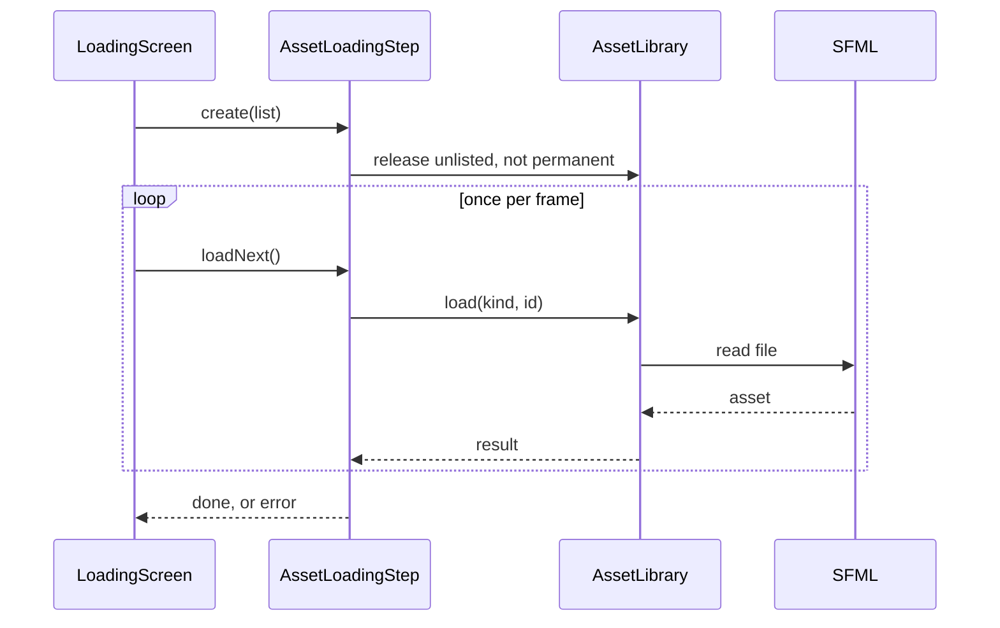
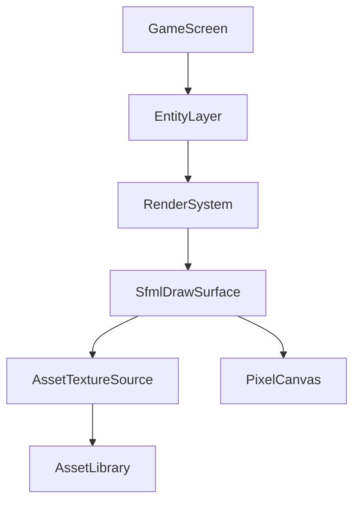

The client, `r-type_client` (`src/client/`), shows the game, plays its sounds and reads the player's input; the server decides what happens in the match (see [Architecture](/R-Type/architecture/)). Today it finds its assets folder, loads the assets of its interface, opens a window and runs its screens over a scrolling starfield: a loading screen, the game screen, which draws its entities from one sprite sheet (for now a provisional showcase), and an options screen. It does not talk to the server yet.

This page tells you where to look when you need to change something. It describes what exists today and says plainly what does not exist yet.

| Part | State | Where |
|---|---|---|
| Window | Available | `src/client/Window/` |
| Frame loop and screen stack | Available | `src/client/Application/` |
| Screens | Available: loading, game and options; the menus are not written yet | `src/client/Screens/` |
| Assets folder and asset ids | Available | `src/client/Assets/`, `assets/README.md` |
| Asset loading | Available; used at launch for the interface assets, and by the loading screen | `src/client/Assets/AssetLibrary/`, `src/client/Assets/AssetLoadingStep/` |
| Path of the running executable | Available | `src/client/Platform/` |
| Drawing entities | Available; drawn by the game screen | `src/client/Rendering/EntityLayer/`, `src/client/Rendering/RenderSystem/`, `src/client/Rendering/SfmlDrawSurface/`, `src/client/Rendering/AssetTextureSource/` |
| Sprites of the ships, Bydos and missiles | Available; first animation frame only | `assets/sprites/entities.png`, `src/client/Rendering/EntitySprites.cpp` |
| Scrolling background | Available; drawn by the frame loop under every screen | `src/client/Rendering/Background/` |
| Sounds and music of the game | Not yet written | — |

## Frame loop and screens: `Application`, `ScreenStack`

`Application` (`src/client/Application/Application/`) opens the window, `GameWindow`, and runs the frame loop until the window is closed or no screen is left. A screen implements `IScreen` (`src/client/Screens/`): `handleEvent()`, `update()` and `draw()`, in playfield units. Screens live in a `ScreenStack` (`src/client/Application/ScreenStack/`). Each frame, the window events go to the screen on top only, then every screen is updated and drawn from the bottom up, so a screen pushed over the game leaves the game running and visible behind it. `GameWindow` handles closing and resizing itself and never passes those events on.

Screens are asked for by identifier: `push()` and `replaceAll()` take a `ScreenId` (`src/client/Screens/ScreenId.hpp`), so a screen never builds the screens it opens. `Application::createScreen()` is the one list of every screen, a `switch` with one case per `ScreenId`; a value without a case does not compile. `push()`, `pop()` and `replaceAll()` only ask for a change; the loop applies the changes after each event and after the update, in the order they were asked for. A screen may therefore pop itself while it handles an event, and the next event already reaches the new screen on top. A screen sees the stack only as an `IScreenNavigator` (`src/client/Screens/IScreenNavigator.hpp`), which holds `push()`, `pop()` and `replaceAll()` and nothing else: applying the changes, updating, drawing and handing out events stay with the frame loop, so no screen can break this order. A screen is built when its change is applied: `replaceAll()` destroys every screen, from the top down, before building the new one. Building the game, or its loading screen, releases the assets of a previous game, so `ScreenId::Game` is always entered through `replaceAll()`, never pushed over a screen that still draws them.

| Screen | Shows | Leaves the stack when |
|---|---|---|
| `LoadingScreen` | a progress bar; one file is loaded per frame | every file is loaded: it asks again, with `replaceAll()`, for the screen it loads for, which `createScreen()` now builds itself |
| `GameScreen` | its entities, over the scrolling background (today the provisional sprite showcase); releasing `OPTIONS_KEY` (Escape) pushes the options over it | not yet: the end of a game is not written |
| `OptionsScreen` | the window size buttons, on a translucent layer over the game | `OPTIONS_KEY` is released again |

The options screen is **provisional**: it stands in for the options menu. The frame loop draws the scrolling background under every screen, the loading screen and the options included; this is **provisional** too, since the starfield will probably become the background of the game screen alone. At launch the client enters a game straight away, with `replaceAll(ScreenId::Game)`: the loading screen of `gameAssets()` while some are not loaded, then the game screen. A file the loading screen cannot load stops the client with exit code 1, naming every such file. The options react to the release of `OPTIONS_KEY`, not to its press: the system repeats the press of a held key, which would open and close them again and again.

## Assets: the folder and the ids

Every file the client reads at run time sits in `assets/`, at the root of the repository. At launch, `locateAssetFolder()` (`rtype_client_assets`) looks for `assets/` next to the executable, then in the folder above it, where the Visual Studio generator writes `Release/` and `Debug/`. The folder the client was launched from plays no part. When neither folder exists, the client stops with exit code 1 and an `AssetFolderNotFoundException` naming both folders it searched.

Code names a file by its **asset id**: its path in `assets/`, with `/` between folders, for example `sprites/player_ship.png`. Every folder and file name of an id starts with a lowercase letter or a digit, then holds only `a-z`, digits, `_`, `-` and `.`; `isValidAssetId()` checks it. An id is therefore spelled the same on every system and never names a file outside `assets/`, and a later mod folder can replace a file by holding the same path. Ids are written once, as named constants.

## Assets: loading

`AssetLibrary` (`rtype_client_asset_library`) owns every loaded asset. `load(kind, id)` reads a texture, a sound or a font the first time only, and only locates a music file, which is streamed while it plays. It never throws: it returns an `AssetLoadResult` (`Loaded`, `InvalidId`, `MissingFile`, `UnreadableFile`). Its lookups, `texture()`, `sound()`, `font()` and `musicFile()`, never read the disk; an id that is not loaded throws `AssetNotLoadedException`. `keepPermanently()` makes assets permanent: no release drops them. A reference stays valid until its asset is released, so a sprite, which keeps a reference to its texture, must be gone before its texture is released.

`AssetLoadingStep` (`rtype_client_asset_loading_step`) loads an `AssetList`. When it is created, it releases every loaded asset the list does not name, except the permanent ones, so whatever still uses them must already be destroyed; the assets already loaded are neither read again nor counted. Then `loadNext()` loads one asset per call, so a loading screen can be drawn between two files. After the last asset, if any could not be loaded, it throws one `AssetLoadingException` naming every invalid id, missing file and unreadable file.

Assets are loaded at two moments only, both declared in `src/client/Screens/ScreenAssets.hpp` and listed in `ScreenAssets.cpp`:

- at launch, before the window opens, `loadInterfaceAssets()` loads `interfaceAssets()`, the assets of the interface, which any screen may use at any time, in a game or outside one (today the font of the options screen, `INTERFACE_FONT_ID`, `fonts/tuffy.ttf`), and makes them permanent, so changing screen outside a game never reads a file;
- when the player enters a game (`ScreenId::Game`), the loading screen loads `gameAssets()`, one file per frame, after releasing what a previous game used and this one does not. When they are all loaded already, the game screen is built at once, after the same release. Today `gameAssets()` holds the entity sheet (`ENTITY_SHEET_ID`) alone: at launch the loading screen reads it in its first update and the game screen replaces it before that frame is drawn, so the loading screen is never seen.

### What a loading step does

The loading screen creates the step, then calls `loadNext()` once per frame until `isFinished()`, drawing the progress in between. At launch, `loadInterfaceAssets()` runs a step to its end at once, before the window opens.



## Assets in the game: from an entity to the screen

The engine knows nothing about assets, and the game only names them: an entity that is drawn carries a `Sprite` component (`rtype_game`) holding an asset id, the rectangle of that image to show (`SpriteFrame`, in pixels of the image) and a layer. Each frame, `RenderSystem` (`src/client/Rendering/`) walks the entities that have a `Position` and a `Sprite`, layer by layer, and asks an `IDrawSurface` to draw each rectangle at its position. `SfmlDrawSurface` finds the texture through `ITextureSource`, which `AssetTextureSource` reads from the `AssetLibrary` without loading anything; an id with no loaded texture is skipped and logged once.

`SfmlDrawSurface` paints on a `PixelCanvas`, the pixel grid of the sky (see [How it is drawn](#how-it-is-drawn)): a position becomes a pixel of the canvas, which covers `BACKGROUND_PIXEL_SIZE` (4) logical units, and each rectangle lands on whole pixels, so a sprite is copied pixel for pixel and its pixels match the stars at every window size. An entity therefore moves on screen by whole background pixels, 4 logical units at a time.

The canvas belongs to `EntityLayer` (`src/client/Rendering/EntityLayer/`), behind the `IEntityLayer` interface. The game screen owns the entities of the game, which appear and disappear with it, and an entity layer. It paints the layer at construction and in every `update()`: the layer clears its canvas to transparent, lets `RenderSystem` paint on it, and ends the picture. In `draw()` it only lays the layer, since `draw()` is const; the entities sit over the background and under any screen pushed over the game. `GameScreen` sees only `IEntityLayer`, so `client_screen_tests` gives it a recording double and needs no graphics card.



Showing a new image takes four steps:

1. Draw it at its native size into `assets/sprites/entities.png`, or put a new file in `assets/sprites/`, named after the asset id rule.
2. Write its rectangle once, as a named constant (`EntitySpriteConstants.hpp` for the entity sheet), and the id of a new file too.
3. List the id in `gameAssets()` (`src/client/Screens/ScreenAssets.cpp`), which already names the entity sheet.
4. Give the entity a `Sprite` with that id, rectangle and layer: for an entity type, a case in `spriteOf`.

## Entity sprites: `spriteOf`

`spriteOf(type)` (`rtype_client_entity_sprites`) is the single table that gives each `EntityType` its `Sprite`: the entity sheet `sprites/entities.png` (`ENTITY_SHEET_ID`), the rectangle of the type, and the `Entities` layer. A value outside `EntityType` gets no sprite, never a neighbor's. The code that will create the entities the server announces calls it once per new entity; turning the type number of the protocol into an `EntityType` belongs to that code.

| Type | Sprite | Native size, in pixels | On the playfield, in logical units |
|---|---|---|---|
| `Player` | the ship of the first player color | 32 × 16 | 128 × 64 |
| `Enemy` | the Bydo | 24 × 24 | 96 × 96 |
| `PlayerMissile` | the player missile | 16 × 6 | 64 × 24 |
| `EnemyMissile` | the enemy missile | 8 × 8 | 32 × 32 |

The sheet and where it comes from are described in `assets/README.md`. Not yet done: the four players share the first ship color, though the sheet holds four; the bonus Bydo has no entity type; only the first of the two animation frames is shown. `client_rendering_tests` checks the table against the shipped sheet with `sf::Image`, which needs no graphics card: every rectangle lies inside the sheet, shows a visible pixel, cuts no sprite and overlaps no other type.

The entities on screen today are a **provisional** showcase: `spawnSpriteShowcase` (`src/client/Rendering/SpriteShowcase.hpp`) puts a player ship, a player missile, an enemy missile and a Bydo across the middle of the playfield when the game screen is built. It will be removed once the client creates the entities the server announces.

## Scrolling background: `ScrollingBackground`

`ScrollingBackground` (`rtype_client_scrolling_background`) fills the playfield behind everything else: three layers of stars drifting left at different speeds, a ringed planet, and random sky events. `Application`, the frame loop, moves it every frame by the real time elapsed since the previous frame, read from `engine::SystemClock`, so its speed does not depend on the frame rate, and draws it before the screens. A frame longer than `MAXIMUM_BACKGROUND_STEP` (50 ms) moves it by 50 ms only, so the sky does not jump after a stall. A star that leaves on the left comes back on the right at a new height, so the sky never shows a seam.

The sky is cosmetic and local to each client: it is not made of entities, nothing of it crosses the network, and each client draws a different sky (the seed comes from `std::random_device`).

```cpp
ScrollingBackground background(std::random_device{}());
background.advance(now - previousFrameTime);
background.draw(window);
```

`draw()` expects a target whose view shows the playfield in its logical units, as the render target of `GameWindow` is set up.

### What the sky holds

| Layer | Stars | Speed, in background pixels per second |
|---|---|---|
| Far | 441 | 4.5 |
| Middle | 90 | 12 |
| Near | 36 | 30 |

The planet drifts at `PLANET_SPEED` (1.8 background pixels per second), drawn in front of the far stars and behind the others. Sky events are shooting stars, flares, asteroids and comets: one starts every 0.8 to 2.6 seconds (`SHORTEST_SKY_EVENT_GAP`, `LONGEST_SKY_EVENT_GAP`), at most `MAXIMUM_SKY_EVENTS` (4) at once, and they animate `SKY_EVENT_CLOCK_RATE` (3) times faster than real time. The layers are `STAR_LAYERS` in `BackgroundConstants.hpp`; the events are in `SkyEvents/`.

### How it is drawn

The sky is painted on a `PixelCanvas` (`rtype_client_pixel_canvas`) of `BACKGROUND_SIZE`, 480 × 270 background pixels; a background pixel covers `BACKGROUND_PIXEL_SIZE` (4) logical units. A canvas is enlarged without smoothing by the largest whole factor that fits the playfield on screen (`integerScaleFactor`: 3 in a 1600 × 900 window), then smoothed over the remainder only, so its pixels stay square and equal at every window size. The entities are painted on a second `PixelCanvas`, laid over the sky. A canvas holds only opaque and fully transparent pixels, so it is laid with a premultiplied alpha blend: the smoothed edges of a sprite do not darken.

A halo is added on top of the sky: the sky blurred by a Gaussian of `HALO_STANDARD_DEVIATION` (3 background pixels), added at 70 % opacity (`HALO_TINT`). It comes from the sky only, so the sprites get none. On a machine without shaders, or whose driver does not compile the halo shader, the sky is drawn without halo and the reason is logged once by the `Background` module. A render texture that cannot be created raises `RenderTextureNotCreatedException`.

On a Retina Mac, SFML 3 renders every window at its size in points, not in screen pixels, and macOS scales the image up, so the whole client looks softer there than on other screens.

### Tested without a screen

`Starfield`, which moves and paints the sky, and the sky events paint through `IPixelSurface` and never touch the graphics card, so `client_background_tests` runs them on the CI. `PixelBatch` turns the painted pixels into one `sf::VertexArray` of points. Only `GaussianBlur`, `PixelCanvas`, `ScrollingBackground` and the drawing of entities (`EntityLayer`, `SfmlDrawSurface`, `AssetTextureSource`) need OpenGL, since a texture cannot exist without it; they are checked on screen.

## Platform: the executable path

`executablePath()` (`src/client/Platform/`) returns the path of the running executable, or nothing when the system does not tell. Each system has its own source file, `ExecutablePathLinux.cpp`, `ExecutablePathMacOs.cpp` and `ExecutablePathWindows.cpp`, and CMake builds only the one that matches.

## Where to intervene

| You want to… | Look at |
|---|---|
| Add an asset | A file in `assets/sprites/`, `sounds/`, `music/` or `fonts/`, and its id in `gameAssets()`, or in `interfaceAssets()` when a screen may use it outside a game, menus and overlays included (`src/client/Screens/ScreenAssets.cpp`) |
| Change the asset id rule | `isValidAssetId()` in `src/client/Assets/AssetIds.cpp`, `ASSET_ID_PUNCTUATION` in `AssetConstants.hpp`, and `assets/README.md` |
| Change where the client looks for `assets/` | `findAssetFolder()` in `src/client/Assets/AssetFolder.cpp` |
| Show a new image in the game | `assets/sprites/`, its rectangle in `src/client/Rendering/EntitySpriteConstants.hpp`, `gameAssets()`, `spriteOf` in `src/client/Rendering/EntitySprites.cpp` |
| Change how an entity type looks | `spriteOf` in `src/client/Rendering/EntitySprites.cpp`, the rectangles in `EntitySpriteConstants.hpp`, `assets/sprites/entities.png` |
| Change how entities are placed on the pixel grid | `SfmlDrawSurface::draw` in `src/client/Rendering/SfmlDrawSurface/` |
| Change when the entities are painted and laid | `GameScreen::update()` and `GameScreen::draw()` in `src/client/Screens/GameScreen/`, `EntityLayer` in `src/client/Rendering/EntityLayer/` |
| Remove the sprite showcase | `SpriteShowcase.hpp`, `SpriteShowcase.cpp` and `SpriteShowcaseConstants.hpp` in `src/client/Rendering/`, the call in the constructor of `GameScreen` |
| Add a screen | A value of `ScreenId` (`src/client/Screens/ScreenId.hpp`) and its case in `Application::createScreen()`; a class implementing `IScreen` in its own folder under `src/client/Screens/`, taking an `IScreenNavigator` if it opens or closes screens, with its `CMakeLists.txt` target and `add_subdirectory` in `src/client/Screens/CMakeLists.txt`; the link in `src/client/Application/Application/CMakeLists.txt` |
| Open a screen from another | `push(ScreenId::…)` to put it over the current one, `replaceAll(ScreenId::…)` to replace every screen with it |
| Load a new kind of asset | `AssetKind`, `AssetList` and `AssetLibrary::load()` |
| Change what happens when an asset cannot be loaded | `AssetLoadingStep::loadNext()` and `AssetLoadingException` in `src/client/Exceptions/ClientException.hpp` |
| Read something only one system provides | A declaration in `src/client/Platform/`, one source file per system, chosen in its `CMakeLists.txt` |
| Change the number or the speed of the stars | `STAR_LAYERS` in `src/client/Rendering/Background/BackgroundConstants.hpp` |
| Change a color of the sky | `src/client/Rendering/Background/BackgroundColors.hpp` |
| Change how often sky events appear, or how many at once | `SHORTEST_SKY_EVENT_GAP`, `LONGEST_SKY_EVENT_GAP`, `MAXIMUM_SKY_EVENTS` in `src/client/Rendering/Background/SkyEvents/SkyEventConstants.hpp` |
| Add a kind of sky event | A class implementing `ISkyEvent` in `src/client/Rendering/Background/SkyEvents/`, a value of `SkyEventKind`, a weight in `SKY_EVENT_WEIGHTS`, a case in `SkyEventScheduler::createEvent` |
| Change the halo | `HALO_STANDARD_DEVIATION` in `BackgroundConstants.hpp`, `HALO_TINT` in `BackgroundColors.hpp`, the blur shader in `HaloShader.hpp`, `GaussianBlur/` |
| Change how the sky and the entities are enlarged | `PixelCanvas::show` in `src/client/Rendering/Background/PixelCanvas/`, `IntegerScale/` |
| Change the window, or when the background moves and is drawn | `src/client/Window/GameWindow/`, `Application::advanceBackground()` and `Application::render()` in `src/client/Application/Application/` |
| Add a client error | `src/client/Exceptions/ClientException.hpp` |

Each folder has its own `CMakeLists.txt` declaring one library; `src/client/Rendering/CMakeLists.txt` declares `rtype_client_entity_sprites` for the table and the showcase, and adds `RenderSystem/`, `SfmlDrawSurface/`, `AssetTextureSource/`, `EntityLayer/` and `Background/`.
