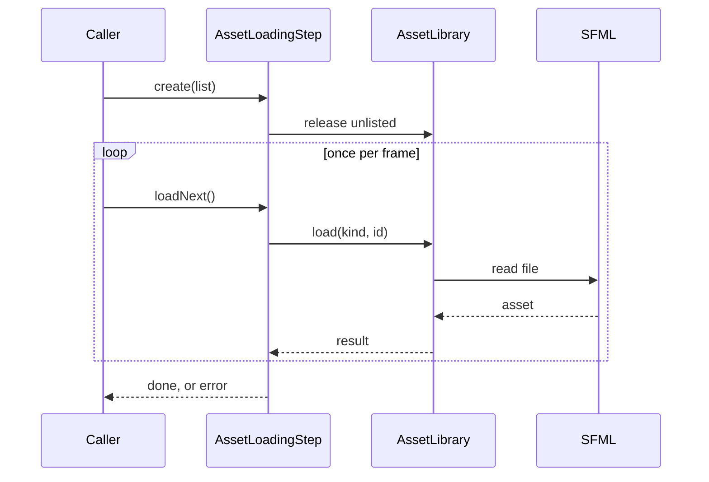
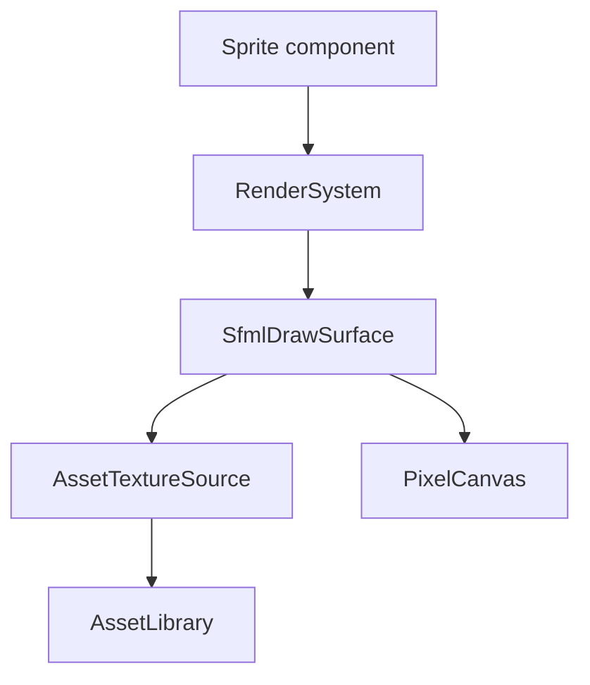

The client, `r-type_client` (`src/client/`), shows the game, plays its sounds and reads the player's input; the server decides what happens in the match (see [Architecture](/R-Type/architecture/)). Today it opens a window, finds its assets folder at launch, can load the assets of a screen, draws a scrolling starfield behind the playfield and draws entities from one sprite sheet. The screens themselves do not exist yet, and no entity comes from the server yet: the entities on screen are a provisional showcase.

This page tells you where to look when you need to change something. It describes what exists today and says plainly what does not exist yet.

| Part | State | Where |
|---|---|---|
| Window and frame loop | Available | `src/client/Window/` |
| Assets folder and asset ids | Available | `src/client/Assets/`, `assets/README.md` |
| Asset loading | Available; used at launch for the font of the window size buttons and the entity sheet | `src/client/Assets/AssetLibrary/`, `src/client/Assets/AssetLoadingStep/` |
| Path of the running executable | Available | `src/client/Platform/` |
| Drawing entities | Available; drawn by the frame loop | `src/client/Rendering/RenderSystem/`, `src/client/Rendering/SfmlDrawSurface/`, `src/client/Rendering/AssetTextureSource/` |
| Sprites of the ships, Bydos and missiles | Available; first animation frame only | `assets/sprites/entities.png`, `src/client/Rendering/EntitySprites.cpp` |
| Scrolling background | Available; drawn by the frame loop | `src/client/Rendering/Background/` |
| Screens and the loading screen | Not yet written | — |
| Sounds and music of the game | Not yet written | — |

## Assets: the folder and the ids

Every file the client reads at run time sits in `assets/`, at the root of the repository. At launch, `locateAssetFolder()` (`rtype_client_assets`) looks for `assets/` next to the executable, then in the folder above it, where the Visual Studio generator writes `Release/` and `Debug/`. The folder the client was launched from plays no part. When neither folder exists, the client stops with exit code 1 and an `AssetFolderNotFoundException` naming both folders it searched.

Code names a file by its **asset id**: its path in `assets/`, with `/` between folders, for example `sprites/player_ship.png`. Every folder and file name of an id starts with a lowercase letter or a digit, then holds only `a-z`, digits, `_`, `-` and `.`; `isValidAssetId()` checks it. An id is therefore spelled the same on every system and never names a file outside `assets/`, and a later mod folder can replace a file by holding the same path. Ids are written once, as named constants.

## Assets: loading per screen

`AssetLibrary` (`rtype_client_asset_library`) owns every loaded asset. `load(kind, id)` reads a texture, a sound or a font the first time only, and only locates a music file, which is streamed while it plays. It never throws: it returns an `AssetLoadResult` (`Loaded`, `InvalidId`, `MissingFile`, `UnreadableFile`). Its lookups, `texture()`, `sound()`, `font()` and `musicFile()`, never read the disk; an id that is not loaded throws `AssetNotLoadedException`. A reference stays valid until its asset is released, so a sprite, which keeps a reference to its texture, must be gone before its texture is released.

`AssetLoadingStep` (`rtype_client_asset_loading_step`) loads the `AssetList` of the next screen. It is built once the previous screen is destroyed: it releases every loaded asset the list does not name, keeps the ones both screens use, then `loadNext()` loads one asset per call, so a loading screen can be drawn between two files. After the last asset, it throws one `AssetLoadingException` naming every invalid id, missing file and unreadable file.

```cpp
rtype::client::AssetLoadingStep loading(
    assets, rtype::client::AssetList{.textures = {PLAYER_SHIP_TEXTURE},
                                     .sounds = {SHOT_SOUND}});
while (!loading.isFinished()) {
  loading.loadNext();
  drawLoadingScreen(loading.processedCount(), loading.assetCount());
}
const sf::Texture& ship = assets.texture(PLAYER_SHIP_TEXTURE);
```

`PLAYER_SHIP_TEXTURE`, `SHOT_SOUND` and `drawLoadingScreen` stand for an id constant and a loading screen that do not exist yet.

### What a loading step does

The caller creates the step, then calls `loadNext()` once per frame until `isFinished()`, drawing the progress in between. Today the caller is `main`, which runs one step at launch, before the window opens, for the font of the window size buttons. Once screens exist, the screen stack will run one step at every screen change.



## Assets in the game: from an entity to the screen

The engine knows nothing about assets, and the game only names them: an entity that is drawn carries a `Sprite` component (`rtype_game`) holding an asset id, the rectangle of that image to show (`SpriteFrame`, in pixels of the image) and a layer. Each frame, `RenderSystem` (`src/client/Rendering/`) walks the entities that have a `Position` and a `Sprite`, layer by layer, and asks an `IDrawSurface` to draw each rectangle at its position. `SfmlDrawSurface` finds the texture through `ITextureSource`, which `AssetTextureSource` reads from the `AssetLibrary` without loading anything; an id with no loaded texture is skipped and logged once.

`SfmlDrawSurface` paints on a `PixelCanvas`, the pixel grid of the sky (see [How it is drawn](#how-it-is-drawn)): a position becomes a pixel of the canvas, which covers `BACKGROUND_PIXEL_SIZE` (4) logical units, and each rectangle lands on whole pixels, so a sprite is copied pixel for pixel and its pixels match the stars at every window size. An entity therefore moves on screen by whole background pixels, 4 logical units at a time. Every frame, `GameWindow` clears this canvas to transparent, lets `RenderSystem` paint on it, and lays it in front of the background and behind the buttons.



Showing a new image takes four steps:

1. Draw it at its native size into `assets/sprites/entities.png`, or put a new file in `assets/sprites/`, named after the asset id rule.
2. Write its rectangle once, as a named constant (`EntitySpriteConstants.hpp` for the entity sheet), and the id of a new file too.
3. List the id in the `AssetList` of every screen that draws it; today `main` loads the entity sheet at launch.
4. Give the entity a `Sprite` with that id, rectangle and layer: for an entity type, a case in `spriteOf`.

## Entity sprites: `spriteOf`

`spriteOf(type)` (`rtype_client_entity_sprites`) is the single table that gives each `EntityType` its `Sprite`: the entity sheet `sprites/entities.png` (`ENTITY_SHEET_ID`), the rectangle of the type, and the `Entities` layer. A value outside `EntityType` gets no sprite, never a neighbor's. The code that will create the entities the server announces calls it once per new entity; turning the type number of the protocol into an `EntityType` belongs to that code.

| Type | Sprite | Native size, in pixels | On the playfield, in logical units |
|---|---|---|---|
| `Player` | the ship of the first player color | 32 × 16 | 128 × 64 |
| `Enemy` | the Bydo | 24 × 24 | 96 × 96 |
| `PlayerMissile` | the player missile | 16 × 6 | 64 × 24 |
| `EnemyMissile` | the enemy missile | 8 × 8 | 32 × 32 |

The sheet and where it comes from are described in `assets/README.md`. Not yet done: the four players share the first ship color, though the sheet holds four; the bonus Bydo has no entity type; only the first of the two animation frames is shown. `client_rendering_tests` checks the table against the shipped sheet with `sf::Image`, which needs no graphics card: every rectangle lies inside the sheet, shows a visible pixel, cuts no sprite and overlaps no other type.

The entities on screen today are a **provisional** showcase: `spawnSpriteShowcase` (`src/client/Rendering/SpriteShowcase.hpp`) puts a player ship, a player missile, an enemy missile and a Bydo across the middle of the playfield when the window opens. It will be removed once the client creates the entities the server announces.

## Scrolling background: `ScrollingBackground`

`ScrollingBackground` (`rtype_client_scrolling_background`) fills the playfield behind everything else: three layers of stars drifting left at different speeds, a ringed planet, and random sky events. `GameWindow` moves it every frame by the real time elapsed since the previous frame, read from `engine::SystemClock`, so its speed does not depend on the frame rate. A frame longer than `MAXIMUM_BACKGROUND_STEP` (50 ms) moves it by 50 ms only, so the sky does not jump after a stall. A star that leaves on the left comes back on the right at a new height, so the sky never shows a seam.

The sky is cosmetic and local to each client: it is not made of entities, nothing of it crosses the network, and each client draws a different sky (the seed comes from `std::random_device`).

```cpp
ScrollingBackground background(std::random_device{}());
background.advance(now - previousFrameTime);
background.draw(window);
```

`draw()` expects a target whose view shows the playfield in its logical units, as `GameWindow` sets it up.

### What the sky holds

| Layer | Stars | Speed, in background pixels per second |
|---|---|---|
| Far | 441 | 4.5 |
| Middle | 90 | 12 |
| Near | 36 | 30 |

The planet drifts at `PLANET_SPEED` (1.8 background pixels per second), drawn in front of the far stars and behind the others. Sky events are shooting stars, flares, asteroids and comets: one starts every 0.8 to 2.6 seconds (`SHORTEST_SKY_EVENT_GAP`, `LONGEST_SKY_EVENT_GAP`), at most `MAXIMUM_SKY_EVENTS` (4) at once, and they animate `SKY_EVENT_CLOCK_RATE` (3) times faster than real time. The layers are `STAR_LAYERS` in `BackgroundConstants.hpp`; the events are in `SkyEvents/`.

### How it is drawn

The sky is painted on a `PixelCanvas` (`rtype_client_pixel_canvas`) of `BACKGROUND_SIZE`, 480 × 270 background pixels; a background pixel covers `BACKGROUND_PIXEL_SIZE` (4) logical units. A canvas is enlarged without smoothing by the largest whole factor that fits the playfield on screen (`integerScaleFactor`: 3 in a 1600 × 900 window), then smoothed over the remainder only, so its pixels stay square and equal at every window size. The entities are painted on a second `PixelCanvas`, laid over the sky. A canvas holds only opaque and fully transparent pixels, so it is laid with a premultiplied alpha blend: the smoothed edges of a sprite do not darken.

A halo is added on top of the sky: the sky blurred by a Gaussian of `HALO_STANDARD_DEVIATION` (3 background pixels), added at 70 % opacity (`HALO_TINT`). It comes from the sky only, so the sprites get none. On a machine without shaders, or whose driver does not compile the halo shader, the sky is drawn without halo and the reason is logged once by the `Background` module. A render texture that cannot be created raises `RenderTextureNotCreatedException`.

On a Retina Mac, SFML 3 renders every window at its size in points, not in screen pixels, and macOS scales the image up, so the whole client looks softer there than on other screens.

### Tested without a screen

`Starfield`, which moves and paints the sky, and the sky events paint through `IPixelSurface` and never touch the graphics card, so `client_background_tests` runs them on the CI. `PixelBatch` turns the painted pixels into one `sf::VertexArray` of points. Only `GaussianBlur`, `PixelCanvas`, `ScrollingBackground` and the drawing of entities (`SfmlDrawSurface`, `AssetTextureSource`) need OpenGL, since a texture cannot exist without it; they are checked on screen.

## Platform: the executable path

`executablePath()` (`src/client/Platform/`) returns the path of the running executable, or nothing when the system does not tell. Each system has its own source file, `ExecutablePathLinux.cpp`, `ExecutablePathMacOs.cpp` and `ExecutablePathWindows.cpp`, and CMake builds only the one that matches.

## Where to intervene

| You want to… | Look at |
|---|---|
| Add an asset | A file in `assets/sprites/`, `sounds/`, `music/` or `fonts/`, and its id in the asset list of the screen that uses it |
| Change the asset id rule | `isValidAssetId()` in `src/client/Assets/AssetIds.cpp`, `ASSET_ID_PUNCTUATION` in `AssetConstants.hpp`, and `assets/README.md` |
| Change where the client looks for `assets/` | `findAssetFolder()` in `src/client/Assets/AssetFolder.cpp` |
| Show a new image in the game | `assets/sprites/`, its rectangle in `src/client/Rendering/EntitySpriteConstants.hpp`, the `AssetList` of the screen, `spriteOf` in `src/client/Rendering/EntitySprites.cpp` |
| Change how an entity type looks | `spriteOf` in `src/client/Rendering/EntitySprites.cpp`, the rectangles in `EntitySpriteConstants.hpp`, `assets/sprites/entities.png` |
| Change how entities are placed on the pixel grid | `SfmlDrawSurface::draw` in `src/client/Rendering/SfmlDrawSurface/` |
| Remove the sprite showcase | `SpriteShowcase.hpp`, `SpriteShowcase.cpp` and `SpriteShowcaseConstants.hpp` in `src/client/Rendering/`, the call in the constructor of `GameWindow` |
| Load a new kind of asset | `AssetKind`, `AssetList` and `AssetLibrary::load()` |
| Change what happens when an asset cannot be loaded | `AssetLoadingStep::loadNext()` and `AssetLoadingException` in `src/client/Exceptions/ClientException.hpp` |
| Read something only one system provides | A declaration in `src/client/Platform/`, one source file per system, chosen in its `CMakeLists.txt` |
| Change the number or the speed of the stars | `STAR_LAYERS` in `src/client/Rendering/Background/BackgroundConstants.hpp` |
| Change a color of the sky | `src/client/Rendering/Background/BackgroundColors.hpp` |
| Change how often sky events appear, or how many at once | `SHORTEST_SKY_EVENT_GAP`, `LONGEST_SKY_EVENT_GAP`, `MAXIMUM_SKY_EVENTS` in `src/client/Rendering/Background/SkyEvents/SkyEventConstants.hpp` |
| Add a kind of sky event | A class implementing `ISkyEvent` in `src/client/Rendering/Background/SkyEvents/`, a value of `SkyEventKind`, a weight in `SKY_EVENT_WEIGHTS`, a case in `SkyEventScheduler::createEvent` |
| Change the halo | `HALO_STANDARD_DEVIATION` in `BackgroundConstants.hpp`, `HALO_TINT` in `BackgroundColors.hpp`, the blur shader in `HaloShader.hpp`, `GaussianBlur/` |
| Change how the sky and the entities are enlarged | `PixelCanvas::show` in `src/client/Rendering/Background/PixelCanvas/`, `IntegerScale/` |
| Change the window or the frame loop | `src/client/Window/GameWindow/` |
| Add a client error | `src/client/Exceptions/ClientException.hpp` |

Each folder has its own `CMakeLists.txt` declaring one library; `src/client/Rendering/CMakeLists.txt` declares `rtype_client_entity_sprites` for the table and the showcase, and adds `RenderSystem/`, `SfmlDrawSurface/`, `AssetTextureSource/` and `Background/`.
