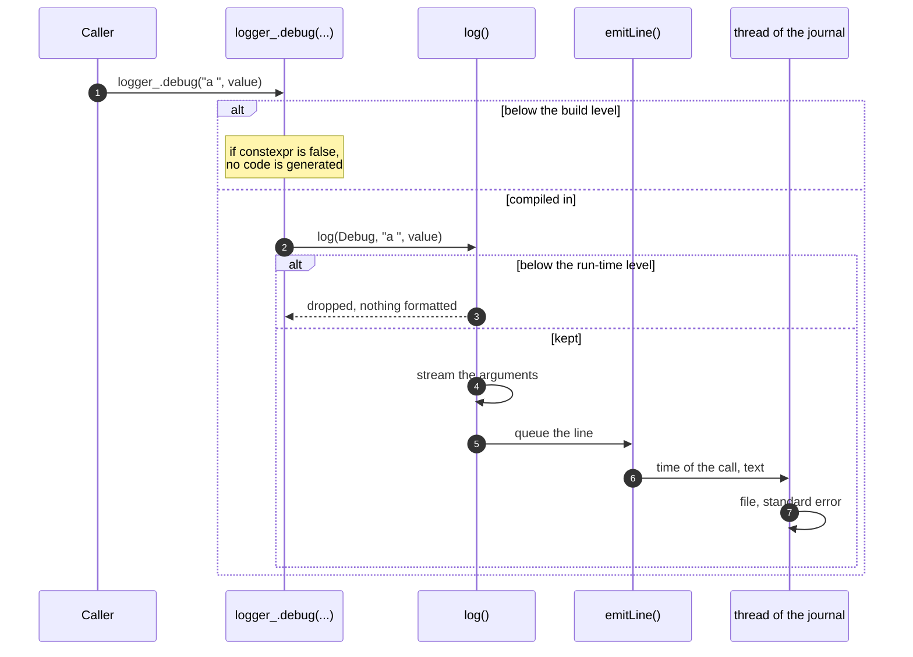

## Context

A network problem is diagnosed after the fact, from what the client and the server wrote down. Both programs therefore share one logger: every line is timestamped, carries a level and the name of the logger that wrote it, and lines written by different threads never mix. A call only queues its line; one thread of the journal writes it, so the game loop never waits for the disk (see [The thread of the journal](#the-thread-of-the-journal)). The file can be written as JSON Lines, one object per line, for a tool to read (see [JSON Lines](#json-lines---log-format-json)).

The logger comes from the raytracer project and lives in `src/logging/`, in the `rtype_logging` library. It depends on nothing else of the repository, so the engine, the game, the network, the client and the server can all use it.

## Line format

```
[2026-10-06T14:03:21.159Z] [INFO ] [Server] - server starting
```

The time is **UTC**, with the date, so the journals of two machines can be compared line by line. A line is the time, the level, the name of the logger, then the message.

When standard error is a terminal, its lines are colored by level. The file never contains color codes. Color is never used on Windows.

## JSON Lines: `--log-format json`

With `--log-format json`, every line of the file is one JSON object, followed by a line feed ([JSON Lines](https://jsonlines.org/)), with the time, the level, the name of the logger and the message, in that order:

```json
{"time":"2026-11-15T14:02:03.123Z","level":"info","logger":"Server","message":"server starting"}
```

Standard error keeps the text format, so a terminal stays readable. The level is written by its name (`trace` to `error`). Every value is escaped by nlohmann-json, so no text a player sent (a nickname, an address) can end a value or add a member, and a byte that is not UTF-8 becomes U+FFFD (`jsonLineOf()`, `src/logging/JournalLine/`). The default is `--log-format text`. A tool filters the file with `jq`, for example `jq -c 'select(.level == "error")' r-type_server.log`.

## Events: `Logger::event()`

An event is a line a tool filters on: a name, the sentence a person reads, and the values of this occurrence. `Logger::event()` takes a `LogEvent` (`src/logging/Logger/`): its level (`info` by default), its name, its message and a span of `EventField`, each a name and a whole number (`std::int64_t`), a text or a truth.

```cpp
const std::array fields{
    logging::EventField{.name = "player", .value = std::int64_t{2}},
    logging::EventField{.name = "address", .value = std::string_view{address}}};
logger_.event(logging::LogEvent{.level = logging::LogLevel::Info,
                                .name = "player.joined",
                                .message = "player 2 joined from 192.168.1.20",
                                .fields = fields});
```

The text line holds the message alone, as `info()` would write it. The JSON line adds `"event"` and one member per field after the message, with their JSON types:

```json
{"time":"…","level":"info","logger":"Lobby","message":"player 2 joined from 192.168.1.20","event":"player.joined","player":2,"address":"192.168.1.20"}
```

A field named like a member every line has (`time`, `level`, `logger`, `message`, `event`) is left out, so a line holds one value per name. The views of a `LogEvent` must live until `event()` returns. The events the server writes are listed on the [Server](/R-Type/server/#events-of-the-journal) page.

## Using the logger

Each class that writes lines owns a `Logger` built with a name:

```cpp
#include "Logger.hpp"

class NetworkContext {
 private:
  rtype::logging::Logger logger_{"Network"};
};

logger_.info("listening on port ", port);
logger_.warn("dropped a packet of ", size, " bytes");
auto timer = logger_.scope("load assets");
```

The arguments of a call are written one after the other; any type that can be written to a `std::ostream` works. `scope("label")` returns a `ScopedTimer` that writes `label took 1.234 ms` when it is destroyed, at the `info` level unless another one is given as the second argument.

### From a plugin: `ILogJournal`

A plugin is a shared library with its own copy of the logger, and the sinks and the level of that copy are never configured by the program. `ILogJournal` (`src/logging/Logger/`) is the way back: the sinks and the level of the program, reached through virtual calls. The `LogRecord` it writes carries the fields of an event too, so a plugin writes events into the journal of its host. `Logger(name, journal)` writes through a journal, which must outlive it, instead of through the sinks of its own copy, and asks it which levels it accepts; `scope()` and the static functions keep using the state of the copy. The logger module of the server provides a `ProcessJournal`, which writes through the `Logger` of the program, so a plugin that requires the service logs to the same file, in the same format, at the same level. The master and the client provide no journal today. Writing a plugin is on the [Modules](/R-Type/modules/#write-a-plugin) page.

## Levels

| Level | Use it for |
|---|---|
| `trace` | very frequent events, such as one line per packet |
| `debug` | diagnostics for developers |
| `info` | significant events, such as starting and stopping |
| `warn` | something abnormal that does not stop the program |
| `error` | a failure |
| `silent` | no line at all |

The default level is `info`.

## Repeated events: `ThrottledLog`

Some events repeat as fast as someone on the network causes them, such as a datagram the server drops: one line each would let anyone flood the journal. `ThrottledLog` (`src/logging/ThrottledLog/`, in `rtype_logging`) writes such an event at most once per interval: at the `debug` level with `debug()`, or at the `error` level with `error()` for an event that a fault of the program causes, such as a message handler that threw. Both count on the same interval.

- The first event gets a line. The next line goes to the first event at least one interval after the previous line, so two lines are never closer than the interval, whatever the rate.
- Every event is counted, and each line ends with how many happened since the previous line, this one included, so the events without a line still show.
- The caller gives the time of each event, from any fixed origin that never goes back: the steady clock, the server's `IClock`, or the ticks a game ran. A test passes the time it wants.
- It is not thread-safe: use one per thread.

```cpp
rtype::logging::ThrottledLog dropLog{"Server",
                                     rtype::network::REJECTION_LINE_INTERVAL};
dropLog.debug(clock.now(), "dropped a datagram from ", sender.address, " port ",
              sender.port, ": ", reason);
```

A line then reads, for example:

```
[2026-10-20T09:12:04.118Z] [DEBUG] [Server] - dropped a datagram from 192.0.2.40 port 41001: its sender was not admitted, and it holds no connection request (12 since the previous line)
```

The parts of the network and of the server that drop what they receive use it with `REJECTION_LINE_INTERVAL` (10 s, `src/network/NetworkConstants.hpp`): see [Network](/R-Type/network/#dispatch-messagedispatcher) and [Server](/R-Type/server/#sorting-the-datagrams-datagramsorter).

## Choosing the level and the output at launch

The client and the server read the same options:

| Option | Effect |
|---|---|
| `--log-level <name>` | The level: `trace`, `debug`, `info`, `warn`, `error` or `silent`, in any case. |
| `--log-file <path>` | The journal. The default is `r-type_server.log` or `r-type_client.log` next to the executable, whatever folder the program was started in, except the client on macOS, whose default is `r-type_client.log` in `~/Library/Logs` (`journalFolder()`, `src/client/Platform/`), where Console shows it and where it never modifies the signed app; or none when that file cannot be opened. The supervisor gives each game process `--log-file r-type_game_<n>.log`, next to the executable, then the logging options of its own launch that the games share (`LogLaunchOptions::forwardedArguments()`): `--log-level` when it was given one, `--no-log-file` when it writes no journal, which wins over the journal of the game since it comes after it, `--no-log-stderr`, `--log-color` and `--log-format json`; then `--log-color` when its own standard error is in colour, since a game writes into a pipe the supervisor relays (see [Server](/R-Type/server/#the-prompt-terminalscreen)). A game process is started with the environment of the supervisor, since the launcher sets none of its own, so without `--log-level` both read the same `RT_LOG_LEVEL`. A relative path given after `--log-file` is read from the folder the program was started in. |
| `--no-log-file` | No journal. |
| `--log-stderr` | Write to standard error too. This is the default. |
| `--no-log-stderr` | Nothing on standard error. |
| `--log-color` | Standard error in colour, even when it is no terminal. Without it, colour is on only when standard error is a terminal and neither `NO_COLOR` nor `RT_LOG_NO_COLOR` is set. |
| `--log-format <text\|json>` | The format of the journal file: text, the default, or JSON Lines (see [JSON Lines](#json-lines---log-format-json)). Standard error is always text. Any other value is an error. |

Without options, every line goes both to the journal and to standard error, so a program launched from a terminal shows its lines there. The first line, at the `info` level under the name `Logging`, gives the absolute path of the journal (`journal: /home/player/r-type/r-type_server.log`), or says `no journal file`.

The level can also come from the `RT_LOG_LEVEL` environment variable; `--log-level` wins over it. A value of `RT_LOG_LEVEL` that is not a level is ignored, while a `--log-level` that is not a level is an error.

The last of `--log-file` and `--no-log-file` wins, and so does the last of `--log-stderr` and `--no-log-stderr`. With `--no-log-file` and `--no-log-stderr`, nothing is written. A program reads all its arguments once, in order, and hands the logging options only the ones that are neither its own options nor the value of one, so the value of an option is never read as a logging option: `r-type_client -n --no-log-file` starts with the nickname `--no-log-file` and keeps its journal. Any other argument is left to the program, which rejects the ones it does not know either (see [Server](/R-Type/server/#launch-options-launchoptions) and [Client](/R-Type/client/#launch-options-launchoptions)); a `--log-` option that does not exist is an error, so a typo is never silent.

`LogLaunchOptions` reads and applies in two steps. `readOption()` reads the logging option the arguments start with, returns how many arguments it took (see [Engine](/R-Type/engine/#launch-arguments-readlauncharguments)), and touches nothing; `apply()` opens the journal, sets the level, then writes the line that names the journal. `server::LaunchOptions` and `client::LaunchOptions` read the logging options with their own and keep them (`logOptions()`), so an invalid argument, or `--help`, stops the program before any journal is created. With an invalid option, or a journal given with `--log-file` that cannot be opened, the program stops with a message and exit code 1. The default journal is different: a package may put the program in a folder the player cannot write to (`Program Files`, an AppImage, `/Applications`), so when that file cannot be opened, `apply()` goes on with standard error alone, if it is on, after the warning `cannot open the journal <path>, writing none`; the next line says `no journal file`. `LogLaunchOptions::usage()` writes the part of a program's `--help` that lists these options; it takes the name of the journal the program writes next to its executable, and `usageWithJournalAt()` the path of a journal kept elsewhere, as the client on macOS gives it.

```cpp
const rtype::server::LaunchOptions launchOptions =
    rtype::server::LaunchOptions::read(
        rtype::engine::processArguments(argumentCount, arguments));
if (launchOptions.helpRequested()) {
  std::cout << rtype::server::LaunchOptions::usage();
  return 0;
}
launchOptions.logOptions().apply();
```

The journal is opened in append mode, so a second launch keeps the lines of the first. The thread of the journal flushes the file after every line it writes, and every program writes the lines still queued before `main()` returns, after an error included (`closeJournal()`). A program that crashes loses the lines still queued, at most `JOURNAL_QUEUE_CAPACITY` (8192). `NO_COLOR` or `RT_LOG_NO_COLOR` turns the color of standard error off.

```bash
./r-type_server --log-level debug
RT_LOG_LEVEL=warn ./r-type_client --log-file /tmp/client.log
```

## Two filters

**At build time**, the CMake option `LOG_LEVEL` sets the lowest level kept in the binaries. Each logging method is wrapped in `if constexpr`, so a call below that level produces no code. The default is `trace`: everything is compiled in, in every build type, so the level chosen at launch always takes effect.

```bash
cmake --preset default -DLOG_LEVEL=info
```

Lowering the level at launch below the build level has no effect, since those calls do not exist in the binary. The unit tests expect the default build level.

**At run time**, the level set at launch drops the calls that remain. The check comes **before** any formatting: a `debug` call at the `info` level does not format its arguments. The arguments themselves are still evaluated by the caller, so an expensive one is guarded with `Logger::shouldLog()`.



## The thread of the journal

A call that passes the level takes the time, formats its line and queues it; one thread of the journal writes the lines to the file and to standard error, in the order they were queued (`JournalWriter`, `src/logging/JournalWriter/`, an spdlog thread pool of `JOURNAL_THREAD_COUNT` (1) thread). The time of a line is the time of its call, never the time it was written, so a line keeps its time when the disk is slow. Two lines queued at once from two threads may reach the file in the reverse order of their times.

The queue holds `JOURNAL_QUEUE_CAPACITY` (8192) lines, reserved when the thread starts. When it is full, the caller never waits: the new line is dropped and counted, and the next line written is preceded, under the name `Logging` at the `warn` level, by `<n> lines were lost: the journal could not keep up`. The first lines of an incident are kept, since they usually say its cause.

- `flushJournal()` waits until every line queued before it is written; the tests read the journal after it.
- `closeJournal()` writes the queued lines and stops the thread, which the next line starts again. The server and the client call it before `main()` returns.
- `Logger::setOutput()` and `setStandardErrorWriter()` write the queued lines to the old output before they change it.

A test stops the thread on its first line and queues 10 000 more: every call returns while the thread is stuck, the first 8192 queued lines are written once it goes on, and the count of the 1808 lost comes with the next one.

## Standard error and the admin console

`setStandardErrorWriter()` (`Logger.hpp`) hands every line meant for standard error, without its end, to a function instead of `std::cerr`, and an empty function gives standard error back. `writeStandardErrorLine()` queues a line that comes from no journal the same way, in its place among the lines of the journal: the line a game process wrote, which the supervisor relays (`ChildOutputRelay`). The admin console of the supervisor sets the writer while it shows its prompt, so every line goes above the line being typed (see [Server](/R-Type/server/#the-prompt-terminalscreen)). The writer runs on the thread of the journal, under the lock of the sinks, so it never writes to the journal itself. The journal file is never handed to it.

## Cost

Measured on an Apple M5 with Apple clang 21 at `-O3` (the `default` preset), local disk, three runs of a throwaway program that is not part of the repository, 4 000 lines per run. The journal is flushed to the operating system after every line, not synchronised to the disk.

| Measure | Result |
|---|---|
| A `debug` call at the `info` level | 2 to 3 ns |
| An `info` line, paid by the calling thread | 0.2 to 0.6 µs |
| An `info` line, until the thread of the journal wrote it to the file, text or JSON | 3.4 to 6.2 µs |
| An `info` line, 8 threads queuing at once, paid by each caller | 0.4 to 0.5 µs |

A server tick lasts 16.67 ms: one `info` line per tick costs the simulation thread under 0.004 % of it, whatever the disk does. The thread of the journal writes about 300 000 lines per second, so only a burst of more than 8192 lines faster than that loses lines. Give a `ScopedTimer` placed in the tick loop the `debug` level, as in `logger_.scope("tick", rtype::logging::LogLevel::Debug)`: at the default `info` level it would write a line on every tick.

These numbers say nothing about Windows or GCC.
