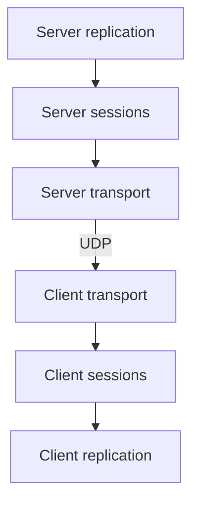

The network library, `rtype_network`, carries datagrams between the programs. Today it opens UDP sockets, sends datagrams and hands over the ones it receives, with their sender, through queues when another thread uses them. It knows nothing about entities or the rules of the game, and it is the only library that includes Asio: the client and the server use it through classes that never name an Asio type (see [Project layout](/R-Type/project-layout/#network)). It also turns every message of the protocol into bytes and back, one field at a time, and hands each message of a received datagram to the code registered for its type. What the datagrams contain is described in [Protocol](/R-Type/protocol/).

The network of the game takes three layers: transport, sessions and replication. This library holds the transport and what the other two share; the sessions and the replication are written in the server and the client, and [Transport, sessions and replication](#transport-sessions-and-replication) shows where each layer lives.

This page tells you where to look when you need to change something. It describes what exists today and says plainly what does not exist yet.

| Part | State | Where |
|---|---|---|
| Event loop | Available | `src/network/NetworkContext/` |
| UDP socket | Available | `src/network/Transport/` |
| Ports and addresses written as text | Available | `src/network/Transport/EndpointText.hpp` |
| Relay between a socket and the queues of another thread | Available | `src/network/Transport/DatagramRelay/` |
| Network simulator: lag, jitter, loss, duplicates and reordering, off by default | Available | `src/network/Transport/Simulator/`, `src/network/Transport/Conditions/` |
| Network conditions applied by the system: netem on Linux, dummynet on macOS | Available, never shipped | `tests/tools/network-conditions/` |
| Serialization | Available | `src/network/Serialization/` |
| Protocol messages, datagram header, dispatch by type | Available | `src/network/Protocol/` |
| Compression of the server's datagrams, zstd with a fixed dictionary | Available | `src/network/Compression/`: `Zstd/` and `Sockets/` |
| Connection cookies | Available | `src/network/Handshake/Cookies/` |
| Rate limit per sender, with temporary bans | Available | `src/network/Handshake/RateLimit/` |
| Traffic counters: datagrams and bytes by peer and by message type, journal and CSV file | Available | `src/network/Statistics/`: `Counting/` and `Recording/` |
| Round trip and jitter of a session, measured from the heartbeats | Available | `src/network/Statistics/RoundTrip/` |
| Tick of the server in its heartbeats, to place it on the clock of the client | Available | `src/network/Protocol/Messages/Heartbeat/`, `src/engine/Time/ServerClock/` |
| Sessions: admission, session token, sequence, heartbeats, timeouts | Available, written in the server and the client | `src/server/Lobby/`, `src/server/Sessions/`, `src/client/Connection/` |
| Replication: entities to messages, and back | Available, written in the server and the client | `src/server/Replication/`, `src/client/Replication/` |
| Guaranteed messages: acknowledgements, sending again, order | Available | `src/network/Reliability/` |
| History of states | Not yet written | — |
| Test tool that sends malformed datagrams | Available, never shipped | `tests/tools/MalformedDatagrams/` |
| Load-test bots: players with no window that join a server and play | Available, never shipped | `tests/tools/LoadTestBots/` |
| Bandwidth campaign: what one client receives and sends, with and without each optimization | Available, never shipped | `tests/tools/bandwidth/`, see [Network measurements](/R-Type/measurements/) |

## Transport, sessions and replication

`rtype_network` never links the engine, so its messages carry plain data, ids, types and quantized positions, never a component (see [Project layout](/R-Type/project-layout/#who-may-link-what)). The sessions, which hold the players of a game, and the replication, which reads the components of a world, are therefore written in each program, on top of this library.

The path of a world state, from a game of the server to the screen of a client:



An input of the player takes the other way through the transport and the sessions only: `ServerSession` sends it, and the `GameSessions` of the game keeps the newest input of each player (see [Server](/R-Type/server/#player-inputs)).

### Transport

Transport carries datagrams and knows nothing of players. Each program runs its socket on a network thread of its own, so its game never waits on the network, and exchanges datagrams with the thread of the game through bounded queues (see [Concurrency](/R-Type/concurrency/)). The parts are in this library and described below: `NetworkContext`, `UdpSocket` and `DatagramRelay`. The server assembles them in `ServerApplication` (`src/server/Network/`, see [Server](/R-Type/server/#threads-serverapplication)), the client in `NetworkThread` (`src/client/Connection/Transport/`, see [Client](/R-Type/client/#network-networkthread)).

### Sessions

A session starts when the server accepts a player and ends when the player leaves or stays silent too long. Every datagram of a session carries the session token of the player, the next sequence of its sender and the acknowledgement of the datagrams its sender accepted, so each side drops a forged datagram, which lacks the token, and a late copy, which is not newer than the newest datagram it read (see [Protocol](/R-Type/protocol/#a-session)), and the server knows which guaranteed messages arrived.

- On the server, `ConnectionAcceptor` (`src/server/Lobby/`) answers the connection requests and gives a place only to a sender that sends back its cookie (`CookieIssuer`, below). `DatagramSorter` checks the token on the network thread, before any queue, then the rate limit of the sender (see [Rate limit](#rate-limit-spendallowance-requestallowances)). The `GameSessions` of each game (`src/server/Sessions/`) checks the sequence, drops the guaranteed messages a datagram acknowledges and sends again the others, keeps the ready state and the newest input of each player, sends the heartbeats, measures the round trip of each player from their echoes and closes the session of a player it hears nothing from (see [Server](/R-Type/server/#sessions-of-a-game-gamesessions)); `SessionDatagram` gives every datagram to a player its header.
- On the client, `ServerSession` (`src/client/Connection/`) holds the one session with the server it joined: it sends the request, answers the challenge, checks the token and the sequence, acknowledges what it accepted, and takes the server for lost after `SESSION_SILENCE_LIMIT` (20 s) without a datagram (see [Client](/R-Type/client/#joining-a-server-serversession-waitingroom-entitymessagequeue)).
- On the client, `RoundTripWatch` (`src/client/Connection/Session/`), an observer of the session, sends the heartbeats and measures the round trip (see [Client](/R-Type/client/#joining-a-server-serversession-waitingroom-entitymessagequeue)).
- Both programs read the same delays, `HEARTBEAT_INTERVAL` (500 ms), `SESSION_TIMEOUT` (5 s) and `RECONNECTION_GRACE` (15 s), in `src/network/Protocol/ProtocolConstants.hpp`. They are **provisional**, like every delay of the protocol: code must read them.

### Replication

Replication turns the entities of a game into messages on the server, and the messages back into entities on the client. The server decides where everything is; the client draws the newest state it received and does not predict its own ship yet.

- On the server, `src/server/Replication/` announces each entity as it appears (`sendEntitySpawned`), sends the world state at the rate set at launch (`WorldStateSender`, see [Server](/R-Type/server/#world-state-worldstatesender)), turns the events of the game into `EntityDestroyed`, `GameEvent` and `PlayerLeft` (`GameEventBroadcaster`), which `MessageDelivery` guarantees, and tells the waiting room and the end of a game (`LobbyStateAnnouncer`, `GameEndAnnouncer`); `src/server/Chat/` relays each chat line as a guaranteed `PlayerChatLine` (`ChatRelay`). Each datagram leaves under the header of its player.
- On the client, `EntityMessageQueue` keeps the messages about entities in the order they arrived until the game screen takes them, and `EntityReplicator` (`src/client/Replication/Entities/`) applies them to the entities of the game screen; `WorldStateFilter` drops a world state older than the newest one applied (see [Client](/R-Type/client/#entities-from-the-server-entityreplicator)).
- The messages and the codec of the world state are in this library (`src/network/Protocol/`, below).

## Event loop: `NetworkContext`

`NetworkContext` owns the Asio event loop. `run()` blocks and runs every network operation, and every socket handler, on the thread that called it. It returns when the loop has no work left or `stop()` is called; a socket that is receiving always has work, so a server returns only on `stop()`.

`stop()` and `post(task)` may be called from any thread. `post()` queues a function to run on the thread that runs `run()`: this is how another thread gets a datagram sent, since a socket may only be used on that thread. A task still queued when the context is destroyed is destroyed without running.

Asio is linked privately to the network targets, so the headers other folders include never include it, and `r-type_server` fails to build if it tries. A class that needs Asio lives in `src/network` and links `rtype_network_asio`, which also defines `ASIO_NO_DEPRECATED` and, on Windows, `_WIN32_WINNT`.

## Sockets: `UdpSocket`

`UdpSocket` (`src/network/Transport/UdpSocket/`) implements `IDatagramSocket`. It opens a UDP socket on an `Endpoint`, sends datagrams and hands every datagram received to a handler. None of its calls blocks. Code that only sends and receives can take an `IDatagramSocket&`, so the [network simulator](#network-simulator-simulatednetworksocket) or a test double stands in for the real socket.

- An `Endpoint` is an IP address written as text, `"127.0.0.1"` or `"::1"`, and a port. Host names are never resolved: `"localhost"` throws `InvalidAddressException`. Port 0 (`ANY_PORT`) lets the system pick a free port, which `localEndpoint()` returns. A port already taken throws `SocketOpenException`.
- `startReceiving(handler)` is called once; a second call throws `ReceivingAlreadyStartedException`. The handler gets the sender and a `std::span` of the bytes, valid only during the call. It must not throw: an exception leaves `run()` and the socket stops receiving.
- A datagram larger than `MAX_DATAGRAM_SIZE` (1200 bytes) never reaches the handler; it is logged at the `debug` level with its sender, at most once per `REJECTION_LINE_INTERVAL` (10 s), with how many since the previous line (see [Logging](/R-Type/logging/#repeated-events-throttledlog)). The socket receives into `RECEIVE_BUFFER_SIZE` (1201) bytes, so a datagram cut down to the buffer by the system is told apart from one of exactly 1200 bytes. An empty datagram arrives as an empty span: checking sizes is the job of the code that decodes it.
- `send(destination, payload)` copies the payload and returns at once. More than `MAX_DATAGRAM_SIZE` bytes throws `DatagramTooLargeException` and sends nothing. A failed send is logged, and UDP never tells whether a datagram arrived.
- An error while receiving is logged and the socket keeps receiving. On Windows, a datagram sent to a port nobody listens on makes a later receive fail with "connection refused"; it is logged at the `debug` level.
- A socket is not thread-safe: use it and destroy it on the thread that runs its `NetworkContext`. Once it is destroyed, its handler is never called again, even for a datagram already received.
- `IncomingDatagram` and `OutgoingDatagram` (`src/network/Transport/`) hold a copy of a datagram's bytes with its sender, or with its destination, for code that keeps a datagram after the handler returns or hands it to another thread.

An echo server, which sends every datagram back to its sender:

```cpp
rtype::network::NetworkContext network;
rtype::network::UdpSocket socket{
    network, rtype::network::Endpoint{
                 .address = std::string{rtype::network::ANY_IPV4_ADDRESS},
                 .port = rtype::network::DEFAULT_SERVER_PORT}};
socket.startReceiving([&socket](const rtype::network::Endpoint& sender,
                                std::span<const std::byte> payload) {
  socket.send(sender, payload);
});
network.run();
```

`r-type_server` opens such a socket on the port given at launch, `DEFAULT_SERVER_PORT` (4242) by default, on every IPv4 interface, sorts each datagram on its network thread, and hands the datagrams of admitted players and the connection requests to its simulation thread, which answers the requests and reads the `ReadyState`, `PlayerInput`, `Heartbeat` and `Disconnection` of the players (see [Server](/R-Type/server/#sorting-the-datagrams-datagramsorter)). The client runs its socket on a thread of its own, `NetworkThread`, described in [Client](/R-Type/client/#network-networkthread).

## Ports and addresses written as text: `portFromText`, `ipv4AddressFromText`

`EndpointText.hpp` (`src/network/Transport/`) turns what a person types into the parts of an `Endpoint`, with the same rule on every system. The client and the server read their launch options with it.

- `portFromText()` accepts decimal digits only, from `LOWEST_PORT` (1) to `HIGHEST_PORT` (65535): no sign, no space, nothing after the digits. Port 0, which asks the system for any free port, is refused: the players could not know it. Anything else throws `InvalidPortException`.
- `ipv4AddressFromText()` accepts four decimal numbers from 0 to 255 separated by dots, such as `LOOPBACK_IPV4_ADDRESS` (`127.0.0.1`), and returns the text unchanged. A number may not start with 0 unless it is 0. A host name, an IPv6 address or anything else throws `InvalidIpv4AddressException`.

They do not ask Asio, which hands the text to the system: `inet_pton` on Linux and macOS, `WSAStringToAddress` on Windows, whose documentation lets the text carry a port. On macOS, `inet_pton` reads `01` as 1 while `inet_aton` reads a leading 0 as octal, so a text with one could name two addresses.

## Socket to queues: `DatagramRelay`

`DatagramRelay` (`src/network/Transport/DatagramRelay/`) connects an `IDatagramSocket` to two `BoundedQueue` (see [Concurrency](/R-Type/concurrency/)), so another thread exchanges datagrams with the network without touching the socket. Its calls run on the thread that runs the socket's `NetworkContext`, or before that thread starts. The socket and the outgoing queue must outlive it. The incoming queue must live longer still: `startReceiving()` gives the socket a handler that writes to it, and the socket keeps that handler until it is destroyed, so the incoming queue stays alive until the socket is destroyed, or until no thread will run its `NetworkContext` again. `ServerApplication` only sends through it: its socket hands what it receives to the server's `DatagramSorter` instead (see [Server](/R-Type/server/#sorting-the-datagrams-datagramsorter)). The client's `NetworkThread` uses both directions and respects the rule: its destructor stops the context and joins the thread before its queues are destroyed.

- `startReceiving()` copies every datagram the socket receives, with its sender, into the incoming queue as an `IncomingDatagram`.
- `sendWaiting()` sends every `OutgoingDatagram` waiting in the outgoing queue, oldest first. A datagram the socket refuses, too large or for an address that is not an IP address, throws, and the ones after it are not sent.
- The other thread drains the incoming queue and pushes to the outgoing one; to get what it pushed sent, it hands `sendWaiting()` to the network thread with `NetworkContext::post()`.

The server only sends through one: it receives through its own `DatagramSorter`, which splits the datagrams between three queues (see [Server](/R-Type/server/#sorting-the-datagrams-datagramsorter)).

## Network simulator: `SimulatedNetworkSocket`

Either program can make its datagrams cross a simulated network, to show on one machine what a poor connection does. `openDatagramSocket()` (`src/network/Transport/Simulator/`) opens the socket of the server (`ServerApplication::open()`) and of the client (`NetworkThread::open()`). For `PERFECT_NETWORK`, every value at zero, it returns the `UdpSocket` itself, so a program launched without the options below pays nothing. Otherwise it returns a `SimulatedNetworkSocket` over the `UdpSocket` and logs a warning such as `network simulated: ping +300 ms, up to 50 ms more, 10 % lost, 2 % duplicated, 5 % reordered`, so a journal tells whether a measurement was taken on a simulated network.

`NetworkConditions` (`src/network/Transport/Conditions/`) holds what the ping shows. Every datagram the program sends or receives crosses the simulated network once, so a client alone given `--lag 100` sees its ping grow by 100 ms, and a server given options adds its own:

- it waits half the lag, then up to half the jitter more, drawn at random, but never arrives before the datagram handed over before it: the jitter bunches datagrams and never reorders them;
- a share of the datagrams never arrives, another share arrives twice, and a lost datagram is never copied;
- a share is held `REORDER_HOLD` (75 ms) longer, so the ones handed over just after it arrive first.

The draws start from fixed seeds (`SENT_DATAGRAMS_SEED`, `RECEIVED_DATAGRAMS_SEED`), so two runs that hand over the same datagrams at the same times lose the same ones. A datagram the real socket would refuse is refused at once, as `IDatagramSocket::send()` promises, and one still in flight when the socket is destroyed never arrives. One direction holds at most `MAXIMUM_DATAGRAMS_IN_FLIGHT` (8192) datagrams, copies included, and loses one handed over when that many wait, as a full router queue does: a flood cannot make one direction hold more than about 10 MB, nor a program, with its two directions, more than about 20 MB. A lag or a jitter below zero or over `MAXIMUM_SIMULATED_DELAY` (10 s), which the options below never give, is refused when the simulated network is built (`SimulatedDelayOutOfRangeException`, from `DatagramsInFlight`): no wait can be drawn from a negative jitter, and a far longer one would overflow the clock the waits are counted on.

Both programs read these options with `SimulatorLaunchOptions` in the same pass as their own and the logging options, in the order given, so an option written after `--network` changes one value of its scenario. The supervisor hands the five values to every game it starts (`SimulatorLaunchOptions::forwardedArguments()`), so the datagrams of the players, who play on the socket of a game, cross the network asked for. The argument after an option that takes a value is always its value: `-n --lag` is the nickname `--lag`, and `--seed --lag 20` refuses `--lag` as a seed.

| Option | Effect |
|---|---|
| `--network <name>` | The five values of a scenario of `NETWORK_SCENARIOS`, below. |
| `--lag <ms>` | What the ping gains, from 0 to `MAXIMUM_SIMULATED_DELAY` (10000). |
| `--jitter <ms>` | How much the ping may vary, from 0 to 10000. |
| `--loss <percent>` | The share of the datagrams lost, from 0 to `MAXIMUM_PERCENT` (100). |
| `--duplicates <percent>` | The share of the datagrams that arrive twice, from 0 to 100. |
| `--reorder <percent>` | The share of the datagrams held longer, from 0 to 100. |

| Scenario | Ping | Jitter | Lost | Duplicated | Reordered |
|---|---|---|---|---|---|
| `4g` | +60 ms | 20 ms | 1 % | 0 % | 0 % |
| `wifi-busy` | +30 ms | 60 ms | 3 % | 1 % | 2 % |
| `bad` | +300 ms | 50 ms | 10 % | 2 % | 5 % |

The values of the scenarios were chosen for the demonstrations, not measured on real networks.

## Network conditions from the system: `tests/tools/network-conditions/`

The same scenarios can be applied by the operating system instead of the programs: every packet that leaves the loopback interface then crosses the poor network, so a server and its clients on one machine play over it with no option of their own, and none of the code of the simulator is involved. `netem.sh` (Linux) and `dummynet.sh` (macOS) are test tools, never shipped. They take the options of the simulator, read in the same order and with the same bounds, and need root:

```bash
sudo tests/tools/network-conditions/netem.sh apply --network bad
sudo tests/tools/network-conditions/netem.sh clear
```

`apply` replaces what an earlier `apply` set; `clear` removes it and does nothing when nothing is applied; `print` prints the commands `apply` would run, without root, and runs none. `dummynet.sh` undoes only what its `apply` did: it refuses a dummynet pipe 4242 that another program made, deletes only the pipe it made, and releases at once a pf reference whose token it cannot keep. While the conditions are applied, everything on the loopback interface is slowed down, not only the game. A packet between two programs of the machine leaves the interface once, so each one waits half the lag, as in the simulator, and a ping to 127.0.0.1 gains the whole lag. `pfctl` writes three messages around those of `dummynet.sh`, none of them an error:

- `No ALTQ support in kernel`, on every call: the kernel of macOS has no ALTQ, a packet queueing system the script does not use.
- On every `apply`, a warning that `-f` could flush the main ruleset: the script loads only its own anchor, `com.apple/rtype-network-conditions`.
- On `clear`, `1 more pf enable reference(s) remaining, pf still enabled` when another program also holds pf enabled: the script releases only the reference its `apply` took, so pf stays as that program wants it.

Each tool applies the values as follows. What a tool cannot do is left out, and `dummynet.sh` warns about it; `netem.sh` refuses `--reorder` unless `--lag` or `--jitter` is above 0, since netem reorders only the packets it delays:

| Value | Simulator | netem | dummynet | clumsy |
|---|---|---|---|---|
| Lag | half on each datagram | `delay`: half on each packet | `delay`: half, rounded up to the millisecond, then by dnctl to its clock tick | `--lag-time`: half |
| Jitter | up to half more, never reordering | the jitter of `delay`, drawn uniformly; `rate 10gbit` keeps the packets in order | none | none |
| Loss | a share of the datagrams | `loss` | `plr` | `--drop-chance` |
| Duplicates | a second arrival, never of a lost datagram | `duplicate`; the copy can be lost too | none | `--duplicate-chance`, `--duplicate-count 2` |
| Reordering | a share held 75 ms longer | `reorder`: the share is sent at once, ahead of the delayed packets | none | `--ood-chance`: a packet held until the next ones passed |

Their draws come from the kernel or from clumsy, not from fixed seeds, so two runs lose different packets.

With the other tests on Linux and macOS, `network_condition_scenarios` checks that the scenarios of `conditions.sh` are those `r-type_server --help` lists, value for value and in the same order, and `network_condition_commands` checks the commands both scripts print for given options. The CI job `network-condition-scripts` lints the scripts with ShellCheck and runs `check-netem.sh` on a runner: it applies `4g` without its loss and measures with ping that each round trip gains at least 60 ms and under 80 ms on average, that a jitter of 200 ms spreads the round trips by 8 ms or more and keeps the packets in order, that a full loss lets nothing through and that `clear` gives the interface its speed back. A measurement counts only when ping sent every echo request it was asked to. No CI job runs on macOS: `dummynet.sh` is checked by hand.

On Windows, [clumsy](https://jagt.github.io/clumsy/) does the same from its window, run as administrator. It takes its settings on its command line and starts with them; this applies `bad` to the loopback address, without its jitter:

```bat
clumsy.exe --filter "outbound and ip.DstAddr >= 127.0.0.1 and ip.DstAddr <= 127.255.255.255" --lag on --lag-time 150 --drop on --drop-chance 10 --duplicate on --duplicate-chance 2 --duplicate-count 2 --ood on --ood-chance 5
```

The filter is the "loopback packets" filter of clumsy: a packet between two programs of the machine is seen once, as it leaves. Stop, in its window, ends the conditions.

## Traffic counters: `TrafficCounters`

Both programs count what crosses their socket, with the classes of `rtype_network_statistics` (`src/network/Statistics/`): `Counting/` counts and adds up, `Recording/` writes the journal line and the file. `CountingDatagramSocket` wraps the socket the way `SimulatedNetworkSocket` does and hands each datagram to `TrafficCounters`. It sits above the simulator, which plays the part of the network: a datagram lost on the way out was sent, and one lost on the way in was never received, so comparing what a sender counted with what its receiver counted shows what the network lost or copied.

`report()` gives a copy of a `TrafficReport`, from any thread: totals since the program started, which only grow. A datagram is in exactly one of its three rows:

| Row | Holds |
|---|---|
| `peers` | One row per peer given to `follow()`. On the server, each player holding a place, by address and port |
| `others` | Anyone else. On the server, what comes from or goes to an address that holds no place; on the client, which follows nobody, everything |
| `departed` | The peers no longer followed, added up |

Only `follow()` adds a row, so a flood costs no memory, whatever addresses it claims. A datagram is counted before anyone checks its sender, so one forged from the address of a player counts in the row of that player. Each row holds `sent` and `received`, each a `DirectionTraffic`:

- `datagrams`: every datagram and all its bytes.
- `unreadable`: the datagrams among them whose messages are not counted, because they are not of this protocol and version or their sizes do not add up to their end. A malformed datagram never adds to a type.
- `messages`: a table indexed by the type byte, `MESSAGE_SLOT_COUNT` (22) figures long. A message counts with its prefix and its payload; the `PACKET_HEADER_SIZE` (22) bytes of the header are in no slot, so they are what `datagrams` holds beyond the slots. `UNKNOWN_MESSAGE_SLOT` (0) holds every byte no message has, so a datagram holding the 256 values of a type byte fills 22 figures, and adds at most one line per figure to the file.

Bytes are those of the UDP payload: over IPv4, the headers of IP and UDP add at least 28 bytes per datagram. A datagram over `MAX_DATAGRAM_SIZE` is dropped by the socket and never counted.

To get a rate, compare two reports. `trafficTotalsOf()` adds up the rows, and its totals stay continuous when a player leaves, since its row only moves to `departed`; `trafficBetween(older, newer)` gives what crossed the socket between two totals, and `addTotals()` adds one total to another.

The server compresses its datagrams below these counters (see [Compression](#compression-zstdcodec-compressingdatagramsocket)), so both programs count them before compression on the way out and once decoded on the way in. The client counts a second time, below its decoding: `NetworkThread::wireTraffic()` counts each datagram with the bytes the network carried, and a compressed one as `unreadable`, since no message of its body can be read. It sits above the simulator too. Only the load-test bots read it today; the server has no such counter, so its journal and its file give the bytes before compression.

`TrafficRecorder` writes the report as time goes by, on the thread of the game, never on the network thread. Every `TRAFFIC_LINE_PERIOD` (10 s), one line at the `info` level under `Traffic`:

```
[INFO ] [Traffic] - traffic over 10 s: sent 2460 datagrams, 1104000 bytes (110400 B/s); received 1240 datagrams, 44640 bytes (4464 B/s)
```

With `--traffic-csv <file>`, the client and each game process also write the whole report to that file (a game to the file of its number its supervisor derives from the one it was given, `traffic_game_<n>.csv` for `traffic.csv`) every `TRAFFIC_CSV_PERIOD` (1 s), one line per figure that is not zero, and once more when they stop, just before they say goodbye, so the last lines do not hold their farewell `Disconnection`:

```
seconds,peer,direction,message,count,bytes
1.000,127.0.0.1:52341,sent,all,246,110400
1.000,127.0.0.1:52341,sent,WorldState,60,98000
1.000,others,received,all,3,120
```

- `peer` is an address and a port, `others` or `departed`. `message` is the name of a message, `unknown` for a byte no message has, `all` for the whole datagrams, or `unreadable`. `count` counts datagrams on `all` and `unreadable`, messages otherwise.
- The figures are totals: a rate is the difference between two lines of one peer, direction and message. A player's lines stop when it leaves, and `departed` jumps by what it held.
- The file is a `CsvFile` (`Recording/`), emptied at launch and given its header first: one file is one run. The game statistics plugin of the server writes its file with it too (see [Server](/R-Type/server/#game-statistics-servergamestatisticsmodule)). A relative path is read from the folder the program was started in. A file that cannot be opened stops the program; one that stops accepting lines is told once in the journal and left, so a full disk never stops a game.

Measured on an Apple M3 Pro with Apple clang 21.0.0 at `-O2`, median of 7 runs of a throwaway program that is not part of the repository:

| Work | When | Cost |
|---|---|---|
| Counting a datagram of 375 bytes | each datagram, on the network thread | 36 ns with no row, 33 ns for the last of 4 players, 92 ns for the last of 32 |
| Counting a malformed datagram, or 1198 foreign bytes | each such datagram | 19 ns, 16 ns |
| Counting 1198 bytes of empty messages, the most a sender can make it read | each such datagram | 4.9 µs |
| Copying a report | every 10 s, and every second with a file | 70 ns for 4 players, 0.32 µs for 32 |
| Building the lines of a report | every second with a file | 4.3 µs for 4 players, 31 µs for 32 |

These numbers say nothing about a disk, GCC, MSVC, Linux or Windows. A row weighs 736 bytes. The line adds about 1.2 MB per day to the journal, which the logger never rotates; with nine figures per player, the file of a game of 4 grows by about 1.7 KB per second, 6 MB per hour.

## Round trip and jitter: `RoundTripMeter`

Both programs measure the round trip of each session with the classes of `rtype_network_statistics_round_trip` (`src/network/Statistics/RoundTrip/`), which `rtype_network_statistics` links. `RoundTripMeter` builds each `Heartbeat` to send with `nextHeartbeat(now)` and reads each one received with `receive(heartbeat, receivedAt)`, which gives back the round trip that Heartbeat closed, before it is smoothed, or nothing when it closed none; the fields and the rule of the echo are in [Protocol](/R-Type/protocol/#round-trip). Every time it takes is the time since the epoch of `std::chrono::steady_clock`, the clock `engine::SystemClock` reads: `DatagramRelay` and the server's `DatagramSorter` stamp each datagram on the network thread (`IncomingDatagram::receivedAt`), and the readers carry that time into `MessageOrigin::receivedAt`, so the wait for the next frame or tick is left out of the round trip.

`RoundTripEstimator` turns the round trips into `RoundTripFigures`: the smoothed round trip, each round trip moving it by 1/`ROUND_TRIP_SMOOTHING_DIVISOR` (8) of its gap to it, as RFC 6298 smooths, and the jitter, the mean gap between two round trips in a row over the `JITTER_WINDOW_SIZE` (16) newest. `figures()` is empty before the first round trip, and the jitter is 0 after a single one. An echo that gives no round trip from 0 to `LONGEST_ROUND_TRIP` (20 s, `SESSION_SILENCE_LIMIT`) is ignored. `RoundTripWire` turns the figures to and from what `RoundTrips` carries, in whole microseconds, and reads the round trip of an echo with `echoedRoundTrip(echo, receivedAt)`, which the meter calls. The constants are in `RoundTripConstants.hpp`, and they are **provisional**, like the delays of the protocol: code must read them.

The server keeps one meter per player (see [Server](/R-Type/server/#silent-players-heartbeats-and-timeouts)), and the client keeps its own in `RoundTripWatch` (see [Client](/R-Type/client/#joining-a-server-serversession-waitingroom-entitymessagequeue)).

The `Heartbeat` of the server also carries its tick while a game runs: `sendHeartbeats()` (`src/server/Sessions/Tracking/`) takes it in a `HeartbeatMoment` with the time, and `GameInstance` tells it in the output stage, after the simulation stage that counts the tick, only while the game is in progress. What the client does with it is in [Engine](/R-Type/engine/#game-loop-time) (`ServerClock`) and [Protocol](/R-Type/protocol/#clock-of-the-server).

A client that lists servers, or the master that checks one, measures the round trip of a server it has no session with through a `ServerInformationRequest` (see [Protocol](/R-Type/protocol/#server-information)). `informationRequestAt(now)` builds the request to send, and `informationRoundTripOf(answer, receivedAt)` reads the round trip from the `ServerInformation` that answers it, as `echoedRoundTrip()` reads an echo: both times on the clock of the asker, the time the server held the request left out, nothing for an answer held longer than its trip or back after `LONGEST_ROUND_TRIP`. The server map of the client calls them through `ServerPingProbe` (see [Client](/R-Type/client/#server-map-servermapscreen-iservercatalog-igamecatalog)); the probe of the master is not written.

## Serialization: `ByteWriter` and `ByteReader`

`ByteWriter` appends values to a `std::vector<std::byte>` and `ByteReader` reads them back from a buffer. Every value is written field by field, never copied from a struct in memory, so neither padding nor the byte order of the machine reaches the wire.

| Call | On the wire |
|---|---|
| `writeUint8` to `writeUint64`, `writeInt8` to `writeInt64` | 1, 2, 4 or 8 bytes, big-endian; signed values in two's complement |
| `writeFloat` | 4 bytes, IEEE-754 binary32, big-endian |
| `writeString` | one length byte, then the characters, at most `MAX_SHORT_STRING_LENGTH` (255) |
| `writeBytes` | the bytes as they are, without a length |

The build fails on a platform where `float` is not binary32. The protocol sends no float (positions are quantized integers), so `writeFloat` is there for later use.

`ByteReader` does not own its buffer: the caller keeps the bytes alive while it reads, and `readBytes(count)` returns a view into it, not a copy. Every read first compares what it needs with `remaining()`. A read that needs more throws `BufferUnderflowException`, and the position does not move, so a truncated or forged datagram is rejected without reading outside the buffer. A string announcing more characters than follow is rejected the same way, before anything is allocated.

`writeString` throws `StringTooLongException` for more than 255 bytes and appends nothing. It copies the bytes as they are and the reader does not check that they are UTF-8, so a caller that needs valid text must check it, as the messages below do for nicknames.

Both exceptions derive from `NetworkException`, the root of every error of this library, so one `catch` handles them all.

```cpp
rtype::network::ByteWriter writer;
writer.writeUint16(sequence);
writer.writeString(playerName);

rtype::network::ByteReader reader(writer.bytes());
const auto decodedSequence = reader.readUint16();
const auto decodedName = reader.readString();
```

`WireTypes` (`src/network/Protocol/`) builds the `bool`, the position and the nickname of the protocol on top of these calls: a `bool` other than 0 or 1 throws `InvalidBoolException`, a coordinate that is NaN throws `InvalidCoordinateException` before anything is written, and `isValidNickname` accepts 1 to 16 bytes of UTF-8 as RFC 3629 defines it, with no control character: no byte below `SPACE_BYTE` (0x20) and no `DELETE_BYTE` (0x7F), so a nickname written in a log line cannot start a line of its own. In UTF-8 each of these characters is one byte of that value, and every byte of a longer sequence is 0x80 or above, so checking the bytes finds exactly them.

## Datagrams: `DatagramCodec`

`DatagramCodec` (`src/network/Protocol/DatagramCodec/`) turns a header and one or more messages into the bytes of a datagram, and a received datagram back into its header and its messages; the layout is in [Protocol](/R-Type/protocol/#datagram).

- `encode(header, message)` writes the `PACKET_HEADER_SIZE` (22) bytes of the `PacketHeader`, the type of the message, the size of its payload on two bytes, then the payload. A payload over `MESSAGE_PAYLOAD_LIMIT` (1175 bytes) throws `DatagramTooLargeException`. A default `PacketHeader` is of `PROTOCOL_VERSION` (6), without a session, a flag or an acknowledgement; the sender sets `sessionToken` and `sequence`, and `ReceivedSequences::acknowledgeIn()` the acknowledgement.
- `encode(header, messages)` writes the header, then each `EncodedMessage` of the span in order. An empty span throws `EmptyDatagramException`, and more than `MAX_DATAGRAM_SIZE` (1200) bytes in all throws `DatagramTooLargeException`; nothing is encoded then.
- `decodeHeader(datagram)` reads the header without judging it, so a datagram of another version still gives its version. Fewer than 22 bytes throws `MalformedDatagramException`.
- `forEachMessage(datagram, onMessage)` hands each message that follows the header to a function, and throws and allocates nothing. It returns whether the sizes add up exactly to the end of the datagram; when they do not, the function may already have seen the messages before the fault.
- `firstMessage<Message>(datagram)` returns the first message of that type, decoded, or nothing when the header is not of this protocol and version or no message has that type; the others are skipped unread. It throws as `splitMessages()` does, and as the reader of that message does when it refuses it. `ConnectionAcceptor` and `ServerInformationDesk` read their request with it.
- `splitMessages(datagram)` returns the `MessageFrame`s that follow the header: the type byte as it arrived, and a view of the payload into the datagram. Either the sizes add up exactly to the end of the datagram, or it throws `MalformedDatagramException` and returns nothing: a datagram without a message, with a size running past its end, or with bytes after its last message is refused whole. Calling it on a temporary buffer does not compile.

Reading the header and splitting the messages are two calls because a receiver checks the version before it trusts the rest. `speaksThisProtocol(header)` is that check: `protocolId` and `version` are those of this code, and `flags` holds no bit outside `KNOWN_FLAGS` (`ACKNOWLEDGES_FLAG` and `GUARANTEED_FLAG`; `COMPRESSED_FLAG` never reaches it, see [Compression](#compression-zstdcodec-compressingdatagramsocket)). The server's `ConnectionAcceptor` and `GameInstance` and the client's `SessionInbound` call it before splitting. Of the checks of [Receiving a datagram](/R-Type/protocol/#receiving-a-datagram) that follow, the server's `DatagramSorter` checks the session token of every datagram from the address of an admitted player (see [Server](/R-Type/server/#sorting-the-datagrams-datagramsorter)) and its `DatagramReader` the sequence of every datagram of a player (see [Server](/R-Type/server/#order-and-loss-arrivalledger)); the client's `SessionInbound`, once accepted, checks the session token and drops a datagram whose `sequence` is not newer than the newest one it accepted (`SessionAcknowledgements`, see [Guaranteed messages](#guaranteed-messages-srcnetworkreliability)).

## Messages: `src/network/Protocol/Messages/`

Each message of the protocol page is a struct of the same name (`ConnectionRequest`, `ReadyState`, `PlayerInput`…), plain data that holds its `MessageType` in `TYPE`. Next to it, `encodePayload(writer, message)` writes its payload, and `decodeMessage<Message>(payload)` reads one. `encodedMessage(message)` (`MessagePayload.hpp`) returns it as an `EncodedMessage`, its type and its payload ready to send, and `encodedSize()` the bytes it takes in a datagram. The messages other than `WorldState` and `DeltaWorldState`, twenty-three today, live in `Messages/`, one folder and one library each (`Messages/LobbyState/`, target `rtype_network_lobby_state`), gathered by `rtype_network_messages`; `WorldState` keeps its codec (below), and `decodeMessage<WorldState>` reads one of its payloads.

- Every value of these messages is checked as the protocol page lists it: a `bool` is 0 or 1, an enumeration holds a listed value, a player number is 1 to 4 and appears once in a list, a nickname is 1 to 16 bytes of UTF-8 without a control character, no action bit above the five actions is set, no entity id is 0, and the player or the entity a `GameEvent` names matches its kind. A `ConnectionAccepted` lists 1 to `MAXIMUM_ENTITY_TYPES` (32) entity types, a count checked before the first type is read, each an `EntitySide` (`src/network/Protocol/EntitySide.hpp`) and a name of `MINIMUM_ENTITY_TYPE_NAME_LENGTH` (1) to `MAXIMUM_ENTITY_TYPE_NAME_LENGTH` (24) bytes of lowercase letters, digits and `_`, or `InvalidTypeNameException`; an `EntitySpawned` names a type other than `NO_ENTITY_TYPE` (0). A count is checked before anything is sized from it, and a byte left after the last field refuses the message.
- Writing runs the same checks before the first byte, so a refused message leaves the writer untouched, and whatever was read can be written back: a nickname accepted from a `ConnectionRequest` never makes a `LobbyState` throw.
- Reading a refused message throws an exception derived from `MalformedMessageException`, or `BufferUnderflowException` for a payload cut short. Writing one throws the same exceptions, except for a coordinate that is NaN, which throws `InvalidCoordinateException`; `WorldStateSender` leaves such an entity out before encoding (see [Server](/R-Type/server/#world-state-worldstatesender)).

The [tutorial](/R-Type/tutorial-add-a-network-message/) adds a message step by step. Adding a message takes a folder of `Messages/` holding its struct, with its `TYPE` and its two functions, and its library, listed in `Messages/CMakeLists.txt`; then its value in `MessageType`, its name in `MESSAGE_TYPE_NAMES` (`src/network/Statistics/Counting/MessageSlotConstants.hpp`) and its row on the protocol page. Nothing that receives datagrams changes.

```cpp
rtype::network::PacketHeader header;
header.sessionToken = sessionToken;
header.sequence = nextSequence;

const std::vector<std::byte> datagram = rtype::network::DatagramCodec::encode(
    header, rtype::network::ReadyState{.ready = true});
```

## Dispatch: `MessageDispatcher`

`MessageDispatcher` (`src/network/Protocol/MessageDispatcher/`) hands each received message to the handler registered for its type, with a `MessageOrigin`: the sender, and the header of the datagram, which carries the session token a client reads from `ConnectionAccepted`.

- `registerHandler<ReadyState>(handler)` registers the one handler of a type; a second one throws `DuplicateMessageHandlerException`.
- `dispatch(origin, messages)` reads each payload, then calls its handler, in order. A message whose type has no handler, which includes the type bytes no message has, is skipped; a message whose payload is refused is dropped. Both are counted (`skippedMessageCount()`, `malformedMessageCount()`) and logged at the `debug` level with the sender and why, at most once per `REJECTION_LINE_INTERVAL` (10 s), with how many since the previous line (see [Logging](/R-Type/logging/#repeated-events-throttledlog)); the next message is handled.
- No exception caused by the content of a message leaves `dispatch()`, so one forged message cannot stop the server. An exception a handler throws (any `std::exception`) is a fault of the program, not of the message: it is caught too, counted (`failedMessageCount()`) and logged at the `error` level with the sender, at most once per `REJECTION_LINE_INTERVAL`, and that message is dropped; the next message is handled. What the handler changed before it threw is kept, so a handler must still leave its state whole when it throws.
- A sender it does not know yet must be answered at most once per datagram: ninety 13-byte `ConnectionRequest` fit in one datagram, and an answer to each would send more bytes than were received. A handler cannot tell which messages shared a datagram, so the code that receives must enforce it before dispatching.
- It is not thread-safe. The client's `ServerSession` hands it the datagrams of the server it contacts, and each server `GameInstance` the datagrams of its players; the server's `ConnectionAcceptor` does not use it, since it reads the first `ConnectionRequest` of each datagram itself, which keeps it to one answer per datagram.

```cpp
rtype::network::MessageDispatcher dispatcher;
dispatcher.registerHandler<rtype::network::ReadyState>(
    [&lobby](const rtype::network::MessageOrigin& origin,
             const rtype::network::ReadyState& message) {
      lobby.setReady(origin.sender, message.ready);
    });

dispatcher.dispatch(
    {.sender = received.sender,
     .header = rtype::network::DatagramCodec::decodeHeader(received.payload)},
    rtype::network::DatagramCodec::splitMessages(received.payload));
```

`lobby` stands for the code that will handle the waiting room; `received` is an `IncomingDatagram`. `decodeHeader` and `splitMessages` throw `MalformedDatagramException` for bytes that are not a header followed by whole messages: the code that receives must catch it and drop the datagram, or one forged datagram would stop the server. `messageTypes(datagram)` runs the checks of `splitMessages` without throwing or allocating, and returns the set of message types the datagram holds, or nothing: the server sorts every datagram it receives with it, since throwing and catching an exception costs about 4 µs, a hundred times the cost of sorting a datagram.

## Compression: `ZstdCodec`, `CompressingDatagramSocket`

The server sends the body of its datagrams as a zstd frame when that is shorter; the rules on the wire are in [Protocol](/R-Type/protocol/#compression). The code is in `src/network/Compression/`.

- `compressBody(body)` and `decompressBody(coded, maximumSize)` (`Zstd/ZstdCodec.hpp`) code one body as one frame with the dictionary `serverToClientDictionary()`, at `COMPRESSION_LEVEL` (1), keeping one zstd context per thread, so any thread can call them. `decompressBody` writes into a buffer of `maximumSize` bytes and returns `std::nullopt` for a frame that is cut, corrupt, followed by other bytes or too large; it never allocates from a value of the frame. A failure of zstd to allocate throws `CompressionUnavailableException`.
- `compressedForm`, `isCompressed` and `plainForm` (`Sockets/DatagramCompression.hpp`) apply the codec to a whole datagram: the header stays in clear with `COMPRESSED_FLAG` raised or cleared. `compressedForm` leaves a datagram as it is when it has no body, carries the token 0 or does not get shorter.
- `CompressingDatagramSocket` wraps an `IDatagramSocket` in the server: it compresses on `send` and drops what it receives with the flag raised. `DecompressingDatagramSocket` wraps it in the client: it decodes on receive and drops what it cannot decode. `ServerApplication` and `NetworkThread` put them between the counting socket and the UDP socket, so the counters see the plain datagrams; the client counts a second time below its decoding, as the network carried each datagram (see [Traffic counters](#traffic-counters-trafficcounters)).
- The dictionary is the file `assets/compression/server_to_client.dict`, which CMake compiles into both programs (`serverToClientDictionary()`), so neither reads it at run time and a client and a server never hold two versions. `tests/tools/compression/train_dictionary.py` makes it from captures of real games (`capture_corpus.py`); it is never edited by hand. Changing it changes the protocol, so `PROTOCOL_VERSION` changes with it.

## Guaranteed messages: `src/network/Reliability/`

`rtype_network_reliability` (`src/network/Reliability/`) holds what both sides need to guarantee a message and deliver it in order, as [Protocol](/R-Type/protocol/#ordered-messages) describes; the server and the client decide when to call it.

- `ReceivedSequences` keeps the datagrams one side accepted from its peer. `accept(sequence)` is true for a sequence newer than the newest accepted, so a duplicate or a late datagram is refused and never acknowledged. `acknowledgeIn(header)` writes `ACKNOWLEDGES`, the newest sequence and the bits of the `ACKNOWLEDGEMENT_BIT_COUNT` (32) datagrams before it; before the first datagram it writes nothing. The server's `ArrivalLedger` and the client's `SessionAcknowledgements` each hold one.
- `UnacknowledgedMessages` keeps the guaranteed messages one side sent its peer, and numbers them: they are the ordered channel of the session. `add()` gives a message the next number and makes it due at once, `takeDue(sequence)` gives the `OrderedMessage` envelopes of the due messages that fit one datagram, oldest first, each with the `firstKept` of that moment, and records the sequence that carries them, and `acknowledge(header)` drops every message one of whose datagrams the header acknowledges. `advance(elapsed)` ages them: a message is due again `GUARANTEED_RESEND_DELAY` (100 ms) after its last send and is given up at `GUARANTEED_MESSAGE_LIFETIME` (1 s), or when `ORDERED_WINDOW` (256) numbers were given after it; giving up a message moves `firstKept` past it. A message too large for a datagram alone, once enveloped (`ORDERED_PAYLOAD_LIMIT`, 1170 bytes), throws `DatagramTooLargeException` at `add()`, so `takeDue()` always has room for the first message due.
- `OrderedReceiver` is the receiving end. `receive(message)` takes in an `OrderedMessage` and returns the messages that can now be handled, oldest number first: those it held before `firstKept`, which the sender gave up waiting for, then the unbroken run from the next number expected. It holds at most `ORDERED_WINDOW` messages, ignores a number already handled or too far ahead, and `reset()` expects `FIRST_ORDERED_NUMBER` again for a new session. The client wraps it in `OrderedInbox`.
- `acknowledges(header, sequence)`, `holdsGuaranteedMessages(header)` and `markGuaranteed(header)` (`GuaranteedDelivery.hpp`) read and write the two flags.

A sender sends what is due until nothing is left, each datagram under a new header (`nextHeader` and `send` stand for the caller's own):

```cpp
unacknowledged.add(rtype::network::encodedMessage(rtype::network::PlayerLeft{
    .playerNumber = 2, .reason = rtype::network::DepartureReason::Left}));
while (unacknowledged.hasDue()) {
  rtype::network::PacketHeader header = nextHeader();
  rtype::network::markGuaranteed(header);
  const std::vector<rtype::network::EncodedMessage> due =
      unacknowledged.takeDue(header.sequence);
  send(rtype::network::DatagramCodec::encode(header, due));
}
```

The tests run it under losses: `UnacknowledgedMessagesFixture` links a sender and a receiver through two `SeededLoss` (`tests/doubles/`), one datagram in five lost each way from fixed seeds, and every one of 200 messages arrives. A datagram that would come late or twice is refused by `ReceivedSequences` as a lost one is, so the losses stand for the reordering and the duplicates of UDP too. `OrderedChannelFixture` adds a delay of three datagrams in ten on top, and every message is handed over once, in the order it was given.

## Connection cookies: `CookieIssuer`

`CookieIssuer` (`rtype_network_handshake_cookies`, `src/network/Handshake/Cookies/`) issues the cookie of a `ConnectionChallenge` and recognizes it when the sender sends it back, so the server gives a place only to the owner of an address and keeps nothing per request (see [Protocol](/R-Type/protocol/#connection)).

- `issue(sender, now)` is the SipHash-2-4 (`sipHash()`, `src/network/Handshake/Cookies/SipHash.hpp`), under a secret key, of the sender's address, its port and the number of the cookie window: the time divided by `COOKIE_WINDOW_DURATION` (10 s). Without the key, nobody can compute it.
- `isValid(cookie, sender, now)` accepts the cookie of that sender in the window of `now` and in the one before it, so a cookie stays valid at least 10 s and less than 20 s after it was issued, depending on when in its window that was, and a challenge answered just before a window ends still works. 0, the cookie of a request that has none yet, is never valid.
- The default constructor draws the key from `std::random_device`; another constructor takes the key, for tests. `now` is any monotonic time, the same origin for every call.

`sipHash()` follows the reference implementation of Aumasson and Bernstein, and its tests check the reference vectors. The window duration is **provisional**, like every delay of the protocol page: code must read `COOKIE_WINDOW_DURATION` (`HandshakeConstants.hpp`).

## Rate limit: `spendAllowance`, `RequestAllowances`

`spendAllowance(allowance, limit, now)` (`rtype_network_handshake_rate_limit`, `src/network/Handshake/RateLimit/`) decides whether one datagram of a sender goes through. A `RateLimit` lets a sender send `burst` datagrams at once after a silence, then one every `interval`. A datagram past that is dropped, and the drop that reaches `dropsBeforeBan` within `dropWindow`, counted from the first drop, bans the sender for `banDuration`: every datagram it sends until then is dropped. It is the generic cell rate algorithm of ITU-T I.371: a `SenderAllowance` keeps when the next datagram is due if the sender had kept to the interval, so a silence gives back one burst, never more, and a sender costs four fields.

- The verdict is `Allowed`, `OverCap`, `NewlyBanned`, once per ban, or `Banned` (`AllowanceVerdict`). Sending during a ban does not lengthen it, and the sender starts again with a whole burst when it ends.
- `RequestAllowances` keeps the allowances of the senders of connection requests, one per address and port, in a table that never grows: `REQUEST_ALLOWANCE_ROWS` (256) rows of `REQUEST_ALLOWANCE_SLOTS_PER_ROW` (4) slots, 104 bytes each on macOS, so about 104 KiB. The row of a sender is the SipHash of its address and port under a key drawn when the table is built, so nobody can aim at the row of another sender. A new sender takes an empty slot of its row, else the one seen longest ago among those not banned, else the one whose ban ends first: forged addresses replace one another, never a banned sender while its row holds one that is not. A sender replaced that way starts again with a whole burst.
- `now` is any monotonic time, the same origin for every call. `RequestAllowances` is not thread-safe.

The limits the server applies are in `RateLimitConstants.hpp`; what a sender must respect is in [Protocol](/R-Type/protocol/#a-sender-that-sends-too-much), and where the server spends them in [Server](/R-Type/server/#sorting-the-datagrams-datagramsorter).

| Limit | For | At once | Then | Banned after | For |
|---|---|---|---|---|---|
| `REQUEST_RATE_LIMIT` | the connection requests of one address and port, whatever token they carry | `REQUEST_BURST` (11) | one every `CONNECTION_REQUEST_INTERVAL` / `DATAGRAMS_PER_REQUEST_INTERVAL` (250 ms) | `REQUEST_DROPS_BEFORE_BAN` (20) drops within `BAN_WINDOW` (1 s) | `BAN_DURATION` (10 s) |
| `PLAYER_RATE_LIMIT` | the datagrams carrying the session token of one player, but its connection requests | `PLAYER_BURST` (60) | `PLAYER_DATAGRAMS_PER_SECOND` (120) a second | `PLAYER_DROPS_BEFORE_BAN` (60) drops within `BAN_WINDOW` (1 s) | `BAN_DURATION` (10 s) |

The bursts and the rates follow from the pace of a client, which `ProtocolConstants.hpp` holds for both programs, so changing that pace changes the limits with it. A joining client sends a request every `CONNECTION_REQUEST_INTERVAL` (500 ms) and the answer to each challenge, `DATAGRAMS_PER_REQUEST_INTERVAL` (2) datagrams per interval. After a stall of the server, it answers at once the `REQUESTS_BEFORE_GIVING_UP` (10) requests it sent before `CONNECTION_ATTEMPT_TIMEOUT` (5 s), right after the last one, which the allowance still counts: hence a burst of 11. A player sends `PLAYER_INPUTS_PER_SECOND` (60) inputs a second, and its limit lets `PLAYER_RATE_HEADROOM` (2) times as many through, a second of inputs at once. With PREDICTION on the client sends one input per simulation tick instead, so a `static_assert` of the server keeps `PLAYER_DATAGRAMS_PER_SECOND` above `SIMULATION_TICKS_PER_SECOND` (60). The drops that ban, their window and the ban are **provisional**, and will be revised with the measurements of the load tests. A `static_assert` keeps `BAN_DURATION` below `SESSION_SILENCE_LIMIT` (20 s), so a banned player keeps its seat. Code must read the constants.

## World state: `WorldStateCodec`

A `WorldState` (`src/network/Protocol/WorldState.hpp`) is the picture of the game at one server tick: the `tick`, the players, and every entity with its network id, the number of its type in the table of the session (`entityType`, one byte, see [Protocol](/R-Type/protocol/#entity-types)) and its position in logical units. It is plain data and knows nothing of the game's components, so the server and the client each translate to and from their own. `WorldStateCodec` (`src/network/Protocol/WorldStateCodec/`) turns it into the payloads of the `WorldState` message and back; the byte layout is in [Protocol](/R-Type/protocol/#world-state).

- `encode(state)` returns one payload per datagram. A payload holds at most 1175 bytes, the 1200 of `MAX_DATAGRAM_SIZE` less the 22-byte packet header and the 3-byte message prefix (`PACKET_HEADER_SIZE`, `MESSAGE_PREFIX_SIZE`), which is 122 entities next to 4 players. A state with more entities gives several payloads with the same tick, each with every player and a part of the entities, in order; a state without entities gives one payload. More than `MAXIMUM_PLAYERS` (4) players throws `TooManyPlayersException`.
- A position is rounded to the nearest eighth of a unit and clamped to -4096 to 4095.875 units, the range of a wire coordinate. The clamp is a last resort, so a coordinate never wraps to the opposite edge; the server must still destroy an entity before it leaves the range (see [Protocol](/R-Type/protocol/#positions)).
- `decode(payload)` throws `BufferUnderflowException` for a truncated payload, and `MalformedMessageException` for more than 4 players, a player number outside 1 to 4 or listed twice, a boolean other than 0 and 1, an entity of id 0, or bytes after the last entity. An entity of type `NO_ENTITY_TYPE` (0), which no type has, is left out of the state and the others are decoded; any other number is read, and what it names is for the receiver to look up in the table of its session. Whatever a payload announces, it makes the receiver allocate for at most 4 players and 255 entities. It accepts 0 players, where the protocol page says 1 to 4: the server sends none until the game has players.
- The server puts each payload in its own datagram with `DatagramCodec::encode(header, MessageType::WorldState, payload)`, which adds the packet header and the message prefix; the header carries the session token and the next sequence of the player it goes to (see [Server](/R-Type/server/#session-headers-sessiondatagram)).

A `DeltaWorldState` (`src/network/Protocol/DeltaWorldState.hpp`) is a state written as the difference from an earlier one, and travels in the datagrams the server sends during a game. Three pieces carry it, all in `src/network/Protocol/`:

- `DeltaWorldStateCodec` (`WorldStateCodec/`, with the field codecs it shares with `WorldStateCodec` in `WorldStateFields`) encodes it as one payload per datagram: each takes changed entities first, then removed ids, until its room (1175 bytes less the 10-byte fixed part and the players) or its count of 255 is used, and every payload lists the players. A state needing more than `MAXIMUM_DELTA_PARTS` (16) payloads throws `TooManyDeltaPartsException`. `decode` throws `InvalidFieldValueException` for a `baseDistance` above `MAXIMUM_REFERENCE_DISTANCE` (60), a `partCount` of 0 or above 16, a `partIndex` not below `partCount`, or an entity or removed id of 0; the other checks are `WorldStateCodec`'s.
- `diffStates(base, current)` and `applyDelta(base, delta)` (`WorldStateDelta/`) compute and apply the two lists, on entities sorted by id. They compare positions as the wire rounds them, with `wireStepsOf()` (`WireTypes.hpp`), so a move below an eighth of a unit is not a change.
- Both programs use them as [Server](/R-Type/server/#world-state-worldstatesender) and [Client](/R-Type/client/#world-state-worldstateassembler) describe.

```cpp
for (const std::vector<std::byte>& payload :
     rtype::network::WorldStateCodec::encode(state)) {
  send(recipient, payload);
}

const rtype::network::WorldState received =
    rtype::network::WorldStateCodec::decode(payload);
```

## Malformed datagrams: `malformed_datagrams`

Anyone can send a datagram to the server, and a client reads whatever comes from the address of its server, so both must survive bytes that are not a valid message. The unit tests check each reader on its own; `malformed_datagrams` checks the programs as they run. It is a test tool in `tests/tools/MalformedDatagrams/`, built with the `test` preset into `build/tests/` and never shipped, and it only talks to the loopback address, 127.0.0.1. Its folder has one sub-folder per role: `Builder/` writes the malformed datagrams, `Flood/` opens a session and sends them, and `Launch/` reads the options; `FloodConstants.hpp`, which all three read, stays at its root next to `main.cpp`.

For `FLOOD_DURATION` (60 s) it sends seven kinds of datagrams in turn, `SERVER_FLOOD_DATAGRAMS_PER_SECOND` (100) a second to a server and `CLIENT_FLOOD_DATAGRAMS_PER_SECOND` (1000) to a client, written by `MalformedDatagramBuilder` from a fixed seed (`FLOOD_SEED`), so a run can be replayed. Every kind but oversized and random bytes starts from a valid message of the protocol and breaks it in one way:

| Kind | What the datagram holds | Where a receiver stops it |
|---|---|---|
| Truncated | a valid message, cut before its last byte | splitting the messages |
| Too long | a valid message followed by random bytes, counted in its size | the reader of its type |
| Oversized | 1201 to 2400 random bytes | the socket |
| Unknown type | a message of type 20 to 255, holding up to 64 random bytes | no reader: skipped |
| Lying size | a valid message whose size announces more bytes than follow it | splitting the messages |
| Extreme value | a valid message whose bounded one-byte field (a bool, a player number, a reason, a count of players or of entity types) holds 255 | the reader of its type |
| Random bytes | up to 1200 random bytes | almost always the header |

The tests of the tool (`malformed_datagram_tests`) check that each kind is stopped where the table says, so a flood never sends a valid message by mistake.

```bash
./build/tests/malformed_datagrams --server 4242
```

This joins the server listening on port 4242 as a player, so the datagrams carry a session token and reach the readers of the game instead of stopping at the sorting of the network thread. After the flood, it checks that the server still answers a connection request: the exit code is 0 if it does, 1 otherwise. `--client 4243` waits on port 4243 for a client launched with `-h 127.0.0.1 -p 4243`, accepts it as player 1, floods it, then checks that the client still sends a datagram in its session: the exit code is 0 if it does, 1 otherwise. To a server, the flood stays below the rate limit of a player, `PLAYER_DATAGRAMS_PER_SECOND` (120), whatever kinds pass its sorting, which a `static_assert` checks, and after a stall of the tool it sends at most `FLOOD_CATCH_UP_LIMIT` (60, the burst of a player) at once and skips the rest of the datagrams it missed, so it tests the readers of the game, not the limit (see [Flood protection](/R-Type/server/#flood-protection)). To a client, which limits nothing, 1000 a second stay below what its queue takes, 256 datagrams between two frames.

Measured on 27 October 2026 on an Apple M4 Pro under macOS 27.0, with the server built in Release, before its rate limit and at 1000 datagrams a second: the tool sent 59,999 datagrams in the minute, none refused by the system, and received 121 datagrams from the server meanwhile; the server only sends to the players of its game, so the session of the tool stayed open. The resident memory of the server was 2,576 KiB before the flood. It rose to 3,264 KiB during the first 25 seconds, then stayed at 3,264 KiB until 10 seconds after the flood. The server still answered a connection request, and its log held 48 lines, at most one per kind of rejection every 10 seconds. The client, built in Release and accepted by `--client` on the same machine, stayed connected for the whole minute and kept sending the tool about one datagram per second (59). Its resident memory rose from 101,120 KiB to 103,552 KiB in the first 15 seconds of the flood, then by about 16 KiB every 5 seconds. Without the flood, in the waiting room of a real server, it rises at the same pace (102,688 to 103,136 KiB over 65 seconds), so the flood adds no growth of its own after its first seconds.

Measured again on 4 November 2026 at 100 datagrams a second, with the server built with the `test` preset on the same machine: the tool sent 5,999 datagrams in the minute, none refused by the system, and received 121 from the server. No datagram was dropped for the rate limit, since no line of the journal at the `debug` level gave that reason, so the session stayed open, and the server still answered a connection request. The memory was not measured in that run.

## Load-test bots: `load_test_bots`

`load_test_bots` measures how the server holds several full games. It is a test tool in `tests/tools/LoadTestBots/`, built with the `test` preset into `build/tests/` and never shipped. Each bot is a player with no window: a `Bot` drives the `PlayerConnection` of the client (`src/client/Connection/`), as the game screen does without prediction, so it sends what a client sends: the request and its cookie, the heartbeats, the `GameLoaded`, a `PlayerInput` every `PLAYER_INPUT_INTERVAL` (60 per second) and its ready state as a value. Its `BotInputSender` sends the inputs once the game started and confirms them from the world states, as the game screen does, so each input repeats only those the server has not applied yet (see [Inputs](/R-Type/protocol/#inputs)); its `BotTally` counts what the report prints; both are tested without a server, through the waiting room and the input link the game screen uses. The folder has one sub-folder per role: `Launch/` reads the options, `Play/` holds what a bot does in a game, in `Pilot/` (`BotPilot`, `BotInputSender`) and `Tally/` (`BotTally`, the `BotReport` it fills and the `BotTraffic` of its socket), and `Squad/` the bots and when they ask to be ready (`Bot`, `BotSquad`, `asksReady()`). One process runs every bot, each with its own socket and network thread, so the server sees as many players. The frames keep a fixed deadline, one `BOT_FRAME_DURATION` (a tick, 1/60 s) after the other, so a late wake-up delays the input of its own frame and none after it. A frame sends one input at most, so updates that keep lasting longer than a frame lower the rate below 60 per second; the report gives the rate each bot kept.

- **Ready.** The server starts a game once every player connected to it is ready, from one player on, and puts a new player in the first game waiting with a free seat. No bot asks to be ready before every bot has the answer to its connection (`asksReady()`), so each game fills before it starts. When a game ends, its players stay connected and none is ready: each bot asks again, and the game starts full again.
- **Play.** A `BotPilot` holds one action at a time, up, down, left, right or shoot, for a time drawn from `SHORTEST_HOLD` (200 ms) to `LONGEST_HOLD` (1 s). Bot n, from 0, draws from the seed plus n, so two launches with the same seed on the same machine draw the same actions in the same order, each for the same time. Each hold is counted down by the time each frame really lasted, so an action may change a frame earlier or later from one launch to the next.

```bash
./build/tests/load_test_bots --bots 32 --seconds 60
```

`-h` and `-p` name the server, as for the client (127.0.0.1, port 4242 by default). `--bots` takes 1 to `MAXIMUM_BOT_COUNT` (36: the 32 seats of the `MAXIMUM_RUNNING_GAMES` (8) games of a supervisor, plus one game the full server refuses), 16 by default, four full games. `--seconds` is 60 and `--seed` 1 by default. The bots are named `BOT1` to `BOT<count>` (bot n, from 0, is `BOT<n + 1>`), and a game refuses a nickname it already holds, so run one launch per server. The server keeps at most `CONNECTION_REQUEST_QUEUE_CAPACITY` (16) connection requests between two ticks, discards the oldest beyond and logs how many; a bot whose request was discarded sends it again `CONNECTION_REQUEST_INTERVAL` (500 ms, `src/network/Protocol/ProtocolConstants.hpp`) later. A bot draws nothing, so it takes every entity type the acceptance of the server names. Once the time is up, the tool prints a line per bot: where its connection stands, the games it saw end, the world states it received and the inputs it sent, each per second of game, and the entities a state listed on average; then what its socket received per second of game, once decoded and as the network carried it (see [Traffic counters](#traffic-counters-trafficcounters)), with its datagrams, and what it sent. Every figure counts the time in game only, from the first world state of a game to its end, as the time does. Then every bot leaves its session, a bot that fails to leave keeping none of the others from it. The exit code is 0 when every bot was still in session when the time was up, 1 otherwise or when a bot could not leave.

Each game process writes how it holds in its own journal, `r-type_game_<n>.log`, every 10 s (see [Metrics](/R-Type/server/#metrics-servermetricsmodule)). The bots connect at once, and the supervisor holds a seat for each player it sends to a game until that game reports it (see [Server](/R-Type/server/)), so a burst fills a game and opens the next. A run holds when the 95th percentile of every line stays under the budget of a tick, 16.67 ms, and when every bot receives the world states the server sends, `DEFAULT_WORLD_STATES_PER_SECOND` (20) unless `--state-rate` says otherwise. A bot that sent fewer than `PLAYER_INPUTS_PER_SECOND` (60) inputs per second loaded the server less than a client would. On one machine, the bots share the processors of the server: read the time of the server process, not the load of the machine.

Measured on 3 November 2026 on an Apple M4 Pro (12 cores) under macOS 27.0, the server and the bots built in Release on the same machine, each line of the journal covering 10 s, on a server that still ran its eight games in one process; they were not measured again on the supervisor:

| Bots | Games | Ticks: median, 95th percentile, worst | World states per bot | Server CPU |
|---|---|---|---|---|
| 16, 60 s | 4 of 8 in progress; one ended and started full again | 0.14 to 0.19 ms, 0.25 to 0.41 ms, 0.99 to 1.52 ms | 20.0 per second | 2.3 s |
| 32, 60 s, three runs | 8 of 8; one or two games ended and started full again in each run | 0.14 to 0.30 ms, 0.29 to 0.75 ms, 0.62 to 2.94 ms, plus one tick of 34.2 ms in one run and one of 24.3 ms in another | 20.0 per second | 3.9 s, 3.6 s and 3.5 s |
| 36, 30 s | 8 of 8; 4 bots refused with `GameFull`, exit code 1 | 0.16 to 0.28 ms, 0.48 to 0.64 ms, 1.68 to 2.08 ms | 20.0 per second for the 32 in session | not taken |

Every run held the budget of a tick: the 95th percentile stayed under 0.8 ms, under 5 % of the budget. The runs of 16 and 32 bots held in full; in the run of 36, the 32 bots in session received every world state, and the 4 others were the refusals of a full server the run is there to show, hence its exit code 1. Two of the three runs of 32 bots each had one tick over the budget, 34.2 ms and 24.3 ms, in a single line of 10 s, with no warning in the journal; their cause is not known. With 32 or 36 bots the server discarded 16 to 24 connection requests in the first 10 s, and the bots got in on their next request. The 32 bots used about 13 % of one core (1.4 s of user and 6.6 s of system time in 64 s), most of it in their 32 network threads.

## Where to intervene

| You want to… | Look at |
|---|---|
| Retrain the dictionary, or change the level of compression | `tests/tools/compression/`, `COMPRESSION_LEVEL` in `src/network/Compression/Zstd/ZstdCodecConstants.hpp`, then `PROTOCOL_VERSION` |
| Change the largest datagram | `MAX_DATAGRAM_SIZE` in `src/network/NetworkConstants.hpp`, and the Transport section of [Protocol](/R-Type/protocol/#transport) |
| Change the port the server listens on by default | `DEFAULT_SERVER_PORT` in `src/network/NetworkConstants.hpp` |
| Change which ports or addresses a program accepts at launch | `portFromText()` and `ipv4AddressFromText()` in `src/network/Transport/EndpointText.cpp`, `LOWEST_PORT` in `NetworkConstants.hpp` |
| Change how datagrams are received or sent | `src/network/Transport/UdpSocket/` |
| Change how datagrams go between the socket and the queues | `src/network/Transport/DatagramRelay/` |
| Change what is counted, or the rows of a report | `TrafficCounters` in `src/network/Statistics/Counting/` |
| Change how often the traffic is written, or the columns of the file | `TRAFFIC_LINE_PERIOD`, `TRAFFIC_CSV_PERIOD` and `TRAFFIC_CSV_HEADER` in `src/network/Statistics/Recording/TrafficRecordingConstants.hpp`, and `trafficCsvRowsOf()` |
| Read the traffic from a part of a program | `context.require<network::TrafficCounters>()` in a module listed after the one that provides it |
| Run a program over a simulated network | the options of [Network simulator](#network-simulator-simulatednetworksocket) |
| Run the game over a network the system degrades | `tests/tools/network-conditions/`, see [Network conditions from the system](#network-conditions-from-the-system-teststoolsnetwork-conditions) |
| Add an option of the network simulator | `SimulatorLaunchOptions::readOption()` and `usage()` in `src/network/Transport/Conditions/SimulatorLaunchOptions.cpp`, its name in `NetworkConditionsConstants.hpp`; the client and the server both read it among their own options, and `read_conditions()` and `record_option()` in `tests/tools/network-conditions/conditions.sh` when netem or dummynet can apply it |
| Change a scenario of the simulator, or add one | `NETWORK_SCENARIOS` and its entries in `src/network/Transport/Conditions/NetworkConditionsConstants.hpp`, then `SCENARIOS` in `tests/tools/network-conditions/conditions.sh`, which `network_condition_scenarios` compares |
| Change what the simulator does to a datagram | `DatagramsInFlight` in `src/network/Transport/Simulator/` |
| Write a class that needs Asio | A folder in `src/network` whose target links `rtype_network_asio` privately |
| Change how an integer, a float or a string is encoded | `src/network/Serialization/ByteWriter/` and `ByteReader/`, then the [Protocol](/R-Type/protocol/#encoding) page |
| Change the string length limit or the sizes | `src/network/Serialization/SerializationConstants.hpp` |
| Change how a delta is computed or applied | `src/network/Protocol/WorldStateDelta/`, then the [Protocol](/R-Type/protocol/#delta-world-state) page |
| Change the layout or the limits of the world state | `src/network/Protocol/WorldStateCodec/`, the sizes in `src/network/Protocol/ProtocolConstants.hpp`, then the [Protocol](/R-Type/protocol/#world-state) page |
| Add a message, or change the fields or the checks of one | `src/network/Protocol/Messages/`, its value in `src/network/Protocol/MessageType.hpp`, then the [Protocol](/R-Type/protocol/#messages) page; the [tutorial](/R-Type/tutorial-add-a-network-message/) adds one from the specification to the handler |
| Change the datagram header or how messages are framed | `src/network/Protocol/DatagramCodec/` and `PacketHeader.hpp`, then the [Protocol](/R-Type/protocol/#datagram) page |
| Measure the round trip of a server outside any session | `informationRequestAt()` and `informationRoundTripOf()` in `src/network/Statistics/RoundTrip/RoundTripWire.hpp`, then the [Protocol](/R-Type/protocol/#server-information) page |
| Change how a `bool`, a position or a nickname is checked | `src/network/Protocol/WireTypes.hpp`, and `Utf8Constants.hpp` for UTF-8 |
| Change how often a rejected datagram or message is logged | `REJECTION_LINE_INTERVAL` in `src/network/NetworkConstants.hpp`, read by the network and the server (see [Logging](/R-Type/logging/#repeated-events-throttledlog)) |
| Handle a received message | `registerHandler<Message>()` on a `MessageDispatcher` |
| Change how many datagrams a sender may send, or how long a ban lasts | `RateLimitConstants.hpp` in `src/network/Handshake/RateLimit/`, which follows the pace of a client in `src/network/Protocol/ProtocolConstants.hpp`; the table of the requests in `RequestAllowances` |
| Change how a connection cookie is computed, or how long it lives | `CookieIssuer` in `src/network/Handshake/Cookies/`, `COOKIE_WINDOW_DURATION` in `src/network/Handshake/Cookies/HandshakeConstants.hpp` |
| Change how a player is let in, challenged or refused | `ConnectionAcceptor` in `src/server/Lobby/` and `ServerSession` in `src/client/Connection/`, then the [Protocol](/R-Type/protocol/#connection) page |
| Change the table of the entity types, its bounds or its checks | `ConnectionAccepted` and `EntityTypeEntry` in `src/network/Protocol/Messages/ConnectionAccepted/`, `EntitySide.hpp`, `MAXIMUM_ENTITY_TYPES`, the name lengths and `isEntityTypeName()` in `src/identifiers/`, which the sheets of the game read too, then the [Protocol](/R-Type/protocol/#entity-types) page |
| Change what a session checks on a received datagram | `DatagramSorter` (`src/server/Network/`) for the token, `DatagramReader` and `ArrivalLedger` (`src/server/Sessions/Tracking/`, `src/server/Sessions/Roster/`) for the sequence; `SessionInbound` on the client |
| Change how soon a guaranteed message is sent again, or how long it is kept | `GUARANTEED_RESEND_DELAY` and `GUARANTEED_MESSAGE_LIFETIME` in `src/network/Protocol/ProtocolConstants.hpp`, `UnacknowledgedMessages` in `src/network/Reliability/`, then the [Protocol](/R-Type/protocol/#ordered-messages) page |
| Make another message guaranteed and ordered | its `EventMessage` in `GameEventEncoder` (`src/server/Replication/Wire/`); the order and the copies are handled by the channel ([Protocol](/R-Type/protocol/#ordered-messages)) |
| Change how long the client waits before a `Heartbeat` that acknowledges | `ACKNOWLEDGEMENT_DELAY` in `src/network/Protocol/ProtocolConstants.hpp`, read by `SessionAcknowledgements` |
| Change the heartbeats or the session timeout | `HEARTBEAT_INTERVAL`, `SESSION_TIMEOUT` and `RECONNECTION_GRACE` in `src/network/Protocol/ProtocolConstants.hpp`, and their tick counts in `src/server/Sessions/Tracking/SessionConstants.hpp` |
| Change how the round trip is smoothed, how many round trips the jitter covers, or the longest round trip accepted | `ROUND_TRIP_SMOOTHING_DIVISOR`, `JITTER_WINDOW_SIZE` and `LONGEST_ROUND_TRIP` in `src/network/Statistics/RoundTrip/RoundTripConstants.hpp` |
| Read the round trip of a player | `ConnectedPlayer::roundTrip` on the server; on the client, `context.find<IPlayerRoundTrips>()` in a module listed after the connection module |
| Send the clients something new about an entity | the sender in `src/server/Replication/`, `EntityReplicator` in `src/client/Replication/Entities/`, and the message in `src/network/Protocol/` |
| Add a network error | `src/network/Exceptions/NetworkException.hpp` |
| Test code against a real socket | `tests/UdpSocketTest.cpp`: a plain Asio client on the loopback address |
| Test code that uses a socket without the network | `tests/doubles/RecordingDatagramSocket.hpp`, as `tests/network/Transport/DatagramRelayTest.cpp` does |
| Test code under losses drawn from a seed | `tests/doubles/SeededLoss.hpp`, as `tests/network/Reliability/UnacknowledgedMessagesFixture.cpp` does |
| Build the bytes of a datagram in a test | `datagramOf()` and `defaultHeaderBytes()` in `tests/network/Protocol/ProtocolFixtures.hpp` |
| Check that a change survives malformed datagrams | `malformed_datagrams` (`tests/tools/MalformedDatagrams/`), see [Malformed datagrams](#malformed-datagrams-malformed_datagrams) |
| Measure how the server holds several full games | `load_test_bots` (`tests/tools/LoadTestBots/`), see [Load-test bots](#load-test-bots-load_test_bots) |
| Measure what one client receives and sends, with and without an optimization | `tests/tools/bandwidth/campaign.sh`, see [Network measurements](/R-Type/measurements/) |

Each folder has its own `CMakeLists.txt` declaring one library, linked into `rtype_network` by `src/network/CMakeLists.txt`.
