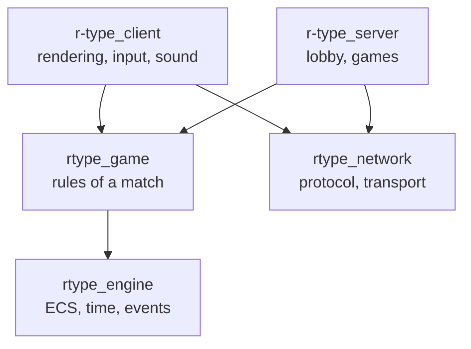
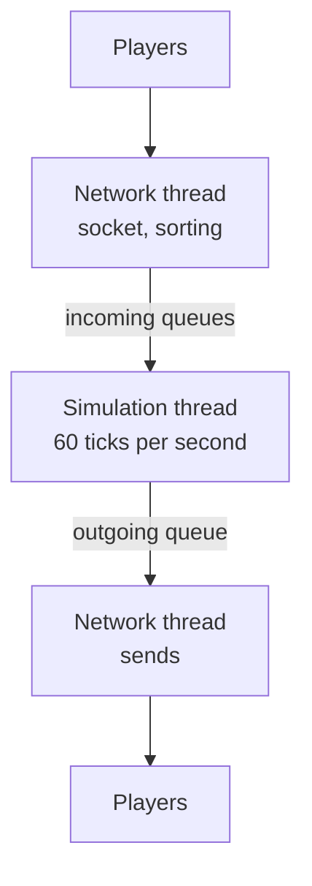
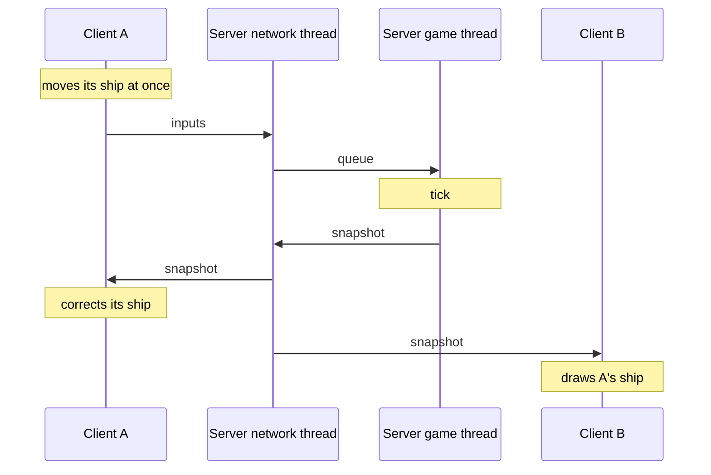
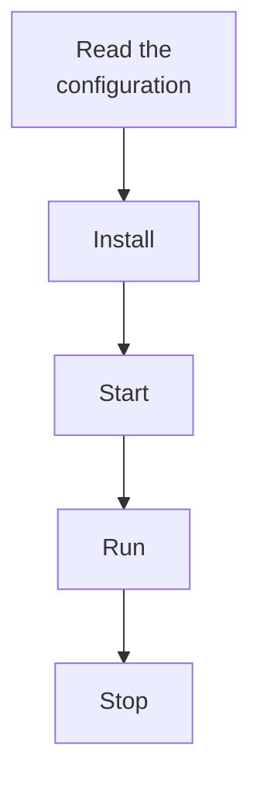
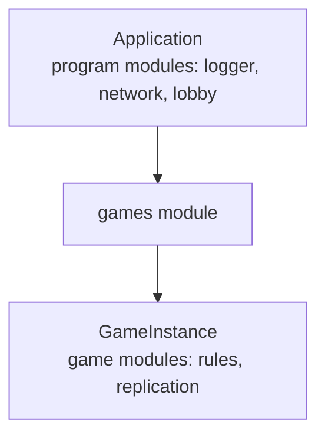
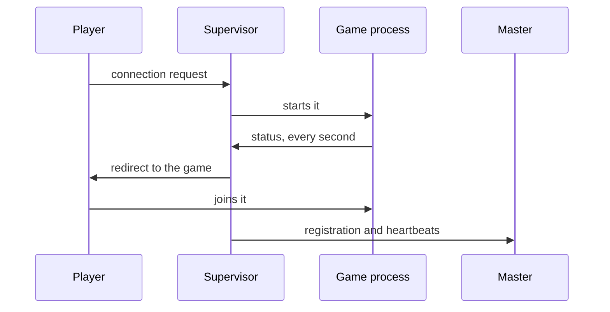

This page is the picture to have in mind before reading the code. Each diagram answers one question and sends you to the page that tells the rest. The reasons for the design are in [Architecture](/R-Type/architecture/).

## The layers

Which part may depend on which? A program links libraries, never the reverse, and between the three libraries below the only link is from the game to the engine.

| Layer | Holds | Never links |
|---|---|---|
| `rtype_engine` | entities, components, systems, time, events | SFML, Asio, the game, the network |
| `rtype_game` | what happens in a match, as systems on the engine | SFML, Asio, the network |
| `rtype_network` | the messages and how they cross the wire | SFML, the engine, the game |
| `r-type_client` | rendering (SFML), input, sound, screens | server code |
| `r-type_server` | the lobby, the games, the link with the master | SFML |

Three small libraries stand beside these: `rtype_logging`, `rtype_concurrency` and `rtype_identifiers`, which every layer may link. A forbidden link stops the CMake configure step. The full table is in [Project layout](/R-Type/project-layout/#who-may-link-what).

## The threads of the server

Which thread does what? Two threads never share game state: they hand datagrams to each other through bounded queues.

Only the network thread touches the socket, and only the simulation thread touches a game, so a game needs no lock. A full queue drops its oldest datagram, so a flood cannot make the server grow. The administration console reads the standard input on a thread of its own and hands each line to the simulation thread. See [Threads](/R-Type/server/#threads-serverapplication) and [One tick](/R-Type/server/#one-tick).

## A key press, from one screen to another

Player A holds the Up arrow and player B sees A's ship move. Each step happens in one place.

This is the path the design aims for; the server half and the prediction of the own ship run today. The inputs of client A reach its game, each tick of a game in progress moves the ships by their `Intent` with `ShipControl` in `MovementSystem`, and the world state goes to every player 20 times per second by default, as many as the host chose with `--state-rate`. Client A moves its ship at once with `ShipControl`, one input per tick, and when a world state confirms an input at a position far from the predicted one it restarts from the server position and replays the inputs after it (`client/Prediction`, always on); the other entities are interpolated (`client/Replication`, `client/Prediction`): both clients draw them at least two state intervals in the past, 100 ms at the default rate, between two world states, and further back for a while after a state arrived late (see [Client](/R-Type/client/#other-entities-interpolation-interpolationclock-positionhistory)). `network/Sessions` and `network/Snapshots` do not exist either: the session token is checked by `DatagramSorter` and the sequence by `DatagramReader`, both in `src/server/`, and the world state is written by `WorldStateCodec` and `DeltaWorldStateCodec` in `network/Protocol`, as the difference from the last state a player acknowledged (`SentStates` keeps what was sent in `server/Sessions/Roster/`, `WorldStateAssembler` rebuilds it in `client/Replication/EntityMessages/`).

| In the diagram | What happens | Where |
|---|---|---|
| moves its ship at once | The key becomes a player input; the ship moves without waiting for the server | `client/Input`, `client/Prediction`, `game/ShipControl` |
| inputs | The last inputs not yet confirmed are sent | `client/Connection`, `network/Protocol` |
| queue | Token and sequence checked, input queued for A's game | `network/Sessions`, `server/Instances` |
| tick | Ship control, then the systems | `game/ShipControl`, `game/Systems` |
| snapshot | The world is sent to every player, 20 times per second by default, as the difference from the last state it acknowledged | `server/Replication`, `network/Protocol` |
| corrects its ship | A restarts from the server position and replays its newer inputs | `client/Prediction` |
| draws A's ship | B shows A's ship two state intervals in the past (100 ms at the default rate, more after a late state), between two states | `client/Replication`, `client/Prediction` |

## The life of a module

Every program is a list of modules that an `Application` drives through five moments, always in this order. The moment of a module is a state, and `Application` moves the whole list from one to the next.

| Moment | In list order | Rule |
|---|---|---|
| Read the configuration | `main()` | the launch options are read once and handed to the constructors |
| Install | first to last | build objects, find and provide services; open nothing |
| Start | first to last | open the socket, the thread, the file |
| Run | by stage | the work added while installing runs once per tick or frame |
| Stop | last to first | close what `start()` opened; never throw |

A module lives at one of two scopes. A game module follows the same five moments, but belongs to one game.

The program scope lives from the start of the program to its end; the game scope, from the creation of a game to its destruction. See [Modules](/R-Type/modules/).

## The processes of the server

How does a player reach a game? `r-type_server` runs as a supervisor, which hosts no game and starts one process per game, so a game that crashes stops its own players only.

The supervisor listens on `DEFAULT_SERVER_PORT` (4242), runs up to `MAXIMUM_RUNNING_GAMES` (8) games, and is the only process that talks to the master. Each game process listens on a port the system picked for it. See [Supervisor and game processes](/R-Type/server/#supervisor-and-game-processes).

