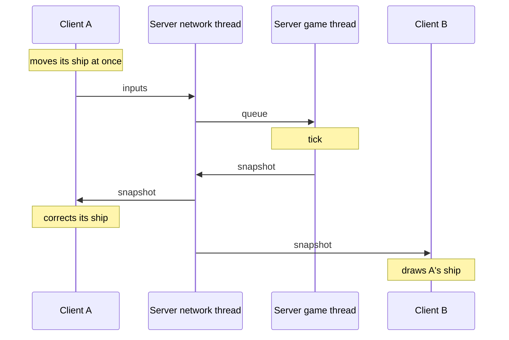

This page answers one question: **where does the code I am about to write go?** It is a map of the repository, not an inventory. It names the libraries, the programs and their main folders, says what each one holds and what it must never hold, and shows how to add a class. Why the code is split this way is explained in [Architecture](/R-Type/architecture/).

Most folders below do not exist yet. Each section says which ones do; the story that creates a folder may adjust what is inside, and updates this page in the same pull request.

## Who may link what

The repository builds two binaries on seven libraries, and the server binary runs one of two programs: the game server, or the master with `--mode master`. Programs link libraries, never the reverse. Between libraries, the only links are `rtype_game` to `rtype_engine`, and any library to `rtype_logging`, `rtype_concurrency` and `rtype_identifiers`.

| Target | Holds | Never links |
|---|---|---|
| `r-type_client` | what the player sees, hears and presses | server or master code |
| `r-type_server` | the lobby, the games running in parallel, the link with the master | SFML, Asio |
| `src/master` | the master, run by `r-type_server --mode master`: the list of game servers, their status, administration, the HTTP API | SFML, Asio, `rtype_game`, server code |
| `rtype_game` | what happens during a match | SFML, Asio, `rtype_network` |
| `rtype_network` | everything that crosses the wire | SFML, `rtype_engine`, `rtype_game` |
| `rtype_engine` | the building blocks any game needs | SFML, Asio, `rtype_game`, `rtype_network` |
| `rtype_logging` | log lines; every other target may link it | anything else |
| `rtype_concurrency` | queues between threads; every other target may link it | anything but `rtype_logging` |
| `rtype_identifiers` | the values the engine and the wire must agree on; every other target may link it | anything else |
| `rtype_storage` | opening a SQLite file and applying its numbered migrations; the programs that keep a database link it | anything else, but SQLiteCpp |

`rtype_logging`, `rtype_concurrency` and `rtype_identifiers` stand alone because `rtype_network` may not link `rtype_engine`, and code on both sides of that line writes logs, hands data from one thread to another and names entities by the same ids. A forbidden link fails the CMake configure step (`rtype_forbid_links` in the root `CMakeLists.txt`); for the libraries of the master, `rtype_forbid_reachable_links` follows every link they reach, `PRIVATE` ones included.

## Where does a new class go?

Ask the questions in order. The first "yes" decides.

| Order | Question | If yes |
|---|---|---|
| 1 | Does it draw, play a sound or read the keyboard or a gamepad? | `src/client` |
| 2 | Is it a message two programs exchange, or code that encodes or transports messages? | `src/network` |
| 3 | Does it decide what happens during a match: movement, damage, score, waves? | `src/game` |
| 4 | Would any other game need it unchanged? | `src/engine` |
| 5 | None of the above | the program that runs it: `src/server`, `src/client` or `src/master` |

The cases where people hesitate:

| Code | Goes in | Because |
|---|---|---|
| Moving the ship from the player's input: its drift, its roll and its dash | `src/game/ShipControl` | the server runs it, and the client runs the same code to predict its own ship |
| Damage after a collision | `src/game/Systems` | it is a rule of the match, even though only the server runs it |
| A queue between two threads | `src/concurrency` | the client, the server and `rtype_network` all need it, and `rtype_network` may not link `rtype_engine` |
| Finding an entity from its network id | `src/engine/NetworkIds` | `rtype_network` may not know entities |
| Opening a SQLite file and migrating it | `src/storage` | the server and the master each keep a file, and neither links the other |
| The entity id no entity has | `src/identifiers` | the engine hands out entity ids and the protocol carries them, and `rtype_network` may not link `rtype_engine` |
| The heartbeat sent to the master | `src/server/Master` | only the server sends it; the message format lives in `src/network/Master` |
| A new protocol message | `src/network/Protocol` | one struct per message, its encoding next to it, then a row in [Protocol](/R-Type/protocol/#messages) |
| A fake transport that loses datagrams | `tests/doubles` | test doubles are never built into a program |
| A feature of the server or the client you can switch on, off or replace (a sound, a lobby, a metrics reporter) | `src/server/<Name>/` or `src/client/<Name>/` | it is a module: its class implements `IModule` and is listed in `serverModules()` or `clientModules()`, see [Adding a module](#adding-a-module) |

## The libraries

### Engine

`src/engine` builds `rtype_engine`, the building blocks of a networked game, R-Type or not. **Never** an R-Type word (Bydo, missile, score), never SFML or Asio.

```
src/engine/
├── EntityRegistry/   creates and recycles entities
├── Components/       stores components by type
├── Systems/          runs systems in a fixed order
├── Events/           typed event bus
├── Collision/        rectangle overlap test and the collision event
├── Time/             fixed timestep, clocks, timers, the clock of the server seen from the client
├── NetworkIds/       entity to network id, and back
├── LaunchArguments/  options read at launch, usage and errors
├── Commands/         named commands, declared settings, the configuration file
│   ├── Interpreter/  the command table and the cutting of a line into words
│   ├── Settings/     declared settings and the set command
│   └── Configuration/ reading the file of commands, its report and its log
├── Modules/          installs, starts and stops a program's modules, in list order; runs their work in named stages and hands services between them
├── Paths/            the executable's folder and the assets/ next to it
├── DataFiles/        the strict reading of a TOML data file and its errors
└── Exceptions/
```

`EntityRegistry`, `Components`, `Systems`, `Events`, `Collision`, `Time`, `NetworkIds`, `LaunchArguments`, `Commands`, `Modules`, `Paths`, `DataFiles` and `Exceptions` exist.

### Logging

`src/logging` builds `rtype_logging`: one `Logger` per class that logs, writing timestamped lines to the terminal and to a file, with the level chosen at launch. It links nothing else of the repository. It is being written, with `Logger/`, `LogLaunchOptions/` and `ThrottledLog/` (see [Logging](/R-Type/logging/#repeated-events-throttledlog)).

### Concurrency

`src/concurrency` builds `rtype_concurrency`: what threads use to hand data to each other (see [Concurrency](/R-Type/concurrency/)). **Never** an R-Type word, SFML or Asio. Like `rtype_logging`, it links nothing else of the repository, so `rtype_network` can use it as well as the engine and the programs. `BoundedQueue/`, `LatestValue/`, `InterruptibleSleep/` and `Exceptions/` exist.

### Storage

`src/storage` builds `rtype_storage`: `openDatabaseFile()`, the one way every program opens a SQLite file, with its settings and its numbered migrations. **Never** a table or an R-Type word: the tables belong to the program. It links SQLiteCpp and nothing else of the repository, and it exists today, with the server as its only user (see [Server](/R-Type/server/#the-file-resultsdatabase)). Its errors derive from `StorageException`, in `Exceptions/`.

### Identifiers

`src/identifiers` builds `rtype_identifiers`: the values the engine and the wire must agree on. **Never** code with a state or a dependency: it holds constants, and the `constexpr` checks made of them alone, so it stays a header-only target that links nothing else of the repository. The engine, which hands out entity ids, and `rtype_network`, which carries them, read the same value from it. `EntityIdConstants.hpp` holds `NO_ENTITY_ID` (0), the entity id no entity has (see [Engine](/R-Type/engine/#network-identifiers)); `EntityTypeConstants.hpp` holds `NO_ENTITY_TYPE` (0), the most entity types and the sizes and bytes of a type name, and `EntityTypeName.hpp` holds `isEntityTypeName()`, so the game, which reads the sheets, and the protocol, which carries their names, refuse the same names.

### Game

`src/game` builds `rtype_game`, the rules of a match: what moves, what collides, what dies, what scores. The server runs all of it; the client only runs `ShipControl`, to predict its own ship. **Never** SFML, Asio or a network message.

```
src/game/
├── World/            the state of one match
├── ShipControl/      applies a player's input to their ship
├── Behaviours/       the named behaviours that pilot the Bydos and the missiles (Piloting/, Movements/)
├── Components/       Position, SteadyMotion, CollisionBox, Health...
├── EntityTypes/      the gameplay of the entity sheets, read and numbered
├── Systems/          movement, collisions, damage, shooting, score
├── Spawning/         where ships, enemies, missiles and bonuses appear
├── Waves/            when and which enemies appear
└── Events/           entity destroyed, player left...
```

`World`, which makes every entity from the sheet of its type, `Components`, `Events`, `EntityTypes` (`EntitySheets`, the gameplay of every sheet of `assets/entities/`, read strictly and numbered from 1 in the order of their names, see [Writing an entity sheet](/R-Type/entity-sheets/)), `Spawning` (the start position of a player's ship, where a projectile appears in front of the body that fires it, and where an enemy of a wave enters), the systems for movement (`Systems/MovementSystem/`, which moves a body by its `Intent`, as a ship or at the top speed of its sheet), the pilots of the Bydos and the missiles (`Systems/PilotSystem/`, which lets a named behaviour of `Behaviours/` write the `Intent` of each body it pilots) and leaving the playfield (`Systems/PlayfieldExitSystem/`), the collision classes (`Systems/CollisionSystem/`, `Systems/CollisionRules/`), the damage rules (`Systems/DamageRules/`), `Waves` (how the waves of Bydos grow and when their Bydos are due) and `ShipControl`, which the server runs and the client does not run yet, exist; the other systems and folders are not written yet. See [Server and game](/R-Type/server/).

### Network

`src/network` builds `rtype_network`: everything that crosses the wire, for the client, the server and the master. **Never** a component: messages carry plain data (ids, quantized positions, health), and the client and the server translate between messages and entities in their own `Replication` folders.

```
src/network/
├── NetworkContext/   the Asio event loop
├── Transport/        UDP socket, relay to queues, lag and loss simulator
├── Serialization/    bit reader and writer, every read bounded
├── Protocol/         one struct per message, encoding, the delta of a world state, dispatch by type
├── Handshake/        Cookies/ the challenge, RateLimit/ the limit per sender, version check
├── Sessions/         session token, sequence numbers, timeouts
├── Reliability/      acknowledgements, ordered channel, fragments
├── Snapshots/        planned; today the delta of a state is in Protocol/WorldStateDelta/, the history of sent states in the server's SentStates
├── Statistics/       the traffic: Counting/ by peer and message type, Recording/ its line and file; RoundTrip/ the round trip and jitter of a session
├── Master/           what the master and a game server share: Routes/, Messages/, Validators/, Client/
└── Exceptions/
```

`NetworkContext`, `Transport` (the UDP socket, the relay to queues and the network simulator), `Serialization`, `Exceptions`, `Protocol` (the datagram header, every message of this version and the dispatch by type), `Compression` (the zstd codec and its dictionary in `Zstd/`, the two sockets that compress what the server sends and decode it in the client in `Sockets/`), `Reliability` (the acknowledgements and the guaranteed messages; no ordered channel or fragments), `Handshake` (the connection cookies in `Cookies/`, the rate limit per sender in `RateLimit/`; no version answer yet), `Statistics` (in `Counting/` the traffic by peer and by message type, in `Recording/` its line in the journal and its file, in `RoundTrip/` the round trip and the jitter of a session, measured from the heartbeats) and `Master` (laid out like the `common/` of a cRPC: `Routes/` declares the method and path of each route of the master once, `Messages/` holds one plain struct per message, `Validators/` reads, checks and writes them in JSON in `rtype_network_master`, and `Client/` holds `MasterClient`, the calls of a game server, in `rtype_network_master_client`; none needs Asio or the game) exist; see [Network](/R-Type/network/). `Sessions` is not written: the heartbeat and session timeout delays are in `Protocol/ProtocolConstants.hpp`, and each program counts them itself, the server in `GameSessions` (`src/server/Sessions/`) and the client in `RoundTripWatch` (see [Network](/R-Type/network/#transport-sessions-and-replication)).

## The programs

### Server

`src/server` builds `r-type_server`: who plays where, and how the state reaches them. Every game owns its `World` and its event bus, and the games run one after the other on the simulation thread; the network thread receives and sends; threads only talk through queues.

```
src/server/
├── Modules/          the list of modules, nothing else
├── Logger/           the logger module
├── Network/          the network module: the socket, the network thread and the simulation thread; Rejections/, the counts of the datagrams it rejects and their report
├── Games/            the games module: the games, where a new player goes, the modules of each game
├── Lobby/            the lobby module: players not in a game; list, create, join, chat
├── Metrics/          the metrics module: Measures/, tick time, counts of games, players and entities; Report/, the report and its lines; the traffic of the socket; the round trip of each player
├── Instances/        one GameInstance per game, what a game hosts whatever its rules; Context/, what it shares with its modules, split into Interfaces/ and Setup/
├── Rules/            the rtype rules module: Match/, the states, the tick and the world of a match; Players/, the lives, score and ship of each player
├── Replication/      the replication module: Announcements/, what the players are told, once (Milestones/) or all through a match (Streams/); Wire/, how it is written
├── Sessions/         the players of a game and their sessions (still carries a player's ship, score and lives): Roster/, what the server knows of each one; Tracking/, what it follows of each session
├── Spawning/         when and where the enemies and missiles appear
├── Exceptions/       the root exception of the server, errors of the waves file
├── Platform/         what differs between Windows, macOS and Linux, and the stop signals
├── LaunchOptions/    port, name, limits, master address
├── Results/          the results module: what each game leaves, and the leaderboard requests
├── Master/           the master module: registration and heartbeats, on the MasterLink thread
├── AdminConsole/     kick and close a game from the terminal
└── Storage/          the storage module: Archive/, the thread that owns the file; Database/, the file and its SQL
```

`Modules` (the list that assembles the modules), `Logger`, `Network` (the network module, which starts and stops the threads, and in `Rejections/` counts the datagrams the network thread rejects and reports them in the journal), `Games` (the games module, the rule that places a new player, the modules of each game, the entity sheets its games are made from, which the lobby reads, the rule that says whether its games are vanilla, the games as the master lists them in `HostedGames`, and the farewell it sends when the server stops), `Lobby` (the lobby module, which answers the connection requests only), `Metrics` (the metrics module: in `Measures/` the durations of the ticks and the census of the games, in `Report/` the newest report and its lines in the journal), `Instances` (one `GameInstance` per game, run on the simulation thread like the rest, which installs the modules of a game and holds the inputs of its players for the input delay, and in `Context/` what a game shares with its modules: the interfaces of the modules in `Interfaces/`, the context, settings and hooks a game gives them in `Setup/`), `Rules` (the `RtypeRulesModule`, which holds the states of a game, its tick and its rules with `GameFlow`, runs the systems of the world, and keeps the score and the lives of its players), `Replication` (the replication module, which tells the players: in `Announcements/Milestones/` the waiting room announcer, the announcement of the ship of each new player and the announcer of the end of a game, in `Announcements/Streams/` the world state sender and the broadcaster of the game events, and in `Wire/` how they are written), `Sessions` (in `Tracking/` the classes that read the datagrams of the players of a game, keep their ready state and newest input, close their sessions, send their heartbeats and deliver a message to every player, once or guaranteed, and in `Roster/` the roster of the players, the session header of every datagram to a player and `SentStates`, the states sent to a player and the one it acknowledged; no other folder of `src/server` is linked by it), `Results` (the results module of a game: `GameResultKeeper` records what each game leaves, `LeaderboardDesk` answers the leaderboard requests), `Master` (the master module: `HeartbeatJob`, which registers the server with the master and sends its heartbeats on the MasterLink thread), `Storage` (the storage module: in `Archive/` the thread that owns the SQLite file of the server and the queues that reach it, in `Database/` the file, its tables and its queries), `Spawning` (the wave spawner, the reader of the waves file and the weapon system), `Platform`, `LaunchOptions` and `Exceptions` exist today; the names of the modules sit in `ModuleConstants.hpp`, next to `ServerConstants.hpp` in `src/server/`. Together they hold the network thread and the simulation thread, the waiting room, the start of the game, the world state, the game events and the end of a game sent to the players (see [Server](/R-Type/server/)), the timer resolution the server asks Windows for, the port and seed read at launch, the players let in, the Bydos appearing and moving, the missiles the players fire, a game with its states, its ready rule and the newest input of each player, which moves its ship, the metrics of the server in its journal, and the results of each game in its SQLite file.

### Client

`src/client` builds `r-type_client`: what the player sees, hears and presses. The frame loop never waits: the network and HTTP threads will hand their results over through queues.

```
src/client/
├── Modules/             the list of the modules, `clientModules()`
├── Logger/              the journal of the client
├── Assets/              the assets of the client
│   ├── Library/         assets found by id, loaded once
│   └── Loading/         a list loaded one file per call
├── Settings/            the settings module and the service
│   ├── Values/          volumes, keys, display, accessibility
│   ├── Definitions/     what each setting is, its id and range
│   └── Storage/         the settings file
├── Window/              the window module
│   ├── Display/         the SFML window, its mode and size
│   └── Loop/            the frame loop and the window events
├── Connection/          the connection module and `ServerSession`
│   ├── Transport/       datagrams between the socket and the frame loop
│   ├── Session/         what crosses a session, in and out
│   ├── Handshake/       the request to join a server and its state
│   ├── EntityTypes/     the entity types of the server, from its acceptance
│   ├── WaitingRoom/     the waiting room until the game starts
│   └── Leaderboard/     the best scores of a server
├── Metrics/             the metrics module: the traffic of the socket, in the journal and a file
├── Audio/               the sound module
│   ├── Contract/        what other folders may use of the sound
│   │   ├── Music/       the music, its clock and the theme
│   │   ├── Sounds/      the sounds and their ids
│   │   └── Service/     the audio service and its silent kind
│   ├── Sounds/          the sounds, their bank and their voices
│   └── Music/           the theme and the music of a game
├── Screens/             the screens module and what screens share
│   ├── Common/          the screens every module may show
│   └── Registry/        where modules add their screens
├── Menus/               the screens before a server
│   ├── Leaderboard/     the leaderboard of a server and its filter
│   ├── Title/           intro, title, connection screen, dialogs
│   └── Options/         the options and their pieces
│       ├── Screen/      the options screen and its dialogs
│       └── Tabs/        the tabs and their rows
├── Lobby/               the waiting room
├── Game/                the game and the end screen
├── Application/         the screen stack and the interfaces of a screen
├── Replication/         what the server announces, applied to the game
│   ├── Entities/        world states to local entities
│   ├── EntityMessages/  what the session queues for the game
│   └── Pilots/          scores and ranking of the pilots
├── Prediction/          own ship predicted, other ships interpolated
├── Input/               keyboard and gamepad to player input
│   ├── Keys/            the keys, their names and their bindings
│   └── Commands/        the actions held and their pace
├── Platform/            what differs between Windows, macOS and Linux
├── LaunchOptions/       server address, port, nickname, sound on or off, traffic file
├── Widgets/             labels, buttons, menus, text fields, lists, HUD
└── Rendering/           sprites, starfield, HUD sprites, effects, lagometer
```

Every folder of this tree exists today; some of what the comments name is not written yet: the gamepad and the lagometer. `Assets` holds the assets module, `Assets/Library/` the library and what it reads, `Assets/Loading/` the loading step; `Window` holds the window module, `Window/Display/` the window, its mode, its size and where the playfield lands in it, `Window/Loop/` the frame loop and the listeners of the window events. A module folder holds its class, `Client<Name>Module`, and the code it owns, side by side; a module with two categories or more gives each a sub-folder, which its folder links (see [The list of modules](#the-list-of-modules)). `Connection` holds the connection module and `ServerSession`, the connection to a server the connection screen and the waiting room drive (see [Client](/R-Type/client/#joining-a-server-serversession-waitingroom-entitymessagequeue)); `Transport/` holds the network thread and the routes of its datagrams (see [Client](/R-Type/client/#network-networkthread)), `Session/` what crosses a session, in and out, `Handshake/` the request to join a server and its state, `EntityTypes/` the table of the entity types the acceptance of the server carried, with `SessionLossWatch` in `Handshake/`, which notices the end of a session so `ClientScreens` brings back the title with a dialog over it, `WaitingRoom/` the waiting room until the game starts, and `Leaderboard/` the best scores of a server, which it asks for over the session. `Metrics` holds the metrics module, which writes the traffic of the socket the connection module provides to the journal and, with `--traffic-csv`, to a file (see [Network](/R-Type/network/#traffic-counters-trafficcounters)). `Audio` holds the sound module and the audio service it provides; `Audio/Sounds/` holds the `SoundBank` the sounds are read into, the player of the sounds, the choice of a voice and `AudioVolume`, which the music reads too; `Audio/Music/` holds the player of a music and the `Soundtrack` that switches from the theme to the music of a game; `Audio/Contract/` holds what the screens, the widgets and the replication use of the sound, in three parts: `Music/` (the music, the clock the intro follows, the audio constants), `Sounds/` (the sounds and their constants) and `Service/` (the audio service and the one that plays nothing) (see [Client](/R-Type/client/#sounds-and-music-iaudioservice-soundplayer-musicplayer)). `Screens` holds the screens module, `ClientScreens`, `openingScreen()`, `PlayerPreferences`, the flash preference and the palette of the pilots the screens share, `ScreenAssets`, and the identifiers of the screens, which several modules read; `Screens/Registry/` holds the `ScreenRegistry` and what a screen is built from, and `Screens/Common/` the screens any module shows (`DialogScreen`, `LoadingScreen`). `Menus` holds the menus module with `Title/`, the intro, the title, the connection screen and the menus of the dialogs over the title, `Leaderboard/`, the leaderboard with its filter and the presentation of its rows, and `Options/`, the options screen with its reset dialog and SAVED stamp in `Options/Screen/`, its tabs, rows and descriptions in `Options/Tabs/`; `Lobby` holds the waiting room, and `Game` the game screen, the end screen and `releasesHeldKey()`, which the end screen uses so a key held down acts once. `Application` holds the screen stack and the interfaces of a screen. `Replication` holds no class of its own: `Entities/` holds the filter that ignores an old world state, `LastListedTicks`, which names the entities no world state has listed for 900 ms up to a closed tick, `PositionHistory`, which keeps the newest positions of each entity so the client can show it between two states (see [Client](/R-Type/client/#other-entities-interpolation-interpolationclock-positionhistory)), and `EntityReplicator`, which applies the entities the server announces to the game screen (see [Client](/R-Type/client/#entities-from-the-server-entityreplicator)); `EntityMessages/` holds the queue through which the game takes the entities and the game events the server announces, one copy of each event (`GameEventHistory`), and `WorldStateAssembler`, which rebuilds each state in full from its delta parts; `Pilots/` holds `ScoreBoard`, which keeps the score and the lives of each pilot for the status band (see [Client](/R-Type/client/#status-band-scoreboard-paintstatusband)), and `FinalRanking`, which ranks the pilots of a game the server ended into the `GameResult` the end screen reads (see [Client](/R-Type/client/#end-screen-endscreen-paintflightlog)). `Input` holds no class of its own: `Input/Keys/` holds the keys, their names, their remapping and the actions they become, and `Input/Commands/` the actions held at a moment and `PlayerInputPacer`, which sends them at a fixed rate (see [Client](/R-Type/client/#inputs-to-the-server-playerinputpacer-iplayerinputlink)). `Settings` holds the settings module and the `SettingsService` every change goes through, which saves it and tells the listeners subscribed; `Settings/Values/` holds what the player sets, with the display mode and the window sizes it names, `Settings/Definitions/` what each setting is, and `Settings/Storage/` the file it is saved in; the game reads the flashes setting, the sound cues and auto-fire, every screen that paints a pilot reads the color mode, and the sounds and the music are told when a volume changes (see [Client](/R-Type/client/#settings-playersettings-settingsservice-settingsfile)).

`Rendering` draws every entity that has a `Position` and a `Sprite` (an asset id, the rectangle of it to show and a layer), from the background layer to the interface layer; the game screen draws them through its `EntityLayer`. Its files are grouped by family, a folder each with its headers and its classes, and a family only depends on the families listed before it:

- `Shaders`: the fragment shaders and how they are loaded.
- `Sprites`: the entity sheet, `EntityAppearances` (the look of each entity type, read from the `[appearance]` of its sheet), `animatedSpriteOf` and `layerOf` (what a new entity is drawn with, and the layer of its side), `Animation` and `AnimationSystem`, `PilotColor`, the color of a pilot and the number of its player, and `AssetTextureSource`, which finds textures in the asset library behind `ITextureSource`.
- `Interface`: what a menu or the status band is painted with: `IInterfaceCanvas` and `InterfaceCanvas`, the text styles, colors and constants, `TextWriter`, which writes the lines of text of the menus and of the entity layer, `PlayerShading`, how a palette paints a player color, `PlayerNumberLabel`, `P` and the number of a player, and `Squadron`.
- `SpriteLook`: what changes how an entity is drawn: its `SpriteTone`, its `HitFlash` (ended by `HitFlashSystem`), the `Caption` of a line of text, `Nudge`, `Reveal`, `Invulnerability`, `PilotShip`, and the `ShipFlight` of a pilot's ship (moved on by `ShipFlightSystem`).
- `Drawing`: `RenderSystem`, which reads those components and draws through `IDrawSurface`, so it is tested without a graphics card; `SfmlDrawSurface`, which draws on the pixel grid of the background with SFML; and `EntityLayer`.
- `Intro`: the scene of the launch intro, as pure functions of its time, its cast drawn once from a seed, and the table of its sounds. Unlike the families above, it also uses the effects, the background and the audio of the client (the holds of the game, the warp, the pixel rounding, the tempo and the sounds): it comes last, and nothing in `Rendering/` uses it (see [Client](/R-Type/client/#launch-intro-introscreen)).

`Rendering/` itself keeps what belongs to no single family: `RenderingConstants.hpp`, `FlashPreference.hpp`, `Easing`, `Typing` (how many letters of a line are typed at a moment, and its start cut at a whole UTF-8 character), `ColorRamp` (the color a share of life reaches in a ramp, and the ramp without its flash under REDUCE FLASHES), `PixelCircle` (the midpoint circle the rings are drawn with) and `PixelCanvas`. It is described in [Client](/R-Type/client/#entity-appearances-entityappearances).

`Rendering/Sprites/Animation` and `Rendering/Sprites/AnimationSystem` play the animations, described as data, by the time elapsed. `Rendering/Effects` holds the rows of the effect sheet and the values of the ladder of intensity, and `EffectSpawner`, which the replicator and the game screen call to play every effect on that ladder. What it holds has a folder each: one class per family of events (`ShotEffects`, `HitEffects`, `KillEffects`, `PilotEffects`, `GainFigures`, `SoundCues`), the `FlashGate` every effect asks before a flash (with its `FlashBudget`), `KillChain`, `GainAttribution`, and the free functions of `SheetEffects` and `EffectTargets`. Then one folder per family of effects, each with its components, its constants and its classes: `Ground`, the pixel effects painted under every sprite (`PixelEffects` creates them, `GroundEffectSystem` moves them on and `paintGroundEffects()` paints them); `SpriteEffects`, what an effect holds on a sprite for a moment, moved on by `SpriteEffectSystem`; `Camera` (`CameraShake`); `MissionStart`, the warp of the stars. The effects depend on the families, never the other way round; of the families, only `Intro` uses them. `Rendering/Easing` holds the easings the effects, the title squadron, the drawing of a roll and the ship flight share. `Rendering/SpriteLook/HitFlashSystem` ends the hit flashes. They are described in [Client](/R-Type/client/#animations-and-effects).

`Rendering/Background` draws the scrolling starfield behind the playfield, and the screens module already draws it; through `ISky`, the game screen speeds its stars up and shakes it. `Rendering/PixelCanvas` is the picture of the background's size that the sky, the entities and the menus are painted on. It is described in [Client](/R-Type/client/#scrolling-background-scrollingbackground).

`Widgets` holds the labels, buttons, text fields and menus every menu is built from, placed by `MenuBuilder`, and the pieces they are drawn with; `ItemList` shows rows of items a screen reads elsewhere, and `KeyChip` is a button with its key standing alone. Each widget is a class in its own folder (`Label/`, `Button/`, `TextField/`, `Menu/`, `MenuBuilder/`, `CutCornerBox/`, `SunkBox/`, `Outline/`, `CheckBox/`, `KeyCap/`, `TabStrip/`, `ItemList/`, `KeyChip/`), with the types it owns nested in it; `Widgets/` itself holds the constants, colors and styles they share, the few types and functions every widget uses (`BarState`, `CheckMark`, `barRowWidth()`, the text helpers of `WidgetText/`), `paintWindowSizeChart()`, the chart of the window sizes drawn beside their list in the options, `paintHangarBay()` (`HangarBay/`), a bay of the waiting room, `paintStatusBand()` (`StatusBand/`), the status band of the game, whose sprites are listed in `Rendering/Interface/` (`HudSpriteConstants.hpp`), `paintPaddedScore()` (`PaddedScore/`), a score on 7 digits whose leading zeros are dimmed, `paintInkTag()` (`InkTag/`), a word on ink such as YOU, which the flight log and `ItemList` share, and `pilotNameOf()` (`PilotName/`), the nickname of a pilot or `P` and its number, which the band and the end screen share, `paintMissionBanner()`, the banner that opens a game, and `paintIntroOverlay()` (`IntroOverlay/`), the bands, texts and logo of the intro. The notices of a game, `DepartureFeed` (`DepartureFeed/`) and `SilenceWarning` (`SilenceWarning/`), and `paintGlowingCall()` (`GlowingCallPainting/`), the call to act of the end screen, have a folder each too. `Widgets/FlightLog/` holds the flight log of the end screen, a family like `RowControls/`: its constants and plain types, then one folder per painter or pure function (`BookMotion/`, `BookPainting/`, `TauntLabel/`, `MissionLogPage/`, `RankingPage/`, `EndChoices/`, `FlightLogPainting/`, `FlightLogTimeline/`, `Taunts/`); its sheet is listed in `Rendering/Interface/` (`FlightLogSheetConstants.hpp`). `Widgets/RowControls/` holds the controls of a row of a tabbed panel: the abstract `RowControl`, its constants, and one folder per control (`Slider/`, `Switch/`, `ChoiceSelector/`, `Dropdown/`, `KeySlot/`, `LinkText/`). `Rendering/Interface/InterfaceCanvas` is the picture a menu is painted on, `Rendering/Interface/InterfacePixel` gives the pixel of that picture under a point of the playfield, `Rendering/Interface/Squadron` the animation of the title screen. They are described in [Client](/R-Type/client/#menus-menubuilder-menu).

`Input` turns key and focus events into the set of actions the player holds. It is described in [Client](/R-Type/client/#player-commands-playercommands).

### Master

`src/master` holds the master, the program `r-type_server --mode master` runs: it will list the game servers and their games, record their heartbeats, run the administration and serve the web frontend. Its folders are libraries, and only the server binary links them, so the master never links SFML, Asio, `rtype_game` or the code of the server. Today it creates the game servers with their keys, takes their registration and their heartbeats, lists the games of a server, and answers `GET /api/health` (see [Master](/R-Type/master/)).

```
src/master/
├── LaunchOptions/    -p, --database, --set, --help after --mode master
├── Logger/           the module logger
├── Storage/          the module storage: the database, on the connection and migrations of rtype_storage
├── Http/             the module http: the HTTP server, its errors, GET /api/health
├── Servers/          the module servers: creation and key, registration, heartbeats, the games of a server; status being written
│   ├── Controllers/  ServersController: reads each route, writes its answer
│   ├── Services/     ServersService: the rules; Helpers/, the key and its fingerprint
│   ├── Repositories/ the only SQL: ServerRepository, HeartbeatSampleRepository
│   └── Models/       the plain structs the layers hand each other
├── Modules/          masterModules(), the list of the modules
├── Administration/   bans, kicks, maintenance, audit log: being written
├── Matchmaking/      a server chosen to create a game: being written
└── Accounts/         optional, with Tickets/: being written
```

`LaunchOptions/`, `Logger/`, `Storage/`, `Http/`, `Servers/` and `Modules/` exist; the others are being written. A folder of a feature is laid out like a module of a web backend: its module class at the root, then one sub-folder per role, as `Servers/` shows.

### Tests, web frontend, assets

- **`tests/`** mirrors `src/`: the test of `src/game/Waves/WaveDirector` is `tests/game/Waves/WaveDirectorTest.cpp`, built into `game_tests`, one executable per library or program. Test doubles (fake clock, lossy transport) go in `tests/doubles/`; test tools in `tests/tools/`, never shipped: today, in `tests/tools/MalformedDatagrams/`, the tool that sends malformed datagrams (see [Network](/R-Type/network/#malformed-datagrams-malformed_datagrams)), in `tests/tools/network-conditions/`, the scripts that apply the network scenarios to the loopback interface from the system (see [Network](/R-Type/network/#network-conditions-from-the-system-teststoolsnetwork-conditions)), in `tests/tools/packaging/`, the script the CI runs to check the packages from another folder (see [Packages](https://github.com/nique-epi/R-Type#packages) in the README), and, in `tests/tools/LoadTestBots/`, the load-test bots (see [Network](/R-Type/network/#load-test-bots-load_test_bots)). Today the older tests sit at the root of `tests/`; `tests/client/`, `tests/concurrency/`, `tests/engine/`, `tests/network/` and `tests/server/` already follow this layout, and `tests/doubles/` holds a socket that records instead of sending, a datagram link that records what is sent and hands over what a test delivers, a connection to a server that records what a screen asks, a settings storage that records each save, a settings listener that records each change it is told, a window on a desktop of a given size, a draw surface that records each rectangle it is asked to draw, an entity layer that records what it paints, a sound player that records the ids it plays, a music clock whose position the test sets, a module that writes down when it is installed, started and stopped, a loss drawn from a seed for each datagram, and a network that delivers the datagrams a test sends late, twice or never, in an order the test gives or draws from a seed. Each folder of `tests/` has its `CMakeLists.txt`: it declares, with `rtype_add_test()`, the executables whose tests all sit in it or below it, and adds its own files to those its parents declare, with `target_sources()`; `rtype_test_support` holds the journal and temporary-folder helpers every executable shares. A test file holds only its tests: its constants are in `<Subject>TestConstants.hpp`, its fixture in `<Subject>Fixture.{hpp,cpp}` and its helpers in `<Subject>Fixtures.{hpp,cpp}`, next to it. In a folder of `tests/tools/`, the fixture and helper files sit in a `Fixtures/` folder beside the tests, as in `tests/tools/LoadTestBots/Play/Pilot/Fixtures/`, and its `CMakeLists.txt` gives them to the test executable of that folder.
- **`web/`** is the React frontend served by the master: `src/api/` (one function per route), `src/pages/`, `src/components/`.
- **`packaging/`** holds what CPack needs beyond the install rules, which sit with the CPack settings in the root `CMakeLists.txt`: the CPack config of each program (`CPackPartConfig.cmake.in`), the settings that differ per generator (`CPackGeneratorConfig.cmake`), the script that builds the AppImage, the `Info.plist` of the app, the `.desktop` file and the icon.
- **`assets/`** holds the files read at run time: `sprites/`, `sounds/`, `music/`, `fonts/` and `icons/` for the client, `waves/` for the server (`waves.toml`, see [Writing the waves file](/R-Type/waves-file/)), and `entities/` for both, one sheet per entity type, whose gameplay the server reads and whose appearance the client reads (see [Writing an entity sheet](/R-Type/entity-sheets/)).

## Modules and libraries

A **module** is a feature you can switch on, switch off or replace: a folder with one class implementing `IModule` or `IGameModule` at its root, which owns everything the folder holds. A folder without that class is a **library**: code with no life cycle, such as `src/client/Widgets/` or `src/game/Waves/`. The [Modules](/R-Type/modules/#required-or-optional) page says what a required and an optional module may do, and gives the removal test.

**No module passes the removal test yet.** The sound and the metrics come closest. No module depends on the sound, the other folders include only its `Contract/`, and no target of `src/` outside `Audio/` links `SFML::Audio`: the sounds are read by its `SoundBank`, not by `AssetLibrary`. The metrics, on both programs, are included by the list only and sit in one folder. What stops both is the build: `src/server/CMakeLists.txt` and `src/client/CMakeLists.txt` add their folder (and `Audio/CMakeLists.txt` adds its `Contract/`), the `CMakeLists.txt` of `Modules/` links their library, and `BUILD_TESTS` is the only CMake option.

### The list of modules

This list describes the code as it is today. A pull request that adds, removes or moves a module updates it.

| Module of the server program | Class | Folder | Kind |
|---|---|---|---|
| `logger` | `ServerLoggerModule` | `src/server/Logger/` | required |
| `network` | `ServerNetworkModule` | `src/server/Network/` | required |
| `storage` | `ServerStorageModule` | `src/server/Storage/` | required |
| `games` | `ServerGamesModule` | `src/server/Games/` | required |
| `lobby` | `ServerLobbyModule` | `src/server/Lobby/` | required |
| `metrics` | `ServerMetricsModule` | `src/server/Metrics/` | optional |
| `master` | `ServerMasterModule` | `src/server/Master/` | optional |

| Module of a game | Class | Folder | Kind |
|---|---|---|---|
| `replication` | `ReplicationModule` | `src/server/Replication/` | required |
| `rtype rules` | `RtypeRulesModule` | `src/server/Rules/` | required |
| `results` | `ResultsModule` | `src/server/Results/` | required |

| Module of the master | Class | Folder | Kind |
|---|---|---|---|
| `logger` | `MasterLoggerModule` | `src/master/Logger/` | required |
| `storage` | `MasterStorageModule` | `src/master/Storage/` | required |
| `http` | `MasterHttpModule` | `src/master/Http/` | required |
| `servers` | `ServersModule` | `src/master/Servers/` | required |

| Module of the client | Class | Folder | Kind |
|---|---|---|---|
| `logger` | `ClientLoggerModule` | `src/client/Logger/` | required |
| `assets` | `ClientAssetsModule` | `src/client/Assets/` | required |
| `settings` | `ClientSettingsModule` | `src/client/Settings/` | required |
| `window` | `ClientWindowModule` | `src/client/Window/` | required |
| `connection` | `ClientConnectionModule` | `src/client/Connection/` | required |
| `metrics` | `ClientMetricsModule` | `src/client/Metrics/` | optional |
| `audio` | `ClientAudioModule` | `src/client/Audio/` | optional |
| `screens` | `ClientScreensModule` | `src/client/Screens/` | required |
| `menus` | `ClientMenusModule` | `src/client/Menus/` | required |
| `lobby` | `ClientLobbyModule` | `src/client/Lobby/` | required |
| `game` | `ClientGameModule` | `src/client/Game/` | required |

Each module class sits in its folder with the code it owns, and `Modules/` keeps only the list of the program.

### The code of a module used elsewhere

When another folder needs code of a module, the first row that fits decides.

| Order | The code… | Then |
|---|---|---|
| 1 | belongs to a required module | it stays there, and the code that needs it includes it: `Lobby/` and `Metrics/` include `Games.hpp`, `Widgets/` includes `PlayfieldMapping.hpp` |
| 2 | belongs to an optional module | it goes in the `Contract/` of that module: `ISoundPlayer`, in `src/client/Audio/Contract/Sounds/` |
| 3 | has no owner and serves several folders | it goes in a library: `Widgets/`, `Rendering/` |

## Adding a class

Adding `WaveDirector` to `src/game/Waves`, a folder that already holds `WaveProgression`, in the flat layout every new folder follows:

```
src/game/Waves/
├── CMakeLists.txt         add_library(rtype_game_waves STATIC WaveDirector.cpp WaveProgression.cpp)
├── WaveDirector.hpp
├── WaveDirector.cpp
├── WaveProgression.hpp
└── WaveProgression.cpp
```

- A folder has one `CMakeLists.txt` and one CMake library. It holds the `.hpp` and `.cpp` of its classes, and of its free functions, side by side. A folder whose classes fall into categories of two classes or more has a sub-folder for each, with a CMake library of its own; a sub-folder also exists when a group of classes needs a dependency the rest must not link, or for the `Contract/` of an optional module. Never one per class, and never deeper than three levels: a sub-folder splits again only when it holds two categories of its own.
- Interfaces (`IWaveSource`), plain structs and constants headers (`WaveConstants.hpp`) sit in the same folder as the classes.
- Two classes of a folder never include each other, directly or through a third.
- A folder written before this convention keeps a folder per class until it is flattened, in a commit of its own; a folder never holds both layouts. The client and the server are flattened, except `src/client/Widgets/` and `src/client/Rendering/`; `src/engine/`, `src/game/`, `src/network/`, `src/logging/` and `src/concurrency/` still keep a folder per class.
- A class declares no type inside it: a struct it uses has a header of its own, in the same folder. A class declares at most ten member functions besides its constructors and its destructor.
- A header of constants is named `<Concept>Constants.hpp` and holds constants only.
- The CMake library of a folder is `rtype_<owner>_<folder_in_snake_case>`, ended by `_module` for a module, linked by the aggregate of its library (`rtype_game`) or by its program. The library of a category sub-folder adds its name to its parent's: `rtype_server_rules_match` for `src/server/Rules/Match/`.
- The namespace is `rtype::<owner>`: `rtype::game` here.
- An error is a subclass of the owner's root exception, in `<owner>/Exceptions/`: `GameException` here.

This follows our previous projects: shared code in libraries and one folder per program, like Zappy; one library per folder, interfaces next to their implementations and tests that mirror the sources, like the Raytracer. One thing differs: folders are `PascalCase`.

## Adding a module

A new module is written directly in its own folder, `src/<program>/<Name>/`, class and code together; the [Modules](/R-Type/modules/) page explains what it does, and the [tutorial](/R-Type/tutorial-write-a-module/) writes one. It is listed where this table says:

| The module… | Listed in |
|---|---|
| belongs to the server and lives as long as the program | `serverModules()`, `src/server/Modules/ServerModules.cpp` |
| belongs to the client | `clientModules()`, `src/client/Modules/ClientModules.cpp` |
| is a rule or a service of one game, and each game has its own | `rtypeGameModules()`, `src/server/Games/RtypeGameModules.cpp` |
| belongs to the master | `masterModules()`, `src/master/Modules/MasterModules.cpp` |

- The folder follows [Adding a class](#adding-a-class): one `CMakeLists.txt`, one CMake library `rtype_<owner>_<name>_module`, the class `<Owner><Name>Module` as a `.hpp` and `.cpp` pair (`ServerLobbyModule`; the class of a game module is `<Name>Module`, as `ReplicationModule` and `RtypeRulesModule` are).
- `Modules/` receives nothing but its line in the list, and `ModuleConstants.hpp` the constant of its name, next to the other names: in `src/server/` or `src/client/`, or `MasterModuleConstants.hpp` in `src/master/`.
- Its pull request adds its row to [the list of modules](#the-list-of-modules), required or optional. An optional module puts what others need in its `Contract/`, and nothing else includes it.
- A module of the program never goes in `src/engine`, unless every game would need it unchanged. `IModule` itself lives there; the modules of R-Type do not.

## A key press, from one screen to another

Player A holds the Up arrow and player B sees A's ship move. Each step happens in one place.

This is the path the design aims for; the server half and the prediction of the own ship run today. The inputs of client A reach its game, each tick of a game in progress moves the ships by their `Intent` with `ShipControl` in `MovementSystem`, and the world state goes to every player 20 times per second by default, as many as the host chose with `--state-rate`. Client A moves its ship at once with `ShipControl`, one input per tick, and when a world state confirms an input at a position far from the predicted one it restarts from the server position and replays the inputs after it (`client/Prediction`, with PREDICTION on); the other entities are interpolated (`client/Replication`, `client/Prediction`): both clients draw them two state intervals in the past, 100 ms at the default rate, between two world states. `network/Sessions` and `network/Snapshots` do not exist either: the session token is checked by `DatagramSorter` and the sequence by `DatagramReader`, both in `src/server/`, and the world state is written by `WorldStateCodec` and `DeltaWorldStateCodec` in `network/Protocol`, as the difference from the last state a player acknowledged (`SentStates` keeps what was sent in `server/Sessions/Roster/`, `WorldStateAssembler` rebuilds it in `client/Replication/EntityMessages/`).



| In the diagram | What happens | Where |
|---|---|---|
| moves its ship at once | The key becomes a player input; the ship moves without waiting for the server | `client/Input`, `client/Prediction`, `game/ShipControl` |
| inputs | The last inputs not yet confirmed are sent | `client/Connection`, `network/Protocol` |
| queue | Token and sequence checked, input queued for A's game | `network/Sessions`, `server/Instances` |
| tick | Ship control, then the systems | `game/ShipControl`, `game/Systems` |
| snapshot | The world is sent to every player, 20 times per second by default, as the difference from the last state it acknowledged | `server/Replication`, `network/Protocol` |
| corrects its ship | A restarts from the server position and replays its newer inputs | `client/Prediction` |
| draws A's ship | B shows A's ship two state intervals in the past (100 ms at the default rate, more after a late state), between two states | `client/Replication`, `client/Prediction` |

## Moves from today's code

A few files predate these conventions. Each move is a `refactor` pull request that changes no behavior.

| Today | Target |
|---|---|
| `src/game/World.cpp` | `src/game/World/` |
| `src/engine/Components/ComponentStorage.hpp` | `src/engine/Components/ComponentStorage/` |
| `tests/*.cpp`, `tests/SimulatedClock.hpp` | `tests/<owner>/<Folder>/`, `tests/doubles/` |

`rtype_forbid_links` also reads only the direct links of a target: a class library inside `rtype_engine` that linked SFML would pass. `rtype_forbid_reachable_links` walks the links, but only the libraries of the master use it: `r-type_server` reaches Asio through `rtype_network_context`, which its network module links and the direct check does not follow, so the line "`r-type_server` never links Asio" holds for its direct links only.

## Not decided yet

- **Track 1** (the engine as its own project, scripting). It would add folders to `src/engine`; until it is decided, the sound, the window and the rendering stay in `src/client`.
