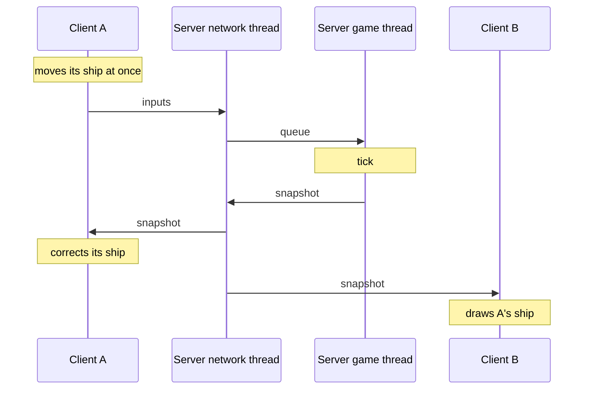

This page answers one question: **where does the code I am about to write go?** It is a map of the repository, not an inventory. It names the libraries, the programs and their main folders, says what each one holds and what it must never hold, and shows how to add a class. Why the code is split this way is explained in [Architecture](/R-Type/architecture/).

Most folders below do not exist yet. Each section says which ones do; the story that creates a folder may adjust what is inside, and updates this page in the same pull request.

## Who may link what

The repository builds three programs on six libraries. Programs link libraries, never the reverse. Between libraries, the only links are `rtype_game` to `rtype_engine`, and any library to `rtype_logging`, `rtype_concurrency` and `rtype_identifiers`.

| Target | Holds | Never links |
|---|---|---|
| `r-type_client` | what the player sees, hears and presses | server or master code |
| `r-type_server` | the lobby, the games running in parallel, the link with the master | SFML, Asio |
| `r-type_master` | the list of game servers, their status, administration, the HTTP API | SFML, `rtype_game` |
| `rtype_game` | what happens during a match | SFML, Asio, `rtype_network` |
| `rtype_network` | everything that crosses the wire | SFML, `rtype_engine`, `rtype_game` |
| `rtype_engine` | the building blocks any game needs | SFML, Asio, `rtype_game`, `rtype_network` |
| `rtype_logging` | log lines; every other target may link it | anything else |
| `rtype_concurrency` | queues between threads; every other target may link it | anything but `rtype_logging` |
| `rtype_identifiers` | the values the engine and the wire must agree on; every other target may link it | anything else |

`rtype_logging`, `rtype_concurrency` and `rtype_identifiers` stand alone because `rtype_network` may not link `rtype_engine`, and code on both sides of that line writes logs, hands data from one thread to another and names entities by the same ids. A forbidden link fails the CMake configure step (`rtype_forbid_links` in the root `CMakeLists.txt`).

## Where does a new class go?

Ask the questions in order. The first "yes" decides.

| | Question | If yes |
|---|---|---|
| 1 | Does it draw, play a sound or read the keyboard or a gamepad? | `src/client` |
| 2 | Is it a message two programs exchange, or code that encodes or transports messages? | `src/network` |
| 3 | Does it decide what happens during a match: movement, damage, score, waves? | `src/game` |
| 4 | Would any other game need it unchanged? | `src/engine` |
| 5 | None of the above | the program that runs it: `src/server`, `src/client` or `src/master` |

The cases where people hesitate:

| Code | Goes in | Because |
|---|---|---|
| Moving the ship from the player's input | `src/game/ShipControl` | the server runs it, and the client will run the same code to predict its own ship |
| Damage after a collision | `src/game/Systems` | it is a rule of the match, even though only the server runs it |
| A queue between two threads | `src/concurrency` | the client, the server and `rtype_network` all need it, and `rtype_network` may not link `rtype_engine` |
| Finding an entity from its network id | `src/engine/NetworkIds` | `rtype_network` may not know entities |
| The entity id no entity has | `src/identifiers` | the engine hands out entity ids and the protocol carries them, and `rtype_network` may not link `rtype_engine` |
| The heartbeat sent to the master | `src/server/MasterLink` | only the server sends it; the message format lives in `src/network/Master` |
| A new protocol message | `src/network/Protocol` | one struct per message, its encoding next to it, then a row in [Protocol](/R-Type/protocol/#messages) |
| A fake transport that loses datagrams | `tests/doubles` | test doubles are never built into a program |

## The libraries

### Engine

`src/engine` builds `rtype_engine`, the building blocks of a networked game, R-Type or not. **Never** an R-Type word (Bydo, missile, score), never SFML or Asio.

```
src/engine/
├── EntityRegistry/   creates and recycles entities
├── Components/       stores components by type
├── Systems/          runs systems in a fixed order
├── Events/           typed event bus
├── Collision/        rectangle overlap test and the collision event
├── Time/             fixed timestep, clocks, timers
├── NetworkIds/       entity to network id, and back
├── LaunchArguments/  options read at launch, usage and errors
└── Exceptions/
```

`EntityRegistry`, `Components`, `Systems`, `Events`, `Collision`, `Time`, `NetworkIds`, `LaunchArguments` and `Exceptions` exist.

### Logging

`src/logging` builds `rtype_logging`: one `Logger` per module, writing timestamped lines to the terminal and to a file, with the level chosen at launch. It links nothing else of the repository. It is being written, with `Logger/`, `LogLaunchOptions/` and `ThrottledLog/` (see [Logging](/R-Type/logging/#repeated-events-throttledlog)).

### Concurrency

`src/concurrency` builds `rtype_concurrency`: what threads use to hand data to each other (see [Concurrency](/R-Type/concurrency/)). **Never** an R-Type word, SFML or Asio. Like `rtype_logging`, it links nothing else of the repository, so `rtype_network` can use it as well as the engine and the programs. `BoundedQueue/` and `Exceptions/` exist.

### Identifiers

`src/identifiers` builds `rtype_identifiers`: the values the engine and the wire must agree on. **Never** code: it holds constants only, so it stays a header-only target that links nothing else of the repository. The engine, which hands out entity ids, and `rtype_network`, which carries them, read the same value from it. `EntityIdConstants.hpp` exists, with `NO_ENTITY_ID` (0), the entity id no entity has (see [Engine](/R-Type/engine/#network-identifiers)).

### Game

`src/game` builds `rtype_game`, the rules of a match: what moves, what collides, what dies, what scores. The server runs all of it; the client will only run `ShipControl`, to predict its own ship, and does not run it yet. **Never** SFML, Asio or a network message.

```
src/game/
├── World/            the state of one match
├── ShipControl/      applies a player's input to their ship
├── Components/       Position, Velocity, CollisionBox, Health...
├── Systems/          movement, collisions, damage, shooting, score, lives
├── Spawning/         creates ships, enemies, missiles, bonuses
├── Waves/            when and which enemies appear
└── Events/           entity destroyed, player left...
```

`World`, `Components`, `Events`, `Spawning` (the start position of a player's ship, the position of a new Bydo and the kinds of Bydo), the systems for movement (`Systems/MovementSystem/`), movement patterns (`Systems/PatternSystem/`) and leaving the playfield (`Systems/PlayfieldExitSystem/`), the collision classes (`Systems/CollisionSystem/`, `Systems/CollisionRules/`), the damage rules (`Systems/DamageRules/`) and `ShipControl`, which the server runs and the client does not run yet, exist; the other systems and folders are not written yet. See [Server and game](/R-Type/server/).

### Network

`src/network` builds `rtype_network`: everything that crosses the wire, for the client, the server and the master. **Never** a component: messages carry plain data (ids, quantized positions, health), and the client and the server translate between messages and entities in their own `Replication` folders.

```
src/network/
├── NetworkContext/   the Asio event loop
├── Transport/        UDP socket, relay to queues, lag and loss simulator
├── Serialization/    bit reader and writer, every read bounded
├── Protocol/         one struct per message, encoding, dispatch by type
├── Handshake/        challenge, rate limit, version check
├── Sessions/         session token, sequence numbers, timeouts
├── Reliability/      acknowledgements, ordered channel, fragments
├── Snapshots/        history and delta encoding of the world state
├── Statistics/       bytes and packets counted per direction
├── Master/           messages and client of the master
└── Exceptions/
```

`NetworkContext`, `Transport` (the UDP socket and the relay to queues, not the simulator), `Serialization`, `Exceptions`, `Protocol` (the datagram header, every message of version 0 and the dispatch by type) and `Handshake` (the connection cookies; no rate limit or version answer yet) exist; see [Network](/R-Type/network/).

## The programs

### Server

`src/server` builds `r-type_server`: who plays where, and how the state reaches them. Every game runs on its own thread and owns its `World`; the network thread owns the sessions and the lobby; threads only talk through queues.

```
src/server/
├── Application/      starts and stops the threads
├── Platform/         what differs between Windows, macOS and Linux
├── LaunchOptions/    port, name, limits, master address
├── Lobby/            players not in a game: list, create, join, chat
├── Instances/        one GameInstance per game, each on its thread
├── Replication/      world to snapshots and game events
├── Spawning/         when and where the enemies of a game appear
├── MasterLink/       registration and heartbeat
├── AdminConsole/     kick and close a game from the terminal
├── Metrics/          tick time and traffic, sent in the heartbeat
└── Storage/          this server's SQLite file: leaderboard, statistics
```

`Application`, `Replication` (the world state sender, the waiting room announcer, the session header of every datagram to a player, the announcement of the ship of each new player, and the encoder and broadcaster of the game events), `Platform`, `LaunchOptions`, `Lobby` (the answers to connection requests only), `Spawning` (the Bydo spawner) and `Instances` (one `GameInstance` for now, run on the simulation thread like the rest, which runs the systems of its world) exist today: the network thread and the simulation thread, the waiting room, the start of the game, the world state and the game events sent to the players (see [Server](/R-Type/server/)), the timer resolution the server asks Windows for, the port and seed read at launch, the players let in, the Bydos appearing and moving, and a game with its states, its ready rule and the newest input of each player, which moves its ship.

### Client

`src/client` builds `r-type_client`: what the player sees, hears and presses. The frame loop never waits: the network and HTTP threads will hand their results over through queues.

```
src/client/
├── Application/      frame loop and screen stack
├── Window/           the SFML window
├── Assets/           assets found by id, loaded at launch or entering a game
├── Platform/         what differs between Windows, macOS and Linux
├── LaunchOptions/    server address, port and nickname
├── Screens/          title, loading, server list, lobby, game, end, options...
├── Widgets/          labels, buttons, menus, text fields, lists
├── Rendering/        sprites, starfield, HUD, effects, lagometer
├── Audio/            sounds and music
├── Input/            keyboard and gamepad to player input, remapping
├── Settings/         volumes, key bindings, accessibility, saved to disk
├── Connection/       session with a server, server list from the master
├── Replication/      applies snapshots to the local entities
└── Prediction/       own ship predicted, other ships interpolated
```

`Application`, `Window`, `Screens` (title, connection, waiting room, loading, game, options and quit confirmation), `Widgets`, `Rendering`, `Assets`, `Platform`, `Input`, `Settings`, `Connection`, `Replication` (the filter that ignores an old world state, and `EntityReplicator`, which applies the entities the server announces to the game screen, see [Client](/R-Type/client/#entities-from-the-server-entityreplicator)) and `LaunchOptions` exist today. `Input` holds the keys, their remapping and the held actions; the gamepad is not written yet. `Settings` holds what the player sets and the file it is saved in; the game reads the flashes setting, and the volumes and the other accessibility settings are saved, but nothing reads them yet (see [Client](/R-Type/client/#settings-playersettings-settingsfile)). `Connection` holds the network thread the client opens at launch (see [Client](/R-Type/client/#network-networkthread)) and the connection to a server, which the connection screen and the waiting room drive (see [Client](/R-Type/client/#joining-a-server-serverconnection)) and through which the game takes the entities the server announces and sends the player's inputs at a fixed rate (see [Client](/R-Type/client/#inputs-to-the-server-playerinputpacer-iplayerinputlink)).

`Rendering` draws every entity that has a `Position` and a `Sprite` (an asset id, the rectangle of it to show and a layer), from the background layer to the interface layer; the game screen draws them through its `EntityLayer`. `RenderSystem` reads these two components, and the `HitFlash` of an entity hit for the tone it is drawn with, and draws through `IDrawSurface`; only `SfmlDrawSurface` knows SFML: it paints on the pixel grid of the background and finds textures through `ITextureSource`, which `AssetTextureSource` reads from the asset library. `spriteOf` and `animationOf` are the single table that gives each entity type its sprite and its animation. It is described in [Client](/R-Type/client/#entity-sprites-spriteof-animationof).

`Rendering/Animation` and `Rendering/AnimationSystem` play the animations, described as data, by the time elapsed. `Rendering/Effects` holds the rows of the effect sheet and `EffectSpawner`, which starts the explosions, impacts, muzzle flashes and hit flashes; `Rendering/HitFlashSystem` ends the hit flashes. They are described in [Client](/R-Type/client/#animations-and-effects).

`Rendering/Background` draws the scrolling starfield behind the playfield, and the frame loop already draws it. `Rendering/PixelCanvas` is the picture of the background's size that the sky, the entities and the menus are painted on. It is described in [Client](/R-Type/client/#scrolling-background-scrollingbackground).

`Widgets` holds the labels, buttons, text fields and menus every menu is built from, placed by `MenuBuilder`, and the pieces they are drawn with; lists of items are not written yet. Each widget is a class in its own folder (`Label/`, `Button/`, `TextField/`, `Menu/`, `MenuBuilder/`, `CutCornerBox/`, `SunkBox/`, `Outline/`, `CheckBox/`, `KeyCap/`, `TabStrip/`), with the types it owns nested in it; `Widgets/` itself holds the constants, colors and styles they share, the few types and functions every widget uses (`BarState`, `CheckMark`, the text helpers of `WidgetText.hpp`), `paintWindowSizeChart()`, the chart of the window sizes drawn beside their list in the options, and `paintHangarBay()`, a bay of the waiting room. `Widgets/RowControls/` holds the controls of a row of a tabbed panel: the abstract `RowControl`, its constants, and one folder per control (`Slider/`, `Switch/`, `ChoiceSelector/`, `Dropdown/`, `KeySlot/`, `LinkText/`). `Rendering/InterfaceCanvas` is the picture a menu is painted on, `Rendering/Squadron` the animation of the title screen. They are described in [Client](/R-Type/client/#menus-menubuilder-menu).

`Input` turns key and focus events into the set of actions the player holds. It is described in [Client](/R-Type/client/#player-commands-playercommands).

### Master

`src/master` builds `r-type_master`, the directory of game servers: it records their heartbeats, computes their status, runs administration and serves the web frontend. Game servers send a heartbeat every 5 seconds and receive admin commands in the reply. Like the other programs, it has `Application/` and `LaunchOptions/`.

```
src/master/
├── Http/             routes, server key and admin secret check
├── Storage/          SQLite connection and migrations
├── GameServers/      registration, heartbeats, status, top 10 of each server
├── Administration/   bans, kicks, maintenance, audit log
├── Matchmaking/      quick play
└── Accounts/         optional, with Tickets/
```

Each module splits its classes into a controller (HTTP in and out), a service (the rules) and repositories (the only place with SQL). Nothing exists yet.

### Tests, web frontend, assets

- **`tests/`** mirrors `src/`: the test of `src/game/Waves/WaveDirector` is `tests/game/Waves/WaveDirectorTest.cpp`, built into `game_tests`, one executable per library or program. Test doubles (fake clock, lossy transport) go in `tests/doubles/`; load-test bots in `tests/tools/`, never shipped. Today the older tests sit at the root of `tests/`; `tests/client/`, `tests/concurrency/`, `tests/engine/`, `tests/network/` and `tests/server/` already follow this layout, and `tests/doubles/` holds a socket that records instead of sending, a datagram link that records what is sent and hands over what a test delivers, a connection to a server that records what a screen asks, a settings storage that records each save, a window on a desktop of a given size, a draw surface that records each rectangle it is asked to draw, an entity layer that records what it paints, and a network that delivers the datagrams a test sends late, twice or never, in an order the test gives or draws from a seed.
- **`web/`** is the React frontend served by the master: `src/api/` (one function per route), `src/pages/`, `src/components/`.
- **`assets/`** holds the files read at run time: `sprites/`, `sounds/`, `music/` and `fonts/` for the client, `waves/` for the server.

## Adding a class

Adding `WaveDirector` to `src/game/Waves`:

```
src/game/Waves/
├── CMakeLists.txt         add_subdirectory(WaveDirector)
└── WaveDirector/
    ├── CMakeLists.txt     add_library(rtype_game_wave_director STATIC WaveDirector.cpp)
    ├── WaveDirector.hpp
    └── WaveDirector.cpp
```

- A concrete class has its own folder, named after it, holding only its `.hpp`, its `.cpp` and its `CMakeLists.txt`.
- Interfaces (`IWaveSource`), plain structs and constants headers (`WaveConstants.hpp`) stay in the parent folder.
- The class library is `rtype_<owner>_<class_in_snake_case>`, linked by the aggregate of its library (`rtype_game`) or by its program.
- The namespace is `rtype::<owner>`: `rtype::game` here.
- An error is a subclass of the owner's root exception, in `<owner>/Exceptions/`: `GameException` here.

This follows our previous projects: shared code in libraries and one folder per program, like Zappy; one library per module, interfaces next to their implementations and tests that mirror the sources, like the Raytracer. Two things differ: folders are `PascalCase`, and a folder holds one class.

## A key press, from one screen to another

Player A holds the Up arrow and player B sees A's ship move. Each step happens in one place.



| In the diagram | What happens | Where |
|---|---|---|
| moves its ship at once | The key becomes a player input; the ship moves without waiting for the server | `client/Input`, `client/Prediction`, `game/ShipControl` |
| inputs | The last inputs not yet confirmed are sent | `client/Connection`, `network/Protocol` |
| queue | Token and sequence checked, input queued for A's game | `network/Sessions`, `server/Instances` |
| tick | Ship control, then the systems | `game/ShipControl`, `game/Systems` |
| snapshot | The world is sent to every player, 20 times per second | `server/Replication`, `network/Snapshots` |
| corrects its ship | A restarts from the server position and replays its newer inputs | `client/Prediction` |
| draws A's ship | B shows A's ship 100 ms in the past, between two snapshots | `client/Replication`, `client/Prediction` |

## Moves from today's code

A few files predate these conventions. Each move is a `refactor` pull request that changes no behavior.

| Today | Target |
|---|---|
| `src/game/World.cpp` | `src/game/World/` |
| `src/engine/Components/ComponentStorage.hpp` | `src/engine/Components/ComponentStorage/` |
| `tests/*.cpp`, `tests/SimulatedClock.hpp` | `tests/<owner>/<Module>/`, `tests/doubles/` |

`rtype_forbid_links` also reads only the direct links of a target: a class library inside `rtype_engine` that linked SFML would pass. It must walk the links recursively.

## Not decided yet

- **HTTP or UDP between the programs and the master.** Only the inside of `src/network/Master` changes.
- **Track 1** (the engine as its own project, scripting). It would add folders to `src/engine`; nothing on this page depends on it.
