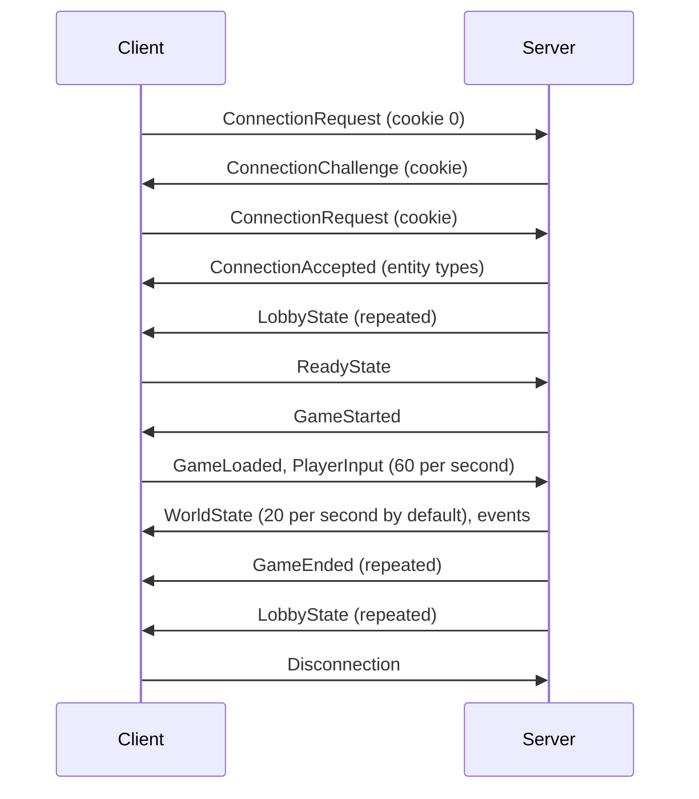

import ByteLayout from '../../components/ByteLayout.astro';

This page is the specification of the protocol the client and the server speak: the format of every datagram and message, the values each field takes, the order of the exchanges from the connection to the end of a game and the departure or the crash of a peer, and what each side does with what it cannot accept. A developer who follows it can write a client for this server, or a server for this client, without reading the code.

## Status of this document

- This is version 6 of the protocol. It is the only version the code speaks; [Version 3](#version-3), [Version 4](#version-4), [Version 5](#version-5) and [Version 6](#version-6) say what each changed from the version before, and what the rest of the second part of the project will change.
- The words MUST, MUST NOT, SHOULD and MAY are used as in RFC 2119. A MUST is a rule every implementation follows to interoperate; a SHOULD names a behavior the code of this repository has and another implementation can drop without breaking the exchange.
- Everything on this page is checked against the code of `src/network`, `src/server` and `src/client`. [Implementation status](#implementation-status) lists the rules the programs do not apply yet, so a rule never reads as working when it does not.
- Numbers are decimal unless written `0x`. A size is in bytes.

## Overview

The client and the server exchange datagrams over UDP. A client asks to join, the server admits it to a waiting room, starts the game once every connected player is ready, then sends the state of the world about 20 times per second while the client sends the keys held 60 times per second. The sections below follow that order: [Transport](#transport) and [Encoding](#encoding) fix the bytes, [Datagram](#datagram) the header and the checks, [Messages](#messages) every message, [A session](#a-session) the exchanges and their timing, [Errors](#errors) and [Losses](#losses) what goes wrong.

## Transport

- Every message of the game travels over UDP; no TCP connection is opened.
- The server listens on one port. The client sends from any port, and the server answers to the address and port the datagram came from.
- A datagram carries at most 1200 bytes of UDP payload. Every IPv6 link carries packets of 1280 bytes or more (RFC 8200, section 5); minus the 40-byte IPv6 header and the 8-byte UDP header, that leaves 1232 bytes, so 1200 keeps room for 32 bytes of IPv6 extension headers. QUIC relies on the same figure and expects it to pass on all IPv6 paths and on modern IPv4 paths (RFC 9000, section 14). A path with a smaller MTU, such as some VPNs and tunnels, may still fragment or drop a datagram; the protocol does not detect it.
- A datagram is read on its own: no message is split across two datagrams.

## Encoding

Each field is written and read one at a time, never copied from memory as a struct, so neither padding nor the byte order of the machine reaches the wire. Integers are big-endian, the order the IP and UDP headers use for their own fields, so a number reads in a capture the way it is written: `protocolId` shows as `52 54 59 50`.

| Type | Size | Encoding |
|---|---|---|
| `u8`, `u16`, `u32`, `u64` | 1, 2, 4, 8 bytes | unsigned, big-endian (most significant byte first) |
| `bool` | 1 byte | 0 is false, 1 is true, any other value is invalid |
| `position` | 4 bytes | x then y, each a signed 16-bit integer (two's complement, big-endian) counting eighths of a logical unit |
| `string` | 1 + n bytes | length `u8`, then n bytes of UTF-8, no terminator |
| enumeration | 1 byte | `u8`; a value not listed on this page is invalid |

### Positions

A position is in logical units, in the frame described in [Architecture](/R-Type/architecture/#coordinate-system). Each coordinate is rounded to the nearest eighth of a unit: 8 on the wire is 1 unit, -8 is -1 unit. The range is -4096 to 4095.875 units and the rounding error is at most 0.0625 unit; every multiple of an eighth survives the round trip through a `float` exactly.

- The range holds the playfield plus one playfield size beyond each edge as long as `PLAYFIELD_WIDTH` and `PLAYFIELD_HEIGHT` stay at or below 2047 units. The code must check this at compile time, so enlarging the playfield breaks the build instead of sending positions to the opposite edge.
- The server must destroy an entity before it leaves the range: a coordinate outside it is a bug. As a last resort, so that a coordinate never wraps to the opposite edge, the encoder clamps it to the nearest end of the range; this hides nothing from the server, which must still not let an entity get there.

## Datagram

A datagram is a 22-byte header followed by one or more messages. The header, byte by byte; every field is used in version 6.

<ByteLayout
  label="The 22-byte header: protocolId on bytes 0 to 3, version on byte 4, flags on byte 5, sessionToken on bytes 6 to 13, sequence on bytes 14 and 15, acknowledgedSequence on bytes 16 and 17, acknowledgementBits on bytes 18 to 21."
  rows={[
    {
      fields: [
        { name: 'protocolId', bytes: 4, tone: 'blue' },
        { name: 'version', bytes: 1, tone: 'blue' },
        { name: 'flags', bytes: 1, tone: 'blue' },
        { name: 'sessionToken', bytes: 8, tone: 'blue' },
      ],
    },
    {
      fields: [
        { name: 'sequence', bytes: 2, tone: 'blue' },
        { name: 'acknowledgedSequence', bytes: 2, tone: 'blue' },
        { name: 'acknowledgementBits', bytes: 4, tone: 'blue' },
      ],
    },
  ]}
/>

| Offset | Size | Field | In version 6 |
|---|---|---|---|
| 0 | 4 | `protocolId` | `0x52545950`, `RTYP` in ASCII |
| 4 | 1 | `version` | 5 |
| 5 | 1 | `flags` | `ACKNOWLEDGES` 0x01, `GUARANTEED` 0x02, `COMPRESSED` 0x04, every other bit 0 |
| 6 | 8 | `sessionToken` | 0 until the connection is accepted, then the token given by the server |
| 14 | 2 | `sequence` | number of the datagram for its sender |
| 16 | 2 | `acknowledgedSequence` | the newest sequence accepted from the peer, when `ACKNOWLEDGES` is set |
| 18 | 4 | `acknowledgementBits` | bit n set: the datagram n + 1 before `acknowledgedSequence` was accepted too |

Each message is a type (`u8`), the size of its payload in bytes (`u16`, the 3 bytes of type and size excluded), then the payload. A receiver accepts several messages in one datagram and reads them in order; the server groups in one datagram the guaranteed messages it sends again (see [Guaranteed messages](#guaranteed-messages)).

- `protocolId` and `version` stay at offsets 0 and 4 in every future version, so a receiver tells which version sent a datagram from its first 5 bytes.
- `sessionToken` is drawn at random by the server when it accepts a connection, never 0. The server writes it in every datagram it sends to that client, and the client copies it into every datagram it sends afterward. Within a session, each side drops and counts a datagram that carries another token, so nobody can steer a ship, or feed a client false states, by forging an address. A `ConnectionRequest` carries 0, since the client has no token yet: it never keeps a session alive, and it only gets a player slot with a valid cookie (see [Connection](#connection)).
- `sequence` counts the datagrams a side sends to the other: one counter per peer, starting at 0 with the first datagram to that peer, growing by 1 and wrapping from 65535 to 0. Within a session, a receiver drops a datagram that is not newer than the newest one it has accepted from that peer, so a late or duplicated datagram never undoes a newer one. Newer means ahead by 1 to 32767 modulo 65536 (serial number arithmetic, RFC 1982), so the comparison survives the wrap. Datagrams sent outside a session (`ConnectionChallenge`, `ConnectionRefused`, `ServerInformationRequest`, `ServerInformation`) carry 0 and are not compared.
- `flags`: `ACKNOWLEDGES` (0x01) says that `acknowledgedSequence` and `acknowledgementBits` name the datagrams the sender accepted from its peer within the session; a side sets it from the first datagram it accepted. `GUARANTEED` (0x02) says that the datagram holds guaranteed messages (see [Guaranteed messages](#guaranteed-messages)). `COMPRESSED` (0x04) says that the body is a zstd frame (see [Compression](#compression)). The other five bits are 0.
- `acknowledgedSequence` is the newest sequence the sender accepted from its peer, and bit n of `acknowledgementBits` (bit 0 the least significant) is set when the datagram n + 1 before it was accepted too, so a header names the 33 newest datagrams. A datagram dropped for its sequence, late or duplicated, is never acknowledged.

Version 1 reserved these fields, so version 2 guarantees messages without moving a field of any datagram. The header costs 17 bytes per datagram more than a 5-byte header: about 11 kbit/s per client at 60 inputs and 20 states per second.

Alternative considered: a 5-byte header (`protocolId`, `version`) and a later version that adds the rest. It is smaller, but the token checked from the first version needs its 8 bytes anyway, and adding the sequence and the acknowledgements in the middle of the project changes the layout of every datagram (they live in `Sessions` and `Reliability`, see [Project layout](/R-Type/project-layout/#network)).

### Receiving a datagram

A received datagram goes through these checks in order. No buffer is sized from a field before that field has been checked against the bytes actually received, and every rejection is logged with its sender, at a bounded rate.

| Check | If it fails |
|---|---|
| The datagram holds 25 to 1200 bytes | dropped |
| `protocolId` is `RTYP` | dropped |
| `version` is 6 | dropped; the server answers an unknown sender with `ConnectionRefused` (`IncompatibleVersion`) if the datagram holds at least 26 bytes |
| `COMPRESSED` is set | the server drops the datagram; the client decodes the body and clears the flag, or drops the datagram when it cannot (see [Compression](#compression)) |
| `flags` has no bit but `ACKNOWLEDGES` and `GUARANTEED`, once `COMPRESSED` is cleared | dropped |
| The message sizes add up exactly to the end of the datagram | dropped |
| The sender is known, or the datagram holds a `ConnectionRequest` or a `ServerInformationRequest` | dropped |
| Within a session, `sessionToken` is the token of the session (a `ConnectionRequest` or a `ServerInformationRequest` may carry 0) | dropped and counted |
| Within a session, `sequence` is newer than the newest one accepted from that peer | dropped |
| The message type is listed below | that message is skipped, the next one is read |
| The payload has the size its type requires and every value is in range | that message is dropped |

The token is checked before the sequence, so a forged datagram never moves the counter. The server reads the acknowledgements of a datagram only once it passed every check above, so a forged or replayed datagram acknowledges nothing. A datagram dropped for its sequence is not heard from the peer: it does not restart the silence count of [A session](#a-session).

The server measures the loss rate of each player from the gaps in `sequence`. Each datagram it accepts counts as received, and the sequences it skips over count as lost; every 100 datagrams counted, received or lost, it takes the share lost as the loss rate of that player and starts counting again. A datagram that arrives late and is dropped stays counted as lost. Nothing is added to the wire. The server never sends a sender that did not prove its address more bytes than the datagram it answers, so a forged source address cannot turn it into an amplifier: a `ConnectionRequest` holds at least 35 bytes, and every answer to a request without a valid cookie at most 33 (`ConnectionChallenge`). Only a request with a valid cookie gets a `ConnectionAccepted`, which may be larger (see [Connection](#connection)). A `ServerInformationRequest` is padded to 106 bytes, and its answer holds at most 106 (see [Server information](#server-information)). A client that receives a datagram of another version decodes nothing in it. While it connects to the server that sent it, it ends the attempt and reports both version numbers to the player: its own, and the one at offset 4; within a session it drops it, so a datagram forged with the address of the server cannot end the session.

## Messages

The type identifies a message in both directions: `Disconnection` and `Heartbeat` appear in both tables with the same number.

### Client to server

| Type | Message | Payload | Sent |
|---|---|---|---|
| 1 | `ConnectionRequest` | `cookie` `u64` (0 until the server gives one), `nickname` `string` (1 to 16 bytes) | every 500 ms until an answer; the client gives up after 5 s |
| 4 | `Disconnection` | none | when the player closes the client, three times 50 ms apart |
| 5 | `Heartbeat` | `sentAt` `u32`, `echoes` `bool`, `echo.sentAt` `u32`, `echo.heldFor` `u32`, `ticks` `bool` (always 0), `tick` `u32` (always 0) (see [Round trip](#round-trip) and [Clock of the server](#clock-of-the-server)) | every 500 ms, whatever else it sends; the client also 40 ms after accepting a datagram that holds guaranteed messages when nothing else was sent |
| 6 | `ReadyState` | `ready` `bool` | when the player changes it, and again while `LobbyState` shows another value |
| 9 | `PlayerInput` | `inputNumber` `u32`, `actions` `u8`, `earlierCount` `u8`, then `earlierCount` times `actions` `u8` | 60 times per second during a game |
| 17 | `GameLoaded` | none | with a `PlayerInput`, at most every 100 ms, from the first one after `GameStarted` until the first state (`WorldState` or `DeltaWorldState`) arrives |
| 18 | `LeaderboardRequest` | `playerCount` `u8` (1 to 4), `difficulty` `string` | when the player opens or changes a leaderboard, then every 500 ms until an answer; the client gives up after 5 s |
| 23 | `ServerInformationRequest` | `sentAt` `u32`, then `padding`, 77 bytes of 0 (see [Server information](#server-information)) | by anyone, outside any session, to learn what a server is and its round trip: a client that lists the servers, the master that checks a server answers |

### Server to client

| Type | Message | Payload | Sent |
|---|---|---|---|
| 2 | `ConnectionAccepted` | `playerNumber` `u8` (1 to 4), `typeCount` `u8` (1 to 32), then per type `side` `u8`: 1 `Player`, 2 `Enemy`, 3 `PlayerMissile`, 4 `EnemyMissile`, and `name` `string` (1 to 24 bytes); see [Entity types](#entity-types) | in answer to a request with a valid cookie; its header carries the session token; to a connected player, again at most once per 250 ms |
| 3 | `ConnectionRefused` | `reason` `u8`: 1 `GameFull`, 2 `GameInProgress`, 3 `IncompatibleVersion`, 4 `NicknameTaken` | in answer to a request |
| 4 | `Disconnection` | none | when the server shuts down, three times 50 ms apart |
| 5 | `Heartbeat` | `sentAt` `u32`, `echoes` `bool`, `echo.sentAt` `u32`, `echo.heldFor` `u32`, `ticks` `bool`, `tick` `u32` (see [Round trip](#round-trip) and [Clock of the server](#clock-of-the-server)) | every 500 ms, whatever else it sends; `ticks` is 1 only while a game is in progress |
| 7 | `LobbyState` | `playerCount` `u8`, then per player `playerNumber` `u8`, `ready` `bool`, `nickname` `string` | on every change, and at least every 500 ms while no game runs |
| 8 | `GameStarted` | none | when every connected player is ready, then every 500 ms to the players that did not send `GameLoaded` yet |
| 10 | `WorldState` | see [World state](#world-state) | not sent by the server since `DeltaWorldState`; a client still reads it |
| 11 | `EntitySpawned` | `entityId` `u32`, `entityType` `u8` (a number of the [entity types](#entity-types)), `position` | when an entity appears; the ship of a player, when the player is accepted; the ship of a player again, when it comes back after a hit; a Bydo, every time one appears; a missile, every time one is fired |
| 12 | `EntityDestroyed` | `entityId` `u32`, `reason` `u8`: 1 `Killed` (explosion), 2 `Removed` (no effect) | when an entity disappears, guaranteed (see [Guaranteed messages](#guaranteed-messages)) |
| 13 | `GameEvent` | `eventNumber` `u16`, `kind` `u8`, `playerNumber` `u8`, `entityId` `u32` | see [Game events](#game-events), guaranteed |
| 14 | `PlayerLeft` | `playerNumber` `u8`, `reason` `u8`: 1 `Left`, 2 `TimedOut` | to the other players, when one leaves or times out, guaranteed |
| 15 | `GameEnded` | `outcome` `u8`: 1 `Victory`, 2 `Defeat`, then `playerCount` `u8`, then per player `playerNumber` `u8`, `score` `u32` | when the game ends: `Victory` once the players beat the last wave of the level, `Defeat` when no player has a life left; then every 500 ms until the server waits for players again |
| 16 | `ConnectionChallenge` | `cookie` `u64` | in answer to a request without a valid cookie |
| 19 | `LeaderboardAnswer` | `playerCount` `u8`, `difficulty` `string`, `rowCount` `u8` (0 to 10), then per row `rank` `u32`, `score` `u32`, `playedAt` `i64` (seconds since 1970 UTC), `nickname` `string`; then `hasOwnRow` `bool`, followed by one row when true | in answer to a request, to the player who sent it, at most once per 500 ms per player |
| 20 | `DeltaWorldState` | see [Delta world state](#delta-world-state) | during a game, as many times per second as the server was told to (20 by default, from 2 to 60) |
| 21 | `RoundTrips` | `playerCount` `u8`, then per player `playerNumber` `u8`, `roundTrip` `u32`, `jitter` `u32`, in microseconds | right after each `Heartbeat` of the server (see [Round trip](#round-trip)) |
| 22 | `EnemyAction` | `entityId` `u32`, `attack` `u8`, `phase` `u8`: 1 `Signal`, 2 `Strike`, 3 `Recover`, 4 `Enraged` | when an enemy enters a step of one of its attacks, guaranteed (see [Guaranteed messages](#guaranteed-messages)) |
| 24 | `ServerInformation` | `sentAt` `u32`, `heldFor` `u32`, `protocolVersion` `u8`, `gameVersion` `string`, `name` `string`, `playerCount` `u16`, `gameCount` `u16`, `freeSeatCount` `u16` | in answer to a `ServerInformationRequest`, to its sender, outside any session (see [Server information](#server-information)) |

### Payload rules

A message is accepted only when its payload has exactly the size its fields add up to, with no byte left over, and every value is in range. These rules complete the tables above; a message that breaks one is dropped (see [Errors](#errors)).

| Message | Rule |
|---|---|
| `ConnectionRequest` | the nickname follows the rules of [Connection](#connection): 1 to 16 bytes of valid UTF-8, no control character |
| `ConnectionAccepted` | `playerNumber` is 1 to 4; `typeCount` is 1 to 32, checked before any type is read; each `side` is 1 to 4; each `name` is 1 to 24 bytes of lowercase ASCII letters, digits and underscores |
| `LobbyState` | at most 4 players, each `playerNumber` 1 to 4 and listed once, each nickname valid as above |
| `GameEnded` | `outcome` is 1 or 2; at most 4 players, each `playerNumber` 1 to 4 and listed once |
| `WorldState` | at most 4 players, each `playerNumber` 1 to 4 and listed once; `motion` follows [World state](#world-state) |
| `EntitySpawned` | `entityId` is not 0, `entityType` is not 0 |
| `EntityDestroyed`, `PlayerLeft`, `ConnectionRefused` | `reason` is in the table of its message; `PlayerLeft` names a `playerNumber` of 1 to 4 |
| `GameEvent` | `kind` is in the table of [Game events](#game-events), and `playerNumber` and `entityId` are 0 or a valid value as that table says |
| `RoundTrips` | at most 4 players, each `playerNumber` 1 to 4 and listed once |
| `EnemyAction` | `entityId` is not 0, `phase` is in the table of its message; `attack` is any `u8`, since the sheet of the enemy gives it its meaning |
| `Heartbeat` | `echoes` and `ticks` are 0 or 1; when `echoes` is 0, `echo.sentAt` and `echo.heldFor` are 0; when `ticks` is 0, `tick` is 0 |
| `Disconnection`, `GameStarted` | the payload is empty |
| `LeaderboardRequest` | `playerCount` is 1 to 4; `difficulty` follows the rules of a nickname: 1 to 16 bytes of valid UTF-8, no control character |
| `LeaderboardAnswer` | as `LeaderboardRequest` for its first two fields; at most 10 rows; each `rank` is at least 1 and each nickname is valid |
| `ServerInformationRequest` | the payload is 81 bytes: `sentAt`, then 77 bytes of 0; a shorter or longer one, or a byte of `padding` other than 0, is invalid |
| `ServerInformation` | `gameVersion` and `name` are 1 to 32 bytes of valid UTF-8, no control character; `playerCount` is at most 4 times `gameCount`, and `playerCount` plus `freeSeatCount` too |

A `LobbyState` or a `GameEnded` with no player is well formed; a `WorldState` too, while the game has none. A `LeaderboardAnswer` with no row is well formed.

### Leaderboard

A leaderboard belongs to one server, one difficulty and one number of players at the start of a game: two difficulties never mix. Each player appears once, with their best score. Equal scores share a rank and the next rank skips (1, 1, 3); among them, the earliest game comes first. The player who asks gets their own row whether or not it is among the 10 listed, so it may appear twice. A guest is recognized by nickname, with no proof that it is the same person.

The server reads a request only from a player with a session, in any state of the game: it drops one from any other sender before reading it, so an answer larger than its request never goes to an unverified address. It answers a player at most once per 500 ms and ignores the other requests.

### Server information

Anyone may ask a server what it is, without a session: a client measures its ping to the servers the player looks at this way, the one selected or those of the page shown, never every server of the list, whose information comes from the master; and the master checks that a server still answers. A `ServerInformationRequest` carries `sentAt`, the time it leaves on the clock of its sender, in microseconds modulo 2^32, as a `Heartbeat` does (see [Round trip](#round-trip)), with a session token and a `sequence` of 0. The server keeps nothing and answers with one `ServerInformation`, to the address and port the request came from:

| Field | Holds |
|---|---|
| `sentAt` | the `sentAt` of the request, unchanged |
| `heldFor` | the microseconds from the arrival of the request to the answer |
| `protocolVersion` | the version the server speaks, the one at offset 4 of its header |
| `gameVersion` | the version of the game it runs, such as `0.1.0` |
| `name` | the name players read in the list of servers |
| `playerCount` | the players seated in its games, away ones included |
| `gameCount` | the games it hosts, whatever their state |
| `freeSeatCount` | the empty seats of the games that wait for players: a game that started gives none |

The asker reads the round trip as the time since the request left, less `heldFor`, both on its own clock, so the time the request waited in the server for its tick is left out; an answer held longer than its trip, or back after more than 20 s, gives none.

- The request is padded with 77 bytes of 0, so its datagram holds 106 bytes, the size of the largest answer, with a name and a game version of 32 bytes. A forged source address never gets more bytes than its forger sent, as QUIC pads its first datagram (RFC 9000, section 8.1). A request of another size is dropped without an answer.
- A datagram gets one answer, to its first `ServerInformationRequest`; one that also holds a `ConnectionRequest` is answered as a connection request only.
- The requests spend the limit of the connection requests of their address and port: one sender places 11 requests of either kind at once, then 4 a second (see [A sender that sends too much](#a-sender-that-sends-too-much)).
- Nothing on this page sends a request again: an asker that gets no answer asks again when it chooses.

### Connection

A connection takes two round trips, so that a forged address never gets a player slot. The client sends `ConnectionRequest` with `cookie` 0; the server answers `ConnectionChallenge` with a cookie and keeps nothing. The client sends its request again with that cookie, and only then does the server give a slot, a token and the [entity types](#entity-types) of the server. The cookie only reaches the real owner of the address, so whoever forges the address cannot send it back. A request with a wrong or expired cookie gets a new challenge; a refusal (`GameFull`, `GameInProgress`, `NicknameTaken`, `IncompatibleVersion`) may be sent at once, since it reserves nothing.

How the server computes the cookie is its own business, as long as it keeps nothing per request and nobody can guess it: a keyed hash of the address, the port and the current 10-second window, with a secret drawn when the server starts, accepted during its window and the next one, does both.

A player keeps the number given by `ConnectionAccepted` until it leaves; the number also picks the color of the player, so no color travels. The nickname travels only in `ConnectionRequest` and `LobbyState`, never during a game. Its limit is 16 bytes, not 16 characters: a letter without accent takes 1 byte, an accented letter 2 and some symbols up to 4, so each accent leaves room for one letter less. The text field of the client counts bytes and refuses a character that would not fit whole; the server drops a request whose nickname is empty, longer than 16 bytes, not valid UTF-8 or holds a control character, U+0000 to U+001F or U+007F, so a nickname can never start a line of its own in a log. The server answers a `ConnectionRequest` with a valid cookie from a sender it already accepted with the same `ConnectionAccepted` again, same number, same token and same table, at most once per 250 ms per player (half the 500 ms between two requests, so a request whose acceptance was lost is not held back because it crossed the network faster than the one before); the requests in between get nothing.

A sender that did not prove its address, that is whose request carries no valid cookie, never gets more bytes than it sent: a challenge (33 bytes) is smaller than the smallest request (35), and so is a refusal (26). Only a request with a valid cookie gets a `ConnectionAccepted`, which carries the table of the entity types and may reach 859 bytes: the cookie went to the address the request came from, so the acceptance goes to an address that proved it receives the datagrams of the server. QUIC lifts its own limit on what it sends an address once it has validated that address the same way (RFC 9000, section 8). Whoever sees the traffic of a player and replays its cookie gets at most four acceptances per second sent to that player, for the 20 s at most that the cookie stays valid.

A nickname is unique on the server: a request whose nickname a player already holds is refused with `NicknameTaken`, before the cookie is checked. Letters of the ASCII alphabet compare without regard to case (`Ace` and `ACE` are the same nickname), every other byte compares as it is, so `É` and `é` are two nicknames. A player whose seat is held (see [A session](#a-session)) still holds its nickname; it is free again once the seat is. A sender already accepted is not refused as a duplicate of itself.

### Entity types

A type is named by the sheet it is read from (`assets/entities/drifter.toml` is `drifter`, see [Writing an entity sheet](/R-Type/entity-sheets/)), never by a number fixed in the code. The server numbers the sheets it loaded in the order of their names, from 1, and keeps those numbers while it runs; `ConnectionAccepted` lists them, and `EntitySpawned`, `WorldState` and `DeltaWorldState` carry them. The number of a type is its place in that list: the first entry is type 1, and 0 names no type. The side says what an entity of that type is, so a receiver knows who it hits and how to draw it without the gameplay of the sheet.

The payload of the `ConnectionAccepted` of player 1 on a server of the five sheets the game ships, byte by byte:

| Bytes | Field | Value |
|---|---|---|
| 0 | `playerNumber` | 1 |
| 1 | `typeCount` | 5 |
| 2 | `side` of type 1 | 2 (`Enemy`) |
| 3 to 10 | `name` of type 1 | 7, then `drifter` |
| 11 | `side` of type 2 | 4 (`EnemyMissile`) |
| 12 to 25 | `name` of type 2 | 13, then `enemy_missile` |
| 26 | `side` of type 3 | 3 (`PlayerMissile`) |
| 27 to 41 | `name` of type 3 | 14, then `player_missile` |
| 42 | `side` of type 4 | 1 (`Player`) |
| 43 to 47 | `name` of type 4 | 4, then `ship` |
| 48 | `side` of type 5 | 2 (`Enemy`) |
| 49 to 55 | `name` of type 5 | 6, then `weaver` |

With its header and its message prefix, that acceptance takes 81 bytes. The largest one takes 22 + 3 + 1 + 1 + 32 × (1 + 1 + 24) = 859 bytes, so it always fits one datagram.

A player who is accepted holds the table: the request the client sends again every 500 ms until it is answered delivers it as it delivers the acceptance, so no session can reach the waiting room without it. The client keeps the table of the first acceptance of its session; a repeated acceptance changes nothing. A client that has no sheet for a name of the table opens no session: it sends its `Disconnection` with the token of that acceptance, three times, as when a player leaves, so the server frees the seat at once, and it tells the player (see [Joining fails](#joining-fails)). A number a state carries that the table does not hold, past its last entry, names nothing the client can draw: the client creates nothing for it.

Alternative considered: a request and an answer of their own once the session opens. It keeps `ConnectionAccepted` small, but needs two messages, a desk on the server and a watch on the client, and a game could start before the answer arrived.

Alternative considered: a hash of the name in each entity instead of a table. It needs nothing at the connection, but two names can give the same hash, and the side of a type would have no place to travel.

### Inputs

`actions` holds one bit per action, bit 0 being the least significant: 0 up, 1 down, 2 left, 3 right, 4 shoot. Bits 5 to 7 are 0, otherwise the message is invalid. A `PlayerInput` is sent even when no key is held (`actions` is 0). `inputNumber` starts at 1 and grows by 1 for each input sent.

A `PlayerInput` also repeats the inputs the server has not confirmed, so the loss of one datagram loses no input. `actions` is the newest input, numbered `inputNumber`; the `earlierCount` actions after it are those of the inputs numbered `inputNumber - 1`, `inputNumber - 2` and so on, newest first. `earlierCount` is at most 15 (`MAXIMUM_REPEATED_INPUTS`, **provisional**: 250 ms at 60 inputs per second, the time between two `WorldState` that confirm inputs plus a round trip, to be revised once measured on a real network) and never reaches below input 1: a message that announces more, or whose earliest input would be numbered 0 or less, is invalid. A sender repeats every input it sent that the server did not confirm, up to that limit; the server confirms an input in `acknowledgedInput` of `WorldState` (see [World state](#world-state)), which is the newest input it applied, so a client forgets the inputs numbered up to that value. Before any confirmation arrives, a sender repeats the 15 inputs before the newest.

The server keeps, for each player, the highest `inputNumber` it has seen. It reads a message from the oldest input to the newest and takes each one whose number is higher than that, so an input lost on its way is taken from the next message, once and in order, and one it already has changes nothing. It applies the newest input at every tick of a game in progress until a newer one arrives, and ignores an older one that arrives late.

### World state

`WorldState` lists every player and every entity of the game, in full each time. The payload of a state with one player and one entity, byte by byte:

<ByteLayout
  label="A WorldState with one player and one entity: tick on bytes 0 to 3, playerCount on byte 4, the player on bytes 5 to 20 (playerNumber, shipEntityId, lives, score, invulnerable, motion, acknowledgedInput), entityCount on byte 21, the entity on bytes 22 to 30 (entityId, entityType, x, y)."
  rows={[
    {
      fields: [
        { name: 'tick', bytes: 4, tone: 'purple' },
        { name: 'playerCount', bytes: 1, tone: 'gray' },
      ],
    },
    {
      fields: [
        { name: 'playerNumber', bytes: 1, tone: 'blue' },
        { name: 'shipEntityId', bytes: 4, tone: 'blue' },
        { name: 'lives', bytes: 1, tone: 'blue' },
        { name: 'score', bytes: 4, tone: 'blue' },
        { name: 'invulnerable', bytes: 1, tone: 'blue' },
        { name: 'motion', bytes: 1, tone: 'blue' },
        { name: 'acknowledgedInput', bytes: 4, tone: 'blue' },
      ],
      note: 'One player, repeated playerCount times.',
    },
    {
      fields: [{ name: 'entityCount', bytes: 1, tone: 'gray' }],
    },
    {
      fields: [
        { name: 'entityId', bytes: 4, tone: 'green' },
        { name: 'entityType', bytes: 1, tone: 'green' },
        { name: 'x', bytes: 2, tone: 'green' },
        { name: 'y', bytes: 2, tone: 'green' },
      ],
      note: 'One entity, repeated entityCount times.',
    },
  ]}
/>

| Field | Type |
|---|---|
| `tick` | `u32`, the simulation tick of the server, counted from the start of the game |
| `playerCount` | `u8` (1 to 4) |
| each player | `playerNumber` `u8`, `shipEntityId` `u32` (0 while the player has no ship), `lives` `u8`, `score` `u32`, `invulnerable` `bool`, `motion` `u8`, `acknowledgedInput` `u32` |
| `entityCount` | `u8` |
| each entity | `entityId` `u32`, `entityType` `u8`, `position` |

`motion` says what the pilot does, one bit each from bit 0: the directions its newest `PlayerInput` holds, at their bits of `actions` (0 up, 1 down, 2 left, 3 right), then 4 its ship rolls, 5 its ship dashes. Bits 6 and 7 are 0, otherwise the message is invalid. `acknowledgedInput` is the `inputNumber` of the newest `PlayerInput` the server applied to the ship of the player, 0 while it applied none (an input the server holds before applying it is not confirmed yet, so the ship it reads is never ahead of the number): a client that predicts its own ship drops the inputs up to it and replays the others on top of the position it reads (see [Client](/R-Type/client/#own-ship-prediction-ownshippredictor-shipprediction)). The field was added to version 1 without changing `PROTOCOL_VERSION`, so two builds of version 1 may misread each other's states; version 2 has it from the start, so two programs of version 2 read the same states. A player takes 16 bytes and an entity 9, so one datagram holds up to 122 entities with 4 players. When the entities do not fit, the server sends several `WorldState` with the same `tick`, each in its own datagram, each with every player and a part of the entities. The client:

- ignores a `WorldState` whose `tick` is lower than the last one applied; an equal `tick` is another part of the same state. The `tick` is compared as a plain 32-bit integer, without wrap-around: it takes 2.27 years at 60 ticks per second to reach 2³². The sender checks come first, so a forged datagram cannot raise the last `tick` applied;
- creates an entity it does not know, from its type, with its appearance effect (the shot sound of a missile, for instance);
- removes an entity that no `WorldState` has listed for 900 ms, counted on the `tick` of the states. A state may come in several parts, and a later part may list an entity an earlier one left out, so a tick counts only once a part of a newer tick closes it: no later part of it is applied, and a lost part never comes. The entity goes when the tick 54 ticks or more past the last one that listed it is closed. With none lost, a ghost goes when the first state after the first state whose tick is 54 ticks or more past its last listing arrives: 950 ms after that listing at the default 20 states per second, 1000 ms at 10, 1500 ms at the lowest rate of 2. While no state arrives, nothing is removed.

An `EntityDestroyed` naming an entity the client does not know, and an `EntitySpawned` naming one it already has, change nothing.

Measured on October 24, 2026, before `acknowledgedInput` added 4 bytes per player, on a local game of two players lasting about 70 seconds (a `tcpdump` capture of the server port): each player received 20.0 `WorldState` per second, each state in a single datagram of 105 bytes of UDP payload on average and 116 at most, for 6 entities on average. That is about 2.1 kB per second and per player for the states alone. The players could not shoot yet, so the game held only ships and Bydos: a game with missiles sends larger states.

`entityId` is given by the server, unique during a game, and never 0. A `u16` would wrap after about 22 minutes at 50 new entities per second, hence 32 bits.

`entityType` is the number of a type in the table of the `ConnectionAccepted` of the session (see [Entity types](#entity-types)). A `WorldState` or a `DeltaWorldState` may carry any number from 1 to 255: a state is read the same in every session, and what a number names is for the client to look up. An entity of type 0, which no type has, is skipped: it is left out of the state, and the other entities of the same `WorldState` are read. An entity takes 9 bytes whatever its type, so the next one starts where it should. A new kind of entity is a new sheet, and changes nothing on this page.

### Delta world state

`DeltaWorldState` is the state the server sends during a game: the same picture as a `WorldState`, written as the difference from an earlier state the player acknowledged, so an entity that did not move costs nothing. Its fixed part is 10 bytes, then the players and the two lists:

| Field | Type |
|---|---|
| `tick` | `u32`, as in a `WorldState` |
| `baseDistance` | `u8`, 0 to 60: how many ticks back the reference state was taken; 0 means no reference, and `changed` then lists every entity |
| `partIndex`, `partCount` | `u8` each: this datagram is part `partIndex` (from 0) of `partCount` (1 to 16) |
| players | `playerCount` `u8`, then each player as in a `WorldState`; every part lists them all |
| `changed` | `changedCount` `u8`, then each entity as in a `WorldState` (9 bytes): the entities the reference lacks, or whose position, rounded to an eighth of a unit, differs from it |
| `removed` | `removedCount` `u8`, then one `entityId` `u32` each: the entities the reference lists and this state does not |

The server keeps, for each player, the states it sent and the datagram sequence of each part. A state is acknowledged once the datagram of every one of its parts is, which the player says in the `acknowledgedSequence` and `acknowledgementBits` of its own datagrams (see [Datagram](#datagram)); the client acknowledges every datagram it accepts, so no message is added. The server writes a state against the newest state the player acknowledged, as long as it is 1 to 60 ticks older than the one it sends (1 s), and in full, with `baseDistance` 0, otherwise: the first state of a game, and the first after a second without an acknowledged state. It sends a delta even when nothing changed, with both lists empty, so the player keeps acknowledging. A state needing more than 16 datagrams is not sent, and the server logs an error.

The client:

- joins the parts of a tick, which may arrive in any order, and counts each part once. A part of a newer tick ends the wait for the parts missing from an older one, which the session refuses once a newer datagram was accepted, so they never come;
- writes the lists onto the state `baseDistance` ticks back, which it keeps for the last 60 states it rebuilt, and gives the rest of the client the full state, so everything after this point reads a state as it reads a `WorldState`: the rules of [World state](#world-state) above apply to the rebuilt state;
- drops a state whose reference it does not hold, with a warning. This does not happen while it accepts datagrams in order, since it keeps every state it rebuilds and the server only uses a reference whose every part the client accepted;
- forgets everything when the `tick` goes back, which is a game that started over.

Measured by `DeltaMeasurementTest` (`tests/server/Replication/Announcements/Streams/`), on ten seconds of a game with one player and 30 enemies, the player acknowledging every state at once, 20 states per second. A state in full takes 321 bytes with the headers, so states in full cost 6420 bytes per second:

| Enemies that move at every tick | Bytes per second to the player | Share of a state in full |
|---|---|---|
| 0 of 30 | 1047 | 16 % |
| 15 of 30 | 3733 | 58 % |
| 30 of 30 | 6420 | 100 % |

The gain comes only from the entities whose position did not change in the last state: an entity that moves costs 9 bytes in a delta as in a full state, so a game where everything moves at every state gains nothing, and one where half of the entities stand still saves about 40 %. `DeltaConvergenceTest` plays ten seconds over a network that loses one datagram in three and thirty in a row: every state the client rebuilds is the world at its tick, and the states after the outage are in full again.

### Game events

A `GameEvent` drives sounds and effects on the client, never a game rule. `eventNumber` starts at 1 for each game and grows by 1 for each event, wrapping from 65535 to 0; a copy sent again carries the same number.

| `kind` | Event | `playerNumber` | `entityId` |
|---|---|---|---|
| 1 | `EntityDamaged`: hit, still alive | 0 | the entity |
| 2 | `PlayerHit`: the player lost a life | the player | 0 |
| 3 | `PlayerEliminated`: no life left, the player now watches | the player | 0 |

An `EntityDamaged` naming an entity the client does not know changes nothing. The explosion of a ship that is hit comes from its `EntityDestroyed` (`Killed`).

A shot has no event of its own: a missile appears through the `EntitySpawned` of a type of side `PlayerMissile` or `EnemyMissile`.

## A session

The messages of one session, from the connection to the end of a game:

In each phase the server repeats one message, and the client shows the screen of the last one it received, so a lost transition never leaves it on the wrong screen; the end screen is the one exception (below).

| Phase | Repeated message | The client shows |
|---|---|---|
| Waiting for players | `LobbyState`, every 500 ms | the lobby |
| Game in progress | `WorldState`, 20 per second by default | the game |
| Game ended | `GameEnded`, every 500 ms | the end screen |

The end screen stays until the player chooses, whatever the server sends after `GameEnded`: a player who plays again finds the waiting room, a player who quits leaves the server. Between `GameEnded` and the next `GameStarted`, the server must send no `WorldState`: the client reads a `WorldState` as the start of a game.

The server takes a `ReadyState` into account only in the first phase, from a connected player, with the same checks as every datagram: the session token, then the `sequence`. Once at least one player is connected and every connected player is ready, the server sends `GameStarted` and waits for the clients to show the game: the screen of a client that has the game assets to load is not ready on the tick the server sends it. A client that shows the game sends `GameLoaded` with its inputs, at most every 100 ms, until the first `WorldState` arrives. The game starts, and the first `WorldState` goes out, once every connected player that is not away has sent one, or after 10 s (`START_BARRIER_SECONDS`) without waiting any longer for the others. Until then the server sends no `WorldState`, and repeats `GameStarted` every 500 ms to the players not yet loaded. A `GameLoaded` outside this wait changes nothing. The message is new in version 1 and carries no field; a server that does not know it skips it as an unknown type.

Each side sends a `Heartbeat` every 500 ms, whatever else it sends, and the client one more to acknowledge guaranteed messages (see [Guaranteed messages](#guaranteed-messages)); any datagram that passes the checks above proves its sender is alive. A player the server has heard nothing from for `SESSION_TIMEOUT` (5 s) may only have lost the network for a moment. The server then marks the player away and keeps its seat, its token, its ship, its score and its lives for `RECONNECTION_GRACE` (15 s) more. The ship stays in the world and can be hit, but the input of the player is cleared and the player does not count when the waiting room checks that everyone is ready. Any datagram carrying the token, from the same address and port, ends the absence: the player is back, nothing was lost, and a new `SESSION_TIMEOUT` starts. A player not heard from for `SESSION_TIMEOUT` plus `RECONNECTION_GRACE` (20 s) loses its seat: the server closes the session, removes the ship and sends `PlayerLeft` (`TimedOut`) to the others, only then. A client that comes back from another address or port is an unknown sender and starts again from the first request. The client keeps its session, and keeps sending its `Heartbeat`, for the same 20 s without a datagram from the server, then closes it and must tell the player that the connection is lost. A `Disconnection` frees the place at once, and the others get `PlayerLeft` (`Left`).

## Round trip

Each side measures the round trip of the session from the `Heartbeat`s, without a clock shared with its peer. A `Heartbeat` carries `sentAt`, the time it leaves on the clock of its sender, in microseconds modulo 2^32, and the echo of the newest `Heartbeat` its sender received: that one's `sentAt`, unchanged, and `echo.heldFor`, the microseconds from its arrival to this sending. When an echo comes back, the round trip is the time since the echoed `Heartbeat` left, read on the clock of the side that sent it, less `echo.heldFor`. A receiver dates each datagram as its socket hands it over, so the time a datagram waits for the next frame or tick counts as held, and is left out. An echo that gives a round trip below 0 or above 20 s is ignored, and a `Heartbeat` received more than 20 s earlier is no longer echoed.

Each side smooths its round trips, each one moving the estimate by an eighth of its gap to it, and takes as the jitter the mean gap between two round trips in a row over the 16 newest, 8 s of `Heartbeat`s. Right after each of its `Heartbeat`s, the server sends the player `RoundTrips`: the smoothed round trip and the jitter, in microseconds, of each player of the game it measured; a player not measured yet is not listed.

## Clock of the server

The two machines share no clock, so a client cannot tell at which of its own instants the server was at a given tick. The `Heartbeat` of the server answers it: while a game is in progress, `ticks` is 1 and `tick` is the tick the server is simulating when it sends it, the tick of the `WorldState` it sends in the same tick; outside a game the tick stands still, so `ticks` is 0 and `tick` is 0. A client never sets them.

A client that receives such a `Heartbeat` in a session, together with a round trip that its echo closes, may place that tick on its own clock. The server sent it half a round trip before the datagram arrived, so tick 0 stood at the arrival time, less half the round trip, less `tick` ticks of 1/60 s. The client keeps the 8 newest estimates, follows the one with the shortest round trip, as the clock filter of NTP does ([RFC 5905](https://www.rfc-editor.org/rfc/rfc5905)): a datagram that waited in a queue has a long round trip and is left aside. It moves toward that estimate by an eighth of the gap at each estimate, and jumps onto it when the gap is more than 6 ticks, and when a `tick` is lower than the previous one, which is a new game. The estimate is exact when the two ways of the path last the same; a path whose ways differ by some time moves it by half of that time, and nothing in the protocol can tell. This is a rule of the client of this repository, not a requirement on the wire: the protocol only says what the two fields mean.

## Errors

This section gathers what each side does when something goes wrong, from a datagram it cannot read to a peer that disappears. Most rules are stated in the sections above, which the tables link to; the rest are stated here. Three rules hold for every case:

- Nothing in a datagram stops a program or closes a session: an error ends with a datagram or a message dropped, never with a crash.
- A dropped datagram or message gets no answer, with one exception: the server answers a datagram of another version from an unknown sender with `ConnectionRefused` (`IncompatibleVersion`), under the size condition of [Receiving a datagram](#receiving-a-datagram).
- A dropped datagram or message changes nothing in the session or the game: at most, the receiver logs it and counts it, and the server counts one dropped for its rate limit against its sender (see [A sender that sends too much](#a-sender-that-sends-too-much)).

### A datagram or a message that cannot be read

| The receiver gets | It | It sends back |
|---|---|---|
| A datagram that fails one of the first checks of [Receiving a datagram](#receiving-a-datagram): size, `protocolId`, `flags`, message sizes | drops the datagram | nothing |
| A datagram of another `version` | drops the datagram; a client connecting to the server that sent it ends the attempt and tells the player both version numbers, its own and the one at offset 4 | from the server to an unknown sender, `ConnectionRefused` (`IncompatibleVersion`), under the size condition of [Receiving a datagram](#receiving-a-datagram); otherwise nothing |
| A datagram from an unknown sender that holds neither a `ConnectionRequest` nor a `ServerInformationRequest` | drops the datagram | nothing |
| Within a session, another `sessionToken`, or a `sequence` that is not newer | drops the datagram; a wrong token is counted | nothing |
| A message of an unknown type | skips that message and reads the next one | nothing |
| A message of a type that only the other side receives, such as `ConnectionAccepted` reaching the server or `PlayerInput` reaching a client | skips that message, as if its type were unknown | nothing |
| A payload of the wrong size, or a value out of range: a `bool` other than 0 or 1, an enumeration value not listed, a bit 5 to 7 set in `actions`, a bit 6 or 7 set in `motion`, a nickname that is empty, longer than 16 bytes, not UTF-8 or holding a control character (U+0000 to U+001F, U+007F) | drops that message; the other messages of the datagram are read | nothing, even to a `ConnectionRequest` dropped this way |
| An entity of type 0 in a `WorldState` or a `DeltaWorldState` | skips that entity and reads the next one (see [World state](#world-state)) | nothing |
| An `EntitySpawned` or an entity of a state whose type the table of the session does not hold | the client creates nothing for it (see [Entity types](#entity-types)) | nothing |

### A sender that sends too much

The server limits what each sender may send, so that one sender cannot crowd out the others. After a silence, a sender may send a burst at once, then at a steady rate:

| Datagrams | At once | Then | Banned after |
|---|---|---|---|
| holding a `ConnectionRequest` or a `ServerInformationRequest`, whatever its token, or of another `version`, from one address and port | 11 | 4 a second | 20 dropped within a second |
| carrying the session token of a player, without a `ConnectionRequest` | 60 | 120 a second | 60 dropped within a second |

A datagram past its limit is dropped without an answer. A ban lasts 10 s: every datagram of that kind from that sender is dropped until then, and sending more does not lengthen it. A client that keeps to this page stays below these limits: it sends a request every 500 ms and the answer to each challenge, after a stall of the server the answers to the ten requests of its attempt at once, and 60 inputs a second during a game. The datagrams of a banned player never reach its session, so the server marks the player away after `SESSION_TIMEOUT` (5 s) and keeps its seat, since the ban ends before the 20 s that free it. Whoever uses the address of a player without its token never spends the limit of the player: a `ConnectionRequest` spends the limit of that address, and any other datagram is dropped before any limit. These values are **provisional**, and follow from the rates of this page: the server derives them from the interval between two requests, the 5 s of an attempt and the 60 inputs a second (`src/network/Handshake/RateLimit/RateLimitConstants.hpp`). Code must read them.

### A message at the wrong moment

A message that is valid but means nothing in the current state of its receiver changes nothing and gets no answer.

| The receiver gets | Because | It |
|---|---|---|
| `ConnectionChallenge`, `ConnectionAccepted` or `ConnectionRefused`, on a client that is not connecting | the attempt was already accepted, refused or given up | ignores it |
| `ConnectionRequest` from a player already accepted | its acceptance was lost | answers it as [Connection](#connection) says: the same `ConnectionAccepted` with a valid cookie, at most once per 250 ms, a `ConnectionChallenge` without one |
| `ReadyState` while no game waits for players | the game has started or ended | ignores it (see [A session](#a-session)) |
| `PlayerInput` while no game runs | the player holds keys before the start | keeps it as the newest input of that player, like any other (see [Inputs](#inputs)) |
| A `LeaderboardRequest` less than 500 ms after the last one answered | the client asked again, or floods | ignores it (see [Leaderboard](#leaderboard)) |
| A `ServerInformation` a client did not ask for | it came late, or was forged | skips it, as a message only the server receives would be |
| `WorldState` with a `tick` lower than the last one applied | it arrived late | ignores it (see [World state](#world-state)) |
| `EntitySpawned` naming an entity the client has; `EntityDestroyed` or `EntityDamaged` naming one it does not have | a copy, or a `WorldState` came first | changes nothing |
| A second copy of a `GameEvent` (same `eventNumber`), of an `EntityDestroyed` or of a `PlayerLeft` | the acknowledgement of a datagram that held it was lost, so it was sent again (see [Guaranteed messages](#guaranteed-messages)) | changes nothing |

### Joining fails

| What happens | The client | The player is told |
|---|---|---|
| No answer within 5 s of the first request: no server at that address, a firewall, or every request or answer lost | stops sending requests | that the server is unreachable |
| `ConnectionChallenge`, because the cookie is missing, wrong or expired | sends the request again with that cookie; the 5 s are not restarted | nothing yet: the attempt goes on |
| `ConnectionRefused` (`GameFull`) | stops sending requests | that the game is full |
| `ConnectionRefused` (`GameInProgress`) | stops sending requests | that a game is in progress |
| `ConnectionRefused` (`NicknameTaken`) | stops sending requests | that the callsign is taken |
| `ConnectionRefused` (`IncompatibleVersion`) | stops sending requests | both version numbers |
| `ConnectionAccepted` whose table names a type the client has no sheet for | opens no session, sends its `Disconnection` three times with the token of the acceptance, and stops sending requests | the first such name, and how many more |
| A request the server drops, such as one with an invalid nickname | gets no answer, so it ends as unreachable after 5 s | that the server is unreachable |

### A peer disappears

| What happens | Who notices, and how | What follows |
|---|---|---|
| The player closes the client | the server, from the `Disconnection`, sent three times | the place is freed at once; the other players get `PlayerLeft` (`Left`) |
| The client loses the network for less than 20 s, or stops sending for that long | the server, after 5 s without a datagram carrying the token of that player | the player is away: the seat and the ship stay; the first datagram that carries the token, from the same address and port, gives the player back |
| The client crashes, is killed, or stays silent for 20 s | the server, after 5 s without a datagram carrying the token of that player, then 15 s more | the session closes and the ship is removed; the other players get `PlayerLeft` (`TimedOut`) |
| The server shuts down | each client, from the `Disconnection`, sent three times | the client closes the session at once and tells the player that the server closed it |
| The server crashes, is killed or loses the network | each client, after 20 s without a datagram from the server | the client closes the session and tells the player that the connection is lost |

A player that comes back after its session closed, 20 s after its last datagram, connects again from the first request, as an unknown sender, and gets a new session token.

The programs handle every case above. In a game, a `PlayerLeft` marks its pilot on the status band and writes a line on the screen of the others (see [Client](/R-Type/client/#departures-and-a-silent-server-departurefeed-silencewarning)). The `Disconnection` the server sends three times when it shuts down on Ctrl-C or SIGTERM (see [Server](/R-Type/server/#stopping-ctrl-c-and-sigterm)), or 20 s without a datagram of the server, ends the session of the client, which goes back to its title and says so in a dialog (see [Client](/R-Type/client/#lost-connection-a-dialog-over-the-title)). While the client holds the session without hearing the server, a game says so (`WAITING FOR THE SERVER`); the waiting room and the end screen do not.

## Guaranteed messages

`EntityDestroyed`, `EnemyAction`, `GameEvent` and `PlayerLeft` change the screen once, and no state message repeats what they show, so they are guaranteed: their sender sends them again until they are acknowledged. In this version only the server sends guaranteed messages, and only the client acknowledges them.

- **Acknowledging.** Within a session, every datagram a side sends MUST acknowledge the datagrams it accepted from its peer, with `ACKNOWLEDGES`, `acknowledgedSequence` and `acknowledgementBits` (see [Datagram](#datagram)). A side that accepts a datagram with `GUARANTEED` set SHOULD send a `Heartbeat` to carry the acknowledgement when 40 ms (`ACKNOWLEDGEMENT_DELAY`) pass with nothing else sent; during a game the next `PlayerInput` carries it first.
- **Sending again.** The server sends a guaranteed message at once, in a datagram with `GUARANTEED` set, and keeps it for each player until an acknowledgement names one of the datagrams it went in. While it is not acknowledged, the server sends it again once 100 ms (`GUARANTEED_RESEND_DELAY`) passed since its last send, in a new datagram with a new sequence and `GUARANTEED` set; the messages due to one player go together, as many as fit in 1200 bytes. A message only goes to the players of the game when it is given: a player who joins later never gets it.
- **Giving up.** The server drops a guaranteed message 1 s (`GUARANTEED_MESSAGE_LIFETIME`) after it was given, acknowledged or not: by then the client removed an entity no state lists (900 ms), and a sound would come too late. The server counts that time in real time at the start of each tick and sends again at the end of a tick: at 60 ticks per second, every 7 ticks (116.7 ms), 9 times at most. With 20 % of datagrams lost independently, about one guaranteed message in two million (0.2 to the 9th) is lost for good.
- **Reading twice.** A guaranteed message arrives twice when the acknowledgement of a datagram that held it is lost, so a receiver MUST read a second copy as changing nothing: an `EntityDestroyed` names an entity already gone; the client handles each `eventNumber` of `GameEvent` once, and remembering the numbers of the last 2 s is enough (1 s of lifetime, and 1 s for copies whose delays differ); a second `PlayerLeft` of a player leaves its pilot marked gone and its line shown once; the client keeps the first copy it sees of an `EnemyAction` for each (`entityId`, `attack`, `phase`) and remembers them for the same 2 s, so a sender never enters the same phase of the same attack of one enemy twice within 2 s, or the client takes the second for a copy of the first. A message made guaranteed later MUST be read twice the same way.

Alternative considered: a number in each guaranteed message, so the receiver drops a copy it already read. It works for any message, but adds bytes to each one, and the three messages guaranteed today already change nothing when read twice.

Alternative considered: `Disconnection` guaranteed as well. Its sender closes at once and cannot wait for an acknowledgement, so it keeps its three copies, as netcode.io sends its disconnect packets without waiting for an answer.

## Losses

Only the messages of [Guaranteed messages](#guaranteed-messages) are sent again until they are acknowledged. The state messages are repeated, so the other losses correct themselves.

`Disconnection` changes the screen once too, but its sender closes at once, so it is sent three times, 50 ms apart. A copy that arrives after the first comes from a session already closed, so from an unknown sender, and changes nothing. With 5 % of datagrams lost independently, one `Disconnection` in 8000 is lost for good.

| Lost message | Corrected by | Within |
|---|---|---|
| `ConnectionRequest`, or its answer, the table of the entity types included | the client sends the request again, the server answers it again, an acceptance at most once per 250 ms | 500 ms |
| `ReadyState` | sent again while `LobbyState` shows another value | 500 ms |
| `LobbyState`, `GameEnded` | the next one | 500 ms |
| `WorldState`, `DeltaWorldState` | the next one; a delta lost is not a reference, so the next is written against an older acknowledged state, or in full after a second without one | 50 ms at the default 20 per second, one rate-th of a second at any other |
| `GameStarted` | the copy sent every 500 ms, or the first state | 500 ms |
| `GameLoaded` | the next one, sent with an input | 100 ms |
| `LeaderboardRequest`, or its answer | the client sends the request again, the server answers it again | 500 ms |
| `PlayerInput` | the next input, which repeats it until the server confirms it | 17 ms |
| `Heartbeat` | the next one, whose echo measures the round trip again | 500 ms |
| `RoundTrips` | the next one | 500 ms |
| `ServerInformationRequest`, or its answer | not corrected by the protocol: the asker asks again when it chooses, and one ping is missing until then | — |
| `EntitySpawned` | the next `WorldState` creates the entity, with its appearance effect | 50 ms at 20 per second |
| `EntityDestroyed`, `EnemyAction`, `GameEvent`, `PlayerLeft` | the next send | 116.7 ms |
| `Disconnection` | the next copy | 50 ms |
| all three copies of `Disconnection` | the session times out: the others get `PlayerLeft` (`TimedOut`) instead of (`Left`) | 20 s |
| every send of an `EntityDestroyed`, 9 in 1 s | the entity is removed once no `WorldState` has listed it for 900 ms up to a closed tick, without explosion | 950 ms at 20 per second |
| every send of an `EnemyAction` | not corrected: the enemy keeps its idle animation for that step; its position and health stay right through the state messages | — |
| every send of a `GameEvent` or a `PlayerLeft` | not corrected: the sound, effect or message on screen is missed; lives, scores and players stay right through the state messages | — |

The rates and delays on this page (60 inputs and 20 states per second by default, 40 ms, 100 ms, 250 ms, 500 ms, 900 ms, 1 s, 5 s, 15 s, 20 s, the 10-second cookie window, and the eighth and the 16 round trips of [Round trip](#round-trip)) are **provisional**: they will be revised once measured on a real network. Code must name each of them as a constant and never repeat the number.

## Compression

From version 4, the server may send the body of a datagram, the bytes after the 22-byte header, as one zstd frame. The client reads the frame back before anything else reads the datagram, so no message changes.

- `COMPRESSED` (0x04) in `flags` says that the body is a zstd frame. The flag belongs to the transport: the receiver clears it once the body is decoded, so a header that still holds it is refused by the `flags` check of [Receiving a datagram](#receiving-a-datagram).
- Only the server compresses, and only a datagram it sends within a session (`sessionToken` is not 0). `ConnectionChallenge` and `ConnectionRefused` stay readable by a peer of any version, with the size the handshake counts on, and `ServerInformation`, sent outside a session too, keeps the size that makes it no larger than its request (see [Server information](#server-information)). The client to server direction is never compressed: its datagrams are about 30 bytes, and the server then never decodes data from an untrusted sender.
- A sender uses the compressed form only when it is strictly shorter than the original body, so a datagram never grows.
- Every frame is made with the dictionary of the protocol (2048 bytes, `assets/compression/server_to_client.dict`), at zstd level 1, without checksum, content size or dictionary identifier. The dictionary is part of the protocol: changing it changes `version`.
- A client decodes into a buffer of at most 1178 bytes (`MAXIMUM_BODY_SIZE`, the datagram less its header) with a decoder window of 2 KiB, so a forged frame allocates nothing from a value it carries. It drops the datagram, without answering, when the token is 0, when the frame is cut, corrupt or followed by other bytes, or when it decodes to more than 1178 bytes. A server drops every datagram it receives with the flag raised.
- A forger of the address of the server gets nothing from this: the client keeps no state while decoding and answers nothing, and the token is checked afterward as for any datagram.

On the games captured while the dictionary was trained, the datagram of the server is 25.1 % shorter with level 1 (23.9 % with level 3).

## Version 2

Version 2 guarantees `EntityDestroyed`, `GameEvent` and `PlayerLeft` with `flags`, `acknowledgedSequence` and `acknowledgementBits`, which version 1 wrote as 0 (see [Guaranteed messages](#guaranteed-messages)). The layout of the header is the same, its meaning is not, so `version` became 2. The server also groups the guaranteed messages it sends again in one datagram, which receivers of version 1 already accepted.

Version 2 also gives `Heartbeat` the time it is sent and the echo of the newest `Heartbeat` received, which measure the round trip (see [Round trip](#round-trip)), then the tick of the server while a game runs (see [Clock of the server](#clock-of-the-server)). A build of version 2 from before the echo sends an empty `Heartbeat`, and one from before the tick stops at the echo, 13 bytes instead of 18: a newer receiver skips either as a message, and an older receiver skips the longer one, since bytes follow what it reads. In every case the datagram still keeps the session alive, so the two play together without a round trip or a clock.

## Version 3

Version 3 gives `GameEnded` the outcome of the game: `outcome`, one byte, comes first, before `playerCount` (see [Messages](#messages)). A game now has an end other than the loss of every life: it is won once the players beat the last wave of the level, so a client needs the outcome to tell a victory from a defeat. The layout of the other messages and of the header is the same; a payload of version 2 has no `outcome`, so its first byte would be read as one, which is why `version` became 3.

The rest of the second part of the project changes the protocol again:

- The client measures the loss rate of the server from the gaps in `sequence`, as the server does for each player: nothing changes on the wire.
- States are already sent as differences from the last one the player acknowledged, by a new message, `DeltaWorldState` (see [Delta world state](#delta-world-state)): `WorldState` is unchanged, so `version` did not change.
- A server already answers `ServerInformationRequest` with `ServerInformation`, two new messages (see [Server information](#server-information)): no message changed, so `version` did not change. A server of version 3 built before them drops the request of a stranger, as it drops any datagram that holds no `ConnectionRequest`.

A client and a server of different versions never play together: the connection is refused with `IncompatibleVersion`.

## Version 4

Version 4 adds the `COMPRESSED` flag and the compression of the server's datagrams (see [Compression](#compression)). The layout of the header and of every message is the same. A client of version 3 would drop the compressed datagrams it cannot read, so `version` became 4 and the server answers a client of version 3 with `ConnectionRefused` (`IncompatibleVersion`).

## Version 5

Version 5 makes `PlayerInput` repeat the inputs the server has not confirmed (see [Inputs](#inputs)). The payload gains `earlierCount` and the earlier `actions` after the newest one, so `version` became 5 and a client and a server of different versions never play together. The datagram of an input with nothing to repeat is 31 bytes (22 + 3 + 6), one more than before, and 1 byte more for each input repeated. The confirmation travels in `acknowledgedInput`, which version 2 already sent.

## Version 6

Version 6 names the entity types by a table instead of four values fixed in the code: `ConnectionAccepted` carries `typeCount` and the types after `playerNumber`, and the `entityType` of `EntitySpawned`, `WorldState` and `DeltaWorldState` is a number of that table (see [Entity types](#entity-types)). The layout of `ConnectionAccepted` changes, and the meaning of `entityType` too: a receiver of version 5 would read type 1 as the ship of a player, which is why `version` became 6. An acceptance is now larger than the request it answers, which only a request with a valid cookie gets (see [Connection](#connection)).

`EnemyAction` (type 22) did not change `version`: a receiver that does not know it skips it as an unknown type, and only the animation of an attack is lost, so a client of version 6 without it plays with a server that sends it.

`ServerInformationRequest` and `ServerInformation` (types 23 and 24) did not change `version` either: a server that does not know them drops the request as a datagram from a sender that was not admitted and holds no connection request, and the asker gets no answer, as from a server that does not answer.

## Implementation status

The code of this repository applies the rules above, with the exceptions listed at the end of this section.

- The socket of the server compresses what it sends within a session, and the socket of the client decodes it, as [Compression](#compression) describes (`src/network/Compression/`). The traffic counters read the datagram before compression and after decoding, so `--traffic-csv` counts the bytes of the plain datagrams, not the bytes on the wire.
- `src/network` holds the pieces: the socket in `Transport` drops a datagram over 1200 bytes (see [Network](/R-Type/network/)), `Serialization` encodes integers and strings, and `Protocol` holds the header and every message of this page, each checked as listed here. A `WorldState` without players is accepted while the game has none (see [Network](/R-Type/network/#world-state-worldstatecodec)).
- Both programs drop a datagram whose header is not of this protocol and version, or whose message sizes do not add up. The server drops on its network thread every datagram that is neither a connection request, an information request nor from a player it admitted, answers the requests as [Connection](#connection) and [Server information](#server-information) describe, and answers a datagram of another version from an unknown sender with `ConnectionRefused` (`IncompatibleVersion`). The client reads only the server it contacts.
- Within a session, each side writes the session token and its next sequence into every datagram it sends: the server in its acceptances, the `EntitySpawned` of the ships, the Bydos and the missiles, `LobbyState`, `GameStarted`, `DeltaWorldState`, the game events, `GameEnded`, `LeaderboardAnswer`, `Heartbeat`, `RoundTrips` and `Disconnection`; the client in its inputs, `ReadyState`, `GameLoaded`, `LeaderboardRequest`, `Heartbeat` and `Disconnection`. Each also acknowledges there the datagrams it accepted, except the client in its `Disconnection`, sent once the session is closed.
- The server guarantees `EntityDestroyed`, `EnemyAction`, `GameEvent` and `PlayerLeft` as [Guaranteed messages](#guaranteed-messages) describes, and reads the acknowledgements of every datagram of a player it accepts. The client sends a `Heartbeat` 40 ms after a datagram that holds guaranteed messages when nothing else went out, and remembers the `eventNumber` of the last 2 s and the (`entityId`, `attack`, `phase`) of each `EnemyAction` of the last 2 s.
- The server checks the token of every datagram from the address of a player it admitted, on its network thread before any queue, and the sequence of every datagram it reads from a player, so a duplicate or a late one is dropped whatever its message. The client checks the token, then the sequence, of every datagram of the server.
- Each side sends a `Heartbeat` every 500 ms and measures the round trip from its echo, and the server sends each player `RoundTrips` after each of its `Heartbeat`s, as [Round trip](#round-trip) describes; the `Heartbeat` of the server also carries its tick during a game, as [Clock of the server](#clock-of-the-server) describes. The server keeps the seat of a silent player for 20 s in all, as [A session](#a-session) describes, and the client closes its session after 20 s without a datagram of the server.

- The client sends `LeaderboardRequest` from its leaderboard screen, and the server answers it.
- The server answers a request with a valid cookie with the `ConnectionAccepted` of the player and the table of its entity types, at most once per 250 ms per player once accepted; the client keeps the table of its first acceptance, and leaves a server whose table names a type it has no sheet for.
- The server limits the datagrams of each address and port, and of each player, on its network thread, as [A sender that sends too much](#a-sender-that-sends-too-much) says.
- The server answers `ServerInformationRequest` as [Server information](#server-information) describes. No program sends one yet: `src/network` holds what the asker needs, the request to send and the round trip read from its answer (see [Network](/R-Type/network/#round-trip-and-jitter-roundtripmeter)), and the list of servers of the client and the probe of the master that will call it are not written.

What the programs do not do yet is listed at the end of [A peer disappears](#a-peer-disappears).

## Validation

| Team | Status |
|---|---|
| Team 1 | pending |
| Team 2 | pending |
| Team 3 | pending |
| Team 4 | pending |
