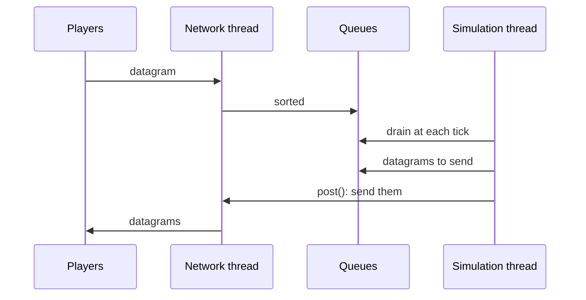
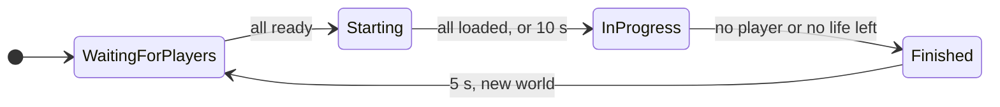
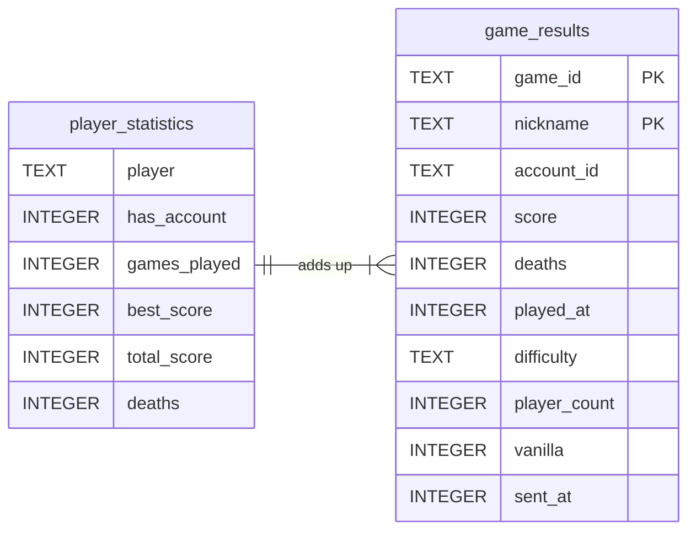

The server, `r-type_server`, runs the game for the players connected to it: it lets them in, plays `DEFAULT_HOSTED_GAME_COUNT` (8) games side by side, up to four players in each, and tells each player what happens in its game. It decides everything: a client only sends its inputs and shows what it is told. It never links SFML or Asio: it reaches the network through `rtype_network`, and its own libraries are checked for it at configure time (see [Project layout](/R-Type/project-layout/#who-may-link-what)).

The game library, `rtype_game`, holds the rules of a match: what moves, what touches what and what that means. It is built on the engine (see [Engine](/R-Type/engine/)), and it knows nothing about sockets, SFML or the messages sent between the programs (see [Project layout](/R-Type/project-layout/#game)). The server runs all of it; the client runs only the part that predicts its own ship (see [Client](/R-Type/client/#own-ship-prediction-ownshippredictor-shipprediction)).

This page tells you where to look when you need to change something. It describes what exists today and says plainly what does not exist yet.

## At a glance

This section is the map of the page: the threads, one tick, the life of a game and the rules, each with the place to look at in the code. The sections below it give the details.

### Threads

The server runs on the threads below. Only the network thread and the simulation thread work during a game, and they share no game state: a datagram crosses from one to the other through a queue, and a request to act through `NetworkContext::post()`. Every game runs on the simulation thread, so nothing in a game needs a lock.

| Thread | Does | Where |
|---|---|---|
| Main | Starts the modules, waits on the `StopRequest`, then stops the modules | `src/server/main.cpp` |
| Network | Started by `ServerNetworkModule::start()`. Owns the socket: sorts each datagram into a queue as it arrives, and sends the outgoing queue when asked | `src/server/Network/` |
| Simulation | Started by `ServerApplication::run()`. Runs `SIMULATION_TICKS_PER_SECOND` (60) ticks per second, and in them every module and every game | `src/server/Network/` |
| Signals | Started by `StopSignals`, on Linux and macOS. Waits for Ctrl-C or SIGTERM and asks for the stop; on Windows, the system runs the handler on a thread of its own | `src/server/Platform/` |

The path of a datagram through the network thread and the simulation thread:



See [Threads](#threads-serverapplication) for the queues and what happens when they fill up, [Tick loop](#tick-loop-tickloop) for the rate, and [Stopping](#stopping-ctrl-c-and-sigterm) for the signals.

### One tick

A tick drains the queues, then runs the stages of `SERVER_LOOP_STAGES`, in this order:

| Stage | Work | Where |
|---|---|---|
| `inputs` | The metrics start measuring the tick | `src/server/Metrics/` |
| `simulation` | Each game in turn plays its tick (below) and the network forgets the players who left it; then the lobby answers the connection requests | `playGames()` in `src/server/Games/`, `answerConnectionRequests()` in `src/server/Lobby/` |
| `outputs` | The event bus of each game delivers its events, so collisions cost health and lives here, and the guaranteed messages among them leave at once; then the metrics end their measure | `src/server/Games/` |

The network thread is then asked to send what the tick left in the outgoing queue.

The tick of one game, `GameInstance::onTick()`, runs the stages of `GAME_STAGES`:

1. `game inputs` reads the datagrams of its players, applies the inputs whose delay is over and closes the silent sessions (`src/server/Sessions/`).
2. `game simulation` runs `GameFlow::onTick()` (`src/server/Rules/Match/`), which ends the game if it is over, then does the work of its state. In `InProgress`, it runs in order `BydoControlSystem`, `PatternSystem`, `MovementSystem`, `PlayfieldExitSystem` and `CollisionSystem` (`addRtypeSystems`, `src/server/Rules/Match/`), then `WeaponSystem`, `BydoSpawner` and `LifeKeeper`, then the world state goes out.
3. `game outputs` sends the guaranteed messages due again, then the heartbeats.

### The life of a game

A game is created when the server starts and never replaced: it goes round these four states of `GameState` as long as the server runs, each round with a new `World`.



New players only join a game in `WaitingForPlayers`. The rule of each transition is in the state table of [A game](#a-game-gameinstance-and-gameflow), and its code in `GameFlow::advanceState` and `reasonToFinish` (`src/server/Rules/Match/GameFlow.cpp`).

### Game rules

The rules play while a game is `InProgress`. What needs only entities lives in `rtype_game` (`src/game/`); what needs the players of a game, or sends them something, lives in `src/server/`. Code must read the constants: most values are **provisional** until gameplay tunes them.

| Rule | In short | Where |
|---|---|---|
| [Moving](#moving-the-ships-shipcontrol) | A ship follows the arrows of the newest input of its player, at `SHIP_SPEED` (480 logical units per second), and stays in the play area | `src/game/ShipControl/`, `src/game/Systems/MovementSystem/` |
| [Shooting](#shooting-weaponsystem) | A ship fires `SHOTS_PER_SECOND` (3) missiles per second while shoot is held; a Bydo fires every `ENEMY_SHOT_INTERVAL` (1.5 s) | `src/server/Spawning/` |
| [Bydos](#waves-of-bydos-wavedirector) | They come in waves read from `assets/waves/waves.toml`; the next wave waits until none is left | `src/game/Waves/`, `src/server/Spawning/` |
| [Contacts](#rules-collisionrules) | Only three pairs count: a missile of a player and a Bydo, a missile of a Bydo and a ship, a ship and a Bydo | `src/game/Systems/CollisionRules/` |
| [Damage](#damage-damagerules) | A missile takes `MISSILE_DAMAGE` (1) from a Bydo, which has `BYDO_HEALTH` (3) | `src/game/Systems/DamageRules/` |
| [Score](#damage-damagerules) | The player whose missile destroys a Bydo earns its points: `DRIFTER_POINTS` (100) or `WEAVER_POINTS` (200) | `src/game/Spawning/BydoKind/`, `src/server/Rules/Players/` |
| [Lives](#lives-lifekeeper) | A player has `STARTING_LIVES` (3); a hit on its ship costs one, and a new ship comes after `RESPAWN_DELAY` (1 s) and cannot be hit for `INVULNERABILITY_DURATION` (2 s) | `src/server/Rules/Players/` |
| [End](#end-of-a-game-gameendannouncer) | The game ends once no player left in it has a life, and each player is told the scores | `GameFlow` in `src/server/Rules/Match/`, `GameEndAnnouncer` in `src/server/Replication/Announcements/Milestones/` |

To change one of them, see [Where to intervene](#where-to-intervene).

## What exists today

| Part | State | Where |
|---|---|---|
| Network thread and simulation thread | Available | `src/server/Network/` |
| Timer resolution on Windows | Available | `src/server/Platform/` |
| The server assembled from modules (logger, network, storage, games, lobby, metrics), stopped on Ctrl-C or SIGTERM with a `Disconnection` to every player | Available | `src/server/Modules/`, `src/server/Platform/` |
| Sorting the datagrams before the queues, session token checked | Available; no limit per address yet | `src/server/Network/` |
| World state sent to the players of a game, at a rate set at launch (`--state-rate`) | Available | `src/server/Replication/Announcements/Streams/`, `src/server/Rules/Match/` |
| Every player's input applied after the same delay, set at launch (`--input-delay`) | Available | `src/server/Instances/` |
| One header for every datagram to a player: session token and next sequence | Available | `src/server/Sessions/Roster/` |
| Game events sent to the players | Available: the removal of a Bydo or a missile that leaves the playfield, the damage and destruction of a Bydo hit by missiles, and the loss of a ship and of a life when a ship touches a Bydo or a missile of a Bydo | `src/server/Replication/`, `src/game/Events/` |
| Launch options | Available: the port, the seed, the state rate, the input delay, the database, `--set` and `--help` | `src/server/LaunchOptions/` |
| Configuration file | Available: `server.cfg` (`module`, `set`) | `src/server/Modules/` |
| Letting players in: challenge, acceptance or refusal | Available; a new player joins the first game waiting for players with a free seat, and is refused with `GameInProgress` or `GameFull` only when no game has one | `src/server/Lobby/`, `src/server/Sessions/` |
| A game: states, ready rule, new world between two games | Available: eight games side by side, each ending once no player is left in it or no player left has a life | `src/server/Rules/Match/` |
| Newest input of each player, held by the `Intent` of its ship and acted on at each tick of a game in progress | Available: the arrows move the ship, shoot fires its missiles | `src/server/Sessions/Tracking/`, `src/server/Rules/Players/`, `src/game/Components/Intent.hpp` |
| Heartbeats every 500 ms, and the round trip and jitter of each player measured from their echoes; a player silent for 5 seconds is away and keeps its seat 15 seconds, then its session closes | Available, and a `Disconnection` closes the session at once | `src/server/Sessions/Tracking/` |
| A nickname unique on the server, held with the seat | Available: a second request for the same nickname gets `NicknameTaken` | `src/server/Sessions/Roster/`, `src/server/Lobby/` |
| Waiting room and start of the game sent to the players (`LobbyState`, `GameStarted`) | Available | `src/server/Replication/Announcements/Milestones/`, `src/server/Rules/Match/` |
| End of a game sent to the players (`GameEnded`) | Available: once no player has a life left, with the score of each, until the game waits for players again | `src/server/Replication/Announcements/Milestones/`, `src/server/Rules/Match/` |
| Metrics in the journal every 10 s: duration of the ticks, time of each system, games, players, entities, round trip of each player and traffic | Available; losses are not measured yet | `src/server/Metrics/` |
| Results of each game kept in a SQLite file, with statistics, and a leaderboard read with `LeaderboardRequest` | Available; the leaderboard of the client reads it, and nothing in the game shows the statistics | `src/server/Results/`, `src/server/Storage/`, `src/storage/` |
| Master mode: `--mode master` runs the master instead of the game server | Available: `GET /api/health` only (see [Master](/R-Type/master/)) | `src/server/LaunchOptions/`, `src/master/` |
| Master link | Not yet written | — |
| Components (`Position`, `Velocity`, `CollisionBox`, `Health`, `EntityType`, `Sprite`, `Layer`) | Available | `src/game/Components/` |
| Movement, run by each game tick: Bydos and missiles by `Velocity`, ships by `Intent` | Available | `src/game/Systems/MovementSystem/`, `src/server/Rules/Match/` |
| Movement patterns, and removal of what leaves the playfield | Available: patterns for the Bydos; a Bydo and its missiles leave on the left, a missile of a player on the right | `src/game/Systems/PatternSystem/`, `src/game/Systems/PlayfieldExitSystem/` |
| Collisions | Available, run by each game tick | `src/game/Systems/CollisionSystem/`, `src/game/Systems/CollisionRules/`, `src/game/Events/`, `src/server/Rules/Match/` |
| Damage and destruction | Available, run by each game tick; a missile takes no health from a ship, and what its hit costs belongs to the lives | `src/game/Systems/DamageRules/`, `src/server/Rules/Players/` |
| Ship of each player, created when the player joins and announced to the others | Available | `src/game/Spawning/`, `src/server/Replication/Announcements/Milestones/` |
| Ship control: how a ship drifts from the directions its player holds, rolls and dashes on a double press, kept above the status band | Available; the client runs `shipAfter` to predict its own ship | `src/game/ShipControl/`, `src/game/Systems/MovementSystem/`, `src/server/Rules/Players/` |
| Bydos appearing off screen at random heights above the status band of the clients, in waves, then moving left | Available | `src/game/Spawning/BydoSpawnPosition.*`, `src/server/Spawning/` |
| Missiles of the players: fired in front of the ship while shoot is held, three per second at most, removed past the right edge | Available | `src/server/Spawning/`, `src/game/Spawning/MissileStartPosition.*`, `src/game/Systems/PlayfieldExitSystem/` |
| Missiles of the Bydos: every Bydo fires to the left 1.5 s after it appears, then every 1.5 s; removed past the left edge | Available | `src/server/Spawning/`, `src/game/Spawning/EnemyMissileStartPosition/`, `src/game/Systems/PlayfieldExitSystem/` |
| Score: points per Bydo kind, credited to the player who fired the missile, sent in the world state | Available | `src/game/Spawning/BydoKind/`, `src/game/Systems/DamageRules/`, `src/server/Rules/Players/` |
| Waves of Bydos that grow, read from the waves file at launch | Available: every game plays the `normal` difficulty | `src/game/Waves/`, `src/server/Spawning/`, `assets/waves/waves.toml` |
| Lives: a life lost when a ship touches a Bydo or a missile of a Bydo, a new ship 1 s later that cannot be hit for 2 s, a player with no life left watching | Available | `src/server/Rules/Players/` |

## Launch options: `LaunchOptions`

`LaunchOptions` (`src/server/LaunchOptions/`) reads what the server is told at launch. `main()` hands it the arguments of the process, and `LaunchOptions::read()` reads them in one pass with the engine's `readLaunchArguments` (see [Engine](/R-Type/engine/#launch-arguments-readlauncharguments)): the options below, those of the network simulator (see [Network](/R-Type/network/#network-simulator-simulatednetworksocket)) and the logging options (see [Logging](/R-Type/logging/#choosing-the-level-and-the-output-at-launch)), which it keeps for the logger module (`logOptions()`). The argument after an option that takes a value is always its value, so `--seed --log-level debug 123` is refused: `--log-level` is no seed.

| Option | Effect |
|---|---|
| `--mode <server\|master>` | The program the binary runs: the game server (`server`, the default) or the master (`master`, see [Master](/R-Type/master/)). It comes before every other option; further on, it is an unknown argument. |
| `-p <port>` | The UDP port to listen on, from 1 to 65535 (see [Network](/R-Type/network/#ports-and-addresses-written-as-text-portfromtext-ipv4addressfromtext)). Default: `DEFAULT_SERVER_PORT` (4242). |
| `--seed <seed>` | The number the random draws of the games start from, a whole number from 0 to 4294967295. Default: drawn at random. See [Bydos](#bydos-bydospawner). |
| `--state-rate <states>` | The world states sent to each player per second, a whole number from 2 to 60. Default: `DEFAULT_WORLD_STATES_PER_SECOND` (20). More states move the other ships more smoothly and use more bandwidth; see [World state](#world-state-worldstatesender). |
| `--input-delay <ticks>` | The ticks every player's input is held before it is applied to its ship, a whole number from 0 to 30. Default: `DEFAULT_INPUT_DELAY_TICKS` (3, 50 ms). The same delay holds for every player; see [Player inputs](#player-inputs). |
| `--database <file>` | The SQLite file the leaderboard of this server is kept in, on a local disk, as the setting `database`. Default: empty, which keeps it in `r-type_server_<port>.db` next to the executable, so two servers on one machine never merge their leaderboards. See [Results and leaderboard](#results-and-leaderboard-resultsmodule-resultsarchive). |
| `--set <name>=<value>` | Gives a setting a value, as the line `set <name> <value>` of `server.cfg` does (see [Configuration](#configuration-servercfg)). Can be given several times. |
| `--network <name>`, `--lag <ms>`, `--jitter <ms>`, `--loss <percent>`, `--duplicates <percent>`, `--reorder <percent>` | The simulated network every datagram of the server crosses, for all its players (see [Network](/R-Type/network/#network-simulator-simulatednetworksocket)). Default: none, the network is not simulated. |
| `--traffic-csv <file>` | The file the traffic of the server goes to every second (see [Network](/R-Type/network/#traffic-counters-trafficcounters)). Default: no file. |
| `--help` | Prints the usage, the simulator and logging options included, on standard output, then exits with code 0 without starting anything or opening the journal. |

- `-p`, `--seed`, `--state-rate`, `--input-delay` and `--database` are shortcuts: each forces the setting `port`, `seed`, `state-rate`, `input-delay` or `database` with the line `set <name> <value>`, the first four once their value is checked. The forced lines run after `server.cfg`, so a launch option wins over the file. `--traffic-csv` is no setting: it names the file of this run only.
- The server listens on every IPv4 interface (`ANY_IPV4_ADDRESS`) and takes no address: `-h`, the client's address option, is an unknown argument here. The last `-p` wins, and so do the last `--seed`, the last `--state-rate`, the last `--input-delay`, the last `--database` and the last `--traffic-csv`.
- An unknown argument, a `-p`, `--seed`, `--state-rate`, `--input-delay`, `--database` or `--traffic-csv` without a value, an invalid port, a seed that is not a whole number from 0 to 4294967295, a state rate that is not a whole number from 2 to 60, an input delay that is not a whole number from 0 to 30, a `--set` value that is not `name=value`, a simulator option without a value or with one out of its range, or a logging option that does not exist or has no value, stops the server before anything starts: it prints `r-type_server:`, the reason and how to see the usage on standard error, then exits with code 1. When several arguments are wrong, the first one from the left is reported.

```bash
./r-type_server -p 4243
```

## Threads: `ServerApplication`

`ServerApplication` (`src/server/Network/`) runs the server on two threads, which never share game state:

- The **network thread**, the one that calls `run()`, runs the `NetworkContext`. A `DatagramSorter` sorts every datagram as it arrives: the datagrams of admitted players that carry their session token go to the player queue, connection requests to the request queue, and the rest is dropped there (see [Sorting the datagrams](#sorting-the-datagrams-datagramsorter)). `DatagramRelay` (`rtype_network`, see [Network](/R-Type/network/#socket-to-queues-datagramrelay)) sends what was left in the outgoing queue. It is the only thread that touches the socket.
- The **simulation thread** runs `SIMULATION_TICKS_PER_SECOND` (60) ticks per second. Each tick drains the player queue and the request queue and hands what arrived, often nothing, to the tick handler given to the constructor, as a `ReceivedDatagrams` (`players`, `connectionRequests`), so a slow or silent player never holds the game up. At the end of the tick it asks the network thread, through `NetworkContext::post()`, to send the outgoing queue.

The tick handler is where the game plugs in. The network module gives one (see [Modules](#modules-and-stopping-the-server)): it keeps the datagrams for the modules and runs the stages of the loop, so in a tick each game of the list gets the datagrams of its own players, reads the `ReadyState` and the inputs among them, moves along its states and tells its players the room, the start and the world state (see [A game](#a-game-gameinstance-and-gameflow) and [Player inputs](#player-inputs)), and the address of each player whose session closed in that tick is forgotten (see [Silent players](#silent-players-heartbeats-and-timeouts)); then each connection request goes to the `ConnectionAcceptor` of the game it is placed in, which answers it and gives each new player a ship in that game (see [Letting players in](#letting-players-in-connectionacceptor-playerroster) and [Player ships](#player-ships-shipspawnannouncer)); then the `EventBus` of each game delivers its events, which the broadcaster sends to the players who joined (see [Game events](#game-events-gameeventencoder-and-gameeventbroadcaster)).

A tick handler puts a datagram in the outgoing queue with `queueDatagram()`, called from the handler itself, on the simulation thread. The datagram is sent at the end of the same tick.

The sorter only lets through datagrams of this protocol whose message sizes add up, but anyone can still send a connection request, and the payloads are read by the tick, so the tick handler must drop and count a datagram it cannot decode, and never let an exception caused by a datagram's content escape: an exception that leaves the tick stops the server (see below), so one truncated datagram would stop it for every player. `ByteReader`, for instance, throws `BufferUnderflowException` when a datagram is shorter than what it reads. The handlers of the players' messages and the answers to connection requests are guarded: an exception one of them throws is logged at the `error` level and that message or datagram is dropped (see [Network](/R-Type/network/#dispatch-messagedispatcher) and [Letting players in](#letting-players-in-connectionacceptor-playerroster)). An exception from anything else in the tick, a system of a game for instance, still stops the server.

The player queue and the outgoing queue hold `INCOMING_DATAGRAM_QUEUE_CAPACITY` and `OUTGOING_DATAGRAM_QUEUE_CAPACITY` (256) datagrams each, about one second of the inputs of four players; the request queue holds `CONNECTION_REQUEST_QUEUE_CAPACITY` (16) (`src/server/ServerConstants.hpp`). These sizes are **provisional**: they will be revised with the rates of the protocol. Code must read the constants.

- When more datagrams arrive between two ticks than the player queue or the request queue holds, the oldest are discarded. Every `TICKS_PER_REPORT` ticks (600, so every ten seconds), the server logs one warning per queue with how many were discarded, if any, one with how many datagrams the sorter dropped before any queue, and one with how many it dropped for their session token, naming the address and port of the first of them (see below). Each datagram the sorter drops is also logged with its sender at the `debug` level (see below).
- A flood of connection requests, or of datagrams from strangers, never pushes a player's datagram out of its queue. It still delays the requests of new players: nothing limits the requests of one address yet (see [Flood protection](#flood-protection)).
- The outgoing queue also discards its oldest datagram when full, but nothing reports it yet.

`ServerApplication` implements `IDatagramSender` (`queueDatagram()`) and `IPlayerAdmission` (`admit()`, `forget()`), the two interfaces the other parts of the server use to reach it. Building it binds nothing: `open()` binds the socket, behind the simulated network the launch options describe if any (`ServerAlreadyOpenException` when it is already bound), and returns the address and port it bound, the port the system picked on port 0; `run()` throws `ServerNotOpenException` before it. `close()` unbinds it, so the port is free again once `run()` returned.

`stop()` makes `run()` return, from any thread: the network thread stops at once, the simulation thread when its current sleep ends, about one tick later. An exception thrown on either thread, by the tick handler for instance, stops both, and `run()` rethrows it.

### Sorting the datagrams: `DatagramSorter`

`DatagramSorter` (`src/server/Network/`) decides, on the network thread, which queue each received datagram goes to, before any queue holds it. It reads the header and the type of each message, never a payload. The first row that applies decides where a datagram goes:

| The datagram… | Goes to |
|---|---|
| is of this protocol with another version, from a sender that was not admitted, and holds at least `CONNECTION_REFUSED_DATAGRAM_SIZE` (26) bytes | the request queue, where the `ConnectionAcceptor` refuses it |
| is not of this protocol and version, has a flag this version does not know, or its message sizes do not add up | nowhere: dropped |
| comes from the address and port of an admitted player without the session token of that player (a `ConnectionRequest` may carry 0 instead) | nowhere: dropped, and counted apart |
| holds a `ConnectionRequest`, whoever sent it | the request queue, where the `ConnectionAcceptor` answers it (see [Letting players in](#letting-players-in-connectionacceptor-playerroster)) |
| comes from an admitted player | the player queue |
| anything else | nowhere: dropped |

- A player is admitted by `ServerApplication::admit(endpoint, sessionToken)`, which the acceptor calls once for each sender it gives a place to, with the token it drew for that player; admitting an address again replaces its token. It may be called from any thread: it posts the admission to the network thread, so a datagram the player sends before that is dropped like a stranger's. `ServerApplication::forget(endpoint, sessionToken)` undoes it once the session of that player closed (see [Silent players](#silent-players-heartbeats-and-timeouts)): the datagrams from that address are dropped like a stranger's again, unless the address was admitted with another token in between, so the two calls may reach the network thread in either order.
- The `PlayerRoster` and the `ConnectionAcceptor` run in the tick, on the simulation thread; the network thread only keeps the address, port and session token of each admitted player.
- Each datagram the sorter drops is counted, readable from any thread: `wrongTokenCount()` for those dropped for their session token, `droppedCount()` for the others. The server reports both every ten seconds with the discards of its queues. The line about the tokens names the address and port of the first such datagram since the previous line (`takeWrongTokenSender()`): the address of a player, used by someone who does not know its token. A flood of forged datagrams therefore adds one line every ten seconds, never one per datagram. Besides these counts, every drop, a wrong token included, is logged at the `debug` level with its sender and why, such as `it is shorter than the packet header` or `its sender was not admitted, and it holds no connection request`, at most once per `REJECTION_LINE_INTERVAL` (10 s), with how many since the previous line (see [Logging](/R-Type/logging/#repeated-events-throttledlog)). The time of these lines comes from the `IClock` the server application gives the sorter, read only to drop a datagram.
- Measured on an Apple Silicon laptop (Apple M4 Pro, `-O2`, median of 7 runs of 2 million datagrams): sorting a datagram costs about 30 ns when a stranger's is dropped, 29 ns when one is dropped for its session token, the sender kept included, 18 ns for bytes shorter than a header, and 37 ns when it is queued, copy included. Reading the clock and counting the drop for its log line take 8 to 16 ns of a drop. A flood of 3 800 datagrams per tick therefore costs the network thread under 0.15 ms of every 16.7 ms, whatever the datagrams hold. A malformed datagram is found without throwing (`DatagramCodec::messageTypes`): an exception costs about 4 µs, so a flood of malformed datagrams would otherwise take about 14 ms of every tick. Answering a request costs about 0.45 µs, or 0.55 µs with a wrong cookie; the request queue keeps that under 9 µs per tick.

### Flood protection

The room of the player queue protects the server's memory; the sorter protects the players from the senders that were not admitted: one of them flooding the server's port with connection requests or with anything else no longer pushes the players' datagrams out. Someone who forges the address and port of an admitted player no longer can either, unless they read its session token on the way: the sorter drops their datagrams before the queue. That player itself, flooding with its own token, still can: the players share one queue (layer 2 below). Since a game closes the session of a player it hears nothing from for 20 seconds, a player who floods long enough can even make the others time out: in the waiting room, where a client sends one heartbeat per second, every heartbeat a player sends for 20 seconds, about twenty, would have to be pushed out of the queue (an estimate, not measured). A plain Python loop on the loopback address sends about 3 800 datagrams per tick (measured on an Apple Silicon laptop), about fifteen times the room of the queue. Other engines protect the players in three layers; the server must have them once sessions exist, and the first and the third are written, in part:

1. **Sort on the network thread, before the queue.** Written: `DatagramSorter` drops there every datagram that is neither from an admitted player nor a `ConnectionRequest`, and every datagram from the address of a player without its session token; the requests have their own queue. Not written: a limit on the requests of each address, in a table of fixed size so that forged addresses cannot make it grow. Quake 3 ignores such datagrams and answers at most 10 status, information or remote console requests per second from one address; Unreal limits how many datagrams of senders without a connection it processes each frame.
2. **One queue per session**, so a flooding client only fills its own. Valve's GameNetworkingSockets keeps one per connection, of 1 000 messages by default.
3. **One input per player and per tick.** The protocol requires it (see [Protocol](/R-Type/protocol/#inputs)). Written: each `GameInstance` keeps only the newest `PlayerInput` of each of its players and ignores older ones (see [Player inputs](#player-inputs)), then, after the input delay, applies it to the ship of that player at each tick of a game in progress (see [Moving the ships](#moving-the-ships-shipcontrol)).

The player queue stays as the last safety net. It discards its oldest datagram, where GameNetworkingSockets refuses the newest, because only the newest input of a player counts. Why threads only talk through queues is explained in [Architecture](/R-Type/architecture/#queues-between-threads).

## Configuration: `server.cfg`

The server reads `server.cfg`, in the folder it is started from, between the install and the start of its modules (see [Engine](/R-Type/engine/#commands-and-configuration-commandinterpreter)). The file is a list of commands, one per line; `#` starts a comment (every command and setting is listed in [Configuration commands](/R-Type/commands/)). `main()` builds the step with `engine::configurationStep()`: it reads `server.cfg`, then runs the lines the launch options force (`LaunchOptions::forcedLines()`).

| Command | Effect |
|---|---|
| `module <name> on\|off` | Turns a module of the table below on or off. A module that is off is never installed, so it provides no service and its work never runs. Refused when a module that stays on depends on it (`storage` needs `network`, `games` needs `network` and `storage`, `lobby` and `metrics` need `games`, all need `logger`). |
| `set port <port>` | The UDP port, from 1 to 65535. Default: 4242. |
| `set seed <seed>` or `set seed none` | The seed of the first game, a whole number from 0 to 4294967295; `none` draws one. Default: `none`. |
| `set state-rate <states>` | The world states sent to each player per second, from 2 to 60. Default: 20. |
| `set input-delay <ticks>` | The ticks every player's input is held before it is applied, from 0 to 30. Default: 3. |
| `set database <file>` | The SQLite file the leaderboard of this server is kept in, on a local disk; a name with a space goes in quotes. Default: empty, which keeps it in `r-type_server_<port>.db` next to the executable, with the port of `set port`. |

- A missing `server.cfg` is not an error: the defaults apply, and the journal says `server.cfg not found, the defaults apply`. A line that is refused (an unknown command, a value out of its bounds) does not stop the server: it is logged at the `warn` level, with its file and line number, and the next line runs.
- The reading is logged once the journal is open, so the lines appear after the modules' own start lines. The `info` lines are hidden at the default level; start the server with `--log-level info` to see them.

```
# server.cfg
set port 4300
set state-rate 30
module lobby off
```

`server.cfg.example`, at the root of the repository, lists every setting with its default and its bounds. It is not read by the server: copy it to `server.cfg`.

## Modules and stopping the server

`src/server/main.cpp` reads the options and hands a list of modules to an `engine::Application` (see [Modules](/R-Type/modules/)). `serverModules()` (`src/server/Modules/ServerModules.cpp`) is the one place that lists them; they start in this order and stop in the reverse one.

| Module | Does | Where |
|---|---|---|
| `logger` | applies the logging options when it starts, logs "server starting" and "server stopped" | `src/server/Logger/` |
| `network` | declares the `port` setting; owns the `ServerApplication`: binds the socket and runs the server on a thread when it starts, gives the port back when it stops; provides `IDatagramSender`, `IPlayerAdmission`, `TickDatagrams` (the datagrams of the tick), `IListeningPort` (the port of the `port` setting) and `network::TrafficCounters` | `src/server/Network/` |
| `storage` | declares the `database` setting; opens the SQLite file of the server and starts the thread that owns it when it starts, finishes what waits and closes the file when it stops; provides `IResultsArchive` | `src/server/Storage/` |
| `games` | declares the `seed`, `state-rate` and `input-delay` settings; the games (`GamesSettings::gameCount`, `DEFAULT_HOSTED_GAME_COUNT` = 8), an `EventBus` for each; reads the waves file when it starts; provides `Games` | `src/server/Games/` |
| `lobby` | one `ConnectionAcceptor` per game, built on the roster of that game | `src/server/Lobby/` |
| `metrics` | measures the ticks and the systems of the games, and writes a report to the journal every `TICKS_PER_REPORT` ticks; writes the traffic of the socket; provides `LatestMetrics` | `src/server/Metrics/` |

Each tick runs the stages of `SERVER_LOOP_STAGES` once, with `SIMULATION_TICK_DURATION`. In `simulation`, the games module runs `onTick()` on each game with the datagrams of its own players (`keepDatagramsOf()`) and makes the network forget the players whose session closed, then the lobby module answers the connection requests, so a request is placed and refused by the state the games just reached. In `outputs`, the bus of each game delivers its events, and the guaranteed messages among them leave at once (see [Guaranteed messages](#guaranteed-messages-messagedelivery)). Only the metrics module works in `inputs`, where it starts measuring the tick, since `onTick()` reads the datagrams and moves the game in one step; it ends its measure in `outputs`, after the games module.

### Several games at once

The [tutorial](/R-Type/tutorial-run-several-games/) runs a server, fills its games and reads them in the journal.

The server creates its games when it starts and keeps them: a finished game waits for players again with a new world, so no game is ever replaced. `Games` decides where a connection request goes, the same way for the lobby and for the tests:

| The sender | The request goes to |
|---|---|
| has a seat in a game | that game, so a repeated request that carries a valid cookie gets the same acceptance again; without a cookie it gets a challenge, as any request does |
| has no seat | the first game waiting for players with a free seat (`Games::joinable()`) |
| has no seat, and no game waits with a free seat | the first game, which refuses it with `GameInProgress` or `GameFull` |

The rule itself is `firstJoinableGame()` (`src/server/Games/`), which reads a `GameVacancy` per game (its state, and whether it is full) rather than the games, so a process that does not own the games could place players with it. Each game has its own acceptor, which draws its own cookies: a player challenged by one game and placed in another, because the first one filled up meanwhile, is challenged once more.

Each game has its own `EventBus`, since its rules and its broadcaster subscribe to it: with one bus, a game would apply the collisions of another to its own entities and send its events to the wrong players. The seed of game n, from 0, is the seed given plus n times `GAME_SEED_STRIDE` (65536), so a game can be played again; without a seed, each game draws its own.

Every game runs on the simulation thread, one after the other in each tick, and the network thread is the only other one that handles datagrams during a game. No state is shared between games, so nothing needs a lock, and the queues between the two threads do not change. The cost of a tick grows with the number of games: the journal gives it every 10 s (see [Metrics](#metrics-servermetricsmodule)), and the tick loop reports its late ticks at the same rate. An exception a system of one game throws stops the server (one a message handler throws only drops that message, see [Threads](#threads-serverapplication)), and a slow game slows the others; running each game in a process of its own would isolate them.

The waves file is read when the games module starts, after the logger module started, so a missing or wrong file stops the start with an error that names the games module, the file, the line and the key, and the line "waves file …" reaches the journal.

### Stopping: Ctrl-C and SIGTERM

`StopSignals` (`src/server/Platform/`) turns the signals that ask a program to stop into a request on a `StopRequest`, the object `main()` waits on. A failure of the network thread asks for the same stop, with the text of the error, so `main()` returns 1 after it and 0 after a signal. Only the first request counts.

- Linux and macOS: `SIGINT` (Ctrl-C) and `SIGTERM`. `StopSignals` blocks them in the main thread before any other thread exists, so every thread inherits the mask, and one thread takes them with `sigwait()`: nothing runs inside a signal handler. A signal that arrives before it is built, while the program starts, has its default action.
- Windows: `SetConsoleCtrlHandler`. The system runs the handler on a new thread. Ctrl-C and Ctrl-Break have no time limit; closing the console window gives the process 5 seconds, so that handler waits for the program to finish stopping, at most `CONSOLE_CLOSE_WAIT` (4 s), before it returns. Logoff and shutdown only reach services, and are handled the same way. This file is checked by the Windows job of the CI only.

On a request, `main()` calls `Application::stop()`. It first stops the stages: it waits for the tick in progress, and no work runs after it. Then the modules stop in the reverse order. The games module tells every player that the server shuts down, with `FAREWELL_COPIES` (3) copies of a `Disconnection`, `FAREWELL_COPY_INTERVAL` (50 ms) apart (`src/server/ModuleConstants.hpp`), each under the next session header of its player (see `FarewellSender`), then waits `FAREWELL_FLUSH_WAIT` (two ticks) so the last copy leaves; the whole stop takes about 130 ms with a player connected (two intervals and two ticks). The storage module then saves what waits and closes its file. The network module then stops the server and closes the socket, and the journal logs "server stopped". Over a simulated network, a copy still in flight when the socket closes never arrives (see [Network](/R-Type/network/#network-simulator-simulatednetworksocket)): each copy waits half the lag, and the socket closes about 130 ms after the first, so with a lag over about 270 ms (the `bad` scenario's 300 ms included) a player gets none. The client closes its session as soon as it reads one, and shows the player that the server shut down (see [Client](/R-Type/client/#lost-connection-a-dialog-over-the-title) and [Protocol](/R-Type/protocol/#a-peer-disappears)).

The Linux job of the CI checks this stop under the sanitizers: it starts the `r-type_server` the `sanitize` preset builds, with no player connected, sends it SIGINT after 5 s and requires exit code 0, which a leak (LeakSanitizer) or a memory error (AddressSanitizer) would change. The same job runs every test under them (see the README).

## Tick loop: `TickLoop`

`TickLoop` (`src/server/Network/`) calls a function once per tick on the thread that runs it. It counts ticks with a `FixedTimestep` and sleeps until its `nextTickTime()`, so the average rate stays at 60 ticks per second: after a late wake-up the missed ticks run back to back, and a stall longer than `MAXIMUM_TICKS_PER_ADVANCE` (5) ticks drops the excess. `ServerApplication` creates it when `run()` starts, so the first tick is due one tick after the call.

The limit is a choice for this game: during a longer stall the game freezes, then resumes where it stopped, unless it lasts long enough for every client to take the server for lost (see [A long stall and the clients](#a-long-stall-and-the-clients)). Catching the whole stall up would play it in an instant, a second of enemy fire that nobody saw coming. Engines differ on it: a Quake 3 dedicated server catches up to 5 seconds, so that the clients' view of the server's clock stays right; Unity lets each game set its `maximumDeltaTime`.

Every `TICKS_PER_REPORT` ticks, the loop logs at the `debug` level how late its ticks started, each compared with the moment it was due; a dropped stall shows in full. The lines go to the terminal and to the journal, `r-type_server.log` (see [Logging](/R-Type/logging/#choosing-the-level-and-the-output-at-launch)):

```bash
./r-type_server --log-level debug
```

After the time stamp, the line reads:

```
[DEBUG] [Simulation] - 600 ticks started on average 4.43782 ms late, at most 8.32842 ms
```

Every stall that drops game time is counted, and the same report then adds a warning, shown at the default level: how many stalls dropped game time since the previous report, how much in total, and the longest. Measured on a server paused for one second:

```
[WARN ] [Simulation] - stalls since the previous report: 1, game time dropped: 939.018 ms, the longest: 939.018 ms; the game froze instead of catching up
```

Repeated at every report, it means that the server keeps falling behind, for instance because its ticks take longer to run than the 16.7 ms each one stands for.

How late a tick starts depends on how precisely the system wakes a sleeping thread:

- On Windows, MSVC's `sleep_for` ends in `Sleep`, whose documentation says that a wait longer than one tick of the system clock but shorter than two "can be anywhere between one and two ticks". While it runs, the loop holds a `FineTimerResolution` (`src/server/Platform/`), which asks Windows for `FINE_TIMER_RESOLUTION_MILLISECONDS` (1 ms). If Windows refuses, the loop logs a warning and runs anyway.
- On macOS, measured on an Apple Silicon laptop, a sleep wakes later the longer it is: 0.5 ms late on average for a 1 ms sleep, 5.6 ms for a 16.7 ms sleep. Timer coalescing, enabled on that machine, is the likely cause. Over several 30-second runs, ticks started 3.8 to 4.5 ms late on average and at most 9.1 ms late, with no client as with four clients sending 60 datagrams per second each, and 600 ticks still ran every ten seconds.
- On Linux and Windows, the lateness is not measured yet.

## Metrics: `ServerMetricsModule`

The `metrics` module (`src/server/Metrics/`) tells an administrator whether the server keeps up. Every `TICKS_PER_REPORT` ticks (600, so 10 s while the server keeps its pace; a stall makes it longer, since it counts ticks), it writes three lines at the `info` level, shown with no option, to the terminal and to the journal. Measured on a server with no player:

```
[INFO ] [Metrics] - 600 ticks lasted 0.0269 ms on average, 0.0215 ms at the median, 0.046458 ms at the 95th percentile and 0.244708 ms at most, for a budget of 16.6667 ms; games in progress: 0 of 8; players connected: 0; entities: 0
[INFO ] [Metrics] - average time per tick: BydoControlSystem 0 ms, PatternSystem 0 ms, MovementSystem 0 ms, PlayfieldExitSystem 0 ms, CollisionSystem 0 ms
[INFO ] [Metrics] - round trips: no player measured
```

Once players are measured, the third line gives each of them, game by game in the order `Games::all()` lists them, numbered from 1, as in `round trips: game 1 player 1 ACE 42.1 ms, jitter 3.2 ms; game 2 player 1 BOB 80 ms, jitter 12.5 ms` (see [Silent players](#silent-players-heartbeats-and-timeouts)).

| Figure | What it says |
|---|---|
| Ticks | How long the stages of each tick lasted, from the `inputs` stage to the end of the `outputs` stage. A percentile is the duration of a real tick, at the nearest rank |
| Budget | `SIMULATION_TICK_DURATION`: a tick that lasts longer leaves the next one late |
| Games in progress | The games in `GameState::InProgress`, out of the games the server hosts |
| Players connected | The players seated in a game, in progress or not |
| Entities | The entities of the worlds of every game |
| Average time per tick | The time of each system in all the games, shared between the ticks of the report. A system runs only in a game in progress |
| Round trips | The smoothed round trip and the jitter of each player measured, in milliseconds, at the end of the report; a player not measured yet is left out |

The measure leaves out what `ServerApplication` does around the stages, emptying the queues of datagrams and handing over what to send, and the report itself, which runs after the measure of its tick. Whether the ticks fall behind as a whole is told by the lines of the tick loop (see [Tick loop](#tick-loop-tickloop)).

The newest report stays in memory as a `MetricsReport` in the service `LatestMetrics` (`src/server/Metrics/Report/`). A module finds it with `context.find<LatestMetrics>()`, which gives `nullptr` when the metrics module is not listed. Any thread may call `report()`, which gives a copy and changes nothing, so readers at different rates all see the same report; it holds the round trips as `roundTrips`; nothing in the server reads it yet. Losses are not measured yet.

The module also writes the traffic of the socket, which the network module provides as `network::TrafficCounters`: a line every 10 s and, with `--traffic-csv`, a file (see [Network](/R-Type/network/#traffic-counters-trafficcounters)). Each report holds it as `traffic`, totals since the server started. A player has a row of its own from the moment `ServerApplication::admit()` takes effect until the session closes:

- the `ConnectionRequest` and the `ConnectionChallenge` come before that, so they count with the others, and the `ConnectionAccepted` is usually the first datagram in the row;
- what a player sends after its session closed counts with the others again;
- a session replaced on the same address keeps the row: closing the old one forgets nothing, as the sorter says (`forget()` returns whether it did).

No module requires this one, and it reads no clock when it is not listed, so removing its line from `serverModules()` changes nothing else. It is listed last: a module listed after it would not be counted, and neither would work another module adds to `inputs`. `--log-level warn` hides the three lines and leaves the measure running.

Measured on an Apple M3 Pro with Apple clang 21.0.0 at `-O2`, median of 7 runs of a throwaway program that is not part of the repository:

| Work | When | Cost |
|---|---|---|
| A tick with no game in progress | each tick | 33 ns |
| A tick with 8 games in progress, 5 systems each | each tick | 0.68 µs, 0.0041 % of a tick |
| Sorting and summarizing 600 ticks | each report | 4.2 µs |
| Building the lines of the ticks and of the systems, measured before the line of the round trips existed | each report | 1.8 µs |
| Writing those two lines | each report | 7.4 µs to the journal alone, 11 µs with standard error sent to `/dev/null` |

These numbers say nothing about a terminal, GCC, MSVC, Linux or Windows. A report adds about 440 bytes to the journal, so about 3.8 MB per day, and the logger never rotates its file.

## World state: `WorldStateSender`

`WorldStateSender` (`src/server/Replication/Announcements/Streams/`) sends the state of the game to its players, as many times per second as the host chose with `--state-rate`. The `GameReplication` of each game builds one with its `PlayerRoster`, and `GameFlow` has it call `onTick(tick, components)` on the tick that starts the game and on every tick of the game, on the simulation thread, with the tick the game counts (see [A game](#a-game-gameinstance-and-gameflow)). `GameReplication` builds it with the rate `LaunchOptions::stateRate()` gave, through `GamesSettings` and `GameSettings`; it throws `InvalidStateRateException` for a rate outside `LOWEST_WORLD_STATES_PER_SECOND` (2) to `HIGHEST_WORLD_STATES_PER_SECOND` (60). On the ticks that carry a state, exactly as many per second as the rate (20 by default, `DEFAULT_WORLD_STATES_PER_SECOND`, one tick in three), it lists every entity that has a `NetworkIdentity`, a `Position` and an `EntityType`, writes it for each player as a `DeltaWorldState` against the state that player acknowledged (see below and [Network](/R-Type/network/#world-state-worldstatecodec)), and hands one `OutgoingDatagram` per connected player and per payload to the function it was given, each starting with the header of that player (see [Session headers](#session-headers-sessiondatagram)). In `main.cpp` that function is `queueDatagram()`.

- The `tick` of a state is the tick given to `onTick`, so the client can tell which of two states is newer. The first state of a game carries tick 0 and leaves in the tick that starts the game, right after `GameStarted`. The game's counter is 32 bits and is not made to wrap: it takes 2.27 years at 60 ticks per second. It starts again at 0 with each game.
- The rate does not have to divide the tick rate. A tick carries a state when `tick × rate % 60` is under the rate, so any rate gives exactly that many states in 60 consecutive ticks, spread as evenly as whole ticks allow: at 45 states per second two states are one or two ticks apart. At 20 this is one tick in three, as before. The lowest rate is 2 because a client removes an entity no state listed for 900 ms (see [Protocol](/R-Type/protocol/#world-state)). A live entity is listed in every state, so this only matters when a state is cut into several datagrams (over 122 entities with four players) and the part that lists the entity is lost. At one state per second the next state is 60 ticks later, 54 or more, so one lost part removes an entity that is alive and brings it back with its appearance effect; at 2 per second the states are 30 ticks apart and two parts in a row must be lost. The highest is the tick rate, one state per tick.
- The default rate is **provisional**: it will be revised once measured on a real network. Code must read the constants and never repeat the 20.

Measured by `StateRateMeasurementTest` (`tests/server/Replication/Announcements/Streams/`), on ten seconds of a game with 4 players and 30 networked entities, nothing else sent: the bytes of the datagrams sent to one player each second, and the longest time that player goes without a state, without loss and when one datagram in ten is lost (the same losses at every rate). The bytes include the 22-byte datagram header and the player list; they do not include IP and UDP headers or the other messages of a game (inputs, heartbeats, events).

| States per second | Bytes per second to one player | Longest time without a state | With one datagram in ten lost |
|---|---|---|---|
| 2 | 738 | 500 ms | 1000 ms |
| 10 | 3690 | 100 ms | 300 ms |
| 20 (default) | 7380 | 50 ms | 150 ms |
| 30 | 11070 | 33 ms | 100 ms |
| 60 | 22140 | 17 ms | 50 ms |

The bytes grow in proportion to the rate, since each state holds the same entities: 369 bytes per state here, every one in full since the test acknowledges nothing (a game that acknowledges sends less, see [Protocol](/R-Type/protocol/#delta-world-state)), and about as many more as the screen holds more entities. The time without a state is one rate-th of a second, rounded up to whole ticks. The test measures the interval between states, not what a player sees: it models neither latency nor a link that is too slow, and how smooth the ships look at a given interval is judged on screen.
- Nothing is built when no player is connected. An entity without a network id, or without a type, is not listed.
- An entity whose position is not a finite number (NaN or infinite), which only a game bug can produce, is left out of the state instead of stopping the server. A warning under the `Replication` module gives how many entities were left out, each time that number changes, so a stuck entity is reported once rather than 20 times per second.
- The state lists every connected player with its number, ship, and score. `lives` is what the player has left, `invulnerable` is true while its ship, back after a hit, cannot be hit (see [Lives](#lives-lifekeeper)), and `motion` holds the directions of its newest input and whether its ship rolls or dashes, so every client can draw what each pilot does. The score is the points the player earned in the current game: a missile with a `MissileOwner` that destroys an enemy with a `ScoreValue` makes `DamageRules` publish `EnemyKilled`, and the `ScoreKeeper` adds the points (`DRIFTER_POINTS` 100, `WEAVER_POINTS` 200, both provisional) to the player's score, which stops at its largest value and goes back to 0 with each new world. The ship of each player has a `NetworkIdentity` (see [Player ships](#player-ships-shipspawnannouncer)), so it is listed as an entity too.
- A state split into several datagrams takes one sequence per datagram, so the client reads every part.
- Each `ConnectedPlayer` holds a `SentStates` (`src/server/Sessions/Roster/`): the last 60 states sent to it, each with the sequence of the datagram of every part, and the newest the player acknowledged. `GameSessions` gives it the header of every datagram of the player it reads, as it does the guaranteed messages, and a state counts as acknowledged once the header acknowledges the datagram of every one of its parts. The state lives and dies with the player, so a player who takes a seat after another never inherits its acknowledgements. A tick lower than the newest kept is a game that started over: the history is forgotten.
- The sender sorts the entities by id once per state and shares that list with `SentStates` of every player, so keeping 60 states costs no copy per player. For each player it takes `referenceFor(tick)`, the acknowledged state 1 to 60 ticks older (`MAXIMUM_REFERENCE_DISTANCE`), or none, and sends `diffStates` against it with `baseDistance` set to the distance, or the whole list with `NO_REFERENCE_DISTANCE`. Nothing is sent to a player whose state needs more than `MAXIMUM_DELTA_PARTS` datagrams: an error says so, the state is not kept, so the player's next states are written against the same older state, or in full.
- Each player carries `acknowledgedInput`, the `inputNumber` of the newest input applied to its ship (`ConnectedPlayer::appliedInputNumber`, kept by `GameInstance` when the hooks of the game see the input), 0 while none was. It is the number of the input applied, not of the newest one received, so a client that predicts its ship compares its position with the server's for the same input.
- A playfield larger than 2047 logical units in either direction fails the build, because a wire coordinate would no longer hold it (see [Protocol](/R-Type/protocol/#positions)).

```cpp
rtype::server::WorldStateSender worldStateSender{
    roster, send, rtype::server::DEFAULT_WORLD_STATES_PER_SECOND};
worldStateSender.onTick(tick, world.components());
```

`GameReplication` builds the sender once, with its roster, which lives as long as the game, and `GameFlow` hands it the components of the current world at each call: a new world replaces the old one between two games.

`World::components()` (`rtype_game`) is the `ComponentRegistry` of the world: a `World` owns its entities and their components, and cannot be copied or moved.

## Letting players in: `ConnectionAcceptor`, `PlayerRoster`

`ConnectionAcceptor` (`src/server/Lobby/`) answers the connection requests the sorter set aside for each tick, at most `CONNECTION_REQUEST_QUEUE_CAPACITY` (16), as the [Protocol](/R-Type/protocol/#connection) describes, and `PlayerRoster` (`src/server/Sessions/Roster/`) holds the players it let in: at most `MAXIMUM_PLAYERS` (4), each a `ConnectedPlayer` with its number, nickname, address and port, session token, next sequence, ship id, score, newest input, and the ticks since the game last read one of its datagrams and since the server last sent it one. A new player takes the lowest free number, so the first four are 1 to 4 in the order they joined. `remove(endpoint)` frees the seat and the number of a player whose session closed; the next player to join takes the lowest free number again.

A datagram of this protocol with another version is answered with `ConnectionRefused` (`IncompatibleVersion`) in a header of version 2, whatever it holds, when it holds at least `CONNECTION_REFUSED_DATAGRAM_SIZE` (26) bytes, the size of that refusal, so the answer is never larger than the datagram; a shorter one gets nothing. Any other datagram is read only when its header is of this protocol and version and its message sizes add up; only its first `ConnectionRequest` is answered, so one datagram never gets more than one answer, and every other message is ignored. A request is answered by the first row that applies:

| The request comes… | Answer |
|---|---|
| from a connected player | the same `ConnectionAccepted` again (same number, same token) with a valid cookie; a `ConnectionChallenge` without one, even during a game |
| while a game is in progress | `ConnectionRefused` (`GameInProgress`) |
| when four players are connected | `ConnectionRefused` (`GameFull`) |
| when a player holds a seat under the same nickname, away or not | `ConnectionRefused` (`NicknameTaken`); letters of the ASCII alphabet compare without regard to case (`PlayerRoster::hasNickname`) |
| without a valid cookie | `ConnectionChallenge`, and nothing is kept |
| with a valid cookie | a place in the roster, a session token drawn at random (never 0), and `ConnectionAccepted` |

- A refusal reserves nothing, so it goes before the cookie is checked. The cookies come from a `CookieIssuer` whose key is drawn when the acceptor is built (see [Network](/R-Type/network/#connection-cookies-cookieissuer)).
- An acceptance carries the session token and the next sequence of that player, 0 for the first (see [Session headers](#session-headers-sessiondatagram)). Challenges and refusals carry token 0 and sequence 0, as every datagram sent before a session.
- Besides the function that admits a sender, the acceptor takes an optional one it calls once for each player it lets in, after it sent the acceptance, and not again when an acceptance is repeated. The lobby module gives the acceptor of each game that `GameInstance`, which gives the player a ship.
- Nothing caused by the content of a datagram makes it throw. An exception while answering a datagram (any `std::exception`: from the roster, the admission, the function called for a new player or the drawing of a token) is logged at the `error` level with its sender, at most once per `REJECTION_LINE_INTERVAL`, and that datagram is dropped; the next one is answered. What the answer did before it threw is kept: a player the function for a new player throws on stays in the roster, admitted and accepted, without what that function gives it, a ship.
- Each new player is logged at the `info` level under `Lobby`, as `player <n> joined from <address> port <port>`; challenges and refusals at the `debug` level. A datagram it cannot read, or whose request its reader refuses (a nickname empty, longer than 16 bytes, not UTF-8 or holding a control character, a cookie cut short), gets no answer and is logged at the `debug` level with its sender and why, at most once per `REJECTION_LINE_INTERVAL` (10 s) of the time the tick hands it.
- Each new player is announced once to the function given to the acceptor, which the lobby module hands to `IPlayerAdmission::admit()` (implemented by `ServerApplication`), so the datagrams of that player reach the tick from then on.
- `setGameInProgress(bool)` turns the `GameInProgress` refusal on and off. The lobby module sets it on the acceptor a request is placed with, just before that acceptor reads it, to whether its game is in any state other than waiting for players, so a request that arrives in the tick where the game starts goes to another game. A player leaves the roster when its session closes (see [Silent players](#silent-players-heartbeats-and-timeouts)).

## Session headers: `SessionDatagram`

Every datagram the server sends a connected player starts with the session token and the next sequence of that player, and acknowledges the datagrams the server accepted from it, whatever its message, because the client drops a datagram that carries another token or that is not newer than the newest one it read (see [Protocol](/R-Type/protocol/#datagram)). The free functions of `SessionDatagram.hpp` (`src/server/Sessions/Roster/`) are the one place that reads and moves `ConnectedPlayer::nextSequence`. They take the server's `ConnectedPlayer`, so they live in the server, in the sessions folder, rather than with the session checks of `rtype_network`:

- `nextSessionHeader(player)` gives the header and moves the sequence on by one, wrapping from 65535 to 0. It writes the acknowledgement of the datagrams accepted from the player into it (`ArrivalLedger::acknowledgeIn()`). It leaves the time since the player was sent a `Heartbeat` alone, so no other datagram delays one (see [Silent players](#silent-players-heartbeats-and-timeouts)).
- `sessionDatagram(player, message)` builds the datagram to the address of the player; an overload takes a message type and a payload already encoded, as the world state needs.
- `sessionHeaderFor(roster, endpoint)` gives the header of the player who sends from that address, or a header without session (token 0, sequence 0) when no player does.

The acceptance, the `EntitySpawned` of ships and Bydos, the waiting room, `GameStarted`, the world state, the game events and the guaranteed messages sent again all go through them, so the sequences a player receives grow by one from its acceptance, across every kind of message.

```cpp
send(rtype::server::sessionDatagram(player, rtype::network::GameStarted{}));
```

## Sessions of a game: `GameSessions`

`GameSessions` (`src/server/Sessions/`) holds the players of one game and the sessions the server keeps with them. `Sessions/` links no other folder of `src/server`, so the others link it and never the other way round, and all of them but `Instances/` link only its sub-folder `Roster/` (`rtype_server_sessions_roster`): what the server knows of each connected player, `PlayerRoster`, `ConnectedPlayer`, `ArrivalLedger` and the session header of `SessionDatagram`. Its other sub-folder, `Tracking/` (`rtype_server_sessions_tracking`), holds what `GameSessions` follows of each session between two ticks: `DatagramReader`, `InputKeeper`, `ReadyKeeper`, `Heartbeats` and `Departures`. It is not yet free of R-Type: `ConnectedPlayer` still carries the ship, the score and the lives without a ship of a player, and `Departures` publishes the `PlayerDeparture` of `src/game`. A game gives it a `GameSessionsParts`: the event bus, the send function, the clock it reads when each tick starts (see [Silent players](#silent-players-heartbeats-and-timeouts)), `readyAccepted`, which says whether a `ReadyState` counts right now, `onClosing`, which receives each player whose session closes, and `onNewerInput`, which is shown each `PlayerInput` newer than the number kept, before the number is kept.

| Class or function | Does |
|---|---|
| `DatagramReader` | splits a datagram of a player into its messages, or drops it and logs why: a header it does not speak, an unknown sender, a sequence that is not newer |
| `ArrivalLedger` | keeps the sequences accepted from a player, which every datagram to it acknowledges, and its loss rate (see [Order and loss](#order-and-loss-arrivalledger)) |
| `ageGuaranteedMessages`, `resendGuaranteedMessages` | age the guaranteed messages of each player when a tick starts, and send the ones due again when it ends (see [Guaranteed messages](#guaranteed-messages-messagedelivery)) |
| `ReadyKeeper` | keeps whether each player is ready, and whether all of them are |
| `InputKeeper` | keeps the newest `PlayerInput` of each player, after showing it to `onNewerInput` |
| `Departures` | closes the session of a player who left or fell silent, and keeps it for `takeDepartedPlayers()` |
| `addTimeSinceHeartbeat`, `sendHeartbeats`, `readHeartbeat` | add the real time since the previous tick to the time since each player was sent a `Heartbeat`, send a `Heartbeat` and `RoundTrips` to each player due one, and hand each `Heartbeat` received to the meter of its sender |

- `GameInstance` calls `startTick` (the time since the previous tick, read on its clock, for the heartbeats and the guaranteed messages), `readDatagrams` (which also drops the guaranteed messages each datagram acknowledges), `closeSilentSessions`, `endTick` (the guaranteed messages due again, the heartbeats and the round trips, then the tick is counted) and `takeDepartedPlayers`; `GameFlow` calls `everyPlayerIsReady` through the function `GameInstance` gives it; the rest of this page tells what each does.
- When a session closes, `Departures` frees the seat, calls `onClosing` with a copy of the player (the game removes its ship there), then logs and publishes the `PlayerDeparture`, in that order.
- The log lines of the sessions are written under `Sessions`.

### Order and loss: `ArrivalLedger`

`ArrivalLedger` (`src/server/Sessions/Roster/`) is held by each `ConnectedPlayer` as `arrivals`. `DatagramReader` asks it to `accept()` the sequence of every datagram of the player, once the sender is known to be a player and after the sorter checked the session token, so a forged datagram never moves it. It refuses a duplicate, an older sequence and a distance of exactly 32768 (`isNewerSequence`, 1 to 32767 ahead, wrapping from 65535 to 0), and the datagram is dropped before any of its messages is read, whatever their type. It keeps them in a `ReceivedSequences` (see [Network](/R-Type/network/#guaranteed-messages-srcnetworkreliability)), whose acknowledgement every datagram to the player carries through `nextSessionHeader()`. A datagram refused for its sequence is never acknowledged, so a client would send its guaranteed messages again; the client sends none in this version.

A refused datagram changes nothing: it does not restart the silence count of the player and moves no counter. The first datagram of a session is always accepted.

The ledger also counts the loss. An accepted datagram counts as received, and the sequences it skipped over count as lost. Once `LOSS_WINDOW_SIZE` (100) datagrams are counted, received or lost, `lossRate()` becomes the share lost over that window, from 0 to 1, and the count starts again; it is empty until the first window is complete. A late datagram that is refused stays counted as lost. Nothing reads the rate yet: it is kept for whoever shows or uses it.


## A game: `GameInstance` and `GameFlow`

`GameInstance` (`src/server/Instances/`) is the context of one game: its `PlayerRoster` (players 1 to 4, whose numbers also pick their colors), the sessions of its players (see [Sessions of a game](#sessions-of-a-game-gamesessions)), its `SystemScheduler`, the event bus it is given, and its modules (see [Modules of a game](#modules-of-a-game-igamemodule)). It knows nothing of the rules it plays: the `RtypeRulesModule` carries them out and owns the world of the game, in a `WorldSlot` (the current `World`, which a new one replaces between two games), with a `GameFlow` (`src/server/Rules/Match/`) that is how the game runs: its state, its tick and every part that works on one world. The game has no network of its own, so a rule changes there without touching how players connect or what they send. The server keeps a list of games (`Games`, see [Several games at once](#several-games-at-once)). The tick handler calls `onTick(datagrams)` on each game with the datagrams of its own players, on the simulation thread, and `onPlayerJoined(player)` gives a new player its ship.

| State (`GameState`) | The game… | It goes to… |
|---|---|---|
| `WaitingForPlayers` | takes `ReadyState`, lets players in and sends them the room (see [Waiting room](#waiting-room-lobbystateannouncer)) | `Starting` on the tick when at least one player is connected and every connected player is ready, which sends every connected player `GameStarted` |
| `Starting` | waits for the players to load the game (see [Starting a game](#starting-a-game-startbarrier)); sends no world state, counts no tick, refuses new connections | `InProgress` on the tick when every connected player that is not away has sent `GameLoaded`, or after `START_BARRIER_TICKS` (600) ticks, `START_BARRIER_SECONDS` (10) seconds |
| `InProgress` | counts one tick per `onTick`, makes the ships of away players want nothing, writes the `Intent` of the Bydos, runs the systems of the world, which move the ships by their `Intent`, fires every `Gun` whose `Intent` wants to shoot, lets the Bydos appear, counts the lives and sends the world state; refuses new connections | `Finished` when `finish()` is called, on the tick the session of its last player closes, or on the tick after the last life of its players is lost (see [End of a game](#end-of-a-game-gameendannouncer)) |
| `Finished` | refuses new connections; a game that ended by itself sends every player the result (see [End of a game](#end-of-a-game-gameendannouncer)) | `WaitingForPlayers` after `FINISHED_STATE_TICKS` (300) ticks, `FINISHED_STATE_SECONDS` (5) seconds |

- Going back to `WaitingForPlayers` builds a new `World`: the tick is 0, the players stay connected, none is ready any more, and each gets its `STARTING_LIVES` back and a new ship, announced again. Network ids start again at 1 in the new world, so the announced ids are the ones of the previous game.
- `onTick` reads a datagram only when its header is of this protocol and version, its message sizes add up, its sender is a player of the game and its sequence is newer than the newest one accepted from that player. It does not check the session token: the sorter already dropped, on the network thread, every datagram from the address of a player that does not carry its token (see [Sorting the datagrams](#sorting-the-datagrams-datagramsorter)), so a sender that forges the address of a player can neither say ready nor steer in its place. Every datagram it does not read is logged at the `debug` level under `Sessions` with its sender and why, at most once per `REJECTION_LINE_INTERVAL` of the ticks the game ran: 600 ticks count as exactly 10 s.
- A `ReadyState` counts only while the game waits for players; anything else is ignored. A late copy never undoes a newer one, because `DatagramReader` already dropped it (see [Order and loss](#order-and-loss-arrivalledger)).
- `finish()` ends the game in progress and does nothing in another state; it tells the players no result. The game ends itself the same way once no player is left in it (see [Silent players](#silent-players-heartbeats-and-timeouts)) or once no player left in it has a life (see [End of a game](#end-of-a-game-gameendannouncer)), and only then tells them the result.
- The tick that puts the game in `Starting` sends every connected player `GameStarted`; the tick that puts it in `InProgress` sends the world state of tick 0, so `GameStarted` always leaves first and a lost one is corrected by the repeat or by that world state. The game logs `game started, players connected: <n>` at the `info` level under `Instances`.
- The end of a game goes out as a `GameEnded` (see [End of a game](#end-of-a-game-gameendannouncer)).

```cpp
for (const std::unique_ptr<GameInstance>& game : games_.all()) {
  game->onTick(tickDatagrams_->players());
  for (const ConnectedPlayer& departed : game->takeDepartedPlayers()) {
    admission_->forget(departed.endpoint, departed.sessionToken);
  }
}
```

The simulation stage runs these steps (see [Modules](#modules-and-stopping-the-server)); `ServerLobbyModule` hands each request to the acceptor of the game it is placed in, after telling that acceptor whether its game is in progress.

## Modules of a game: `IGameModule`

A game installs modules instead of building the rules of R-Type itself, so a rule is added without touching `GameInstance`, and a game of another kind lists its own modules. `IGameModule` (`src/server/Instances/Context/Interfaces/IGameModule.hpp`) has four functions: `name()`, `install(game, install)`, `start()` and `stop()`. `GameModules` (`src/server/Instances/`) installs them in the order they are listed, starts them in that order, and stops the started ones in the opposite order when the game is destroyed. A module whose `start()` throws is not stopped, and neither are those after it. A null module in the list throws `NullModuleException` before any module is installed, through the check `Application` makes on its own modules (`requireNoNullModule`, `src/engine/Modules/RequireNoNullModule.hpp`).

- `install()` takes what the module needs from the `GameContext` (the bus, the systems, the roster, the session hooks, the settings (a copy of the seed, the waves and the name of the difficulty), the send function and the ready rule), provides its services and adds its work to the stages of the tick. It keeps nothing open: subscriptions and the parts that work on the world are made in `start()` and released in `stop()`.
- A module that needs the service of another must be listed after it: `install.require<IGameReplication>()` throws `MissingServiceException` otherwise.
- A tick runs three stages, in order: `GAME_INPUT_STAGE` counts the time since the previous tick for the heartbeats and the guaranteed messages, reads the datagrams and closes the silent sessions, `GAME_SIMULATION_STAGE` runs what the modules added, `GAME_OUTPUT_STAGE` sends the guaranteed messages due again, then the heartbeats.
- One module must provide `IGameFlow` (`state()`, `tick()`, `finish()`); the game answers its own functions through it.
- `RtypeRulesModule` builds its `GameFlow` in `install()`, which opens nothing, and `start()` calls `GameFlow::begin()`, which builds the first world and subscribes the rules to the bus. Until then the flow answers as a game that waits for players at tick 0. `stop()` destroys the flow, then the `ScoreKeeper`, which give their subscriptions back to the bus.
- What happens to a player goes through `SessionHooks` (`src/server/Instances/Context/Setup/SessionHooks.hpp`), in the `GameContext`: four lists of functions, `joined`, `closing`, `newerInput` and `leaderboardRequested`. A module adds its functions in `start()`, and the game calls them in the order of the modules, so any module can follow a player joining, a session closing or an input being kept, without a change to `GameInstance`. The lists are not emptied by `stop()`: the game is destroyed right after its modules stop and calls no hook in between.

| Module (`rtypeGameModules()`, in this order) | Provides | Holds |
|---|---|---|
| `ReplicationModule` (`src/server/Replication/`) | `IGameReplication` | `GameReplication` (the world state sender and the announcers of the room, the ships and the end of a game) and the `GameEventBroadcaster`, subscribed when the module starts |
| `RtypeRulesModule` (`src/server/Rules/`) | `IGameFlow` | the world of the game (its `WorldSlot`), the systems of the world, the `GameFlow` with its rules, and the `ScoreKeeper` |
| `ResultsModule` (`src/server/Results/`) | nothing | `GameResultKeeper` and `LeaderboardDesk` (see [Results and leaderboard](#results-and-leaderboard-resultsmodule-resultsarchive)) |

`GameFlow` tells the players what happens through `IGameReplication`, never through the announcers: each call sends what it has to before it returns, so the order of the datagrams to a player is the order of the calls. The bus cannot carry these calls, because it delivers an event at the end of the tick, while creating a ship must set `ConnectedPlayer::shipEntityId` at once.

```cpp
rtype::server::GameInstance game{
    rtype::server::GameInstanceParts{.send = send,
                                     .settings = settings,
                                     .events = events,
                                     .clock = clock},
    rtype::server::rtypeGameModules(results)};
```

## Silent players: heartbeats and timeouts

A client that crashes, is killed or loses the network sends nothing more, and nothing in UDP says so. Each game's `GameSessions` therefore counts, for each of its players, the ticks since it last read one of its datagrams (`ConnectedPlayer::ticksSinceReceived`). Any datagram the game reads counts, which leaves out one dropped for its sequence: an input, a `ReadyState`, or the `Heartbeat` a client sends every `HEARTBEAT_INTERVAL` (500 ms) (see [Client](/R-Type/client/#joining-a-server-serversession-waitingroom-entitymessagequeue)). When the count reaches `SESSION_TIMEOUT_TICKS` (300 ticks, the `SESSION_TIMEOUT` of 5 s), the player is **away**: `ConnectedPlayer::away` is set, its newest input is cleared so the ship stops, and the game logs `player <n> is away` at the `info` level under `Sessions`. The seat, the number, the session token, the ship, the score and the lives are kept, the ship stays in the world and can be hit, and `DatagramSorter` still admits the address, so the player is back with the first datagram it sends from the same address and port: the game clears `away` and restarts the count. An away player does not count in `ReadyKeeper::everyPlayerIsReady()`, so it does not hold back the start of the game, and it still holds its nickname. When the count reaches `SESSION_CLOSING_TICKS` (1200 ticks, the `SESSION_SILENCE_LIMIT` of 20 s: `SESSION_TIMEOUT` plus the `RECONNECTION_GRACE` of 15 s), the session closes in that tick, after the datagrams are read and before the game moves along its states:

1. the seat and the number are freed (`PlayerRoster::remove`), so a client killed and started again, which comes back from another port, takes a free seat instead of a fifth one; the steps below read the copy of the player the roster hands back;
2. the ship leaves the world (`World::removePlayer`) and, when the world held it, is published as an `EntityDestruction` (`Removed`), so the clients make it disappear without an explosion;
3. a `PlayerDeparture` (`TimedOut`) is published, which the others get as a guaranteed `PlayerLeft` (see [Game events](#game-events-gameeventencoder-and-gameeventbroadcaster)), and their screen marks the pilot gone (see [Protocol](/R-Type/protocol/#a-peer-disappears)).

`takeDepartedPlayers()` hands each departed player over once. The games module then calls `IPlayerAdmission::forget()`. The game events go to the players of the roster, so the next ones reach the others only (see [Game events](#game-events-gameeventencoder-and-gameeventbroadcaster)). The game logs `player <n> timed out: nothing received from <address> port <port> for 5 s` at the `info` level under `Sessions`.

- For the silence of its players, the game counts the ticks it runs, not the time that passes: during a stall of the server, the datagrams wait in the player queue and are read at the next tick, so a stall closes no session by itself. A stall long enough for the clients to take the server for lost closes each of their sessions all the same, `SESSION_CLOSING_TICKS` (1200) ticks after the last datagram the server read from its client (see [A long stall and the clients](#a-long-stall-and-the-clients)).
- The rest of the tick runs without the player: a waiting room whose other players are all ready starts waiting for the clients to load in that tick, and the world state of that tick no longer lists the ship.
- A game in progress whose last player timed out or left ends in that tick, after the sessions close and before the game moves along its states, as `finish()` ends it: it takes no new player until the finished state is over, `FINISHED_STATE_TICKS` (300) ticks counted from that tick, then waits for players with a new world. The game logs `game finished: no player left` at the `info` level under `Instances`. A waiting room whose last player timed out keeps waiting.

A player who leaves does not wait for the timeout. Its client sends a `Disconnection` when the player leaves the waiting room or closes the window (see [Client](/R-Type/client/#joining-a-server-serversession-waitingroom-entitymessagequeue)), and the session closes in the tick that reads it, through the same three steps, with a `PlayerDeparture` (`Left`): the others get `PlayerLeft` (`Left`) at once. The game logs `player <n> left from <address> port <port>` at the `info` level under `Sessions`. The two copies the client sends after the first are dropped: by the sorter once it forgot the address, or by the games module, which hands a datagram only to the game whose roster holds its sender, so no game reads them and no line is logged.

The server sends heartbeats too, and counts them in real time rather than in ticks, since a client waits in real time. When a tick starts, before anything is sent in it, a game reads its clock (`GameInstanceParts::clock`, the `engine::SystemClock` of the games module) and adds the time since the previous tick started, a stall included, to the time since each player was sent a `Heartbeat` (`ConnectedPlayer::sinceHeartbeat`). At the end of the tick, it reads the clock again and sends each player whose time reached `TIME_BETWEEN_HEARTBEATS` a `Heartbeat`, then `RoundTrips`, and starts that time over; other datagrams leave it alone, so the round trip is measured during a game too. `TIME_BETWEEN_HEARTBEATS` is `HEARTBEAT_INTERVAL` rounded down to whole ticks, 30 ticks (499.99998 ms), so while the server runs on time two heartbeats to a player are never further apart than 500 ms; waiting for the whole interval would wait 31 ticks. After a stall, see [A long stall and the clients](#a-long-stall-and-the-clients).

Each `ConnectedPlayer` holds a `RoundTripMeter` as `roundTrip` (see [Network](/R-Type/network/#round-trip-and-jitter-roundtripmeter)). Its `Heartbeat` is built by that meter at the time of the end of the tick, and echoes the newest `Heartbeat` of the player; each `Heartbeat` the game reads from the player goes to the meter with the time its datagram arrived on the network thread. `RoundTrips` lists every player of the game measured, the player it goes to included; it is encoded once per tick, only when a player is due one. The metrics module writes the same figures in the journal (see [Metrics](#metrics-servermetricsmodule)).


`HEARTBEAT_INTERVAL`, `SESSION_TIMEOUT` and `RECONNECTION_GRACE` (`src/network/Protocol/ProtocolConstants.hpp`) are **provisional**, like every delay of the protocol. Code must read them, or their tick counts and `TIME_BETWEEN_HEARTBEATS` in `src/server/Sessions/Tracking/SessionConstants.hpp`, and never repeat 500, 5, 15, 30, 300 or 1200.

### A long stall and the clients

A client takes the server for lost once `SESSION_SILENCE_LIMIT` (20 s, `SESSION_TIMEOUT` plus `RECONNECTION_GRACE`) passed since the last datagram it read, then sends nothing more and ignores what the server sends afterwards (see [Client](/R-Type/client/#joining-a-server-serversession-waitingroom-entitymessagequeue)). Its wait starts with the last datagram the server sent before the stall. Since a stall counts in full in the time since a player was sent a `Heartbeat`, the first tick after a stall of 500 ms or more sends a `Heartbeat` to every player: a server that comes back before its clients waited 20 s keeps them, in the waiting room, in a game and once it ended, provided that datagram reaches them in time. One sent just under the limit may still arrive too late, as section 10.1.1 of RFC 9000 says of QUIC. The server closes the sessions of the clients that gave up `SESSION_CLOSING_TICKS` (1200) ticks after the last datagram it read from each.

## Waiting room: `LobbyStateAnnouncer`

`LobbyStateAnnouncer` (`src/server/Replication/Announcements/Milestones/`) tells the players of a game who is in the waiting room and who is ready, as a `LobbyState` (see [Protocol](/R-Type/protocol/#a-session)). `GameFlow` calls `onWaitingTick()` on every tick it waits for players, and builds a new announcer with each new world, so the room goes out at the first tick of every wait.

- The room lists every connected player, in order of number, with its ready state and its nickname, read from the `PlayerRoster` at each tick.
- It is sent to every connected player as soon as it differs from the room sent last: in the tick a `ReadyState` changes it, and in the tick after a player joins, since the lobby module answers the connection requests after the games ticked. When that `ReadyState` makes every player ready, the game starts in the same tick and sends `GameStarted` instead.
- An unchanged room is sent again `TICKS_PER_LOBBY_STATE` (30) ticks after the last send. `LOBBY_STATE_INTERVAL` (500 ms) is **provisional**, like the protocol rate it follows; `TICKS_PER_LOBBY_STATE` is that interval in whole ticks, rounded down, so 30 ticks are 499.99998 ms, while adding up tick durations until 500 ms would wait 31 ticks, 516.7 ms. Code must read the constants (`src/server/ServerConstants.hpp`) and never repeat 500 or 30.
- Nothing is sent while the game is in progress or finished, and a room without players reaches no one.

## Player ships: `ShipSpawnAnnouncer`

A player gets a ship the moment the `ConnectionAcceptor` lets them in. `ShipSpawnAnnouncer` (`src/server/Replication/Announcements/Milestones/`) creates it with `World::spawnPlayer(position)` (`rtype_game`), which gives the entity a `Position`, a `CollisionBox` of `SHIP_WIDTH` by `SHIP_HEIGHT`, an `EntityType::Player` and a `NetworkIdentity` from the world's `NetworkIdAllocator`, and returns that network id. The id is kept in `ConnectedPlayer::shipEntityId` (`NO_ENTITY_ID` while the player has no ship).

`shipStartPosition(playerNumber, playerCount)` (`src/game/Spawning/`) says where the ship appears: at `SHIP_START_X_RATIO` (0.1) of the playfield width, so x is 192, and on a row of its own. The height is cut into `playerCount + 1` equal parts and player n takes the n-th cut, so with four players the rows are 216, 432, 648 and 864 logical units, each pair 216 apart. A number that is 0 or above `playerCount` throws `InvalidPlayerNumberException`.

The announcer then sends an `EntitySpawned` (`PlayerShip`, the position of the ship) in its own datagram, carrying the session token and the next sequence of the recipient:

- the new ship goes to every connected player, the new one included;
- the new player also gets one for each ship already in the game, so it sees the others. The position sent is the one the ship has in the world at that moment.
- A player who already has a ship gets no second one, and nothing is sent.
- A lost `EntitySpawned` is recovered from the world state (see [Protocol](/R-Type/protocol/#world-state)).
- When the session of a player closes, its ship leaves the world and the others get its `EntityDestroyed` (`Removed`) (see [Silent players](#silent-players-heartbeats-and-timeouts)).

```cpp
rtype::server::ShipSpawnAnnouncer shipSpawnAnnouncer{world, roster,
                                                     queueDatagram};
rtype::server::ConnectionAcceptor connectionAcceptor{
    roster, queueDatagram,
    [&admission](const rtype::network::Endpoint& player,
                 std::uint64_t sessionToken) {
      admission.admit(player, sessionToken);
    },
    [&shipSpawnAnnouncer](rtype::server::ConnectedPlayer& player) {
      shipSpawnAnnouncer.onPlayerJoined(player);
    }};
```

## Player inputs

Each game's `InputKeeper` tells the newest input of each of its players from a late one, as the [Protocol](/R-Type/protocol/#inputs) requires: an input is newer when its `inputNumber` is higher than `ConnectedPlayer::newestInputNumber`, which is empty until the first input arrives. It reads them in `onTick`, through the same dispatcher and after the same checks as the `ReadyState` (see [A game](#a-game-gameinstance-and-gameflow)), so each datagram is decoded once. A newer input is held by `DelayedInputs` (`src/server/Instances/`) for the input delay, then shown to the game, which runs `noteTaps` and then `steerShipByInput` (`src/server/Rules/Players/`): the last input of a player is the `Intent` of its ship, the directions and the shot it holds. Nothing in the game reads an input afterwards: `MovementSystem` and the weapon system act on the `Intent` (see [Moving the ships](#moving-the-ships-shipcontrol) and [Shooting](#shooting-weaponsystem)).

- **Input delay.** Every input is held for the same number of ticks, `--input-delay` (3 by default, `LOWEST_INPUT_DELAY_TICKS` 0 to `HIGHEST_INPUT_DELAY_TICKS` 30). An input read in tick N is applied in tick N + delay, before the simulation of that tick, in the order the inputs were read, whoever sent them; with a delay of 0 it is applied in tick N. The delay counts from the tick the server read the input, not from the key press, so it adds to the ping of each player instead of replacing it: a player at 100 ms still lags 100 ms more than a player at 20 ms. What it evens out is the lag the server adds, the same for all. It is checked in the order of arrival: an older or duplicated input is dropped when it is read, not held. `ConnectedPlayer::inputApplied` follows the input applied, so the first input of a session is still taken for a first press while later ones wait. The inputs held for a player whose session closes are dropped. A game built with a delay outside the range throws `InvalidInputDelayException`.
- An input that is older, a duplicate, or numbered like the one kept changes nothing, so a datagram that arrives late or twice never undoes a newer input. Each player is compared with its own inputs only. Inputs are ordered by their `inputNumber`; the sequence of their datagram only decides, before that, whether the datagram is read at all.
- Inputs are read in every state of the game, and the input number kept outlives a new world: the client numbers its inputs for the whole session, so its next input stays newer. The input itself does not outlive its ship: a ship of a new world, or one that came back after a hit, wants nothing until the next input arrives, which a client sending 60 inputs per second delivers within a tick or two. A ship moves and fires only while the game is in progress: the `Intent` written in the waiting room acts from the tick after the one that starts the game.
- The session token check of the sorter stops a sender that forges the address and port of a player: one forged input numbered 4294967295 would otherwise stay above every input the player sends for the rest of the session. It runs on the network thread, before the player queue, so a forged datagram takes no room in the queue either (see [Sorting the datagrams](#sorting-the-datagrams-datagramsorter)).
- `inputNumber` is compared as a plain number: at 60 inputs per second, it would take more than 800 days to wrap.
- A client that connects again from the same address and port gets back the same place and token, but numbers its inputs from 1 again: they would be ignored until they pass the input number kept. No path of the client leads there today. A player whose session closed comes back as a new player, with no input number kept.
- A player the server took for away has its input number cleared and its ship made to want nothing at each tick (`silenceAwayShips`), so the ship slows to a stop instead of drifting on.

## Starting a game: `StartBarrier`

`StartBarrier` (`src/server/Rules/Match/`) holds the start of a game until the clients show it, so every player begins at the same moment instead of the one with the slower loading screen starting behind. The `GameFlow` of a game owns one.

- `open()`, called on the tick the game goes from `WaitingForPlayers` to `Starting`, clears `ConnectedPlayer::loaded` of every connected player and sends each `GameStarted`.
- `advance()`, called on every tick of `Starting`, counts one tick and returns whether the game may start: when every connected player that is not away is loaded, or when `START_BARRIER_TICKS` (600, 10 s) ticks were counted, in which case it logs `starting without <n> player(s) who did not load the game in time` at the `warn` level under `Instances`. An away player is not waited for, as in the ready check.
- Every `GAME_STARTED_REPEAT_TICKS` (30, half a second) ticks it sends `GameStarted` again to the players not yet loaded, so a lost copy does not cost them the whole wait.
- `ConnectedPlayer::loaded` is set by `ReadyKeeper` when a `GameLoaded` is read, in any state of the game; only the wait reads it, and `open()` clears it, so a `GameLoaded` from before the wait changes nothing.
- The wait is counted in ticks, like `FINISHED_STATE_TICKS`, so a stall of the server does not shorten it (see [Silent players](#silent-players-heartbeats-and-timeouts)).

## Moving the ships: `ShipControl`

`shipAfter(from, held, elapsed)` (`src/game/ShipControl/`, `rtype_game_ship_control`) says where a `MovingShip` is after `elapsed`, its player holding the `ShipDirections` `held` (up, down, left, right), and how it moves then. A `MovingShip` is a position and a `ShipMotion`, the component `World::spawnPlayer` gives every ship: its velocity along each axis, the maneuver it runs and the last press of each direction. A new world or a respawn creates a new ship, so it starts at rest. `shipAfter` is a free function, and `MovementSystem` calls it for every entity with a `ShipMotion`, a `Position` and an `Intent`: the ship has no `Velocity`, and it moves by the directions its `Intent` holds, whichever controller wrote them. The client runs the same function to predict its own ship, one tick per input (see [Client](/R-Type/client/#own-ship-prediction-ownshippredictor-shipprediction)), so a change to it changes both programs.

- The ship drifts. Along each axis, its velocity chases the direction held times `SHIP_SPEED` (480 logical units per second): each tick closes the share 1 − e^(−rate × tick) of the gap, and never less than floor × tick, so the curve ends instead of creeping. While the axis is held, the rate is `DRIFT_RISE_RATE` (6 per second) and the floor `DRIFT_RISE_FLOOR` (960 units per second squared): a ship at rest reaches `SHIP_SPEED` on its 21st tick, 350 ms. Once let go, `DRIFT_FALL_RATE` (4.5) and `DRIFT_FALL_FLOOR` (720): a ship let go at `SHIP_SPEED` glides 85 units and stops on its 28th tick. A reversal chases the new target from the current speed, so the ship slides a little before it turns. x grows to the right and y downwards.
- Two directions on two axes aim at `SHIP_SPEED` divided by the square root of 2 on each axis, 339.4 units per second, so a diagonal is no faster than a straight line. Two opposite directions cancel out: up and down together aim at nothing on that axis.
- The ship stops where its side meets an edge of the play area, the playfield less the status band at its bottom (`PLAY_AREA_HEIGHT`, 984 units from the top edge): its center stays from 64 to 1856 in x and from 32 to 952 in y, half of `SHIP_WIDTH` (128) and of `SHIP_HEIGHT` (64) away from each edge, so the whole ship stays in sight. It loses its velocity along the axis an edge stopped, so it never pushes on once let go.
- `SHIP_WIDTH` and `SHIP_HEIGHT` are the size the client draws the ship at: 32 by 16 pixels of the entity sheet (`PLAYER_SHIP_FRAME`), each covering `BACKGROUND_PIXEL_SIZE` (4) logical units. A client test compares the two, so a new ship sprite comes with new constants.
- `SHIP_SPEED` and the drift constants are **provisional**: they will be tuned once the game is played on screen. Code must read the constants (`src/game/ShipControl/ShipControlConstants.hpp`) and never repeat their values.

### Roll and dash: `motionAfterInput`

`motionAfterInput(motion, change)` reads a new input of a player for its ship: the directions it held before, the ones it holds now, and its `inputNumber`. A direction pressed again within `DOUBLE_TAP_INPUTS` (13) inputs of its last press starts a maneuver, which `shipAfter` carries on top of the drift, its distance eased out (fast first, then slow):

| Pressed twice | Maneuver | Distance | Duration |
|---|---|---|---|
| down or up | roll | `ROLL_SIDESTEP` (112 units) that way | `ROLL_DURATION` (400 ms) |
| right | dash | `DASH_DISTANCE` (144 units) forward | `DASH_DURATION` (200 ms) |
| left | backstep | `BACKSTEP_DISTANCE` (96 units) back | `DASH_DURATION` |

The window is counted in input numbers, the clock of the client, which sends 60 inputs per second: 13 inputs are 217 ms, whatever the delays of the network. Nothing starts while a maneuver runs, a roll waits `ROLL_COOLDOWN` (500 ms) after the last roll, a dash or a backstep waits `DASH_COOLDOWN` (500 ms) after the last of them, so they are not chained back to back, and the press that started a maneuver is not the first press of the next one, so two slow taps stay two small moves. A rolling ship is hit like any other. These values are **provisional**, like `SHIP_SPEED`.

Each tick of a game in progress, `MovementSystem` moves every ship by one `SIMULATION_TICK_DURATION` with `shipAfter`, from the directions of its `Intent`, after `PatternSystem` and before the collisions. The `Intent` is written when an input arrives, by `steerShipByInput`, which reads the directions from the `actions` byte of the input with the bit positions the protocol names in `ProtocolConstants.hpp` (`UP_ACTION_BIT_POSITION` to `SHOOT_ACTION_BIT_POSITION`), through `directionsOf` in `src/server/Rules/Players/`; the shoot bit is not a direction. Every newer input is first shown to the `onNewerInput` the game gives its sessions, which runs `motionAfterInput` against the directions the `Intent` held before it (`noteTaps`, also in `ShipInput`), so a double press is read even when its inputs arrive in the same tick. A new ship wants nothing, so it stays still until its player sends an input, and the newest input keeps moving the ship until a newer one arrives. The ships do not move while the game waits for players or is finished. Each ship, its motion and its `Intent` are found by network id with `World::shipPositionOf(shipId)`, `World::shipMotionOf(shipId)` and `World::shipIntentOf(shipId)`, which look it up in a table of the ships of the world instead of visiting every entity, and give `nullptr` for any other id.

```cpp
rtype::game::MovingShip ship{.position = start, .motion = {}};
ship = rtype::game::shipAfter(
    ship, rtype::game::ShipDirections{.up = true, .right = true},
    rtype::engine::SIMULATION_TICK_DURATION);
```

## Game events: `GameEventEncoder` and `GameEventBroadcaster`

The game announces what the players must see or hear by publishing an event on the `EventBus`; the server turns it into a message and sends it to every client. The game publishes five of the events in `src/game/Events/` for the players: `EntityDestruction` (`Killed` or `Removed`), `EntityDamage`, `PlayerHit`, `PlayerElimination` and `PlayerDeparture` (`Left` or `TimedOut`). The broadcaster also reads `EntitySpawn` and the encoder can write it, but nothing publishes it: the ships, the Bydos and the missiles are announced by a direct send (`sendEntitySpawned`, `src/server/Replication/Wire/EntitySpawnSender.hpp`). They carry a network id or a player number, never an `Entity`: whoever publishes reads the id from the `NetworkIdentity` before the entity is destroyed.

`GameEventEncoder` (`src/server/Replication/Wire/`) writes an event as the message of the protocol (see [Protocol](/R-Type/protocol/#game-events)) and says whether it is guaranteed (`EventMessage::guaranteed`). An `EntitySpawn` becomes an `EntitySpawned`, sent once, because the next world state creates the entity anyway. An `EntityDestruction` becomes an `EntityDestroyed`, a `PlayerDeparture` a `PlayerLeft`, and the other three a `GameEvent` of kind `EntityDamaged`, `PlayerHit` or `PlayerEliminated`; these are guaranteed. The encoder numbers the `GameEvent`s from `FIRST_EVENT_NUMBER` (1), wrapping from 65535 to 0, and an event it refuses uses no number.

`GameEventBroadcaster` (`src/server/Replication/Announcements/Streams/`) subscribes to those events and the `EntitySpawn`, six in all, and hands each message to one of the two functions of its `GameEventBroadcasterParts`: `sendToEveryPlayer` for a message sent once, `guaranteeToEveryPlayer` for a guaranteed one. The replication module gives it the two functions of `MessageDelivery` on the roster of its game (see [Guaranteed messages](#guaranteed-messages-messagedelivery)).

- A message goes to the players in the roster of the game when the bus delivers the event: a player who joins after the delivery never gets it. A player whose session closes in a tick leaves the roster before the bus delivers the events of that tick, so the others alone get its departure.
- An event the protocol refuses is skipped: a position that is not a number, the entity id 0 (which no entity has), or a player number outside 1 to 4. The broadcaster logs a warning with the name of the event, sends nothing and does not use an event number, so the next event goes out and the server keeps running. Only the encoding is protected: a fault in the sending still stops the tick.
- The broadcaster keeps the handle of each of its subscriptions and gives them back to the bus when it is destroyed, which the replication module does when it stops, so the bus never calls it after that.
- Nothing is sent when the game has no player, but the encoder still runs, so a `GameEvent` still uses an event number.
- `PlayfieldExitSystem` publishes an `EntityDestruction` when a Bydo or a missile, of a player or of a Bydo, leaves the playfield. `DamageRules` publishes one for each missile that hits and for each Bydo it destroys, and an `EntityDamage` for a Bydo hit that survives. The players get each of them.

```cpp
rtype::engine::EventBus events;
rtype::server::GameEventBroadcaster broadcaster{
    rtype::server::GameEventBroadcasterParts{
        .events = events,
        .sendToEveryPlayer =
            [&roster, &send](const rtype::network::EncodedMessage& message) {
              rtype::server::sendToEveryPlayer(roster, send, message);
            },
        .guaranteeToEveryPlayer =
            [&roster, &send](const rtype::network::EncodedMessage& message) {
              rtype::server::guaranteeToEveryPlayer(roster, send, message);
            }}};

events.publish(rtype::game::PlayerHit{.playerNumber = 2});
events.dispatch();
```

## Guaranteed messages: `MessageDelivery`

`MessageDelivery.hpp` (`src/server/Sessions/Tracking/`) sends a message to every player of a roster, each datagram under the next session header of its player, as [Protocol](/R-Type/protocol/#guaranteed-messages) describes:

- `sendToEveryPlayer(roster, send, message)` sends it once.
- `guaranteeToEveryPlayer(roster, send, message)` gives it to the `ConnectedPlayer::unacknowledged` of each player (an `UnacknowledgedMessages`, see [Network](/R-Type/network/#guaranteed-messages-srcnetworkreliability)), then sends each player its guaranteed messages due at once, in a datagram with `GUARANTEED_FLAG` set. A message too large for a datagram alone throws `DatagramTooLargeException` before any player gets it.
- `ageGuaranteedMessages(roster, elapsed)` makes them older by the real time since the previous tick started, when a tick starts, as the time since a player was sent a datagram is counted (see [Silent players](#silent-players-heartbeats-and-timeouts)): a stall of the server ages them too, since the client waits in real time.
- `resendGuaranteedMessages(roster, send)` sends each player the ones due again, in as few datagrams as they fit, at the end of the tick, before the heartbeats.

`GameSessions` drops the messages a datagram of the player acknowledges when it reads that datagram, before its messages are handled, since a `Disconnection` in it frees the seat. The messages of a player leave with its seat. At 60 ticks per second a message not acknowledged goes out again every 7 ticks (116.7 ms), 9 times at most (ticks 0, 7, … 56 after the first), and is dropped at 61 ticks, 1 s old. The tests count those ticks with `TICKS_BEFORE_A_RESEND` (7) and `TICKS_OF_A_LIFETIME` (61), in `tests/server/GuaranteedMessageTestConstants.hpp`.


## Bydos: `BydoSpawner`

`BydoSpawner` (`src/server/Spawning/`) makes the Bydos appear in the `World`, in waves: a `WaveDirector` says when (see [Waves of Bydos](#waves-of-bydos-wavedirector)). A `GameFlow` builds one with each world, from a `BydoSpawnerParts` holding the world, the players, the send function, the seed and the wave plan of the game, and ticks it only while the game is `InProgress`, so nothing appears while the game waits for players or is finished, and every new game starts its waves over with the first pause. With the `normal` difficulty, the first Bydo of a game appears on the 241st tick, 4 seconds in.

- `bydoSpawnPosition(randomUnit)` (`src/game/Spawning/`) says where: `BYDO_SPAWN_MARGIN` (64 logical units) past the right edge of the playfield, so the Bydo is off screen, and at a height from `BYDO_ROW_MARGIN` (112) to `PLAY_AREA_HEIGHT` (984) minus that margin, 872. The margin is `BYDO_SPAWN_VERTICAL_MARGIN` (64), more than half of the height of a Bydo, and the room a Bydo may move on its pattern, `BYDO_PATTERN_ROOM` (48), so even at the bottom of a wave a Bydo stays above the status band every client draws along the bottom of the playfield (see [Architecture](/R-Type/architecture/#coordinate-system)). A draw of 0 gives the highest row; a draw from 0 up to, but not including, 1 is accepted, anything else (1 included, or not a number) throws `InvalidRandomUnitException`. The margins are **provisional**: chosen before a Bydo had a size, they are wider than half of its 96 units, so a Bydo still appears and leaves off screen.
- `World::spawnBydo(position, kind)` gives the entity a `Position`, a `Velocity` of `-BYDO_SPEED` (240 units per second, **provisional**, to the left), a `MovementPattern`, `EntityType::Enemy`, `Health`, a `NetworkIdentity` and a `CollisionBox` of `BYDO_WIDTH` × `BYDO_HEIGHT` (96 × 96 logical units, its 24 × 24 pixels of the entity sheet; a client test compares the two). The spawner gives the Bydos the kinds the wave plan lists, in turn, the turn carrying on from one wave to the next (`Drifter` then `Weaver` with `normal`), and draws nothing for it, so a seed still gives the same heights. A plan without kinds throws `EmptyEnemyCycleException`. See [Bydo movement](#bydo-movement-patternsystem-and-playfieldexitsystem).
- Every connected player is sent an `EntitySpawned` (`Bydo`, the position), in its own datagram, like the ship of a player. Both use `sendEntitySpawned` (`src/server/Replication/Wire/EntitySpawnSender.hpp`). With no player connected, the Bydo appears and nothing is sent. When every network id was given, the spawn is skipped and a warning is logged.
- The generator is a `std::mt19937` started from a seed. The spawner logs it at the `info` level when it is built (`Bydo spawning starts from the seed 42`), so the same seed gives the same heights in the same order. `GameFlow` gives each world the seed of the game plus the number of worlds built before it, so one seed replays every game of a session; without `--seed`, the server draws it from `std::random_device`. The spawner also logs each wave at the start of the pause before it (`wave 2: 4 Bydos, one every 1750 ms`).

```bash
./r-type_server --seed 42
```

## Bydo movement: `PatternSystem` and `PlayfieldExitSystem`

Each tick of a game in progress, `GameFlow` makes the ships of away players want nothing, then runs five systems of the world, in this order, before the missiles are fired and the Bydos appear: `BydoControlSystem`, which writes the `Intent` of the Bydos, `PatternSystem`, `MovementSystem`, which moves the ships by their `Intent` (see [Moving the ships](#moving-the-ships-shipcontrol)), `PlayfieldExitSystem`, then `CollisionSystem` (see [Collisions](#collisions)). It runs them with `SIMULATION_TICK_DURATION`, and the scheduler belongs to the `GameInstance`, which gives it to the modules: `RtypeRulesModule` adds the five systems when it starts (`addRtypeSystems`), so they survive the new worlds.

- A Bydo moves left at `BYDO_SPEED` through its `Velocity`, which `MovementSystem` applies. Its `MovementPattern` holds a `PatternShape`, the row it appeared on (`originY`) and its age in seconds.
- `PatternSystem` (`src/game/Systems/PatternSystem/`) sets the height of every entity that has a `MovementPattern`. `Straight` keeps the row. `Wave` puts the entity at `originY + WAVE_AMPLITUDE * sin(2 * pi * age / WAVE_PERIOD_SECONDS)`, with an amplitude of 48 units and a period of 2 seconds, both **provisional**. The height is computed from the age, never added up tick by tick, so it does not depend on how the time is cut into steps. The amplitude stays within `BYDO_PATTERN_ROOM`, the room every row keeps above and below it, checked at compile time, so a Bydo on a wave stays in the area of play.
- `patternShapeOf(kind)` (`src/game/Spawning/BydoKind/`) says which shape a kind follows: the `Drifter` goes `Straight`, the `Weaver` follows a `Wave`.
- `PlayfieldExitSystem` (`src/game/Systems/PlayfieldExitSystem/`) destroys an entity of type `Enemy` that has a `NetworkIdentity` once its `Position` is more than `BYDO_EXIT_MARGIN` (64 logical units, **provisional**) beyond the left edge, and publishes an `EntityDestruction` with the cause `Removed` under its network id. A Bydo exactly at the margin is still in. It removes a missile of a player the same way once its center is more than half of `PLAYER_MISSILE_WIDTH` beyond the right edge (see [Shooting](#shooting-weaponsystem)), and a missile of a Bydo once its center is more than half of `ENEMY_MISSILE_WIDTH` beyond the left edge (see [Enemy fire](#shooting-weaponsystem)); a Bydo or a missile of a Bydo past the right edge, where Bydos appear, stays. A ship is never removed by leaving. It takes the `EventBus` of the server, which `GameInstance` receives at construction and which must outlive it.
- A Bydo crosses the playfield in about 8.5 seconds: 2048 logical units at `BYDO_SPEED`, from `BYDO_SPAWN_MARGIN` past the right edge to `BYDO_EXIT_MARGIN` past the left one.
- The players are sent a guaranteed `EntityDestroyed` (`Removed`) for each Bydo removed (see [Game events](#game-events-gameeventencoder-and-gameeventbroadcaster)).

## Waves of Bydos: `WaveDirector`

`WaveDirector` (`src/game/Waves/WaveDirector/`, `rtype_game_wave_director`) decides when the Bydos of a game appear. It knows no world, no file and no network: each tick, `BydoSpawner` tells it how many entities of type `Enemy` the world holds, and it answers how many Bydos must appear now.

- The waves grow along a `WaveCurve` (`src/game/Waves/WaveCurve.hpp`): its first `BydoWave` (how many Bydos, and the time between two), the Bydos added and the time cut per wave, the shortest time between two Bydos and the pause before each wave. `bydoWaveAfter` (`src/game/Waves/WaveProgression/`) gives the wave after a wave. `isPlayable` is false for a curve with no Bydo, no time between two Bydos, waves that slow down or a negative duration, and the director throws `InvalidWaveCurveException` on such a curve.
- A game starts with a pause. The Bydos of a wave are due one by one, the first at the end of the pause, the next ones an interval apart, on the timers of a `TimerScheduler`, so a wave never drifts. Once every Bydo of a wave is due, the next wave waits for a tick that finds no `Enemy` in the world, killed or removed past the left edge, and its pause starts on that tick. A Bydo gone before the last of its wave is due does not end the wave.
- The spawner counts the enemies before it creates the Bydos due, so the tick on which the last Bydo of a wave appears never ends that wave. A Bydo `PlayfieldExitSystem` removes stops counting on the tick it leaves; a Bydo missiles destroy stops counting on the tick after the bus delivers its destruction.
- A duration ends on the tick that reaches it: a tick lasts 16 666 666 ns, so a pause of 4 seconds ends on its 241st tick.

## Waves file: `WaveCatalog`

`WaveCatalog` (`src/server/Spawning/`, built into `rtype_server_spawning`) reads the waves of each difficulty from a TOML file with toml++. That library is the only one that links toml++, and only the server links it, so no client target can read the levels. `serverModules()` hands the games module `WAVE_FILE_IN_ASSETS` (`waves/waves.toml`) in the `assets/` folder that `locateAssetFolder()` finds next to the executable or one level above it, whatever folder the server was started in (see [Engine](/R-Type/engine/#files-next-to-the-executable-locateassetfolder)). When the games module starts, it reads that file, takes the `WavePlan` of `DEFAULT_DIFFICULTY` (`normal`) and gives it to the game in its `GameSettings`, with the seed. A `WavePlan` holds a `WaveCurve` and the kinds its Bydos take in turn.

Every key, value and enemy name of every difficulty is checked. The first error throws a `ServerException` (`src/server/Exceptions/`) naming the file, the line and the column, and the dotted name of the key; `runServer` prints it and returns 1. The format, the ranges, the shipped difficulties and every error are in [Writing the waves file](/R-Type/waves-file/).

```cpp
const rtype::server::WaveCatalog catalog =
    rtype::server::WaveCatalog::fromFile(
        rtype::engine::locateAssetFolder() /
        rtype::server::WAVE_FILE_IN_ASSETS);
rtype::server::WavePlan waves =
    catalog.planOf(rtype::server::DEFAULT_DIFFICULTY);
```

## Shooting: `WeaponSystem`

`WeaponSystem` (`src/server/Spawning/`) fires the missiles of the players and of the Bydos with the same code. Every body that shoots carries a `Gun` (`src/game/Components/Gun.hpp`): the projectile it fires, the ticks between two shots (`intervalTicks`) and the ticks left before the next one (`ticksUntilReady`). It also carries an `Intent` (`src/game/Components/Intent.hpp`) whose `shooting` says whether its controller wants it to fire. The player controller writes `shooting` from the shoot bit of the newest input (`steerShipByInput`); the Bydo controller (`BydoControlSystem`, `src/game/Systems/BydoControlSystem/`, run with the systems of the world) sets it for every Bydo. Each tick of a game in progress, after the systems run, `GameFlow` calls `onTick()`: every `Gun` that is not ready counts one tick down, and every body whose `Intent` wants to shoot and whose `Gun` is ready fires one projectile, then starts counting `intervalTicks` again.

| Body | Fires | Interval | First shot |
|---|---|---|---|
| Ship (`World::spawnPlayer`) | `PlayerMissile` | `SHOT_INTERVAL_TICKS` (20), from `SHOTS_PER_SECOND` (3, **provisional**) | at once: `ticksUntilReady` is 0 |
| Bydo (`World::spawnBydo`) | `EnemyMissile` | `ENEMY_SHOT_INTERVAL_TICKS` (90), from `ENEMY_SHOT_INTERVAL` (1.5 s, **provisional**) | after a whole interval |

- The count goes down whether the `Intent` wants to shoot or not, so releasing shoot and pressing it again fires no sooner. The game keeps one `Intent` per ship, from the newest input, so sending more inputs fires no faster either: a modified client cannot beat the rate.
- `missileStartPosition(ship)` (`src/game/Spawning/`) puts the missile of a player on the row of the ship, its back against the front of the ship: its center is 96 logical units ahead of the center of the ship, half of `SHIP_WIDTH` (128) plus half of `PLAYER_MISSILE_WIDTH` (64). `enemyMissileStartPosition(bydo)` (`src/game/Spawning/EnemyMissileStartPosition/`) puts the missile of a Bydo on its row, its right side against the left side of the Bydo: its center is 64 units before the center of the Bydo, half of `BYDO_WIDTH` (96) plus half of `ENEMY_MISSILE_WIDTH` (32).
- `World::spawnPlayerMissile(position, playerNumber)` gives a `Position`, a `Velocity` of `PLAYER_MISSILE_SPEED` (960 units per second to the right, **provisional**, twice `SHIP_SPEED`), a `CollisionBox` of `PLAYER_MISSILE_WIDTH` × `PLAYER_MISSILE_HEIGHT` (64 × 24, its 16 × 6 pixels of the entity sheet), `EntityType::PlayerMissile`, a `MissileOwner` naming the player, so a kill is credited to it, and a `NetworkIdentity`. The owner is the connected player whose ship fired; a ship that belongs to no connected player fires nothing.
- `World::spawnEnemyMissile(position)` gives a `Position`, a `Velocity` of `-ENEMY_MISSILE_SPEED` (360 units per second to the left, **provisional**, three quarters of `SHIP_SPEED`, so a ship outruns it), a `CollisionBox` of `ENEMY_MISSILE_WIDTH` × `ENEMY_MISSILE_HEIGHT` (32 × 32, its 8 × 8 pixels of the entity sheet; a client test compares the two), `EntityType::EnemyMissile` and a `NetworkIdentity`. It has no `MissileOwner`, and it hits only ships (see [Rules](#rules-collisionrules)). A missile that hits a ship is removed by `DamageRules` and costs the player a life (see [Lives](#lives-lifekeeper)).
- Every connected player is sent an `EntitySpawned` (`PlayerMissile` or `EnemyMissile`) in its own datagram, like a Bydo. The client draws a missile of a Bydo with its own sprite, over everything of the playfield, and plays its orange muzzle flash (see [Client](/R-Type/client/#entity-sprites-spriteof-animationof)).
- `PlayfieldExitSystem` removes a missile of a player once its center is past 1952, half its width beyond the right edge, and one of a Bydo once it is past −16, beyond the left edge, and announces it as `Removed`. A missile of a player crosses the playfield in 2 seconds, one of a Bydo in 5.3.
- With these values a Bydo fires five times on its way across: 1.5, 3, 4.5, 6 and 7.5 seconds after it appears, the last when the Bydo is at x 184, and it leaves at about 8.5 seconds. Each Bydo counts from its own appearance, so Bydos that appeared a multiple of 1.5 seconds apart fire on the same tick. In the `normal` difficulty, the five Bydos of the third wave, which come one every 1.5 seconds, fire together, and from the fifth wave on, which brings one every second, up to three fire on the same tick.
- A weapon system is built with each world, so every ship may fire at the start of a game, and bodies fire only while the game is in progress. When every network id was given, no projectile appears, a warning is logged, and the `Gun` counts its interval all the same.

Code must read the constants (`src/game/Components/GunConstants.hpp`, `src/game/Components/MissileConstants.hpp`, `src/game/Components/EntitySizeConstants.hpp`) and never repeat 3, 20, 1.5 s, 90, 960, 360, 64, 32 or 24. To add an enemy or a weapon, give the body a `Gun` and an `Intent` and write the `Intent` from a controller: no second path to move or shoot is needed.

## Collisions

A collision takes two steps, in two classes. The first finds what overlaps; the second decides which overlaps matter. Neither removes health nor destroys an entity: they only announce what happened, so the damage rules can react to it (see [Event bus](/R-Type/engine/#event-bus-eventbus)).

### Detection: `CollisionSystem`

`CollisionSystem` (`src/game/Systems/CollisionSystem/`, an `ISystem`) looks at every entity that has a `Position` and a `CollisionBox`. A `CollisionBox` is a size in logical units, centered on the `Position`. For each pair of boxes that overlap, it publishes one `Collision` (the engine event, see [Collisions](/R-Type/engine/#collisions-bounds-overlaps-and-collision)).

- Each overlapping pair is published once per update. Which of the two entities comes first carries no meaning.
- Boxes that only touch along an edge or at a corner do not overlap.
- An entity without a `Position` or without a `CollisionBox` is never reported.
- Every pair is tested, so the cost grows with the square of the number of boxes. The list of boxes is kept between updates, so a steady state allocates nothing.
- `update()` only queues the events. The loop must call `EventBus::dispatch()` after the systems, and run `CollisionSystem` after `MovementSystem`, so the boxes are tested where the entities now are.

### Rules: `CollisionRules`

`CollisionRules` (`src/game/Systems/CollisionRules/`) subscribes to `Collision` when it is created and unsubscribes when it is destroyed. For each `Collision` it reads the `EntityType` of both entities, in whichever order they come, and publishes a game event for three pairs only:

| Pair | Published |
|---|---|
| `PlayerMissile` and `Enemy` | `MissileHit{missile, target}`, the target being the enemy |
| `EnemyMissile` and `Player` | `MissileHit{missile, target}`, the target being the player |
| `Player` and `Enemy` | `ShipContact{player, enemy}` |

Every other pair is ignored: a player missile does not hurt a player, two enemies do not hurt each other, two missiles do not stop each other. An entity without an `EntityType`, or destroyed between the moment the `Collision` was published and the moment it is delivered, is ignored too.

The events are structs in `src/game/Events/`. `MissileHit` and `ShipContact` say that a contact happened; what it costs is decided by [`DamageRules`](#damage-damagerules) for a `MissileHit`, and by [`LifeKeeper`](#lives-lifekeeper) for a `ShipContact` and for a `MissileHit` whose target is a ship.

```cpp
rtype::engine::EventBus events;
rtype::game::CollisionRules rules{events, components};

scheduler.add(std::make_unique<rtype::game::MovementSystem>());
scheduler.add(std::make_unique<rtype::game::CollisionSystem>(events));

events.subscribe<rtype::game::MissileHit>([](const rtype::game::MissileHit& hit) {
  // remove health from hit.target, destroy hit.missile
});

scheduler.run(components, SIMULATION_TICK_DURATION);
events.dispatch();
```

The bus and the registry must outlive `CollisionRules`, and the bus must outlive `CollisionSystem`. `addRtypeSystems` adds `CollisionSystem` after `PlayfieldExitSystem`, and `GameFlow` builds a `CollisionRules` and a `DamageRules` with each world, on the registry of that world. The games module delivers the events in the `outputs` stage of every tick, so a collision is judged in the tick it is found, and never against the registry of a world replaced since. A ship has a `CollisionBox` from `World::spawnPlayer`, so a ship that touches a Bydo makes a `ShipContact`, and a missile of a Bydo that touches it a `MissileHit`.

## Damage: `DamageRules`

`DamageRules` (`src/game/Systems/DamageRules/`) decides what a `MissileHit` costs. It subscribes to `MissileHit` when it is created and unsubscribes when it is destroyed. For each hit, in this order:

1. The missile is destroyed and announced with an `EntityDestruction` whose cause is `Removed`, so the clients show nothing.
2. If the target has a `Health`, it loses `MISSILE_DAMAGE` (1) points. While it has points left it is announced with an `EntityDamage`. At 0 or less it is destroyed and announced with an `EntityDestruction` whose cause is `Killed`, which the client shows as an explosion.
3. A target without `Health` is not hurt: the missile still disappears.

- A Bydo has `Health` of `BYDO_HEALTH` (3) when `World::spawnBydo` creates it, so three missiles destroy it. Both values are **provisional** until gameplay tunes them. Code must read the constants and never assume 1 or 3.
- A Bydo destroyed by the missile of a player earns that player its points (`ScoreValue`): `DamageRules` publishes an `EnemyKilled`, and `ScoreKeeper` (`src/server/Rules/Players/`) adds them to its score.
- The ship of a player has no `Health`: a missile of a Bydo that hits it is removed here, and what that hit and a contact with a Bydo cost belongs to the lives (see [Lives](#lives-lifekeeper)).
- Network ids are read from the `NetworkIdentity` before the entity is destroyed. A hit naming an entity that is already gone, or that has no `NetworkIdentity`, is ignored, so two missiles that reach the same Bydo in one `dispatch()` kill it once, and the second missile is left alone.
- The bus and the registry must outlive `DamageRules`. It publishes while the bus delivers, so its events reach `GameEventBroadcaster` in the same tick.
- `GameFlow` builds it with each world (see [Collisions](#collisions)). A missile that hits therefore vanishes with no effect of its own; the clients play the hit of the Bydo on the `EntityDamaged` of the first two hits (see [Client](/R-Type/client/#effects-effectspawner)), and its explosion on the third.

```cpp
rtype::engine::EventBus events;
rtype::game::CollisionRules collisionRules{events, world.components()};
rtype::game::DamageRules damageRules{events, world.components()};
```

## Lives: `LifeKeeper`

`LifeKeeper` (`src/server/Rules/Players/`) keeps the lives of the players of one world. It subscribes to `ShipContact` and `MissileHit` when it is created and unsubscribes when it is destroyed. A player joins with `STARTING_LIVES` (3, `src/game/Components/LivesConstants.hpp`), its ship included, and each new world gives them back. The lives and the protection of a ship are the `Lives` and `Invulnerable` components of that ship.

1. A ship that touches a Bydo is destroyed, and so is the Bydo, each announced with an `EntityDestruction` (`Killed`), so the clients show two explosions. Nobody earns the points of the Bydo. A ship that a missile of a Bydo hits is destroyed the same way, announced `Killed`; `DamageRules` removes the missile.
2. The player loses a life, announced with a `PlayerHit`, then with a `PlayerElimination` when none is left.
3. A player with a life left has no ship for `RESPAWN_DELAY` (1 s, 60 ticks), then gets a new one at its start position through `IGameReplication::onPlayerJoined`, which announces it again.
4. That ship cannot be hit for `INVULNERABILITY_DURATION` (2 s, 120 ticks), the tick it comes back included: a Bydo it touches meanwhile costs nothing and stays, and a missile that hits it meanwhile disappears and costs nothing.

- A player with no life left has no ship and only watches: its input moves and fires nothing. Once no player left in the game has a life, the game ends (see [End of a game](#end-of-a-game-gameendannouncer)).
- A contact naming an entity already gone is ignored, so two Bydos touching one ship in the same `dispatch()` cost one life.
- While a player has a ship, its lives are the `Lives` of the ship and its protection the `Invulnerable` of the ship. When the ship is destroyed, the player keeps the lives it had, one less, in `ConnectedPlayer::livesWithoutShip`, with the wait in `ticksUntilRespawn`, and the next ship is created with them. `livesOf(world, player)` (`src/server/Rules/Players/`) says how many a player has, whichever holds them. `onTick()` counts the protections and the waits down at each tick of a game in progress, and the world state sends `lives` and `invulnerable`.
- The three values are **provisional** until gameplay tunes them. Code must read the constants (`STARTING_LIVES` in `src/game/Components/LivesConstants.hpp`, the other two in `src/server/Rules/Players/LifeKeeperConstants.hpp`) and never repeat 3, 1 s or 2 s.
- A hit on anything but the ship of a connected player, a Bydo hit by a missile of a player, changes nothing here.
- `DamageRules` must subscribe before the keeper. The bus hands each `MissileHit` to its subscribers in the order they subscribed, and `DamageRules` ignores a hit whose target is already gone, so in the other order the missile would fly on past the ship. `GameFlow::buildWorld()` builds them in that order, and a test of the game checks that the hit removes the missile.

```cpp
lifeKeeper_ = std::make_unique<LifeKeeper>(
    LifeKeeperParts{.events = events_.get(),
                    .world = world,
                    .roster = roster_.get(),
                    .respawn = [this](ConnectedPlayer& player) {
                      replication_.get().onPlayerJoined(player);
                    }});
```

`GameFlow` builds one with each world, in `buildWorld()`, and calls `onTick()` after the Bydos appear.

## End of a game: `GameEndAnnouncer`

A game in progress ends once no player left in it has a life. `LifeKeeper` takes the last one while the bus is dispatched, at the end of a tick; at the start of the next tick, after the sessions close, `GameFlow` finds no connected player with a life, logs `game finished: no player has a life left` at the `info` level under `Instances` and moves to `Finished`. A player who waits for its next ship still has a life, so the game goes on.

`GameEndAnnouncer` (`src/server/Replication/Announcements/Milestones/`) then tells every player the result, as a `GameEnded` (see [Protocol](/R-Type/protocol/#a-session)):

- The result is read once, when the game ends: every connected player, in order of number, with its score. Every copy says the same, whoever leaves meanwhile.
- It goes to every connected player at the first tick of the end, one tick after the last life was lost, so after the first copy of the last explosion and of its game events. It goes again to the players still connected every `TICKS_PER_GAME_ENDED` (30) ticks, until the game waits for players again `FINISHED_STATE_TICKS` (300) ticks after the end.
- No world state goes out meanwhile. The new world then gives every player its `STARTING_LIVES` and a score of 0; the players stay connected and say ready to play again.
- `GAME_ENDED_INTERVAL` (500 ms) is **provisional**, like the protocol rate it follows; `TICKS_PER_GAME_ENDED` is that interval in whole ticks, rounded down. Code must read the constants (`src/server/ServerConstants.hpp`) and never repeat 500 or 30.

A game ended by `finish()`, or by the departure of its last player, tells no one a result.

## Results and leaderboard: `ResultsModule`, `ResultsArchive`

Every game that ends leaves a row per player in the SQLite file of its server, and a player can read the best scores of that server. Nothing here needs the master: without one, the leaderboard of the server is complete. The storage itself was chosen by a comparative study, which is not on this site yet.

### What a game leaves: `GameResultKeeper`

`GameResultKeeper` (`src/server/Results/`) reads `IGameFlow::state()` once per tick, right after the rules ran. When the game enters `InProgress`, it counts the connected players. When it goes from `InProgress` to `Finished`, it hands a `GameResult` to the archive.

- A row goes to each player connected when the game started. A player who leaves keeps a row, with the score and the deaths it had when it left, so leaving does not erase a bad game. A player who leaves during `Starting` was never counted.
- The score is read in the tick of the end, before the bus delivers anything more, so it is the score `GameEnded` tells the players.
- Deaths are `STARTING_LIVES` minus `ConnectedPlayer::livesWithoutShip`, which holds the lives left even while the player has a ship.
- A game ended by `finish()` or left by all its players is recorded like the others. A game with no row to write leaves nothing. A game the server stops in the middle has no end, so it leaves nothing either.

### The file: `ResultsDatabase`

`ResultsDatabase` (`src/server/Storage/Database/`) is the only place of the server that holds SQL, and every value reaches SQLite as a bound parameter, so a nickname is never read as SQL. Each game is one transaction: after a crash, all its rows are there or none is.

The file holds one table, which every finished game writes, and one view, computed from that table each time it is read:



The table is `STRICT`: SQLite refuses a value it cannot store in the declared type without loss, where an ordinary table would keep it as it came. Its key is `game_id` and `nickname` together, so a game holds one row per player. The index `game_results_of_a_leaderboard`, on `difficulty` and `player_count`, finds the rows of one leaderboard.

| Column of `game_results` | Holds |
|---|---|
| `game_id` | 32 hexadecimal characters drawn by SQLite, not a counter, so a deleted file never reuses an identifier |
| `nickname` | The nickname of the player; `NOCASE` folds ASCII letters only, as `PlayerRoster::hasNickname()` does, so `ACE` and `ace` are one player |
| `account_id` | Empty: accounts do not exist yet |
| `score`, `deaths` | What the player left the game with |
| `played_at` | When the game ended, in seconds since 1970 UTC |
| `difficulty`, `player_count` | `GameSettings::difficulty` (always `normal` for now) and the players connected at the start |
| `vanilla` | 0: no definition of a vanilla game exists yet |
| `sent_at` | Empty: nothing sends results to the master yet |

The view `player_statistics` adds up the rows of each player, every difficulty together: `games_played`, `best_score`, `total_score` and `deaths`, under the account identifier when there is one and under the nickname otherwise. It holds no data of its own, so it cannot disagree with the rows. Nothing in the game reads it yet.

`openDatabaseFile()` (`rtype_storage`, `src/storage/`) opens every connection: a write-ahead log, `synchronous` FULL, then the migrations the file does not hold, each committed with its number in `PRAGMA user_version`. A change adds a line to `RESULTS_MIGRATIONS`, never edits one. The file of a server is the setting `database` (`set database <file>` in `server.cfg`, or `--database <file>`); while it is empty, it is `r-type_server_<port>.db` next to the executable, the port being the one the network module gives through `IListeningPort`, or 4242 when no module gives one. A file that cannot be opened, cannot use a write-ahead log (a network file system) or was written by a newer program stops the start with an error that names it.

- A process killed loses no committed game; a test saves a game and ends its process at once. What still waits in a queue is lost, at most one `STORAGE_POLL_INTERVAL` of work.
- An operating system crash or a power cut rest on the SQLite documentation and on a disk that honors a flush: neither was tested.
- The `-wal` file is part of the database while the server runs. A host who copies the file by hand while it runs can get a broken copy: `VACUUM INTO` makes a safe one.

### The storage thread: `ResultsArchive`

`ResultsArchive` (`src/server/Storage/Archive/`) owns the only connection, on a thread of its own, so a game never waits for the disk: a commit can last longer than a tick. `IResultsArchive::record()` and `ask()` push to a `BoundedQueue` and return at once. Every `STORAGE_POLL_INTERVAL` (20 ms), the thread saves the results that wait, then answers the requests that wait. It takes the requests off their queue first, so a request made after a result always reads that result.

- Results and requests have a queue each, `WAITING_RESULTS_CAPACITY` and `WAITING_ASKS_CAPACITY` (64 each), so a flood of requests never pushes a result out. A full queue discards its oldest message, and the journal reports a result lost that way. These sizes and the interval are **provisional**: code must read the constants.
- An error on one result or one request is logged under `Storage`, and the next one is handled: a full disk costs results, not games.
- `ServerStorageModule` (`src/server/Storage/`) depends on the network module, whose port names the default file, so the server refuses a list of modules without it; it is listed before the games module, so it starts before the games and stops after them. Stopping finishes what waits: a game over when the server stops is still saved.

A read ranks the whole leaderboard. Measured on one Mac in a Release build, with SQLite 3.53.4, it takes 1.5 ms at 1,000 rows of one leaderboard, 14.5 ms at 10,000 and 112 ms at 100,000, on the storage thread only; saving a game of four takes about 0.05 ms there, without the flush to the disk macOS only does on request. Past about 10,000 rows, players asking as fast as they may can outrun the thread: answers wait, the oldest requests are discarded and their clients ask again, and neither a game nor a result is affected. A table of the best score per player, written in the transaction of the rows, is the way out if a server ever gets there. Linux and Windows are not measured.

### Reading a leaderboard: `LeaderboardDesk`

`LeaderboardDesk` (`src/server/Results/`) takes a `LeaderboardRequest` to the archive and brings the `LeaderboardAnswer` back (see [Protocol](/R-Type/protocol/#leaderboard)). `GameSessions` reads the request like every message of a player, after the same checks (session token on the network thread, sequence on the simulation thread), and hands it with its sender to `SessionHooks::leaderboardRequested`, where `ResultsModule` listens, as a `PlayerInput` reaches `newerInput`.

- A player gets at most one answer per `TICKS_BETWEEN_LEADERBOARD_ANSWERS` ticks (30, 500 ms), counted per player. The other requests are ignored, so a flood costs one read. These ticks are counted by the desk, since the tick of the game stays 0 while it waits for players.
- The storage thread encodes the answer, so a stored row the protocol refuses costs a line in the journal and no exception on the simulation thread. Each game drains its own queue of answers once per tick.
- An answer goes out only to a player still in the session it was asked in. Another player on the same address gets nothing, and the answer never goes to an address no session proves.

The client sends the request from its leaderboard screen (see [Client](/R-Type/client/#leaderboard-leaderboardscreen-ileaderboardsource)).

## Where to intervene

| You want to… | Look at |
|---|---|
| Change what a tick does | The work a module adds to a stage: `playGames()` in `src/server/Games/ServerGamesModule.cpp`, `answerConnectionRequests()` in `src/server/Lobby/ServerLobbyModule.cpp` |
| Add a module to the server | A class implementing `IModule` in a folder of its own, `src/server/<Name>/`, listed in `serverModules()` after the modules it depends on: see the [tutorial](/R-Type/tutorial-write-a-module/) |
| Change what the server does when it stops | `ServerGamesModule::stop()` and `FarewellSender`, in `src/server/Games/` |
| Change which datagrams reach the tick | `DatagramSorter::sort` in `src/server/Network/DatagramSorter.cpp` |
| Change how many connection requests a tick answers | `CONNECTION_REQUEST_QUEUE_CAPACITY` in `src/server/ServerConstants.hpp` |
| Add a setting the host can set | `declareInteger()` or `declareText()` in the `install()` of the module that uses it, read in its `start()`; name it in `src/server/ServerConstants.hpp` |
| Add a launch option | A function that returns its `LaunchOption` and its entry in the list of `LaunchOptions::read()`, and `usage()`, in `src/server/LaunchOptions/LaunchOptions.cpp`; a name the client uses too goes in `src/engine/LaunchArguments/LaunchArgumentsConstants.hpp`. An option of the network simulator goes in `SimulatorLaunchOptions` instead, which the server and the client both read among their own (see [Network](/R-Type/network/#network-simulator-simulatednetworksocket)) |
| Change the port the server listens on by default | `DEFAULT_SERVER_PORT` in `src/network/NetworkConstants.hpp`, shared with the client |
| Change how many ticks an input is held by default | `DEFAULT_INPUT_DELAY_TICKS` in `src/server/ServerConstants.hpp`; the host sets it at launch with `--input-delay` |
| Change how often the world state is sent by default | `DEFAULT_WORLD_STATES_PER_SECOND` in `src/server/ServerConstants.hpp`; the host sets it at launch with `--state-rate` |
| Change how often an unchanged waiting room is sent again | `LOBBY_STATE_INTERVAL` in `src/server/ServerConstants.hpp` |
| Change what the waiting room lists | `roomOf` in `src/server/Replication/Announcements/Milestones/LobbyStateAnnouncer.cpp` |
| Change when a game ends | `reasonToFinish` in `src/server/Rules/Match/GameFlow.cpp` |
| Change how often the end of a game is sent again | `GAME_ENDED_INTERVAL` in `src/server/ServerConstants.hpp` |
| Change what a game records when it ends | `GameResultKeeper` in `src/server/Results/` |
| Change the tables of the results, or a query | A new line of `RESULTS_MIGRATIONS` and `LEADERBOARD_QUERY` in `src/server/Storage/Database/ResultsDatabaseConstants.hpp` |
| Change how often a player is answered | `LEADERBOARD_ANSWER_INTERVAL` in `src/server/Instances/Context/Setup/GameInstanceConstants.hpp` |
| Change how every SQLite connection is opened | `openDatabaseFile()` in `src/storage/DatabaseFile.cpp` |
| Send a datagram to a player during a session | `sessionDatagram` in `src/server/Sessions/Roster/SessionDatagram.hpp`, then the send function of the game |
| Announce something to every client | Publish one of the events of `src/game/Events/` on the `EventBus`; `GameEventBroadcaster` sends it |
| Send a new kind of event | A struct in `src/game/Events/`, an `encode` overload in `GameEventEncoder`, a `subscribeTo` line in the `GameEventBroadcaster` constructor |
| Change whether an event is guaranteed | `EventMessage::guaranteed` in the `encode` overloads of `GameEventEncoder` (`src/server/Replication/Wire/`) |
| Change how a guaranteed message is sent again | `MessageDelivery` in `src/server/Sessions/Tracking/`, and the delays in `src/network/Protocol/ProtocolConstants.hpp` |
| Change how many `Disconnection` copies the server sends when it stops | `FAREWELL_COPIES` and `FAREWELL_COPY_INTERVAL` in `src/server/ModuleConstants.hpp` |
| Change the lives a player starts with, the wait for its new ship, or how long that ship cannot be hit | `STARTING_LIVES` in `src/game/Components/LivesConstants.hpp`, `RESPAWN_DELAY` and `INVULNERABILITY_DURATION` in `src/server/Rules/Players/LifeKeeperConstants.hpp` |
| Change what a ship that touches an enemy, or that a missile of an enemy hits, costs | `LifeKeeper` in `src/server/Rules/Players/` |
| Change the health of a Bydo, or the damage of a missile | `BYDO_HEALTH` in `src/game/Components/HealthConstants.hpp`, `MISSILE_DAMAGE` in `src/game/Systems/DamageRules/DamageConstants.hpp` |
| Change what a hit does | `DamageRules::onMissileHit` in `src/game/Systems/DamageRules/DamageRules.cpp` |
| Change what the world state lists | `WorldStateSender::capture` in `src/server/Replication/Announcements/Streams/WorldStateSender.cpp` |
| Send a datagram from the tick | `ServerApplication::queueDatagram()` |
| Change how a connection request is answered | `ConnectionAcceptor::answer` in `src/server/Lobby/ConnectionAcceptor.cpp` |
| Change where a ship appears | `shipStartPosition` and `SHIP_START_X_RATIO` in `src/game/Spawning/` |
| Change how fast a ship moves, drifts, rolls or dashes, or its size | `SHIP_SPEED`, the `DRIFT_`, `ROLL_` and `DASH_` constants, `DOUBLE_TAP_INPUTS`, `SHIP_WIDTH` and `SHIP_HEIGHT` in `src/game/ShipControl/ShipControlConstants.hpp`; a new size goes with a new `PLAYER_SHIP_FRAME` on the client, which a test compares |
| Change how a ship moves from the directions held, or what a double press starts | `shipAfter` and `motionAfterInput` in `src/game/ShipControl/ShipControl.cpp` |
| Change which actions of an input move the ship | `directionsOf` in `src/server/Rules/Players/ShipInput.cpp`, with the bit positions of `src/network/Protocol/ProtocolConstants.hpp` |
| Change how many Bydos come, how often, or which kinds | `assets/waves/waves.toml`; see [Writing the waves file](/R-Type/waves-file/) |
| Change how a wave follows the one before | `bydoWaveAfter` in `src/game/Waves/WaveProgression/WaveProgression.cpp` |
| Change when the next wave starts | `WaveDirector::advance` in `src/game/Waves/WaveDirector/WaveDirector.cpp` |
| Add a key to the waves file, or a kind of enemy the file can name | the keys, ranges and `ENEMY_NAMES` in `src/server/Spawning/WaveFileConstants.hpp`, read by `src/server/Spawning/WaveCatalog.cpp` |
| Change which difficulty the games play, or where the server finds the waves file | `DEFAULT_DIFFICULTY` and `WAVE_FILE_IN_ASSETS` in `src/server/ServerConstants.hpp`; the `assets/` folder itself is found by `findAssetFolder()` in `src/engine/Paths/AssetFolder.cpp` |
| Change where a Bydo appears | `bydoSpawnPosition` and the margins in `src/game/Spawning/` |
| Change how fast a Bydo moves, or the height and period of a wave | `BYDO_SPEED`, `WAVE_AMPLITUDE`, `WAVE_PERIOD_SECONDS` in `src/game/Systems/PatternSystem/PatternConstants.hpp` |
| Change which pattern a kind of Bydo follows | `patternShapeOf` in `src/game/Spawning/BydoKind/BydoKind.cpp` |
| Change when a Bydo or a missile leaves the playfield | `BYDO_EXIT_MARGIN` in `src/game/Spawning/SpawningConstants.hpp`, `hasLeftThePlayfield` in `src/game/Systems/PlayfieldExitSystem/PlayfieldExitSystem.cpp` |
| Change how often a ship fires | `SHOTS_PER_SECOND` in `src/game/Components/GunConstants.hpp` |
| Change which action fires | `steerShipByInput` in `src/server/Rules/Players/PlayerController.cpp` |
| Change where a missile appears, how fast it flies or its size | `missileStartPosition` in `src/game/Spawning/`, `PLAYER_MISSILE_SPEED` in `src/game/Components/MissileConstants.hpp`, `PLAYER_MISSILE_WIDTH` and `PLAYER_MISSILE_HEIGHT` in `src/game/Components/EntitySizeConstants.hpp`; a new size goes with a new `PLAYER_MISSILE_FRAME` on the client, which a test compares |
| Change how often a Bydo fires | `ENEMY_SHOT_INTERVAL` in `src/game/Components/GunConstants.hpp`; which Bydos want to fire, `BydoControlSystem` in `src/game/Systems/BydoControlSystem/` |
| Change where a missile of a Bydo appears, how fast it flies or its size | `enemyMissileStartPosition` in `src/game/Spawning/EnemyMissileStartPosition/`, `ENEMY_MISSILE_SPEED` in `src/game/Components/MissileConstants.hpp`, `ENEMY_MISSILE_WIDTH` and `ENEMY_MISSILE_HEIGHT` in `src/game/Components/EntitySizeConstants.hpp`; a new size goes with a new `ENEMY_MISSILE_FRAME` on the client, which a test compares |
| Change the size a Bydo is hit at | `BYDO_WIDTH` and `BYDO_HEIGHT` in `src/game/Components/EntitySizeConstants.hpp`, with `BYDO_FRAME` on the client, which a test compares |
| Replay a game | Start the server with the seed found in its log: `--seed <seed>` |
| Change who is told about a new ship | `ShipSpawnAnnouncer` in `src/server/Replication/Announcements/Milestones/` |
| Change when a game starts or ends, what the players are told at the start, or what is reset between two games | `GameFlow::advanceState`, `announceGameStart`, `startNewWorld` and `buildWorld` in `src/server/Rules/Match/GameFlow.cpp` |
| Change how long a game stays finished | `FINISHED_STATE_SECONDS` in `src/server/Instances/Context/Setup/GameInstanceConstants.hpp` |
| Change how players get their number, or what the server keeps of them | `PlayerRoster` in `src/server/Sessions/Roster/`, `ConnectedPlayer` in `src/server/Sessions/Roster/ConnectedPlayer.hpp` |
| Read the input a player holds | the `Intent` of its ship (`World::shipIntentOf`), written by `steerShipByInput` |
| Change which input of a player the server acts on | `isNewer` in `src/server/Sessions/Tracking/InputKeeper.cpp`; the number kept is `ConnectedPlayer::newestInputNumber` |
| Change which datagrams of the players a game reads | `DatagramReader::read` in `src/server/Sessions/Tracking/DatagramReader.cpp` |
| Change how long a game waits for a silent player, how long it keeps its seat, or how often a side sends a heartbeat | `SESSION_TIMEOUT`, `RECONNECTION_GRACE` and `HEARTBEAT_INTERVAL` in `src/network/Protocol/ProtocolConstants.hpp`, shared with the client |
| Change what the server sends with its heartbeats, or how it measures each player | `sendHeartbeats()` and `readHeartbeat()` in `src/server/Sessions/Tracking/Heartbeats.cpp`, `ConnectedPlayer::roundTrip` in `src/server/Sessions/Roster/` |
| Change the line of the round trips in the journal | `roundTripsOf()` in `src/server/Metrics/Measures/GamesMeasures.cpp`, `roundTripsLineOf()` in `src/server/Metrics/Report/MetricsLines.cpp` |
| Change what happens when the session of a player closes | `Departures::close` in `src/server/Sessions/Tracking/Departures.cpp`, `RtypeRulesModule::removeShipOf` in `src/server/Rules/RtypeRulesModule.cpp`, and `playGames()` in `src/server/Games/ServerGamesModule.cpp` |
| Change the size of the queues between threads | `INCOMING_DATAGRAM_QUEUE_CAPACITY` and `OUTGOING_DATAGRAM_QUEUE_CAPACITY` in `src/server/ServerConstants.hpp` |
| Change the simulation rate | `SIMULATION_TICKS_PER_SECOND` in `src/engine/Time/TimeConstants.hpp` |
| Change how often the simulation reports | `REPORT_SECONDS` in `src/server/ServerConstants.hpp`, for the tick loop and the metrics |
| Change what the traffic counts or how it is written | [Network](/R-Type/network/#traffic-counters-trafficcounters) |
| Change what the metrics report | `reportTheTicks()` in `src/server/Metrics/ServerMetricsModule.cpp`, `censusOf()` in `src/server/Metrics/Measures/GamesMeasures.cpp`, and `ticksLineOf()` in `src/server/Metrics/Report/MetricsLines.cpp` |
| Change how many ticks the server catches up after a stall | `MAXIMUM_TICKS_PER_ADVANCE` in `src/engine/Time/TimeConstants.hpp`, read by every `FixedTimestep` |
| Write code that differs between Windows and the other systems | `src/server/Platform/`: a `Windows.cpp` file and a `Posix.cpp` file per class, chosen in its `CMakeLists.txt` |
| Test code that uses a socket without the network | `tests/doubles/RecordingDatagramSocket.hpp` |
| Test code that receives datagrams late, twice or never | `tests/doubles/UnreliableNetwork.hpp` |
| Test the whole server | `tests/server/Network/ServerApplicationTest.cpp`: a client on the loopback address, and a tick handler that records or throws |
| Change which pairs of entities matter | `CollisionRules::publishIfRuleMatches` in `src/game/Systems/CollisionRules/CollisionRules.cpp` |
| React to a hit or a contact | `subscribe<MissileHit>` or `subscribe<ShipContact>` on the `EventBus`; the structs are in `src/game/Events/` |
| Change when two boxes count as overlapping | `overlaps` in `src/engine/Collision/Overlaps.hpp` |
| Change how entities move | `MovementSystem` in `src/game/Systems/MovementSystem/`; the ships move through `ShipControl` in `src/game/ShipControl/` instead |
| Add a component type | A new struct in `src/game/Components/` |
| Write a test with entities that collide | `tests/CollisionScene.hpp` |

Each folder holding sources has its own `CMakeLists.txt` declaring one CMake library, its classes flat beside it, unless they fall into categories (see [Project layout](/R-Type/project-layout/#adding-a-class)). A folder that holds a module is named after it, and its library ends in `_module`: `Logger/`, `Network/`, `Games/`, `Lobby/`, `Metrics/`, `Replication/`, and `Rules/` for the `rtype rules` module (`rtype_server_rules_module`). Some of them give each of their categories a sub-folder with a library of its own, which the root links and which never links the root: `Rules/Match/` and `Rules/Players/`, `Replication/Announcements/` and `Replication/Wire/`, `Metrics/Measures/` and `Metrics/Report/`. A sub-folder with two categories of its own splits once more, the deepest level: `Replication/Announcements/Milestones/` and `Streams/`, `Instances/Context/Interfaces/` and `Setup/`. The folders without a module are libraries: `Instances/` (`rtype_server_instances`), whose `Context/` holds what a game shares with its modules (`rtype_server_instances_context`, header-only, the interfaces of the modules in `Interfaces/` and what a game gives them in `Setup/`), `Spawning/` (`rtype_server_spawning`, the only one that links toml++), `Platform/`, `Exceptions/`, `LaunchOptions/`, and `Modules/`, which holds only the list of modules (`rtype_server_modules`). `Sessions/` (`rtype_server_sessions`) holds `GameSessions` and links its two categories, `Roster/` and `Tracking/`. `src/server/CMakeLists.txt` declares `rtype_server_constants`, the folder of `ServerConstants.hpp` and `ModuleConstants.hpp`, and `r-type_server`, which links `rtype_server_modules`.
