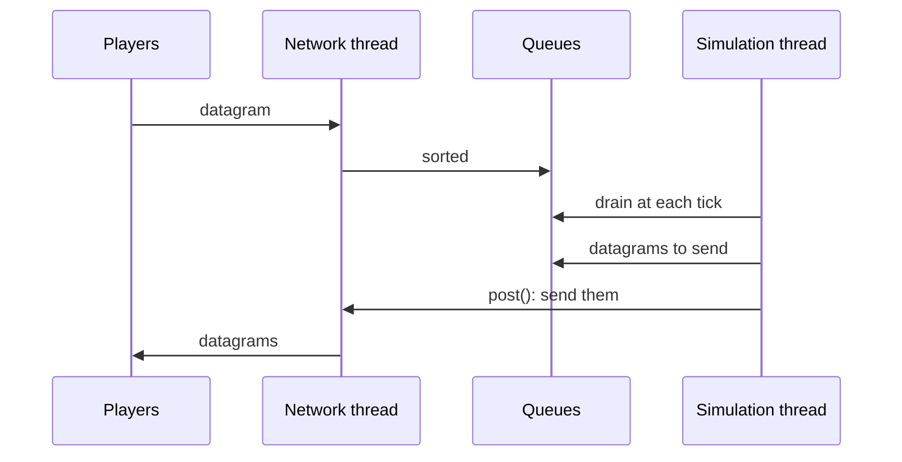
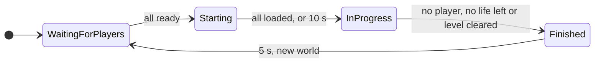
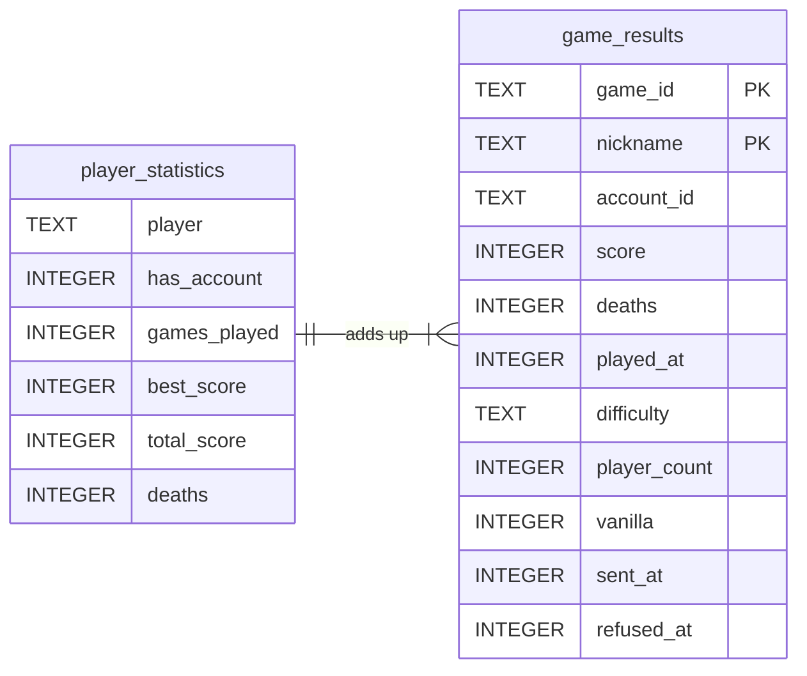

The server, `r-type_server`, runs the game for the players connected to it: it lets them in, plays up to `MAXIMUM_RUNNING_GAMES` (8) games, up to four players in each, and tells each player what happens in its game. It decides everything: a client only sends its inputs and shows what it is told.

The binary has three roles, chosen by `--mode` (see [The three roles](#the-three-roles-supervisor-game-and-master)):

| Role | Started by | Does |
|---|---|---|
| `supervisor`, the default | the host | reads `server.cfg`, listens on port 4242, starts one game process per game and sends each player to it, serves its content pack over HTTP on the TCP port of the same number, answers the information requests and tells the master |
| `game` | the supervisor, never the host | hosts one game on a port of its own, reads only the file of commands its supervisor gave it, and reports to its supervisor |
| `master` | the host | lists the servers for the players (see [Master](/R-Type/master/)) |

Most of this page describes a game process: the threads, the tick, the game and its rules run there. It never links SFML or Asio: it reaches the network through `rtype_network`, and its own libraries are checked for it at configure time (see [Project layout](/R-Type/project-layout/#who-may-link-what)).

The game library, `rtype_game`, holds the rules of a match: what moves, what touches what and what that means. It is built on the engine (see [Engine](/R-Type/engine/)), and it knows nothing about sockets, SFML or the messages sent between the programs (see [Project layout](/R-Type/project-layout/#game)). The server runs all of it; the client runs only the part that predicts its own ship (see [Client](/R-Type/client/#own-ship-prediction-ownshippredictor-shipprediction)).

This page tells you where to look when you need to change something. It describes what exists today and says plainly what does not exist yet.

## At a glance

This section is the map of the page: the threads, one tick, the life of a game and the rules, each with the place to look at in the code. The sections below it give the details.

### Threads

A game process and the supervisor each run on the threads below. Only the network thread and the simulation thread work during a game, and they share no game state: a datagram crosses from one to the other through a queue, and a request to act through `NetworkContext::post()`. Every game runs on the simulation thread, so nothing in a game needs a lock.

| Thread | Does | Where |
|---|---|---|
| Main | Starts the modules, waits on the `StopRequest`, then stops the modules | `src/server/main.cpp` |
| Network | Started by `ServerNetworkModule::start()`. Owns the socket: sorts each datagram into a queue as it arrives, and sends the outgoing queue when asked | `src/server/Network/` |
| Simulation | Started by `ServerApplication::run()`. Runs `SIMULATION_TICKS_PER_SECOND` (60) ticks per second, and in them every module and every game | `src/server/Network/` |
| Content pack | In the supervisor only. Started by `ServerContentModule::start()`: the `HttpServer` listens on a thread of its own and answers the downloads of the content pack on the threads of cpp-httplib (see [Content pack](#content-pack-servercontentmodule-contentpackdesk)) | `src/server/Content/`, `src/network/Http/` |
| MasterLink | In the supervisor only. Started by `ServerMasterModule::start()` when `master-url` and `master-key` are set. Runs the `HeartbeatJob`: registers the supervisor with the master and sends its heartbeats, reading only `LatestHostedGames` and `LatestServerMeasures`, which the supervised games module publishes, then the vanilla results the master has not answered, through a connection of its own to the file of results (see [Link with the master](#link-with-the-master-servermastermodule)) | `src/server/Master/` |
| AdminConsole | In the supervisor only. Started by `ServerAdminConsoleModule::start()`: reads the standard input and hands each line to the simulation thread, which runs it (see [Administration console](#administration-console-serveradminconsolemodule)) | `src/server/AdminConsole/` |
| Signals | Started by `StopSignals`, on Linux and macOS. Waits for Ctrl-C or SIGTERM and asks for the stop; on Windows, the system runs the handler on a thread of its own | `src/server/Platform/` |

The path of a datagram through the network thread and the simulation thread:



See [Threads](#threads-serverapplication) for the queues and what happens when they fill up, [Tick loop](#tick-loop-tickloop) for the rate, and [Stopping](#stopping-ctrl-c-and-sigterm) for the signals.

### One tick

A tick drains the queues, then runs the stages of `SERVER_LOOP_STAGES`, in this order:

| Stage | Work | Where |
|---|---|---|
| `inputs` | The metrics start measuring the tick | `src/server/Metrics/` |
| `simulation` | Each game in turn plays its tick (below) and the network forgets the players who left it; then the lobby answers the connection requests | `playGames()` in `src/server/Games/`, `answerConnectionRequests()` in `src/server/Lobby/` |
| `outputs` | The event bus of each game delivers its events, so collisions cost health and lives here, and the guaranteed messages among them leave at once; then the metrics end their measure | `src/server/Games/` |

The network thread is then asked to send what the tick left in the outgoing queue.

The tick of one game, `GameInstance::onTick()`, runs the stages of `GAME_STAGES`:

1. `game inputs` reads the datagrams of its players, applies the inputs whose delay is over and closes the silent sessions (`src/server/Sessions/`).
2. `game simulation` runs `GameFlow::onTick()` (`src/server/Rules/Match/`), which ends the game if it is over, then does the work of its state. In `InProgress`, it runs in order `BossPhaseSystem`, `PilotSystem`, `MovementSystem`, `PlayfieldExitSystem`, `CollisionSystem` and `HurtZoneSystem` (`addRtypeSystems`, `src/server/Rules/Match/`), then `WeaponSystem`, `VolleySystem`, `WaveSpawner`, `BossStage` and `LifeKeeper`, then the world state goes out.
3. `game outputs` sends the guaranteed messages due again, then the heartbeats.

### The life of a game

A game is created when its game process starts and never replaced: it goes round these four states of `GameState` as long as the process runs, each round with a new `World`. The process ends by itself once its players are gone (see [Supervisor and game processes](#supervisor-and-game-processes)).



New players only join a game in `WaitingForPlayers`. The rule of each transition is in the state table of [A game](#a-game-gameinstance-and-gameflow), and its code in `GameFlow::advanceState` and `reasonToFinish` (`src/server/Rules/Match/GameFlow.cpp`).

### Game rules

The rules play while a game is `InProgress`. What needs only entities lives in `rtype_game` (`src/game/`); what needs the players of a game, or sends them something, lives in `src/server/`. Code must read the constants: most values are **provisional** until gameplay tunes them.

| Rule | In short | Where |
|---|---|---|
| [Moving](#moving-the-ships-shipcontrol) | A ship follows the arrows of the newest input of its player, at `SHIP_SPEED` (480 logical units per second), and stays in the play area | `src/game/ShipControl/`, `src/game/Systems/MovementSystem/` |
| [Shooting](#shooting-weaponsystem) | A ship fires a missile every 333 ms (20 ticks) while shoot is held, a Bydo every 1500 ms (90 ticks): the gun of their [sheet](/R-Type/entity-sheets/) | `src/server/Spawning/`, `assets/entities/` |
| [Bydos](#waves-of-bydos-wavedirector) | They come in waves read from `assets/waves/waves.toml`; the next wave waits until none is left, and after the last wave of the level comes the boss its difficulty names, if any | `src/game/Waves/`, `src/server/Spawning/` |
| [Boss](#boss-bossstage-and-bossphasesystem) | The Bydo Tyrant arrives 4400 ms after the last wave of `normal` and `hard`, takes no hit during its arrival, has more health with more players, enrages below half its health, and is hit anywhere on its body | `src/server/Spawning/`, `src/game/Systems/BossPhaseSystem/`, `assets/entities/bydo_tyrant.toml` |
| [Contacts](#rules-collisionrules) | Four pairs count: a missile of a player and a Bydo, a missile of a Bydo and a ship, a ship and a Bydo, a ship and a look item; with friendly fire, a missile of a player and the ship of another player too | `src/game/Systems/CollisionRules/` |
| [Damage](#damage-damagerules) | A missile takes `MISSILE_DAMAGE` (1) from a Bydo, which has the health of its sheet (3) | `src/game/Systems/DamageRules/`, `assets/entities/` |
| [Score](#damage-damagerules) | The player whose missile destroys a Bydo earns the score of its sheet: 100 for a Drifter, 200 for a Weaver | `assets/entities/`, `src/server/Rules/Players/` |
| [Lives](#lives-lifekeeper) | A player has the lives of the rules of its game, `STARTING_LIVES` (3) by default; a hit on its ship costs one, and a new ship comes after `RESPAWN_DELAY` (1 s) and cannot be hit for `INVULNERABILITY_DURATION` (2 s) | `src/server/Rules/Players/` |
| [End](#end-of-a-game-gameendannouncer) | The game ends in a defeat once no player left in it has a life, or in a victory once the level is cleared, its last wave over and its boss, if it has one, destroyed with every other enemy, and each player is told the outcome and the scores | `GameFlow` in `src/server/Rules/Match/`, `GameEndAnnouncer` in `src/server/Replication/Announcements/Milestones/` |

To change one of them, see [Where to intervene](#where-to-intervene).

## What exists today

| Part | State | Where |
|---|---|---|
| Network thread and simulation thread | Available | `src/server/Network/` |
| Timer resolution on Windows | Available | `src/server/Platform/` |
| The server assembled from modules (logger, network, storage, games, lobby, information, metrics, master), stopped on Ctrl-C or SIGTERM with a `Disconnection` to every player | Available | `src/server/Modules/`, `src/server/Platform/` |
| Sorting the datagrams before the queues, session token checked, rate limit per address and port with temporary bans | Available | `src/server/Network/` |
| Rejected datagrams counted by cause and by sender, reported in the journal every 10 s | Available for the datagrams the network thread rejects; the `network` command of the [administration console](#administration-console-serveradminconsolemodule) reads the count since the start | `src/server/Network/Rejections/` |
| World state sent to the players of a game, at a rate set at launch (`--state-rate`) | Available | `src/server/Replication/Announcements/Streams/`, `src/server/Rules/Match/` |
| Every player's input applied after the same delay, set at launch (`--input-delay`) | Available | `src/server/Instances/` |
| One header for every datagram to a player: session token and next sequence | Available | `src/server/Sessions/Roster/` |
| Game events sent to the players | Available: the removal of a Bydo or a missile that leaves the playfield, the damage and destruction of a Bydo hit by missiles, the loss of a ship and of a life when a ship touches a Bydo or a missile of a Bydo, the attacks of the enemies, and the status of a boss (`BossStatus`) | `src/server/Replication/`, `src/game/Events/` |
| Launch options | Available: of the supervisor (the port, the seed, the state rate, the input delay, the start at the boss, the database, `--set` and `--help`) and of a game process (`GameLaunchOptions`) | `src/server/LaunchOptions/` |
| Configuration file | Available: `server.cfg` (`module`, `set`, `plugin`, `plugin-folder`), read by the supervisor alone, which writes the lines of its games to `r-type_games_<port>.cfg` | `src/server/Modules/`, `src/engine/Commands/Configuration/`, `src/server/SupervisedGames/` |
| Information requests answered outside any session: name, versions, players, games, free seats, and the time the request was held | Available, by the supervisor; the server map of the client sends them (see [Client](/R-Type/client/#server-map-servermapscreen-iservercatalog-igamecatalog)) | `src/server/Information/`, `src/server/SupervisedGames/` |
| Letting players in: challenge, acceptance or refusal | Available: the supervisor places a new player by the game its request asks for (any game with a free seat, the game of a number, or a new game), starts a game when one is needed, and refuses it with `ServerFull`, `GameNotFound`, `GameInProgress` or `GameFull`; the game process accepts it, and the acceptance announces the content pack the supervisor serves over HTTP | `src/server/SupervisorLobby/`, `src/server/Lobby/`, `src/server/Sessions/` |
| One process per game, started by the supervisor | Available: up to 8 game processes, numbered by place from 1 to 8, each reporting its state, its players and its measures every second and ending by itself or when told to | `src/server/Processes/`, `src/server/SupervisedGames/`, `src/server/SupervisorLink/`, `src/server/SupervisorLobby/` |
| A game: states, ready rule, new world between two games | Available: one game per game process, ending once no player is left in it, no player left has a life, or its level is cleared | `src/server/Rules/Match/` |
| Newest input of each player, held by the `Intent` of its ship and acted on at each tick of a game in progress | Available: the arrows move the ship, shoot fires its missiles | `src/server/Sessions/Tracking/`, `src/server/Rules/Players/`, `src/game/Components/Intent.hpp` |
| Heartbeats every 500 ms, and the round trip and jitter of each player measured from their echoes; a player silent for 5 seconds is away and keeps its seat 15 seconds, then its session closes | Available, and a `Disconnection` closes the session at once | `src/server/Sessions/Tracking/` |
| A nickname unique on the server, held with the seat | Available: a second request for the same nickname gets `NicknameTaken` | `src/server/Sessions/Roster/`, `src/server/Lobby/` |
| Waiting room and start of the game sent to the players (`LobbyState`, `GameStarted`) | Available | `src/server/Replication/Announcements/Milestones/`, `src/server/Rules/Match/` |
| End of a game sent to the players (`GameEnded`) | Available: when the game is won or lost, with its outcome and the score of each, until the game waits for players again | `src/server/Replication/Announcements/Milestones/`, `src/server/Rules/Match/` |
| Metrics in the journal every 10 s: duration of the ticks, time of each system, games, players, entities, round trip of each player and traffic | Available; losses are not measured yet | `src/server/Metrics/` |
| Results of each game kept in a SQLite file, with statistics, and a leaderboard read with `LeaderboardRequest` | Available; the leaderboard of the client reads it, and nothing in the game shows the statistics | `src/server/Results/`, `src/server/Storage/`, `src/storage/` |
| Text chat in the waiting room and during a match (`ChatLine`, `PlayerChatLine`), one line a second per player, 127 bytes at most | Available; the client sends and shows them (see [Client](/R-Type/client/#chat-chatchannel-chatwindow)) | `src/server/Chat/` |
| Game statistics: a CSV row per Bydo killed and the total of each game, written by a plugin | Available, loaded by `plugin game-statistics` | `src/server/GameStatistics/` |
| Master mode: `--mode master` runs the master instead of the supervisor | Available (see [Master](/R-Type/master/)) | `src/server/LaunchOptions/`, `src/master/` |
| Administration console of the supervisor: the games and their pilots, closing a game, expelling and banning a pilot, the traffic, the rejected datagrams and the measures of the games | Available | `src/server/AdminConsole/`, `src/server/BanBook/` |
| Master link: registration, heartbeats and the results of vanilla games | Available, from the supervisor, one registration for all its games; admin orders and bans not yet written (see [Link with the master](#link-with-the-master-servermastermodule)) | `src/server/Master/` |
| Components (`Position`, `SteadyMotion`, `CollisionBox`, `Health`, `EntityType`, `EntityTypeNumber`, `Sprite`, `Layer`) | Available | `src/game/Components/` |
| Entity sheets: every entity made from the sheet of its type, the sheets read at launch | Available: the ship, the Bydos, the Bydo Tyrant and their missiles (see [Writing an entity sheet](/R-Type/entity-sheets/#the-shipped-sheets)) | `assets/entities/`, `src/game/EntityTypes/`, `src/game/World.cpp` |
| Movement, run by each game tick: every body by its `Intent`, a ship as a ship, the Bydos and the missiles at the top speed of their sheet | Available | `src/game/Systems/MovementSystem/`, `src/server/Rules/Match/` |
| Behaviours of the Bydos and the missiles, and removal of what leaves the playfield | Available: the behaviours of [Writing an entity sheet](/R-Type/entity-sheets/#behaviours-and-their-settings), `bydo_tyrant` included, with the settings their sheets give them; a Bydo and its missiles leave on the left, a missile of a player on the right; a boss never leaves | `src/game/Behaviours/`, `src/game/Systems/PilotSystem/`, `src/game/Systems/PlayfieldExitSystem/` |
| Collisions | Available, run by each game tick | `src/game/Systems/CollisionSystem/`, `src/game/Systems/CollisionRules/`, `src/game/Events/`, `src/server/Rules/Match/` |
| Damage and destruction | Available, run by each game tick; a missile takes no health from a ship, and what its hit costs belongs to the lives | `src/game/Systems/DamageRules/`, `src/server/Rules/Players/` |
| Ship of each player, created when the player joins and announced to the others | Available | `src/game/Spawning/`, `src/server/Replication/Announcements/Milestones/` |
| Ship control: how a ship drifts from the directions its player holds, rolls and dashes on a double press, kept above the status band | Available; the client runs `shipAfter` to predict its own ship | `src/game/ShipControl/`, `src/game/Systems/MovementSystem/`, `src/server/Rules/Players/` |
| Bydos appearing off screen at random heights above the status band of the clients, in waves, then moving left | Available | `src/game/Spawning/WaveEntryPosition.*`, `src/server/Spawning/` |
| Missiles of the players: fired in front of the ship while shoot is held, three per second at most, removed past the right edge | Available | `src/server/Spawning/`, `src/game/Spawning/ProjectileStartPosition.*`, `src/game/Systems/PlayfieldExitSystem/` |
| Missiles of the Bydos: every Bydo fires to the left 1.5 s after it appears, then every 1.5 s; removed past the left edge | Available | `src/server/Spawning/`, `src/game/Spawning/ProjectileStartPosition.*`, `src/game/Systems/PlayfieldExitSystem/` |
| Score: the points of the sheet of each Bydo, credited to the player who fired the missile, sent in the world state | Available | `assets/entities/`, `src/game/Systems/DamageRules/`, `src/server/Rules/Players/` |
| Waves of Bydos that grow, read from the waves file at launch, up to the last wave of the level | Available: each game plays the difficulty its creator chose, `normal` (8 waves) by default, then the Bydo Tyrant in `normal` and `hard` (see [Boss](#boss-bossstage-and-bossphasesystem)) | `src/game/Waves/`, `src/server/Spawning/`, `assets/waves/waves.toml` |
| The boss after the last wave: its warning, its arrival, its fight, its rage and its volleys | Available: the Bydo Tyrant, in `normal` and `hard` (see [Boss](#boss-bossstage-and-bossphasesystem)) | `src/server/Spawning/`, `src/game/Systems/BossPhaseSystem/`, `src/game/Behaviours/Movements/Attacks/` |
| Lives: a life lost when a ship touches a Bydo or a missile of a Bydo, a new ship 1 s later that cannot be hit for 2 s, a player with no life left watching | Available | `src/server/Rules/Players/` |

## The three roles: supervisor, game and master

`main()` (`src/server/main.cpp`) reads `--mode`, the first argument, and runs one of three programs. Each reads its own launch options, its own file of commands and its own list of modules, so a role holds only what it needs:

| | `supervisor`, the default | `game` | `master` |
|---|---|---|---|
| Launch options | `LaunchOptions` | `GameLaunchOptions` | `MasterLaunchOptions` (see [Master](/R-Type/master/)) |
| Reads | `server.cfg`, whole; runs its own lines and keeps the lines of its games | only the file given after `--configuration`; none without it | `master.cfg` |
| Modules | `supervisorModules()`: logger, network, content, supervised games, bans, supervisor lobby, information, master, admin console | `gameProcessModules()`: logger, network, storage, games (one game), lobby, metrics, supervisor link, and the plugins its file loads | `masterModules()` |
| Settings it owns | `port`, `database`, `server-name`, `master-url`, `master-key`, `public-address` | `seed`, `state-rate`, `state-encoding`, `input-delay`, `start-at-boss`, and those of its plugins; its `port` and `database` come from its command line | those of `master.cfg` |
| Talks to the master | yes, one registration for all its games | never | |
| Answers information requests | yes | never | |
| Journal | `r-type_server.log` | `r-type_game_<n>.log`, n its number in the journal of the supervisor | `r-type_master.log` |
| An error prints | `supervisor stopped: <reason>` | `game stopped: <reason>` | `master stopped: <reason>` |

The host only starts the supervisor and the master. `--mode game` is the command line the supervisor gives each game process (see [Supervisor and game processes](#supervisor-and-game-processes)); started by hand without `--supervisor` and `--link-token`, it stops at once. There is no mode that hosts games in the process that reads `server.cfg`: `--mode server` is an unknown mode.

`tests/server/Modules/ServerRolesTest.cpp` keeps the roles apart: it installs the modules of each role and checks that every `set` line of `server.cfg.example` is declared by the role that runs it, and that a game process holds neither the information nor the master.

## Launch options: `LaunchOptions`

`LaunchOptions` (`src/server/LaunchOptions/`) reads what the supervisor is told at launch. `main()` hands it the arguments of the process, and `LaunchOptions::read()` reads them in one pass with the engine's `readLaunchArguments` (see [Engine](/R-Type/engine/#launch-arguments-readlauncharguments)): the options below, those of the network simulator (see [Network](/R-Type/network/#network-simulator-simulatednetworksocket)) and the logging options (see [Logging](/R-Type/logging/#choosing-the-level-and-the-output-at-launch)), which it keeps for the logger module (`logOptions()`). The argument after an option that takes a value is always its value, so `--seed --log-level debug 123` is refused: `--log-level` is no seed.

| Option | Effect |
|---|---|
| `--mode <supervisor\|game\|master>` | The program the binary runs: the supervisor (`supervisor`, the default), a game process (`game`, started by the supervisor only, see [A game process](#a-game-process-gamelaunchoptions)) or the master (`master`, see [Master](/R-Type/master/)). It comes before every other option; further on, it is an unknown argument. |
| `-p <port>` | The UDP port to listen on, from 1 to 65535 (see [Network](/R-Type/network/#ports-and-addresses-written-as-text-portfromtext-ipv4addressfromtext)). Default: `DEFAULT_SERVER_PORT` (4242). The games listen on ports the system picks. |
| `--seed <seed>` | The number the random draws of the games start from, a whole number from 0 to 4294967295. Default: drawn at random. Handed to the games. See [Waves](#waves-wavespawner). A seed makes the games not vanilla (see [Vanilla games](#vanilla-games-vanillabreaches)). |
| `--state-rate <states>` | The world states sent to each player per second, a whole number from 2 to 60. Default: `DEFAULT_WORLD_STATES_PER_SECOND` (20). Handed to the games. More states move the other ships more smoothly and use more bandwidth; see [World state](#world-state-worldstatesender). |
| `--input-delay <ticks>` | The ticks every player's input is held before it is applied to its ship, a whole number from 0 to 30. Default: `DEFAULT_INPUT_DELAY_TICKS` (3, 50 ms). Handed to the games. The same delay holds for every player; see [Player inputs](#player-inputs). Any other delay makes the games not vanilla. |
| `--boss` | Starts every game at its boss, without the waves, to test the fight: the boss is announced on the first tick of the game and appears `BOSS_ARRIVAL_WARNING` (4400 ms) later, and the ships never die. A difficulty without a boss is won at once. Handed to the games. It makes the games not vanilla (see [Vanilla games](#vanilla-games-vanillabreaches)). Default: the waves are played. |
| `--database <file>` | The SQLite file the leaderboard of this server is kept in, on a local disk, as the setting `database`. Default: empty, which keeps it in `r-type_server_<port>.db` next to the executable, with the port of the supervisor, so two servers on one machine never merge their leaderboards. Every game of the supervisor is started with this file. See [Results and leaderboard](#results-and-leaderboard-resultsmodule-resultsarchive). |
| `--set <name>=<value>` | Gives a setting a value, as the line `set <name> <value>` of `server.cfg` does (see [Configuration](#configuration-servercfg)). Can be given several times. A setting of the games is handed to them. |
| `--network <name>`, `--lag <ms>`, `--jitter <ms>`, `--loss <percent>`, `--duplicates <percent>`, `--reorder <percent>` | The simulated network every datagram of the supervisor's socket crosses (see [Network](/R-Type/network/#network-simulator-simulatednetworksocket)), and the one of every game it starts: the supervisor gives each game the five values (`LaunchOptions::gameArguments()`), so a datagram between a player and its game crosses the network asked for once, on the side of the game, and the requests a player sends the supervisor cross it on the side of the supervisor. The statuses between the supervisor and its games cross both. Default: none, the network is not simulated. |
| `--traffic-csv <file>` | The file each game writes its traffic to, named after it: for `traffic.csv`, game n writes `traffic_game_<n>.csv` in the same folder (`GAME_TRAFFIC_FILE_INFIX`, `gameCommand()`), so two games never write one file. The supervisor has no metrics module and writes none. Default: no file. |
| `--help` | Prints the usage, the simulator and logging options included, on standard output, then exits with code 0 without starting anything or opening the journal. |

- `-p`, `--seed`, `--state-rate`, `--input-delay`, `--boss` and `--database` are shortcuts: each forces the setting `port`, `seed`, `state-rate`, `input-delay`, `start-at-boss` or `database` with the line `set <name> <value>`, the first four once their value is checked, `--boss` with the value 1. The forced lines run after `server.cfg`, so a launch option wins over the file. The lines of `seed`, `state-rate`, `input-delay` and `start-at-boss` are not run by the supervisor: it hands them to its games, after the lines of the file (see [Configuration](#configuration-servercfg)).
- The supervisor listens on every IPv4 interface (`ANY_IPV4_ADDRESS`) and takes no address: `-h`, the client's address option, is an unknown argument here. The last `-p` wins, and so do the last `--seed`, the last `--state-rate`, the last `--input-delay`, the last `--database` and the last `--traffic-csv`.
- An unknown argument, a `-p`, `--seed`, `--state-rate`, `--input-delay`, `--database` or `--traffic-csv` without a value, an invalid port, a seed that is not a whole number from 0 to 4294967295, a state rate that is not a whole number from 2 to 60, an input delay that is not a whole number from 0 to 30, a `--set` value that is not `name=value`, a simulator option without a value or with one out of its range, or a logging option that does not exist or has no value, stops the program before anything starts: it prints `r-type_server:`, the reason and how to see the usage on standard error, then exits with code 1. When several arguments are wrong, the first one from the left is reported.

```bash
./r-type_server -p 4243
```

### A game process: `GameLaunchOptions`

`GameLaunchOptions` (`src/server/LaunchOptions/`) reads the arguments after `--mode game`, the ones `gameCommand()` (`src/server/SupervisedGames/Launch/`) writes for each game:

| Option | Effect |
|---|---|
| `-p <port>` | The UDP port of the game, which the supervisor picked. |
| `--supervisor <port>`, `--link-token <number>` | The UDP port of the supervisor, on the loopback, and the whole number from 1 to 18446744073709551615 they share. Required, together: without either, the program stops before anything starts (`MissingSupervisorLinkException`). |
| `--database <file>` | The leaderboard file of the supervisor. |
| `--log-file <file>` | `r-type_game_<n>.log` next to the executable. |
| `--configuration <file>` | The file of commands the game reads, `r-type_games_<port>.cfg` next to the executable with the port of the supervisor; no file without it. |
| `--traffic-csv <file>`, the simulator and logging options | As for the supervisor. The supervisor gives each game its own `--log-file`, then the logging options it shares (`--log-level`, `--no-log-file`, `--no-log-stderr`, see `LogLaunchOptions::forwardedArguments()`), then the five values of its simulated network, then `--traffic-csv` with the file of that game when it was given one. A `--no-log-file` comes after the journal of the game, so the last one wins and the game writes none either. |
| `--difficulty <name>`, `--lives <count>`, `--friendly-fire <0\|1>` | The rules of the game, as its creator chose them (see [Rules of a game](#rules-of-a-game)). |

`-p`, `--database`, `--difficulty`, `--lives` and `--friendly-fire` force the settings `port`, `database`, `difficulty`, `lives` and `friendly-fire`, after the file of `--configuration`.

## Threads: `ServerApplication`

`ServerApplication` (`src/server/Network/`) runs the server on two threads, which never share game state:

- The **network thread**, the one that calls `run()`, runs the `NetworkContext`. A `DatagramSorter` sorts every datagram as it arrives: the datagrams of admitted players that carry their session token go to the player queue, connection requests to the request queue, information requests to the information queue, and the rest is dropped there, as is a datagram over the rate limit of its sender (see [Sorting the datagrams](#sorting-the-datagrams-datagramsorter)). `DatagramRelay` (`rtype_network`, see [Network](/R-Type/network/#socket-to-queues-datagramrelay)) sends what was left in the outgoing queue. It is the only thread that touches the socket.
- The **simulation thread** runs `SIMULATION_TICKS_PER_SECOND` (60) ticks per second. Each tick drains the player queue, the request queue and the information queue and hands what arrived, often nothing, to the tick handler given to the constructor, as a `ReceivedDatagrams` (`players`, `connectionRequests`, `informationRequests`), so a slow or silent player never holds the game up. At the end of the tick it asks the network thread, through `NetworkContext::post()`, to send the outgoing queue.

The tick handler is where the game plugs in. The network module gives one (see [Modules](#modules-and-stopping-the-server)): it keeps the datagrams for the modules and runs the stages of the loop, so in a tick each game of the list gets the datagrams of its own players, reads the `ReadyState` and the inputs among them, moves along its states and tells its players the room, the start and the world state (see [A game](#a-game-gameinstance-and-gameflow) and [Player inputs](#player-inputs)), and the address of each player whose session closed in that tick is forgotten (see [Silent players](#silent-players-heartbeats-and-timeouts)); then each connection request goes to the `ConnectionAcceptor` of the game it is placed in, which answers it and gives each new player a ship in that game (see [Letting players in](#letting-players-in-connectionacceptor-playerroster) and [Player ships](#player-ships-shipspawnannouncer)), and each information request is answered (see [Server information](#server-information-serverinformationmodule-serverinformationdesk)); then the `EventBus` of each game delivers its events, which the broadcaster sends to the players who joined (see [Game events](#game-events-gameeventencoder-and-gameeventbroadcaster)).

A tick handler puts a datagram in the outgoing queue with `queueDatagram()`, called from the handler itself, on the simulation thread. The datagram is sent at the end of the same tick.

The sorter only lets through datagrams of this protocol whose message sizes add up, but anyone can still send a connection request, and the payloads are read by the tick, so the tick handler must drop and count a datagram it cannot decode, and never let an exception caused by a datagram's content escape: an exception that leaves the tick stops the server (see below), so one truncated datagram would stop it for every player. `ByteReader`, for instance, throws `BufferUnderflowException` when a datagram is shorter than what it reads. The handlers of the players' messages and the answers to connection requests are guarded: an exception one of them throws is logged at the `error` level and that message or datagram is dropped (see [Network](/R-Type/network/#dispatch-messagedispatcher) and [Letting players in](#letting-players-in-connectionacceptor-playerroster)). An exception from anything else in the tick, a system of a game for instance, still stops the server.

The player queue and the outgoing queue hold `INCOMING_DATAGRAM_QUEUE_CAPACITY` and `OUTGOING_DATAGRAM_QUEUE_CAPACITY` (256) datagrams each, about one second of the inputs of four players; the request queue holds `CONNECTION_REQUEST_QUEUE_CAPACITY` (16) and the information queue `INFORMATION_REQUEST_QUEUE_CAPACITY` (16) (`src/server/ServerConstants.hpp`). These sizes are **provisional**: they will be revised with the rates of the protocol. Code must read the constants.

- When more datagrams arrive between two ticks than the player queue, the request queue or the information queue holds, the oldest are discarded, and the datagram that made room is counted against its sender (see [Rejection report](#rejection-report-rejectionledger)).
- A flood of connection requests, or of datagrams from strangers, never pushes a player's datagram out of its queue, and one address and port places at most `REQUEST_BURST` (11) requests in the request queue, then 4 a second. Many forged addresses can still fill that queue and delay the requests of new players (see [Flood protection](#flood-protection)). The information requests have a queue of their own, so a flood of them never pushes a connection request out, and they spend the same limit: one address and port places 11 requests of either kind at once.
- The outgoing queue also discards its oldest datagram when full, but nothing reports it yet.

`ServerApplication` implements `IDatagramSender` (`queueDatagram()`) and `IPlayerAdmission` (`admit()`, `forget()`), the two interfaces the other parts of the server use to reach it. Building it binds nothing: `open()` binds the socket, behind the simulated network the launch options describe if any (`ServerAlreadyOpenException` when it is already bound), and returns the address and port it bound, the port the system picked on port 0; `run()` throws `ServerNotOpenException` before it. `close()` unbinds it, so the port is free again once `run()` returned.

`stop()` makes `run()` return, from any thread: the network thread stops at once, the simulation thread when its current sleep ends, about one tick later. An exception thrown on either thread, by the tick handler for instance, stops both, and `run()` rethrows it.

### Sorting the datagrams: `DatagramSorter`

`DatagramSorter` (`src/server/Network/`) decides, on the network thread, which queue each received datagram goes to, before any queue holds it. It reads the header and the type of each message, never a payload. The first row that applies decides where a datagram goes:

| The datagram… | Goes to |
|---|---|
| is of this protocol with another version, from a sender that was not admitted, and holds at least `CONNECTION_REFUSED_DATAGRAM_SIZE` (26) bytes | the request queue, where the `ConnectionAcceptor` refuses it, if its address and port is within `REQUEST_RATE_LIMIT`; otherwise nowhere |
| is not of this protocol and version, has a flag this version does not know, or its message sizes do not add up | nowhere: dropped |
| comes from the address and port of an admitted player without the session token of that player (a `ConnectionRequest`, a `ServerInformationRequest` or a `MasterProbe` may carry 0 instead) | nowhere: dropped, and counted apart |
| comes from a stranger and holds neither a `ConnectionRequest`, a `ServerInformationRequest` nor a `MasterProbe` | nowhere: dropped, without spending any limit |
| carries the session token of the player of its address and holds neither | spends the allowance of that player under `PLAYER_RATE_LIMIT`; then the player queue, or nowhere over the limit |
| holds a `ConnectionRequest`, whatever its token: from a stranger, with 0, or with the token of the player of its address | spends the allowance of its address and port under `REQUEST_RATE_LIMIT`, so a player places no more requests than a stranger; then the request queue, where the `ConnectionAcceptor` answers it (see [Letting players in](#letting-players-in-connectionacceptor-playerroster)), or nowhere over the limit |
| holds a `ServerInformationRequest` and no `ConnectionRequest`, whatever its token | spends the allowance of its address and port under `REQUEST_RATE_LIMIT`, the one its connection requests spend; then the information queue, where the `ServerInformationDesk` answers it (see [Server information](#server-information-serverinformationmodule-serverinformationdesk)), or nowhere over the limit |
| holds a `MasterProbe` and neither request, whatever its token | spends the allowance of its address and port under `REQUEST_RATE_LIMIT`; then the probe queue, where the master module keeps its token (see [Link with the master](#link-with-the-master-servermastermodule)), or nowhere over the limit |

- A player is admitted by `ServerApplication::admit(endpoint, sessionToken)`, which the acceptor calls once for each sender it gives a place to, with the token it drew for that player. Admitting an address again with another token replaces it and gives the player a fresh allowance; with the same token, it keeps what the player spent, so admitting one session twice never lifts its ban. A player who asks to join again is answered by the acceptor without being admitted again, so its ban stays as well. It may be called from any thread: it posts the admission to the network thread, so a datagram the player sends before that is dropped like a stranger's. `ServerApplication::forget(endpoint, sessionToken)` undoes it once the session of that player closed (see [Silent players](#silent-players-heartbeats-and-timeouts)): the datagrams from that address are dropped like a stranger's again, unless the address was admitted with another token in between, so the two calls may reach the network thread in either order.
- The `PlayerRoster` and the `ConnectionAcceptor` run in the tick, on the simulation thread; the network thread only keeps the address, port, session token and allowance of each admitted player.
- The rate limits are those of [Network](/R-Type/network/#rate-limit-spendallowance-requestallowances): the allowance of each admitted player is kept with its address and token, and those of the other senders by address and port in a `RequestAllowances`. The token is checked before any allowance is spent, so whoever forges the address of a player without its token never spends the allowance of the player: their requests spend the allowance of that address among the requests, and their other datagrams are dropped first. They can neither drop nor ban the datagrams of the player.
- Each datagram the sorter drops is counted in the `RejectionLedger` of the server application, with its cause and its sender (see [Rejection report](#rejection-report-rejectionledger)). Besides these counts, every drop, a wrong token included, is logged at the `debug` level with its sender and why, such as `it is shorter than the packet header`, `its sender was not admitted, and it holds no connection request` or `its sender sent more than its rate limit`, at most once per `REJECTION_LINE_INTERVAL` (10 s), with how many since the previous line (see [Logging](/R-Type/logging/#repeated-events-throttledlog)). The time of these lines, and the time the allowances are spent at, come from the `IClock` the server application gives both, read only for a datagram dropped or one that passed the token.
- Measured before the rate limit on an Apple Silicon laptop (Apple M4 Pro, `-O2`, median of 7 runs of 2 million datagrams): sorting a datagram costs about 30 ns when a stranger's is dropped, 29 ns when one is dropped for its session token, the sender kept included, 18 ns for bytes shorter than a header, and 37 ns when it is queued, copy included. Reading the clock and counting the drop for its log line take 8 to 16 ns of a drop. A flood of 3 800 datagrams per tick therefore costs the network thread under 0.15 ms of every 16.7 ms, whatever the datagrams hold. A malformed datagram is found without throwing (`DatagramCodec::messageTypes`): an exception costs about 4 µs, so a flood of malformed datagrams would otherwise take about 14 ms of every tick. Answering a request costs about 0.45 µs, or 0.55 µs with a wrong cookie; the request queue keeps that under 9 µs per tick.
- Measured again on 4 November 2026, before and after the rate limit, with a harness on a simulated clock and the journal off (Apple M4 Pro, `-O2`, median of 7 runs of 2 million datagrams): a stranger's datagram dropped costs 16 and 18 ns, one dropped for its session token 22 and 23 ns, bytes shorter than a header 2.5 ns, and a player's datagram queued 37 and 40 ns. A request queued cost 36 ns before; it now costs about 100 ns from a new sender, which takes a slot of the table and the SipHash of its address, and 69 ns from a banned sender. A flood of 3 800 requests per tick, each from a new address, therefore costs the network thread about 0.4 ms of every 16.7 ms.
- Counting each drop in the `RejectionLedger` was measured before the rate limit existed (Apple M5, `-O2`, median of 7 runs of 2 million datagrams, against the same code without it): it takes a stranger's drop from 32 to 36 ns when the datagrams come from one address, to about 43 ns when they come from 64 addresses in turn, and to about 165 ns when each comes from a new address, which then takes the place of another; bytes shorter than a header go from 17 to 21 ns. A flood of 3 800 datagrams per tick, each from a new forged address, therefore costs the network thread about 0.6 ms of every 16.7 ms for the ledger, besides the figures above; the simulation thread does not pay it.

### Rejection report: `RejectionLedger`

The network thread counts each datagram it rejects: each one the sorter drops, and each one that makes a queue discard its oldest datagram. `RejectionLedger` (`src/server/Network/Rejections/`) keeps one count per cause, and the counts of each sender by address and port. Every `TICKS_PER_REPORT` ticks (600, so every ten seconds), `RejectionReporter` writes them at the `warn` level, then the counts of the senders start afresh; a report with nothing rejected writes nothing.

| Cause | The datagram… |
|---|---|
| `shorter than the header` | holds fewer bytes than a packet header |
| `foreign header` | is of another protocol, of another version the server does not refuse, or has a flag this version does not know |
| `message sizes` | holds messages whose sizes do not add up to its end |
| `stranger` | comes from a sender that was not admitted and holds no message sent outside any session, a connection request or an information request |
| `wrong session token` | comes from the address of an admitted player without its session token |
| `over rate limit` | comes from a sender over its rate limit, a player or an address and port among the requests |
| `newly banned` | is the one that put its sender over the limit once too often: the ban starts with it |
| `banned` | comes from a sender during its ban |
| `player queue full` | made the player queue discard its oldest datagram |
| `request queue full` | made the request queue discard its oldest datagram |
| `information queue full` | made the information queue discard its oldest datagram: the asker gets no answer and asks again when it chooses |
| `probe queue full` | made the probe queue discard its oldest datagram: its token is lost, and the master sends another after the next heartbeat |

```
rejected 4 datagrams in the last 10 s (5 since the start): 1 stranger, 3 wrong session token
rejected 3 datagrams from 203.0.113.7 port 40000 in the last 10 s: 3 wrong session token
rejected datagrams from 2 more senders in the last 10 s, besides 1 forgotten to keep at most 64
```

- The first line counts each cause since the previous report, and every datagram rejected since the start. Then come at most `REPORTED_SENDER_COUNT` (5) senders, the most rejected first, and the one rejected most recently first among those rejected as often. The last line counts the senders it does not name.
- The ledger keeps at most `REJECTED_SENDER_CAPACITY` (64) senders between two reports. A new sender then takes the place of the one rejected least recently, whose counts are forgotten, as the zones of nginx's `limit_req` forget the least recently used address. So senders that forge a new address for each datagram never make the ledger hold more, and the report stays seven lines at most, whatever they send. Such a flood can push a real sender out of the list, never out of the counts of its cause; the last line says how many were forgotten. The traffic counters do the opposite: every sender that was not admitted shares one row, so they name none of them (see [Network](/R-Type/network/#traffic-counters-trafficcounters)).
- A queue only knows the sender of the datagram that made room: the one it discards is an older one, whose sender may be another. In a flood, the sender that pushes is almost always the one that floods.
- The address and port are written as they are, so a tool that reads the journal, fail2ban for instance, can match the lines of one address.
- The ledger is safe from any thread: the sorter records on the network thread and the reporter reads on the simulation thread, each under one lock, held to count one datagram or to copy the report.
- Not counted: a datagram larger than `MAX_DATAGRAM_SIZE` (1200 bytes), which the socket drops before the sorter; a connection request the `ConnectionAcceptor` cannot read or refuses; a message of a player the game cannot read or has no handler for; a datagram whose sequence is not newer than the newest one read. Each of them keeps its own line at the `debug` level. The `network` command of the [administration console](#administration-console-serveradminconsolemodule) reads the count since the start with `rejectedSinceStart()`, which resets nothing.

### Flood protection

The room of the player queue protects the server's memory; the sorter protects the players from the other senders. A stranger flooding the server's port with connection requests or with anything else no longer pushes the players' datagrams out, and one address and port places at most `REQUEST_BURST` (11) requests in the request queue, then 4 a second. Someone who forges the address and port of an admitted player no longer can either, unless they read its session token on the way: the sorter drops their datagrams before the queue, and their requests without a token spend the limit of that address among the requests, never the one of the player. That player itself, flooding with its own token, is limited too: past `PLAYER_RATE_LIMIT` its datagrams are dropped, so, while the simulation keeps its pace and empties the queue at every tick, it can no longer push the datagrams of the others out of their shared queue, nor make them time out. During a stall of the simulation the queue is not emptied: past about 1.6 s, the allowance of one player alone, 60 at once then 120 a second, fills the `INCOMING_DATAGRAM_QUEUE_CAPACITY` (256) places, and the oldest datagrams are discarded, as four players at the pace of the protocol fill them in about a second anyway. A plain Python loop on the loopback address sends about 3 800 datagrams per tick (measured on an Apple Silicon laptop), about fifteen times the room of the queue. Other engines protect the players in three layers; the first and the third are written, and the rate limit of each player stands in for most of the second:

1. **Sort on the network thread, before the queue.** Written: `DatagramSorter` drops there every datagram that is neither from an admitted player, a `ConnectionRequest`, a `ServerInformationRequest` nor a `MasterProbe`, every datagram from the address of a player without its session token, and every datagram over the rate limit of its sender; the connection requests, the information requests and the probes of the master have a queue each. A sender that keeps going is banned for `BAN_DURATION` (10 s) (see [Network](/R-Type/network/#rate-limit-spendallowance-requestallowances)). The allowances of the senders of requests sit in a table of fixed size, 1024 senders, so forged addresses cannot make it grow. Quake 3 ignores such datagrams and answers at most 10 status, information or remote console requests per second from one address; Unreal limits how many datagrams of senders without a connection it processes each frame.
2. **One queue per session**, so a flooding client only fills its own. Valve's GameNetworkingSockets keeps one per connection, of 1 000 messages by default. Not written: the players share one queue, but the limit of each one keeps it to two datagrams a tick on average, after a burst of 60, so 32 players sending at their limit fill 64 of its 256 places a tick.
3. **One input per player and per tick.** The protocol requires it (see [Protocol](/R-Type/protocol/#inputs)). Written: each `GameInstance` keeps only the newest `PlayerInput` of each of its players and ignores older ones (see [Player inputs](#player-inputs)), then, after the input delay, applies it to the ship of that player at each tick of a game in progress (see [Moving the ships](#moving-the-ships-shipcontrol)).

The limits are kept by address and port, where Quake 3 keeps them by address alone, so the players behind one router, or several clients on one machine, keep a limit each. A flooder that changes its port at every datagram therefore escapes the limit of one port; the room of the request queue, 16 per tick, still bounds what it costs the server. A forger who knows the address and port of a client about to join can get that port banned for 10 s; without the ban, the same flood would hold the client back for as long as it lasts anyway.

The player queue stays as the last safety net. It discards its oldest datagram, where GameNetworkingSockets refuses the newest, because only the newest input of a player counts. Why threads only talk through queues is explained in [Architecture](/R-Type/architecture/#queues-between-threads).

## Configuration: `server.cfg`

The supervisor reads `server.cfg`, in the folder it is started from, between the install and the start of its modules (see [Engine](/R-Type/engine/#commands-and-configuration-commandinterpreter)). It is the only program that reads it. The file is a list of commands, one per line; `#` starts a comment (every command and setting is listed in [Configuration commands](/R-Type/commands/)). `main()` builds the step with `engine::configurationStep()`: it reads `server.cfg`, then runs the lines the launch options force (`LaunchOptions::forcedLines()`). Before that, and before it builds the modules, it reads the lines that belong to the games with `engine::handedOverLines()`, which applies the same rule and runs nothing, and builds the supervised games module with them.

Each line belongs to the supervisor or to its games. `gameLineRule()` (`src/server/Modules/GameLineRule.cpp`) decides, from the catalogue of `src/server/Modules/ServerRoleConstants.hpp`:

| The line… | Belongs to |
|---|---|
| sets a setting of `GAME_SETTING_NAMES`: `seed`, `state-rate`, `state-encoding`, `input-delay`, `start-at-boss`, `game-statistics-file` | the games |
| runs a command of `GAME_COMMAND_NAMES`: `plugin`, `plugin-folder` | the games |
| is `module <name> on\|off` on a module the supervisor does not have, one `SUPERVISOR_MODULE_NAMES` does not name | the games |
| anything else | the supervisor, which runs it, or refuses it when it does not know it |

A line of the games is not run by the supervisor, in none of the three passes of the step, so the supervisor never loads a plugin. It is kept as written, the lines of the file first, then the forced ones, in `GameLaunchSettings::gameLines`. When it starts, the supervised games module writes them, one per line, to `r-type_games_<port>.cfg` next to the executable, with the port of the supervisor, and starts every game with `--configuration` and that file (`GameConfigurationFile`, `src/server/SupervisedGames/`). The supervisor does not check the lines of its games: a wrong one is refused by each game, in its own journal.

| Command | Effect |
|---|---|
| `module <name> on\|off` | Turns a module on or off, in the supervisor when it is one of its modules, in each game otherwise (see [Modules](#modules-and-stopping-the-server)). A module that is off is never installed, so it provides no service and its work never runs. Refused when a module that stays on depends on it: in the supervisor, `content` needs `network`, `supervised games` needs `network`, `supervisor lobby` needs `network` and `supervised games`, `information` needs `network` and `supervised games`, `master` needs `network`, `supervised games` and `information`; in a game, `storage` needs `network`, `games` needs `network` and `storage`, `lobby` needs `network` and `games`, `metrics` needs `games` and `network`, `supervisor link` needs `network` and `games`, the `game-statistics` plugin needs `network` and `games` once loaded; all need `logger`. |
| `set port <port>` | The UDP port of the supervisor, from 1 to 65535. Default: 4242. |
| `set seed <seed>` or `set seed none` | For the games: the seed of the game, a whole number from 0 to 4294967295; `none` draws one. Default: `none`. |
| `set state-rate <states>` | For the games: the world states sent to each player per second, from 2 to 60. Default: 20. |
| `set state-encoding delta\|full` | For the games: how each world state is written for a player: `delta`, as the difference from the newest state it acknowledged, or with every entity when it acknowledged none or when the newest it acknowledged is more than 60 ticks older (`MAXIMUM_REFERENCE_DISTANCE`); `full`, every entity in every state. Default: `delta`. `full` is there to measure what the differences save (see [Network measurements](/R-Type/measurements/)). |
| `set input-delay <ticks>` | For the games: the ticks every player's input is held before it is applied, from 0 to 30. Default: 3. |
| `set start-at-boss 0\|1` | For the games: 1 starts every game at its boss, without the waves, with ships that never die, and makes the games not vanilla; 0 plays the waves. Default: 0. `--boss` sets it to 1. |
| `set database <file>` | The SQLite file the leaderboard of this server is kept in, on a local disk; a name with a space goes in quotes. Default: empty, which keeps it in `r-type_server_<port>.db` next to the executable, with the port of `set port`. Declared by the supervised games module, which starts every game with this file. |
| `set master-url <url>` | The master the supervisor lists this server on, `http://<host>[:<port>]`. Default: empty, and the server runs alone (see [Link with the master](#link-with-the-master-servermastermodule)). |
| `set master-key <key>` | The key the master gave when the host created this server on it. Default: empty, and the server runs alone. Never committed: only `server.cfg.example` is, with an empty key. |
| `set public-address <address>` | The IPv4 address players reach this server at, which the master lists. Default: empty, and the master lists the address the registration comes from, `127.0.0.1` when the master runs on the same machine. A host name is refused, and so are the addresses no player reaches the server at: `0.0.0.0`, a loopback `127.x.x.x` and `255.255.255.255`. |
| `set server-name <name>` | The name players read in the list of servers and in the answer to an information request, 1 to 32 bytes of printable UTF-8. Declared by the information module. Default: `R-Type server`. |
| `set game-statistics-file <file>` | For the games. Declared by the `game-statistics` plugin, so refused by each game unless a `plugin game-statistics` line loads it: the CSV file the statistics of each game are named after: each game writes it with `_<port>` before its extension, with its own port. Default: empty, which writes `r-type_statistics_<port>.csv` next to the executable (see [Game statistics](#game-statistics-servergamestatisticsmodule)). |

- A missing `server.cfg` is not an error: the defaults apply, and the journal says `server.cfg not found, the defaults apply`. A line that is refused (an unknown command, a value out of its bounds) does not stop the program: it is logged at the `warn` level, with its file and line number, and the next line runs. A line of the games refused by a game is in the journal of that game, once per game started.
- The reading is logged once the journal is open, so the lines appear after the modules' own start lines. The `info` lines are hidden at the default level; start the server with `--log-level info` to see them.

```
# server.cfg
set port 4300
set state-rate 30
module lobby off
```

`server.cfg.example`, at the root of the repository, lists every setting with its default and its bounds. It is not read by the server: copy it to `server.cfg`.

## Modules and stopping the server

`src/server/main.cpp` reads the options and hands a list of modules to an `engine::Application` (see [Modules](/R-Type/modules/)). Each role has its list, the one place that names its modules, in `src/server/Modules/`; they start in this order and stop in the reverse one.

`gameProcessModules()` (`GameProcessModules.cpp`) lists the modules of a game process:

| Module | Does | Where |
|---|---|---|
| `logger` | applies the logging options when it starts, logs "server starting" and "server stopped"; provides the journal as an `ILogJournal`, so a plugin logs where the lines of the game go | `src/server/Logger/` |
| `network` | declares the `port` setting; owns the `ServerApplication`: binds the socket and runs it on a thread when it starts, gives the port back when it stops; provides `IDatagramSender`, `IPlayerAdmission`, `TickDatagrams` (the datagrams of the tick), `IListeningPort` (the port of the `port` setting), `network::TrafficCounters` and the `RejectionLedger` | `src/server/Network/` |
| `storage` | declares the `database` setting; opens the SQLite file and starts the thread that owns it when it starts, finishes what waits and closes the file when it stops; provides `IResultsArchive`; reads the bans of that file again every second on a thread of its own (`BanWatch`) and provides them as `LatestBans` (see [Banning a pilot](#banning-a-pilot)) | `src/server/Storage/` |
| `games` | declares the `seed`, `state-rate`, `state-encoding`, `input-delay` and `start-at-boss` settings, and the rules of its game, `difficulty`, `lives` and `friendly-fire` (`GameRuleSettings`); the one game of the process and its `EventBus`; reads the waves file when it starts and judges whether its game is vanilla; provides `RunningGame` and `IGameEvents` (the bus of the game, for a module listed after it or a plugin) | `src/server/Games/` |
| `lobby` | one `ConnectionAcceptor`, built on the roster of the game; reads the content of the assets and of the resources when it installs, which every acceptance announces with the port of the supervisor; refuses a banned pilot and expels a seated one once the `LatestBans` of the storage module name it (see [Banning a pilot](#banning-a-pilot)) | `src/server/Lobby/` |
| `metrics` | measures the ticks and the systems of the game, and writes a report to the journal every `TICKS_PER_REPORT` ticks; writes the traffic of the socket; provides `LatestMetrics` | `src/server/Metrics/` |
| `supervisor link` | sends the supervisor a `GameStatus` every second and when it changes, with the measures of `LatestMetrics` when the metrics module is on; asks the process to stop when the supervisor does or is gone, and expels the pilots an `ExpulsionOrder` of the supervisor names (see [Expelling a pilot](#expelling-a-pilot)) | `src/server/SupervisorLink/` |

A plugin joins the end of that list when a `plugin` line of its file loads it, after `supervisor link`: the server has one, `game-statistics` (see [Game statistics](#game-statistics-servergamestatisticsmodule)).

`supervisorModules()` (`SupervisorModules.cpp`) lists the modules of the supervisor, whose names `SUPERVISOR_MODULE_NAMES` repeats in the same order, so the configuration of the games can be read before they are built (`SupervisorModules.TheRuleKnowsEveryModuleOfTheSupervisor` checks both agree):

| Module | Does | Where |
|---|---|---|
| `logger` | as in a game, for `r-type_server.log` | `src/server/Logger/` |
| `network` | as in a game, on the port of the supervisor | `src/server/Network/` |
| `content` | reads the sheets and the sprite sheets of the assets and of the resources and encodes the content pack when it installs; serves it over HTTP on the TCP port of the number of `port` when it starts (see [Content pack](#content-pack-servercontentmodule-contentpackdesk)) | `src/server/Content/` |
| `supervised games` | declares the `database` setting, which it gives every game; reads the difficulties of the waves file of its content folders (see [Resources](#resources-ensure-lines)) and writes the file of commands of the games when it starts; starts, follows and stops the game processes (`GameRegistry`); provides `IServerOccupancy`, `LatestHostedGames`, `LatestServerMeasures`, `HostedDifficulties` and `IResultsFile`, the file of that setting | `src/server/SupervisedGames/` |
| `bans` | required; provides the `BanBook`, the bans of the file `IResultsFile` names, which it reads when it starts if that file exists, and which the first ban creates otherwise (see [Banning a pilot](#banning-a-pilot)) | `src/server/BanBook/` |
| `supervisor lobby` | answers the connection requests: refuses a banned pilot once its cookie is valid, refuses the rules of a new game it does not accept, sends each player to a game, or starts one | `src/server/SupervisorLobby/` |
| `information` | declares the `server-name` setting; answers the information requests with what `IServerOccupancy` counts; provides `IServerName` | `src/server/Information/` |
| `master` | declares the `master-url`, `master-key` and `public-address` settings, and registers the name `IServerName` gives; keeps the master told of the games, and sends the vanilla results of the file `IResultsFile` names, on a thread of its own, MasterLink, when both a url and a key are set | `src/server/Master/` |
| `admin console` | registers `games`, `players`, `close-game`, `kick`, `ban`, `unban`, `bans`, `network` and `help` in the interpreter; reads the terminal on a thread of its own, AdminConsole, from its start to its stop, and runs the lines typed at each tick (see [Administration console](#administration-console-serveradminconsolemodule)) | `src/server/AdminConsole/` |

The supervisor loads no plugin: a `plugin` line goes to its games (see [Configuration](#configuration-servercfg)).

Each tick runs the stages of `SERVER_LOOP_STAGES` once, with `SIMULATION_TICK_DURATION`. In a game process, in `simulation`, the games module runs `onTick()` on its game with the datagrams of its own players (`keepDatagramsOf()`) and makes the network forget the players whose session closed, then the lobby module answers the connection requests, so a request is refused by the state the game just reached, then the supervisor link reads the datagrams of the supervisor and sends its status. In `outputs`, the bus of the game delivers its events, and the guaranteed messages among them leave at once (see [Guaranteed messages](#guaranteed-messages-messagedelivery)). Only the metrics module works in `inputs`, where it starts measuring the tick, since `onTick()` reads the datagrams and moves the game in one step; it ends its measure in `outputs`, after the games module. In the supervisor, every module works in `simulation`: the supervised games read the statuses and the exits of the games, then the lobby answers the connection requests and the information module the information requests, by the state the games just reported, and last the console runs the lines typed since the previous tick.

### Several games at once

The [tutorial](/R-Type/tutorial-run-several-games/) runs a supervisor, fills its games and reads them in the journals.

A game process hosts one game. `RunningGame` (`src/server/Games/`) holds it with its `EventBus`, which its rules and its broadcaster subscribe to: the games module creates the game when the process starts and keeps it, since a finished game waits for players again with a new world. Every connection request of the process goes to the acceptor of that game:

| The sender | The answer |
|---|---|
| has a seat in the game | the same acceptance again when the request carries a valid cookie; without a cookie, a challenge, as any request gets |
| has no seat, and the game waits with a free seat | a challenge, then a seat once it answers with the cookie |
| has no seat, and the game left the waiting room or is full | `ConnectionRefused` with `GameInProgress` or `GameFull` |

Sending a player to a game that has a place is the work of the supervisor: `firstJoinableGame()` (`src/server/Games/`) reads a `GameVacancy` per game (its state, and whether it is full) rather than the games, so the supervisor, which does not own its games, places players with it (see [Supervisor and game processes](#supervisor-and-game-processes)). The game starts from the seed given, and without one it draws its own.

The game runs on the simulation thread of its process, and the network thread is the only other one that handles datagrams during a game, so nothing needs a lock. An exception a system of the game throws stops its process only (one a message handler throws only drops that message, see [Threads](#threads-serverapplication)); the supervisor and the other games go on.

The waves files are read when the games module starts, after the logger module started, so a missing or wrong file stops the start of the game process with an error that names the games module, the file, the line and the key, and the line "waves files …" reaches the journal of that game. The supervisor reads the same files when it starts (see [Rules of a game](#rules-of-a-game)), so a wrong file stops it before it opens any game.

### Supervisor and game processes

`r-type_server`, which runs the supervisor unless `--mode` says otherwise, runs no game. It listens on `DEFAULT_SERVER_PORT` (4242), answers the connection requests, starts one process per game and sends each player to the game that has a place. A game process is the same binary started with `--mode game -p <port> --supervisor <port> --link-token <number> --database <file> --log-file r-type_game_<n>.log --configuration r-type_games_<port>.cfg --difficulty <name> --lives <count> --friendly-fire <0|1>` (see [A game process](#a-game-process-gamelaunchoptions)): it hosts one game, on a port the system picked for it. An exception in a game stops that process only; the supervisor and the other games go on.

| Step | Who | What |
|---|---|---|
| 1 | player to supervisor | a `ConnectionRequest` without a cookie gets a `ConnectionChallenge`; nothing is kept or started |
| 2 | player to supervisor | the request with the cookie is placed by the game it asks for (below): a game that has a seat; a new game process on the smallest free place, when the player takes any game and none has a seat, or asks for a new game; a `ConnectionRefused` otherwise, `ServerFull` when the `MAXIMUM_RUNNING_GAMES` (8) places are taken |
| 3 | game process to supervisor | once it runs, a `GameStatus` (its state, the nicknames of its players and its measures) every `STATUS_INTERVAL` (1 s), and at once when it changes; the supervisor answers each with a `GameStatusAcknowledged` |
| 4 | supervisor to player | once the game reported, the player's next request (they repeat every 500 ms) gets a `ConnectionRedirect` to the port of the game; while the game starts, the supervisor answers nothing. Either way the player holds a seat of that game from then on (below) |
| 5 | player to game | a new handshake with the game process, which places the player as a server does |

The supervisor does not see inside a game: `GameRegistry` (`src/server/SupervisedGames/Registry/`) holds, per game, its number, its place, its port, its link token, the state its process reported (`Starting` until the first status), the nicknames of its players, its measures and the handle of the process. The number grows from 0 with each game started and names the journal of the game; the place, from 1 to `MAXIMUM_RUNNING_GAMES`, is the smallest free one when the game starts (`GameRegistry::open()`, `NoFreeGameSlotException` when none is) and is the number the master and the players read, `GAME 1` to `GAME 8`. A game that has not reported counts as waiting for players, so a burst of requests starts one process.

`GameRegistry::placeFor()` places a player by the `GameChoice` of its request (see [Supervisor](/R-Type/protocol/#supervisor) on the protocol page), and returns a `GamePlace`: `Redirect` or `Wait` with the port of the game, `Open`, or `Refuse` with its `RefusalReason`.

| The request asks for | `placeFor()` |
|---|---|
| `AnyGame` | the game that holds a seat for its sender, else the first game played by the default rules that `firstJoinableGame()` finds; else `Open` while fewer than 8 games run, else `Refuse` (`ServerFull`) |
| `NewGame` | the game its sender opened with a `NewGame`, while that game waits for players and its sender holds a seat there or nobody else came; else `Open` while fewer than 8 games run, else `Refuse` (`ServerFull`) |
| `ExistingGame` | the game in that place, whatever its rules: `Refuse` with `GameNotFound` when no game holds it, `GameInProgress` when it is in progress or finished, then `GameFull` when its seats are taken and none is held for the sender |

### Rules of a game

The player who creates a game chooses its difficulty, the lives of each player and friendly fire, in its `NewGame` (see [Supervisor](/R-Type/protocol/#supervisor) on the protocol page). The rules are fixed when the game opens and apply to that game only; a game opened for an `AnyGame` gets the default ones, `network::defaultGameRules()`: `normal`, `STARTING_LIVES` (3), no friendly fire.

1. The supervised games module reads the entity sheets and the waves files when it starts, and keeps the names of their tables in `HostedDifficulties`. A file the server cannot read stops the supervisor there, before it opens any game.
2. `ServerSupervisorLobbyModule` asks `refusalOf()` (`src/server/SupervisorLobby/`) before it places a `NewGame`: `UnknownDifficulty` for a difficulty the file has no table for, then `LivesOutOfRange` for lives out of `LOWEST_LIVES` to `HIGHEST_LIVES` (1 to 9, **provisional**). Nothing is opened then.
3. `GameSpawner::openGame()` keeps the rules in the `SupervisedGame` and gives them to the process: `gameCommand()` writes `--difficulty`, `--lives` and `--friendly-fire`.
4. The games module of the process reads them as settings (`GameRuleSettings`, `src/server/Games/`) into `GameSettings`: the game plays the waves of that difficulty, each player gets those lives when it joins and with each new world, and the deaths of its results count from them.

The three settings are no lines of `server.cfg`: the supervisor does not declare them, so a host cannot set the rules of every game. An `AnyGame` only goes to a game played by the default rules, so a player never lands in rules it did not choose; it joins any other by its number.

A game opened for a `NewGame` remembers who asked for it (`SupervisedGame::creator`, given to `GameSpawner::openGame()`), until the game leaves the registry: the request the client repeats every 500 ms while the game starts finds it, so one player opens one game. Any player may join it afterwards; it starts like any game, once every connected player is ready. On `Open`, `ServerSupervisorLobbyModule` starts the game, then places the player again, so the player that opened the game holds a seat of it at once.

A redirected player takes a handshake with the game before the game reports it, so between the redirect and the next status of the game the supervisor cannot read that player in the nicknames. `SeatReservations` fills the gap: each game holds a seat for each player the supervisor sent to it or told to wait for it, the player whose request opened the game included, and a game is full when its players and its seats held reach four. Without it, five players asking within a second all went to the first game, which seated four and refused the fifth with `GameFull`; now the fifth opens a second game. A seat ends in two ways:

| What happens | The seat |
|---|---|
| A status of the game, newer than every one taken, names one more player of that nickname than the game had when the seat was given | ends: the player sat down, and the game counts it now |
| A status that names none of the players sent, sent before they arrived | stays: two players joining one after the other make the game report twice before the last one sits |
| A late or repeated status, which `record()` does not take | changes nothing |
| `SEAT_RESERVATION_TIMEOUT` (3 s) passes, counted with the ticks of the supervisor | ends: the player is not coming (the handshake takes two round trips, a lost request 500 ms more), and the seat is free again |

A sender holds one seat: a player that asks again, because its redirect was lost, is sent to the game of its seat and takes no other, and a seat lasts its 3 s from the first request whatever the requests after it. A request reaches this step only with a valid cookie, so only from an address that receives; a sender that never joins holds one seat for 3 s at a time, which it would hold for good by joining. Two players asking under one nickname at once, while a namesake already plays in that game, can see one of their seats end early, when the first of them sits. A status is taken only if it is newer than the newest one of that game (serial number arithmetic on `sequence`), so a late one never undoes a newer one. A process that ended leaves the registry and frees its place: with code 0 after it reported, the journal says the game ended; with any other code, or code 0 before any status, it says it crashed. A game that sends no status within `GAME_START_TIMEOUT` (10 s) is killed. A process that cannot be started (no free port, program refused) is logged and nothing else happens.

`SupervisedGamesReport` (`src/server/SupervisedGames/`) turns the registry into what the supervisor tells others, and `SupervisedGamesWatch` publishes the first two only when they change:

- `supervisedHostedGames()`: the games as the master lists them, by place; a game still starting is `waiting`, a game waiting with four players `full`.
- `supervisedMeasures()`: the median and the 95th percentile of the ticks of the slowest game, and the mean round trip of every player, each game counting as many times as it has players.
- `supervisedOccupancy()`: the players of the games, `MAXIMUM_RUNNING_GAMES` (8) games, and as free seats the empty seats of the games waiting for players or starting, plus four for each place no game holds.

The supervisor and a game process know each other by the link token, a random 64-bit number the supervisor draws for each game and passes on the command line: each side admits the other's address and token before the first datagram, so the network lets it through. The token is visible in the process list of the machine; it only gives the right to stop that game.

A game process stops by itself, with code 0, when its supervisor has sent nothing for `SUPERVISOR_SILENCE_LIMIT` (5 s), when it had players and has none for `EMPTY_GAME_GRACE` (10 s), when no player came in `IDLE_GAME_TIMEOUT` (30 s), or when the supervisor sends it a `Disconnection`. A game that ends its round waits for players again; it does not stop. The journal line is `stopping: <reason>`.

Stopping the supervisor with Ctrl-C or SIGTERM sends each game a `Disconnection` three times, waits up to `STOP_GRACE_WAIT` (3 s) for the processes to end, then kills the rest. If the supervisor is killed instead, the games do not stay behind:

| System | What ends a game process whose supervisor died |
|---|---|
| Linux | `PR_SET_PDEATHSIG` (SIGTERM), asked between `fork` and `exec` |
| Windows | a job object with `JOB_OBJECT_LIMIT_KILL_ON_JOB_CLOSE`, which holds every child |
| macOS | nothing at the system level; the silence limit above ends it within 5 s |

On Linux the "parent" is the thread that started the child, so the supervisor starts every game from its simulation thread, which lives as long as it does. Processes are started through `IProcessLauncher` (`src/server/Processes/`), implemented with Boost.Process v2 and polled at each tick, never waited for, so the supervisor has no thread more.

### Administration console: `ServerAdminConsoleModule`

The supervisor reads commands from the terminal it was started in. The `admin console` module (`src/server/AdminConsole/`) registers nine commands in the interpreter of the supervisor, the one `server.cfg` is read with, so a line does the same typed in the terminal or written in `server.cfg`:

| Command | Answer |
|---|---|
| `games` | one line per game: its place, its number, its state, its pilots, its port, then the 95th percentile of its tick and its mean round trip once its status gave them; `no game runs` without a game |
| `players` | the nicknames of the pilots of each game, by place |
| `close-game <place>` | sends the game in that place the order the supervisor sends its games when it stops, `FAREWELL_COPIES` (3) copies of a `Disconnection` under its link token; the game tells its pilots and ends, and `games` lists it until its process ended. Refused when no game holds the place |
| `kick <nickname>` | sends each game whose last status names that pilot, the case of the ASCII letters aside, `FAREWELL_COPIES` (3) copies of an `ExpulsionOrder` under its link token, and writes `<nickname> told to leave game <number> in place <place>` for each (see [Expelling a pilot](#expelling-a-pilot)). Nicknames are unique in a game, not on the server, so a pilot of that nickname in two games leaves both. Refused, sending nothing, without exactly one nickname the protocol accepts, or when no game names that pilot |
| `ban <nickname\|address> [<length>]` | bans the target until the end of the length, `30m`, `2h` or `7d` (1 to `MAXIMUM_BAN_COUNT`, 9999, minutes, hours or days), or for good without one, and writes `nickname ACE banned for 2 h`; a ban of the same target, the case of the ASCII letters aside, is replaced (see [Banning a pilot](#banning-a-pilot)). A word that reads as an IPv4 address is an address, any other a nickname, so `01.2.3.4` is a nickname. Refused, banning nothing, when the word is neither, the length cannot be read, or the file refuses the ban |
| `unban <nickname\|address>` | lifts the ban of that target and writes `nickname ace unbanned`; refused when no ban names it |
| `bans` | one line per ban in force, with the time it has left rounded up to the minute (`nickname ACE, 1 h 59 min left`) or `for good`; `no ban` without one |
| `network` | what crossed the socket of the supervisor since the module installed, the datagrams the network thread rejected since the start (`RejectionLedger::rejectedSinceStart()`, which takes nothing from the report of the journal), then the measures of the games the heartbeats carry to the master |
| `help` | one line per command of the supervisor, with its arguments |

The answers go to the standard output and the journal to the standard error, so the two never mix when the journal is redirected. A refused line is answered with the reason the interpreter gives, `unknown command 'gmaes' in line 'gmaes'` for instance.

The commands read the registry of the games, which only the simulation thread touches, so the thread `AdminConsole` (`ConsoleReader`) only reads: it hands each line to the simulation thread through a `BoundedQueue` of `CONSOLE_LINE_CAPACITY` (64) lines, and the module runs them at the next tick, in their order. A `\r` before the end of a line is removed, and a line longer than `MAXIMUM_CONSOLE_LINE_LENGTH` (1024 bytes) is dropped whole, never cut. The stop wakes the read: on Linux and macOS, `select()` waits on the input and on a pipe the stop writes to (`poll()` does not work on a terminal under macOS); on Windows, the stop cancels `ReadFile()` with `CancelSynchronousIo()`, a file the Windows job of the CI only checks.

| Situation | The console |
|---|---|
| No terminal (`< /dev/null`, a service, the CI) | runs the last line, writes `the console input ended` in the journal and reads nothing more; the server goes on |
| The supervisor runs in the background of a shell (`&`) | is not suspended: `SIGTTIN` is ignored during a read, so the read fails and is tried again every `CONSOLE_BACKGROUND_WAIT` (500 ms), until `fg` |
| `module "admin console" off` in `server.cfg` | is never installed: no thread, and its commands are unknown |
| The build sets `RTYPE_MODULE_ADMIN_CONSOLE` off | is not compiled, and the supervisor lists no such module |

#### Expelling a pilot

The supervisor knows the nicknames of the pilots of a game, from its statuses, but not their addresses: the game process holds their sessions, so it expels them.

| Tick | Where | What happens |
|---|---|---|
| N | supervisor | `kick ace` sends 3 `ExpulsionOrder` to each game whose status names `ACE` |
| N' | game process | the supervisor link reads the orders (`holdsStopOrder()` and `expulsionIn()`, `SupervisorOrders.hpp`); `PlayerExpeller` sends each pilot of that nickname not expelled yet 3 `Expulsion` in its session, then sets `ConnectedPlayer::expulsion` to the reason, so the later copies of the order find nobody left to tell |
| N' + 1 | game process | `Departures::closeSilentSessions()` closes the sessions of the expelled pilots first, with the cause of their reason, `Expelled` here: the seat is free, and the others get `PlayerLeft` (`Expelled`), guaranteed |

The `Expulsion` copies are queued before the mark, so they always leave under the session of the pilot, the lesson ioquake3 learnt in r1038. Until the next tick the pilot still counts for the ready rule, as a silent pilot does, for at most one tick (16.7 ms). An expulsion bans nobody: the pilot may join again at once.

#### Banning a pilot

A ban bars a nickname, the case of the ASCII letters aside (`network::nicknameKey()`), or an IPv4 address, for good or until a second (`Ban`, `BanList`, `src/server/Bans/`). The bans live in the table `bans` of the file of the server, the one the supervisor and every game share (see [The file](#the-file-resultsdatabase)), so they outlive a restart and a game started later has them at once. The supervisor writes them; each game reads them again.

| When | Where | What happens |
|---|---|---|
| T | supervisor | `ban ace 2h` writes the row of `ace` in `bans` (`BansDatabase::save()`, which replaces a row of the same target), then the copy of the `BanBook` in memory |
| T + at most 1 s | each game process | `BanWatch`, on a thread and a connection of its own, reads the bans in force every `BAN_REREAD_INTERVAL` (1 s) and publishes them in `LatestBans`; a read the file refuses keeps the bans read before |
| next tick | each game process | the lobby module sees a newer revision of `LatestBans` and expels every seated pilot a ban names, as [Expelling a pilot](#expelling-a-pilot) does, with the reason `Banned`: 3 `Expulsion` (`Banned`), then `PlayerLeft` (`Banned`) to the others |
| a new request | supervisor, or a game asked directly | the supervisor lobby refuses `ConnectionRefused` (`Banned`) once the cookie is valid, so a forged address learns nothing of the bans; a game refuses it before the cookie, like its other refusals: the 26 bytes of the refusal are fewer than the 38 of the smallest request |

The client of a banned pilot shows `THE HOST BANNED YOU.`, and the status band of the others `BANNED` (see [Client](/R-Type/client/#departures-and-a-silent-server-departurefeed-silencewarning)). A ban ends on its second, `expires_at`: from then the supervisor lets the pilot in, and a game at its next read.

| Column of `bans` | Holds |
|---|---|
| `kind` | `nickname` or `address` |
| `target` | The nickname, compared with `NOCASE`, or the address as `network::ipv4AddressFromText()` writes it; with `kind`, the key of the table |
| `banned_at`, `expires_at` | When the ban started and ends, in seconds since 1970 UTC; `expires_at` is empty for a ban for good |

The `bans` module opens the file at its start only when the file exists, and creates it at the first ban otherwise, so a supervisor that runs alone and bans nobody creates no file. The table is the third migration of `SERVER_MIGRATIONS`, after the two of the results.

A game process that no longer reads its datagrams does not stop on `close-game`, expels nobody on `kick`, and stays in `games`.

### Stopping: Ctrl-C and SIGTERM

`StopSignals` (`src/server/Platform/`) turns the signals that ask a program to stop into a request on a `StopRequest`, the object `main()` waits on. A failure of the network thread asks for the same stop, with the text of the error, so `main()` returns 1 after it and 0 after a signal. Only the first request counts.

- Linux and macOS: `SIGINT` (Ctrl-C) and `SIGTERM`. `StopSignals` blocks them in the main thread before any other thread exists, so every thread inherits the mask, and one thread takes them with `sigwait()`: nothing runs inside a signal handler. A signal that arrives before it is built, while the program starts, has its default action.
- Windows: `SetConsoleCtrlHandler`. The system runs the handler on a new thread. Ctrl-C and Ctrl-Break have no time limit; closing the console window gives the process 5 seconds, so that handler waits for the program to finish stopping, at most `CONSOLE_CLOSE_WAIT` (4 s), before it returns. Logoff and shutdown only reach services, and are handled the same way. This file is checked by the Windows job of the CI only.

On a request, `main()` calls `Application::stop()`. It first stops the stages: it waits for the tick in progress, and no work runs after it. Then the modules stop in the reverse order. In a game process, which the supervisor asks to stop with a `Disconnection`, the games module tells every player that the server shuts down, with `FAREWELL_COPIES` (3) copies of a `Disconnection`, `FAREWELL_COPY_INTERVAL` (50 ms) apart (`src/server/ModuleConstants.hpp`), each under the next session header of its player (see `FarewellSender`), then waits `FAREWELL_FLUSH_WAIT` (two ticks) so the last copy leaves; the whole stop takes about 130 ms with a player connected (two intervals and two ticks). The storage module then saves what waits and closes its file. The network module then stops the server and closes the socket, and the journal logs "server stopped". Over a simulated network, a copy still in flight when the socket closes never arrives (see [Network](/R-Type/network/#network-simulator-simulatednetworksocket)): each copy waits half the lag, and the socket closes about 130 ms after the first, so with a lag over about 270 ms (the `bad` scenario's 300 ms included) a player gets none. The client closes its session as soon as it reads one, and shows the player that the server shut down (see [Client](/R-Type/client/#lost-connection-a-dialog-over-the-title) and [Protocol](/R-Type/protocol/#a-peer-disappears)).

The Linux job of the CI checks the stop of the supervisor under the sanitizers: it starts the `r-type_server` the `sanitize` preset builds with `--mode supervisor`, with no player connected and so no game running, sends it SIGINT after 5 s and requires exit code 0, which a leak (LeakSanitizer) or a memory error (AddressSanitizer) would change. The same job runs every test under them (see the README).

## Tick loop: `TickLoop`

`TickLoop` (`src/server/Network/`) calls a function once per tick on the thread that runs it. It counts ticks with a `FixedTimestep` and sleeps until its `nextTickTime()`, so the average rate stays at 60 ticks per second: after a late wake-up the missed ticks run back to back, and a stall longer than `MAXIMUM_TICKS_PER_ADVANCE` (5) ticks drops the excess. `ServerApplication` creates it when `run()` starts, so the first tick is due one tick after the call.

The limit is a choice for this game: during a longer stall the game freezes, then resumes where it stopped, unless it lasts long enough for every client to take the server for lost (see [A long stall and the clients](#a-long-stall-and-the-clients)). Catching the whole stall up would play it in an instant, a second of enemy fire that nobody saw coming. Engines differ on it: a Quake 3 dedicated server catches up to 5 seconds, so that the clients' view of the server's clock stays right; Unity lets each game set its `maximumDeltaTime`.

Every `TICKS_PER_REPORT` ticks, the loop logs at the `debug` level how late its ticks started, each compared with the moment it was due; a dropped stall shows in full. The lines of the supervisor go to the terminal and to its journal, `r-type_server.log` (see [Logging](/R-Type/logging/#choosing-the-level-and-the-output-at-launch)):

```bash
./r-type_server --log-level debug
```

The supervisor gives its level to every game it starts, so the journal of each game, `r-type_game_<n>.log`, holds these lines too. Without `--log-level`, the games read `RT_LOG_LEVEL` from the environment they inherit, as the supervisor does (see [Logging](/R-Type/logging/#choosing-the-level-and-the-output-at-launch)).

After the time stamp, the line reads:

```
[DEBUG] [Simulation] - 600 ticks started on average 4.43782 ms late, at most 8.32842 ms
```

Every stall that drops game time is counted, and the same report then adds a warning, shown at the default level: how many stalls dropped game time since the previous report, how much in total, and the longest. Measured on a server paused for one second:

```
[WARN ] [Simulation] - stalls since the previous report: 1, game time dropped: 939.018 ms, the longest: 939.018 ms; the game froze instead of catching up
```

Repeated at every report, it means that the server keeps falling behind, for instance because its ticks take longer to run than the 16.7 ms each one stands for.

How late a tick starts depends on how precisely the system wakes a sleeping thread:

- On Windows, MSVC's `sleep_for` ends in `Sleep`, whose documentation says that a wait longer than one tick of the system clock but shorter than two "can be anywhere between one and two ticks". While it runs, the loop holds a `FineTimerResolution` (`src/server/Platform/`), which asks Windows for `FINE_TIMER_RESOLUTION_MILLISECONDS` (1 ms). If Windows refuses, the loop logs a warning and runs anyway.
- On macOS, measured on an Apple Silicon laptop, a sleep wakes later the longer it is: 0.5 ms late on average for a 1 ms sleep, 5.6 ms for a 16.7 ms sleep. Timer coalescing, enabled on that machine, is the likely cause. Over several 30-second runs, ticks started 3.8 to 4.5 ms late on average and at most 9.1 ms late, with no client as with four clients sending 60 datagrams per second each, and 600 ticks still ran every ten seconds.
- On Linux and Windows, the lateness is not measured yet.

## Metrics: `ServerMetricsModule`

The `metrics` module (`src/server/Metrics/`) tells an administrator whether the server keeps up. Every `TICKS_PER_REPORT` ticks (600, so 10 s while the server keeps its pace; a stall makes it longer, since it counts ticks), it writes three lines at the `info` level, shown with no option, to the terminal and to the journal. Measured on a game process whose two players had just left, on 6 November 2026, in the journal of that game:

```
[INFO ] [Metrics] - 600 ticks lasted 0.047839 ms on average, 0.044958 ms at the median, 0.104917 ms at the 95th percentile and 0.679333 ms at most, for a budget of 16.6667 ms; games in progress: 0 of 1; players connected: 0; entities: 6
[INFO ] [Metrics] - average time per tick: PilotSystem 0.004829 ms, MovementSystem 0.002854 ms, PlayfieldExitSystem 0.001956 ms, CollisionSystem 0.001956 ms, HurtZoneSystem 0.002437 ms
[INFO ] [Metrics] - round trips: no player measured
```

Once players are measured, the third line gives each of them, in order of number, under the number of the game of the process, always 1 (`NUMBER_OF_THE_GAME`), as in `round trips: game 1 player 1 "ACE" 42.1 ms, jitter 3.2 ms; game 1 player 2 "BOB" 80 ms, jitter 12.5 ms`. The nickname is chosen by the client, so it is written between double quotes, with the quote and the backslash escaped and every byte outside the printable ASCII as `\xNN`: it can neither end the line nor pass for another field (see [Silent players](#silent-players-heartbeats-and-timeouts)).

| Figure | What it says |
|---|---|
| Ticks | How long the stages of each tick lasted, from the `inputs` stage to the end of the `outputs` stage. A percentile is the duration of a real tick, at the nearest rank |
| Budget | `SIMULATION_TICK_DURATION`: a tick that lasts longer leaves the next one late |
| Games in progress | 1 when the game of the process is in `GameState::InProgress`, 0 otherwise, out of the one game it hosts (`GAMES_OF_A_GAME_PROCESS`) |
| Players connected | The players seated in the game, in progress or not |
| Entities | The entities of the world of the game |
| Average time per tick | The time of each system of the game, shared between the ticks of the report. A system runs only while the game is in progress |
| Round trips | The smoothed round trip and the jitter of each player measured, in milliseconds, at the end of the report; a player not measured yet is left out |

The measure leaves out what `ServerApplication` does around the stages, emptying the queues of datagrams and handing over what to send, and the report itself, which runs after the measure of its tick. Whether the ticks fall behind as a whole is told by the lines of the tick loop (see [Tick loop](#tick-loop-tickloop)).

The newest report stays in memory as a `MetricsReport` in the service `LatestMetrics` (`src/server/Metrics/Contract/`), a `concurrency::LatestValue<MetricsReport>` (see [Concurrency](/R-Type/concurrency/#the-newest-value-of-a-thread-latestvalue)). A module finds it with `context.find<LatestMetrics>()`, which gives `nullptr` when the metrics module is not listed. Any thread may call `value()`, which gives a copy and changes nothing, so readers at different rates all see the same report; it holds the round trips as `roundTrips`. The supervisor link reads it for each `GameStatus`, through `LatestStatusMeasures` (`src/server/SupervisorLink/`), which keeps the median and the 95th percentile of the ticks and the mean round trip of the players, in microseconds, and works them out again only when a newer report was published. Losses are not measured yet.

The module also writes the traffic of the socket, which the network module provides as `network::TrafficCounters`: a line every 10 s and, with `--traffic-csv`, a file (see [Network](/R-Type/network/#traffic-counters-trafficcounters)). Each report holds it as `traffic`, totals since the server started. A player has a row of its own from the moment `ServerApplication::admit()` takes effect until the session closes:

- the `ConnectionRequest` and the `ConnectionChallenge` come before that, so they count with the others, and the `ConnectionAccepted` is usually the first datagram in the row;
- what a player sends after its session closed counts with the others again;
- a session replaced on the same address keeps the row: closing the old one forgets nothing, as the sorter says (`forget()` returns whether it did).

No module requires this one, and it reads no clock when it is not listed, so removing its line from `gameProcessModules()` changes nothing else: the supervisor link then sends statuses without measures. It is listed after the modules whose work it measures and before the supervisor link, which only reads datagrams and sends one status a second: a module listed after it would not be counted, and neither would work another module adds to `inputs`. `--log-level warn` hides the three lines and leaves the measure running.

Measured on an Apple M3 Pro with Apple clang 21.0.0 at `-O2`, median of 7 runs of a throwaway program that is not part of the repository, when a server still ran eight games in one process; a game process now runs one:

| Work | When | Cost |
|---|---|---|
| A tick with no game in progress | each tick | 33 ns |
| A tick with 8 games in progress, 5 systems each | each tick | 0.68 µs, 0.0041 % of a tick |
| Sorting and summarizing 600 ticks | each report | 4.2 µs |
| Building the lines of the ticks and of the systems, measured before the line of the round trips existed | each report | 1.8 µs |
| Writing those two lines | each report | 7.4 µs to the journal alone, 11 µs with standard error sent to `/dev/null` |

These numbers say nothing about a terminal, GCC, MSVC, Linux or Windows. A report adds about 440 bytes to the journal, so about 3.8 MB per day, and the logger never rotates its file.

## World state: `WorldStateSender`

`WorldStateSender` (`src/server/Replication/Announcements/Streams/`) sends the state of the game to its players, as many times per second as the host chose with `--state-rate`. The `GameReplication` of each game builds one with its `PlayerRoster`, and `GameFlow` has it call `onTick(tick, components)` on the tick that starts the game and on every tick of the game, on the simulation thread, with the tick the game counts (see [A game](#a-game-gameinstance-and-gameflow)). `GameReplication` builds it with the rate `LaunchOptions::stateRate()` gave, through `GamesSettings` and `GameSettings`; it throws `InvalidStateRateException` for a rate outside `LOWEST_WORLD_STATES_PER_SECOND` (2) to `HIGHEST_WORLD_STATES_PER_SECOND` (60). On the ticks that carry a state, exactly as many per second as the rate (20 by default, `DEFAULT_WORLD_STATES_PER_SECOND`, one tick in three), it lists every entity that has a `NetworkIdentity`, a `Position` and an `EntityType`, writes it for each player as a `DeltaWorldState` against the state that player acknowledged, or in full with `set state-encoding full` (see below and [Network](/R-Type/network/#world-state-worldstatecodec)), and hands one `OutgoingDatagram` per connected player and per payload to the function it was given, each starting with the header of that player (see [Session headers](#session-headers-sessiondatagram)). In `main.cpp` that function is `queueDatagram()`.

- The `tick` of a state is the tick given to `onTick`, so the client can tell which of two states is newer. The first state of a game carries tick 0 and leaves in the tick that starts the game, right after `GameStarted`. The game's counter is 32 bits and is not made to wrap: it takes 2.27 years at 60 ticks per second. It starts again at 0 with each game.
- The rate does not have to divide the tick rate. A tick carries a state when `tick × rate % 60` is under the rate, so any rate gives exactly that many states in 60 consecutive ticks, spread as evenly as whole ticks allow: at 45 states per second two states are one or two ticks apart. At 20 this is one tick in three, as before. The lowest rate is 2 because a client removes an entity no state listed for 900 ms (see [Protocol](/R-Type/protocol/#world-state)). A live entity is listed in every state, so this only matters when a state is cut into several datagrams (over 122 entities with four players) and the part that lists the entity is lost. At one state per second the next state is 60 ticks later, 54 or more, so one lost part removes an entity that is alive and brings it back with its appearance effect; at 2 per second the states are 30 ticks apart and two parts in a row must be lost. The highest is the tick rate, one state per tick.
- The default rate is **provisional**: it will be revised once measured on a real network. Code must read the constants and never repeat the 20.
- With `set state-encoding full`, the sender writes every state with no reference, as it writes the first state of a game: `baseDistance` 0 and every entity in `changed`. `ServerGamesModule` reads the setting when the games start and gives it to each game in its `GameSettings`; `GameReplication` reads it, with the rate, from the `GameSettings` of its game and hands both to its `WorldStateSender` as a `StateSending` (`src/server/Replication/Announcements/Streams/`). The value itself is a `StateEncoding` (`src/server/`). The setting changes how the states travel, not the game, so it does not make the games leave vanilla. It exists to measure what the differences save (see [Network measurements](/R-Type/measurements/)).

Measured by `StateRateMeasurementTest` (`tests/server/Replication/Announcements/Streams/`), on ten seconds of a game with 4 players and 30 networked entities, nothing else sent: the bytes of the datagrams sent to one player each second, and the longest time that player goes without a state, without loss and when one datagram in ten is lost (the same losses at every rate). The bytes include the 22-byte datagram header and the player list; they do not include IP and UDP headers or the other messages of a game (inputs, heartbeats, events).

| States per second | Bytes per second to one player | Longest time without a state | With one datagram in ten lost |
|---|---|---|---|
| 2 | 738 | 500 ms | 1000 ms |
| 10 | 3690 | 100 ms | 300 ms |
| 20 (default) | 7380 | 50 ms | 150 ms |
| 30 | 11070 | 33 ms | 100 ms |
| 60 | 22140 | 17 ms | 50 ms |

The bytes grow in proportion to the rate, since each state holds the same entities: 369 bytes per state here, every one in full since the test acknowledges nothing (a game that acknowledges sends less, see [Protocol](/R-Type/protocol/#delta-world-state)), and about as many more as the screen holds more entities. The time without a state is one rate-th of a second, rounded up to whole ticks. The test measures the interval between states, not what a player sees: it models neither latency nor a link that is too slow, and how smooth the ships look at a given interval is judged on screen.
- Nothing is built when no player is connected. An entity without a network id, or without the `EntityTypeNumber` of its sheet, is not listed; the number goes out as its `entityType`, the number of its type among the sheets of the content pack (see [Protocol](/R-Type/protocol/#entity-types)).
- An entity whose position is not a finite number (NaN or infinite), which only a game bug can produce, is left out of the state instead of stopping the server. A warning under the `Replication` module gives how many entities were left out, each time that number changes, so a stuck entity is reported once rather than 20 times per second.
- The state lists every connected player with its number, ship, and score. `lives` is what the player has left, `invulnerable` is true while its ship, back after a hit, cannot be hit (see [Lives](#lives-lifekeeper)), and `motion` holds the directions of its newest input and whether its ship rolls or dashes, so every client can draw what each pilot does. The score is the points the player earned in the current game: a missile with a `MissileOwner` that destroys an enemy with a `ScoreValue` makes `DamageRules` publish `EnemyKilled`, and the `ScoreKeeper` adds the points (`DRIFTER_POINTS` 100, `WEAVER_POINTS` 200, both provisional) to the player's score, which stops at its largest value and goes back to 0 with each new world. The ship of each player has a `NetworkIdentity` (see [Player ships](#player-ships-shipspawnannouncer)), so it is listed as an entity too.
- A state split into several datagrams takes one sequence per datagram, so the client reads every part.
- Each `ConnectedPlayer` holds a `SentStates` (`src/server/Sessions/Roster/`): the last 60 states sent to it, each with the sequence of the datagram of every part, and the newest the player acknowledged. `GameSessions` gives it the header of every datagram of the player it reads, as it does the guaranteed messages, and a state counts as acknowledged once the header acknowledges the datagram of every one of its parts. The state lives and dies with the player, so a player who takes a seat after another never inherits its acknowledgements. A tick lower than the newest kept is a game that started over: the history is forgotten.
- The sender sorts the entities by id once per state and shares that list with `SentStates` of every player, so keeping 60 states costs no copy per player. With the `delta` encoding, the default, it takes for each player `referenceFor(tick)`, the acknowledged state 1 to 60 ticks older (`MAXIMUM_REFERENCE_DISTANCE`), or none, and sends `diffStates` against it with `baseDistance` set to the distance, or the whole list with `NO_REFERENCE_DISTANCE`. With `full`, it takes no reference and sends every player the whole list. Nothing is sent to a player whose state needs more than `MAXIMUM_DELTA_PARTS` datagrams: an error says so, the state is not kept, so the player's next states are written against the same older state, or in full.
- Each player carries `acknowledgedInput`, the `inputNumber` of the newest input applied to its ship (the `inputNumber` of `ConnectedPlayer::appliedInput`, kept by `GameInstance` when the hooks of the game see the input), 0 while none was. It is the number of the input applied, not of the newest one received, so a client that predicts its ship compares its position with the server's for the same input.
- A playfield larger than 2047 logical units in either direction fails the build, because a wire coordinate would no longer hold it (see [Protocol](/R-Type/protocol/#positions)).

```cpp
rtype::server::WorldStateSender worldStateSender{
    roster, send,
    rtype::server::StateSending{
        .statesPerSecond = rtype::server::DEFAULT_WORLD_STATES_PER_SECOND,
        .encoding = rtype::server::StateEncoding::Delta}};
worldStateSender.onTick(tick, world.components());
```

`GameReplication` builds the sender once, with its roster, which lives as long as the game, and `GameFlow` hands it the components of the current world at each call: a new world replaces the old one between two games.

`World::components()` (`rtype_game`) is the `ComponentRegistry` of the world: a `World` owns its entities and their components, and cannot be copied or moved.

## Letting players in: `ConnectionAcceptor`, `PlayerRoster`

`ConnectionAcceptor` (`src/server/Lobby/`) answers the connection requests the sorter set aside for each tick, at most `CONNECTION_REQUEST_QUEUE_CAPACITY` (16), as the [Protocol](/R-Type/protocol/#connection) describes, and `PlayerRoster` (`src/server/Sessions/Roster/`) holds the players it let in: at most `MAXIMUM_PLAYERS` (4), each a `ConnectedPlayer` with its number, nickname, address and port, session token, next sequence, ship id, score, newest input, and the ticks since the game last read one of its datagrams and since the server last sent it a `Heartbeat`. A new player takes the lowest free number, so the first four are 1 to 4 in the order they joined. `remove(endpoint)` frees the seat and the number of a player whose session closed; the next player to join takes the lowest free number again.

A datagram of this protocol with another version is answered with `ConnectionRefused` (`IncompatibleVersion`) in a header of this version (`PROTOCOL_VERSION`, 14), whatever it holds, when it holds at least `CONNECTION_REFUSED_DATAGRAM_SIZE` (26) bytes, the size of that refusal, so the answer is never larger than the datagram; a shorter one gets nothing. Any other datagram is read only when its header is of this protocol and version and its message sizes add up; only its first `ConnectionRequest` is answered, so one datagram never gets more than one answer, and every other message is ignored. A request is answered by the first row that applies:

| The request comes… | Answer |
|---|---|
| from a connected player | the same `ConnectionAccepted` again (same number, same token, same content pack) with a valid cookie, once `CONNECTION_ACCEPTANCE_REPEAT_INTERVAL` (250 ms) passed since the previous one, and nothing before; a `ConnectionChallenge` without a valid cookie, even during a game |
| while a game is in progress | `ConnectionRefused` (`GameInProgress`) |
| when four players are connected | `ConnectionRefused` (`GameFull`) |
| when a player holds a seat under the same nickname, away or not | `ConnectionRefused` (`NicknameTaken`); letters of the ASCII alphabet compare without regard to case (`PlayerRoster::hasNickname`) |
| without a valid cookie | `ConnectionChallenge`, and nothing is kept |
| with a valid cookie | a place in the roster, a session token drawn at random (never 0), and `ConnectionAccepted` with the content pack of the game |

- A refusal reserves nothing, so it goes before the cookie is checked. The cookies come from a `CookieIssuer` whose key is drawn when the acceptor is built (see [Network](/R-Type/network/#connection-cookies-cookieissuer)).
- An acceptance carries the session token and the next sequence of that player, 0 for the first (see [Session headers](#session-headers-sessiondatagram)). Challenges and refusals carry token 0 and sequence 0, as every datagram sent before a session.
- An acceptance announces the content pack of the game: its fingerprint, its size and the TCP port the supervisor serves it on (see [Content pack](#content-pack-servercontentmodule-contentpackdesk)). Its datagram takes 64 bytes, more than the request it answers, so it only answers a request whose cookie is valid: a sender that did not prove its address never gets more than `LARGEST_UNPROVEN_ANSWER_DATAGRAM_SIZE` (33) bytes, a challenge, and a request holds at least `SMALLEST_CONNECTION_REQUEST_DATAGRAM_SIZE` (38). `ConnectedPlayer::lastAcceptedAt` keeps the time of the last acceptance of each player, on the clock of the cookies, and `isAcceptanceDue()` lets the next one through only once `CONNECTION_ACCEPTANCE_REPEAT_INTERVAL` (250 ms, `src/server/Lobby/LobbyConstants.hpp`) passed: half the `CONNECTION_REQUEST_INTERVAL` of the client, so a request whose acceptance was lost is not held back because it crossed the network faster than the one before, and a player who floods valid requests gets at most four acceptances per second. The time leaves with the player.
- The acceptor is built from a `ConnectionAcceptorParts` (`src/server/Lobby/ConnectionAcceptorParts.hpp`): the roster, the function that sends, the function that admits a sender, the announcement of the content pack, and an optional function it calls once for each player it lets in, after it sent the acceptance, and not again when an acceptance is repeated. The lobby module gives the acceptor the `GameInstance` of the process, which gives the player a ship. It reads the announcement once when it installs, with `contentAnnouncementOf()` (`src/server/Content/ContentAnnouncementReading.hpp`), from the content folders the games module reads its sheets from, so the numbers of the pack are those the game gives its entities.
- Nothing caused by the content of a datagram makes it throw. An exception while answering a datagram (any `std::exception`: from the roster, the admission, the function called for a new player or the drawing of a token) is logged at the `error` level with its sender, at most once per `REJECTION_LINE_INTERVAL`, and that datagram is dropped; the next one is answered. What the answer did before it threw is kept: a player the function for a new player throws on stays in the roster, admitted and accepted, without what that function gives it, a ship.
- Each new player is logged at the `info` level under `Lobby`, as `player <n> joined from <address> port <port>`; challenges and refusals at the `debug` level. A datagram it cannot read, or whose request its reader refuses (a nickname empty, longer than 16 bytes, not UTF-8 or holding a control character, a cookie cut short), gets no answer and is logged at the `debug` level with its sender and why, at most once per `REJECTION_LINE_INTERVAL` (10 s) of the time the tick hands it.
- Each new player is announced once to the function given to the acceptor, which the lobby module hands to `IPlayerAdmission::admit()` (implemented by `ServerApplication`), so the datagrams of that player reach the tick from then on.
- `setGameInProgress(bool)` turns the `GameInProgress` refusal on and off. The lobby module sets it on the acceptor a request is placed with, just before that acceptor reads it, to whether its game is in any state other than waiting for players, so a request that arrives in the tick where the game starts goes to another game. A player leaves the roster when its session closes (see [Silent players](#silent-players-heartbeats-and-timeouts)).

## Resources: `ensure` lines

A resource is content a host adds to the server without touching its assets or rebuilding it: a folder of `resources/`, beside the assets folder, started by an `ensure <name>` line of `server.cfg` (see [Configuration commands](/R-Type/commands/#ensure)). It has the shape of the assets folder and is laid over it:

| In `resources/<name>/` | Holds | Read by |
|---|---|---|
| `resource.toml` | `description`, a text; `depends`, the resources started before it, optional | the supervisor and the games |
| `entities/*.toml` | entity sheets, as in the assets | the games, and the content pack |
| `sprites/…` | the sprite sheets its sheets name | the content pack |
| `waves/waves.toml` | waves laid over those of the assets, key by key | the supervisor and the games |

`engine::ensuredResources()` (`src/engine/Resources/EnsureLines.hpp`) reads the names of the `ensure` lines, and `engine::contentFoldersOf()` (`ContentFolders.hpp`) lays them: the assets folder first, then each resource after the resources it depends on, each once; a resource without a manifest or a circle of dependencies is refused. The supervisor reads the lines it hands to its games (`supervisorModules()`), a game process the lines of its file (`runGame()` in `src/server/main.cpp`, which keeps them out of its interpreter with `ensureLineRule()`), both before they build their modules, so the supervisor serves the content its games play.

Over those folders, `game::sheetTextsInFolders()` reads the sheets of every folder, `game::contentFilesIn()` lists the sheets and the sprite sheets of the pack, and `engine::contentFilesOf()` lists the waves file of every folder that holds one, in their order, for `WaveCatalog::fromFiles()` to lay each over the ones before it (see [Writing the waves file](/R-Type/waves-file/#waves-of-a-resource)). A sheet two folders hold, or a sprite sheet two folders hold, stops the start: a resource adds, it never overrides a sheet. The games of a resource that brings a sheet or waves are not vanilla (see [Vanilla games](#vanilla-games-vanillabreaches)). `resources/crimson-drifter/` is the example the repository ships: a faster, sturdier Drifter, its sprite sheet, and a waves file that gives only the enemies of normal, so the rest of the waves stays that of the assets.

## Content pack: `ServerContentModule`, `ContentPackDesk`

The supervisor serves the content pack of the server, so a player who lacks its sheets downloads them before it plays (see [Protocol](/R-Type/protocol/#content-pack)). The `content` module (`ServerContentModule`, `src/server/Content/`) is required, and listed after `network` in `supervisorModules()`, whose `IListeningPort` it reads.

- `install()` reads the content folders once, the assets and the resources of the `ensure` lines (`game::contentFilesIn()`, the sheets of every `entities` and the sprite sheets they name, see [Resources](#resources-ensure-lines)), and encodes the pack (`network::encodeContentPack()`). A sheet whose `sheet` path breaks the rules of a pack, or more than 64 files, or a pack over 8 MiB, stops the supervisor there.
- `start()` listens for HTTP on every IPv4 interface (`0.0.0.0`), on the TCP port of the number of the `port` setting, with a `network::HttpServer` (see [Network](/R-Type/network/#http-server-httpserver)), and logs `content pack <fingerprint> (<n> bytes) served on TCP port <port>`. When `port` is 0, the system choosing the UDP port, it logs `the port is chosen by the system: the content pack is not served`; when another program holds the TCP port, it logs the reason followed by `: the content pack is not served`. Either way the supervisor runs on, and a player who lacks the pack is told its download failed.
- `stop()` stops listening once the downloads in progress are answered.

`ContentPackDesk` answers `GET /api/packs/{fingerprint}` (`CONTENT_PACK_ROUTE`, `src/network/Content/Delivery/ContentRouteConstants.hpp`) on the threads of the HTTP server: the pack with `ETag` for its own fingerprint, 404 for any other, so it never reads a path to find a file. Each address spends `PACK_REQUEST_RATE_LIMIT` (`ServerContentConstants.hpp`: 3 requests at once, then one every 10 s, 10 refused within a minute ban it for a minute), its port left out since each connection takes another; past it, a request gets 429. A request for a range of bytes gets 206 and those bytes, from the `HttpServer`.

Each game process announces the pack in its acceptances: `ServerLobbyModule` is built with the port of its supervisor (`--supervisor`) and with the content folders of its `ensure` lines, and computes, when it installs, `contentAnnouncementOf(contentFolders, port)` (`ContentAnnouncementReading.hpp`), the function the supervisor's pack is encoded by, so the fingerprint and the size it announces are those of the pack served. A host who opens only the UDP port of the supervisor in a firewall or a router lets in only the players whose own assets, or cache, already hold the pack; the TCP port of the same number serves the others.

## Server information: `ServerInformationModule`, `ServerInformationDesk`

The module `information` (`src/server/Information/`), a module of the supervisor, answers the `ServerInformationRequest` of anyone on the port of the supervisor, without a session, as the [Protocol](/R-Type/protocol/#server-information) describes: the server map of a client reads from the answer its ping to each server the master lists (see [Client](/R-Type/client/#server-map-servermapscreen-iservercatalog-igamecatalog)). A game process has no such module, so it answers no information request. It declares `server-name` and hands it to the master module as the `IServerName` it provides, so the name a player reads in the list and the one a ping returns are one setting.

Each tick, after the supervised games module and the supervisor lobby, `ServerInformationDesk` answers the requests the sorter set aside, at most `INFORMATION_REQUEST_QUEUE_CAPACITY` (16), with one `ServerInformation` each, to the address and port the request came from, with session token 0 and sequence 0:

- the name, `SERVER_GAME_VERSION` (the version of the CMake project, `InformationConstants.hpp`) and `PROTOCOL_VERSION`;
- what `IServerOccupancy` counts, which the supervised games module provides from `supervisedOccupancy()`: the players the games reported in their newest `GameStatus`, `MAXIMUM_RUNNING_GAMES` (8) as the number of games, and as free seats the empty seats of the games waiting for players or starting, plus four for each place no game holds (see [Supervisor and game processes](#supervisor-and-game-processes));
- the `sentAt` of the request, and as `heldFor` the time from its arrival, stamped by the sorter, to the tick that answers it, so the asker leaves the wait for the tick out of its ping.

The request is padded to 106 bytes and the answer holds at most 106, so a forged address never gets more than its forger sent. Only the first request of a datagram is answered. A datagram whose header is not of this protocol and version, or whose request is refused (a padding of the wrong size or not made of zeros), gets nothing and is logged at the `debug` level under `Information`, at most once per `REJECTION_LINE_INTERVAL` (10 s). An exception while answering is logged at the `error` level and the next datagram is answered.

## Session headers: `SessionDatagram`

Every datagram the server sends a connected player starts with the session token and the next sequence of that player, and acknowledges the datagrams the server accepted from it, whatever its message, because the client drops a datagram that carries another token or that is not newer than the newest one it read (see [Protocol](/R-Type/protocol/#datagram)). The free functions of `SessionDatagram.hpp` (`src/server/Sessions/Roster/`) are the one place that reads and moves `ConnectedPlayer::nextSequence`. They take the server's `ConnectedPlayer`, so they live in the server, in the sessions folder, rather than with the session checks of `rtype_network`:

- `nextSessionHeader(player)` gives the header and moves the sequence on by one, wrapping from 65535 to 0. It writes the acknowledgement of the datagrams accepted from the player into it (`ArrivalLedger::acknowledgeIn()`). It leaves the time since the player was sent a `Heartbeat` alone, so no other datagram delays one (see [Silent players](#silent-players-heartbeats-and-timeouts)).
- `sessionDatagram(player, message)` builds the datagram to the address of the player; an overload takes a message type and a payload already encoded, as the world state needs.
- `sessionHeaderFor(roster, endpoint)` gives the header of the player who sends from that address, or a header without session (token 0, sequence 0) when no player does.

The acceptance, the `EntitySpawned` of ships and Bydos, the waiting room, `GameStarted`, the world state, the game events and the guaranteed messages sent again all go through them, so the sequences a player receives grow by one from its acceptance, across every kind of message.

```cpp
send(rtype::server::sessionDatagram(player, rtype::network::GameStarted{}));
```

## Sessions of a game: `GameSessions`

`GameSessions` (`src/server/Sessions/`) holds the players of one game and the sessions the server keeps with them. `Sessions/` links no other folder of `src/server`, so the others link it and never the other way round, and all of them but `Instances/` link only its sub-folder `Roster/` (`rtype_server_sessions_roster`): what the server knows of each connected player, `PlayerRoster`, `ConnectedPlayer`, `ArrivalLedger` and the session header of `SessionDatagram`. Its other sub-folder, `Tracking/` (`rtype_server_sessions_tracking`), holds what `GameSessions` follows of each session between two ticks: `DatagramReader`, `InputKeeper`, `ReadyKeeper`, `Heartbeats` and `Departures`. It is not yet free of R-Type: `ConnectedPlayer` still carries the ship, the score and the lives without a ship of a player, and `Departures` publishes the `PlayerDeparture` of `src/game`. A game gives it a `GameSessionsParts`: the event bus, the send function, the clock it reads when each tick starts (see [Silent players](#silent-players-heartbeats-and-timeouts)), `readyAccepted`, which says whether a `ReadyState` counts right now, `onClosing`, which receives each player whose session closes, and `onNewerInput`, which is shown each `PlayerInput` newer than the number kept, before the number is kept.

| Class or function | Does |
|---|---|
| `DatagramReader` | splits a datagram of a player into its messages, or drops it and logs why: a header it does not speak, an unknown sender, a sequence that is not newer |
| `ArrivalLedger` | keeps the sequences accepted from a player, which every datagram to it acknowledges, and its loss rate (see [Order and loss](#order-and-loss-arrivalledger)) |
| `ageGuaranteedMessages`, `resendGuaranteedMessages` | age the guaranteed messages of each player when a tick starts, and send the ones due again when it ends (see [Guaranteed messages](#guaranteed-messages-messagedelivery)) |
| `ReadyKeeper` | keeps whether each player is ready, and whether all of them are |
| `InputKeeper` | keeps the newest `PlayerInput` of each player, after showing it to `onNewerInput`; `keepNewerOf` first shows the inputs a message repeats |
| `Departures` | closes the session of a player who left or fell silent, and keeps it for `takeDepartedPlayers()` |
| `addTimeSinceHeartbeat`, `sendHeartbeats`, `readHeartbeat` | add the real time since the previous tick to the time since each player was sent a `Heartbeat`, send a `Heartbeat` and `RoundTrips` to each player due one, and hand each `Heartbeat` received to the meter of its sender |

- `GameInstance` calls `startTick` (the time since the previous tick, read on its clock, for the heartbeats and the guaranteed messages), `readDatagrams` (which also drops the guaranteed messages each datagram acknowledges), `closeSilentSessions`, `endTick` (the guaranteed messages due again, the heartbeats and the round trips, then the tick is counted) and `takeDepartedPlayers`; `GameFlow` calls `everyPlayerIsReady` through the function `GameInstance` gives it; the rest of this page tells what each does.
- When a session closes, `Departures` frees the seat, calls `onClosing` with a copy of the player (the game removes its ship there), then logs and publishes the `PlayerDeparture`, in that order.
- The log lines of the sessions are written under `Sessions`.

### Order and loss: `ArrivalLedger`

`ArrivalLedger` (`src/server/Sessions/Roster/`) is held by each `ConnectedPlayer` as `arrivals`. `DatagramReader` asks it to `accept()` the sequence of every datagram of the player, once the sender is known to be a player and after the sorter checked the session token, so a forged datagram never moves it. It refuses a duplicate, an older sequence and a distance of exactly 32768 (`isNewerSequence`, 1 to 32767 ahead, wrapping from 65535 to 0), and the datagram is dropped before any of its messages is read, whatever their type. It keeps them in a `ReceivedSequences` (see [Network](/R-Type/network/#guaranteed-messages-srcnetworkreliability)), whose acknowledgement every datagram to the player carries through `nextSessionHeader()`. A datagram refused for its sequence is never acknowledged, so a client would send its guaranteed messages again; the client sends none in this version.

A refused datagram changes nothing: it does not restart the silence count of the player and moves no counter. The first datagram of a session is always accepted.

The ledger also counts the loss. An accepted datagram counts as received, and the sequences it skipped over count as lost. Once `LOSS_WINDOW_SIZE` (100) datagrams are counted, received or lost, `lossRate()` becomes the share lost over that window, from 0 to 1, and the count starts again; it is empty until the first window is complete. A late datagram that is refused stays counted as lost. Nothing reads the rate yet: it is kept for whoever shows or uses it.


## A game: `GameInstance` and `GameFlow`

`GameInstance` (`src/server/Instances/`) is the context of one game: its `PlayerRoster` (players 1 to 4, whose numbers also pick their colors), the sessions of its players (see [Sessions of a game](#sessions-of-a-game-gamesessions)), its `SystemScheduler`, the event bus it is given, and its modules (see [Modules of a game](#modules-of-a-game-igamemodule)). It knows nothing of the rules it plays: the `RtypeRulesModule` carries them out and owns the world of the game, in a `WorldSlot` (the current `World`, which a new one replaces between two games), with a `GameFlow` (`src/server/Rules/Match/`) that is how the game runs: its state, its tick and every part that works on one world. The game has no network of its own, so a rule changes there without touching how players connect or what they send. A game process keeps one game (`RunningGame`, see [Several games at once](#several-games-at-once)). The tick handler calls `onTick(datagrams)` on it with the datagrams of its own players, on the simulation thread, and `onPlayerJoined(player)` gives a new player its ship.

| State (`GameState`) | The game… | It goes to… |
|---|---|---|
| `WaitingForPlayers` | takes `ReadyState`, lets players in and sends them the room (see [Waiting room](#waiting-room-lobbystateannouncer)) | `Starting` on the tick when at least one player is connected and every connected player is ready, which sends every connected player `GameStarted` |
| `Starting` | waits for the players to load the game (see [Starting a game](#starting-a-game-startbarrier)); sends no world state, counts no tick, refuses new connections | `InProgress` on the tick when every connected player that is not away has sent `GameLoaded`, or after `START_BARRIER_TICKS` (600) ticks, `START_BARRIER_SECONDS` (10) seconds |
| `InProgress` | counts one tick per `onTick`, makes the ships of away players want nothing, writes the `Intent` of the Bydos, runs the systems of the world, which move the ships by their `Intent`, fires every `Gun` whose `Intent` wants to shoot and the volleys of the enemies, lets the Bydos appear, brings the boss in, counts the lives and sends the world state; refuses new connections | `Finished` when `finish()` is called, on the tick the session of its last player closes, on the tick after the last life of its players is lost, or on the tick after its level is cleared (see [End of a game](#end-of-a-game-gameendannouncer)) |
| `Finished` | refuses new connections; a game that ended by itself sends every player the result (see [End of a game](#end-of-a-game-gameendannouncer)) | `WaitingForPlayers` after `FINISHED_STATE_TICKS` (300) ticks, `FINISHED_STATE_SECONDS` (5) seconds |

- Going back to `WaitingForPlayers` builds a new `World`: the tick is 0, the players stay connected, none is ready any more, and each gets the lives of the rules back and a new ship, announced again. Network ids start again at 1 in the new world, so the announced ids are the ones of the previous game.
- `onTick` reads a datagram only when its header is of this protocol and version, its message sizes add up, its sender is a player of the game and its sequence is newer than the newest one accepted from that player. It does not check the session token: the sorter already dropped, on the network thread, every datagram from the address of a player that does not carry its token (see [Sorting the datagrams](#sorting-the-datagrams-datagramsorter)), so a sender that forges the address of a player can neither say ready nor steer in its place. Every datagram it does not read is logged at the `debug` level under `Sessions` with its sender and why, at most once per `REJECTION_LINE_INTERVAL` of the ticks the game ran: 600 ticks count as exactly 10 s.
- A `ReadyState` counts only while the game waits for players; anything else is ignored. A late copy never undoes a newer one, because `DatagramReader` already dropped it (see [Order and loss](#order-and-loss-arrivalledger)).
- `finish()` ends the game in progress and does nothing in another state; it tells the players no result. The game ends itself the same way once no player is left in it (see [Silent players](#silent-players-heartbeats-and-timeouts)) or once no player left in it has a life (see [End of a game](#end-of-a-game-gameendannouncer)), and only then tells them the result.
- The tick that puts the game in `Starting` sends every connected player `GameStarted`; the tick that puts it in `InProgress` sends the world state of tick 0, so `GameStarted` always leaves first and a lost one is corrected by the repeat or by that world state. The game logs `game started, players connected: <n>` at the `info` level under `Instances`.
- The end of a game goes out as a `GameEnded` (see [End of a game](#end-of-a-game-gameendannouncer)).
- Each move from one state to another is published on the bus of the game as a `GameStateChanged`, with the state left and the state reached, once per move: the results follow it, and so does the list of games the master is told of. A player taking a place is published as a `game::PlayerArrival`, the counterpart of `game::PlayerDeparture`.

```cpp
GameInstance& game = runningGame_.game();
keepDatagramsOf(game.roster(), tickDatagrams_->players(), datagramsOfGame_);
game.onTick(datagramsOfGame_);
for (const ConnectedPlayer& departed : game.takeDepartedPlayers()) {
  admission_->forget(departed.endpoint, departed.sessionToken);
}
```

The simulation stage runs these steps (see [Modules](#modules-and-stopping-the-server)); `ServerLobbyModule` then hands the requests of the tick to the acceptor of the game, after telling it whether the game is in progress.

## Modules of a game: `IGameModule`

A game installs modules instead of building the rules of R-Type itself, so a rule is added without touching `GameInstance`, and a game of another kind lists its own modules. `IGameModule` (`src/server/Instances/Context/Interfaces/IGameModule.hpp`) has four functions: `name()`, `install(game, install)`, `start()` and `stop()`. `GameModules` (`src/server/Instances/`) installs them in the order they are listed, starts them in that order, and stops the started ones in the opposite order when the game is destroyed. A module whose `start()` throws is not stopped, and neither are those after it. A null module in the list throws `NullModuleException` before any module is installed, through the check `Application` makes on its own modules (`requireNoNullModule`, `src/engine/Modules/RequireNoNullModule.hpp`).

- `install()` takes what the module needs from the `GameContext` (the bus, the systems, the roster, the session hooks, the settings (a copy of the seed, the waves and the name of the difficulty), the send function and the ready rule), provides its services and adds its work to the stages of the tick. It keeps nothing open: subscriptions and the parts that work on the world are made in `start()` and released in `stop()`.
- A module that needs the service of another must be listed after it: `install.require<IGameReplication>()` throws `MissingServiceException` otherwise.
- A tick runs three stages, in order: `GAME_INPUT_STAGE` counts the time since the previous tick for the heartbeats and the guaranteed messages, reads the datagrams and closes the silent sessions, `GAME_SIMULATION_STAGE` runs what the modules added, `GAME_OUTPUT_STAGE` sends the guaranteed messages due again, then the heartbeats.
- One module must provide `IGameFlow` (`state()`, `tick()`, `finish()`); the game answers its own functions through it.
- `RtypeRulesModule` builds its `GameFlow` in `install()`, which opens nothing, and `start()` calls `GameFlow::begin()`, which builds the first world and subscribes the rules to the bus. Until then the flow answers as a game that waits for players at tick 0. `stop()` destroys the flow, then the `ScoreKeeper`, which give their subscriptions back to the bus.
- What happens to a player goes through `SessionHooks` (`src/server/Instances/Context/Setup/SessionHooks.hpp`), in the `GameContext`: six lists of functions, `joined`, `closing`, `newerInput`, `leaderboardRequested`, `chatLineSent` and `shipLookChosen`. A module adds its functions in `start()`, and the game calls them in the order of the modules, so any module can follow a player joining, a session closing or an input being kept, without a change to `GameInstance`. The lists are not emptied by `stop()`: the game is destroyed right after its modules stop and calls no hook in between.

| Module (`rtypeGameModules()`, in this order) | Provides | Holds |
|---|---|---|
| `ReplicationModule` (`src/server/Replication/`) | `IGameReplication` | `GameReplication` (the world state sender and the announcers of the room, the ships and the end of a game) and the `GameEventBroadcaster`, subscribed when the module starts |
| `RtypeRulesModule` (`src/server/Rules/`) | `IGameFlow` | the world of the game (its `WorldSlot`), the systems of the world, the `GameFlow` with its rules, and the `ScoreKeeper` |
| `ResultsModule` (`src/server/Results/`) | nothing | `GameResultKeeper` and `LeaderboardDesk` (see [Results and leaderboard](#results-and-leaderboard-resultsmodule-resultsarchive)) |
| `LooksModule` (`src/server/Looks/`) | nothing | `LookRelay` (see [Ship looks](#ship-looks-looksmodule-lookrelay)) |
| `ChatModule` (`src/server/Chat/`), optional | nothing | `ChatRelay` (see [Chat](#chat-chatmodule-chatrelay)) |

`GameFlow` tells the players what happens through `IGameReplication`, never through the announcers: each call sends what it has to before it returns, so the order of the datagrams to a player is the order of the calls. The bus cannot carry these calls, because it delivers an event at the end of the tick, while creating a ship must set `ConnectedPlayer::shipEntityId` at once.

```cpp
rtype::server::GameInstance game{
    rtype::server::GameInstanceParts{.send = send,
                                     .settings = settings,
                                     .events = events,
                                     .clock = clock},
    rtype::server::rtypeGameModules(results)};
```

## Silent players: heartbeats and timeouts

A client that crashes, is killed or loses the network sends nothing more, and nothing in UDP says so. Each game's `GameSessions` therefore counts, for each of its players, the ticks since it last read one of its datagrams (`ConnectedPlayer::ticksSinceReceived`). Any datagram the game reads counts, which leaves out one dropped for its sequence: an input, a `ReadyState`, or the `Heartbeat` a client sends every `HEARTBEAT_INTERVAL` (500 ms) (see [Client](/R-Type/client/#joining-a-server-serversession-waitingroom-entitymessagequeue)). When the count reaches `SESSION_TIMEOUT_TICKS` (300 ticks, the `SESSION_TIMEOUT` of 5 s), the player is **away**: `ConnectedPlayer::away` is set, its newest input is cleared so the ship stops, and the game logs `player <n> is away` at the `info` level under `Sessions`. The seat, the number, the session token, the ship, the score and the lives are kept, the ship stays in the world and can be hit, and `DatagramSorter` still admits the address, so the player is back with the first datagram it sends from the same address and port: the game clears `away` and restarts the count. An away player does not count in `ReadyKeeper::everyPlayerIsReady()`, so it does not hold back the start of the game, and it still holds its nickname. When the count reaches `SESSION_CLOSING_TICKS` (1200 ticks, the `SESSION_SILENCE_LIMIT` of 20 s: `SESSION_TIMEOUT` plus the `RECONNECTION_GRACE` of 15 s), the session closes in that tick, after the datagrams are read and before the game moves along its states:

1. the seat and the number are freed (`PlayerRoster::remove`), so a client killed and started again, which comes back from another port, takes a free seat instead of a fifth one; the steps below read the copy of the player the roster hands back;
2. the ship leaves the world (`World::removePlayer`) and, when the world held it, is published as an `EntityDestruction` (`Removed`), so the clients make it disappear without an explosion;
3. a `PlayerDeparture` (`TimedOut`) is published, which the others get as a guaranteed `PlayerLeft` (see [Game events](#game-events-gameeventencoder-and-gameeventbroadcaster)), and their screen marks the pilot gone (see [Protocol](/R-Type/protocol/#a-peer-disappears)).

`takeDepartedPlayers()` hands each departed player over once. The games module then calls `IPlayerAdmission::forget()`. The game events go to the players of the roster, so the next ones reach the others only (see [Game events](#game-events-gameeventencoder-and-gameeventbroadcaster)). The game logs `player <n> timed out: nothing received from <address> port <port> for 5 s` at the `info` level under `Sessions`.

- For the silence of its players, the game counts the ticks it runs, not the time that passes: during a stall of the server, the datagrams wait in the player queue and are read at the next tick, so a stall closes no session by itself. A stall long enough for the clients to take the server for lost closes each of their sessions all the same, `SESSION_CLOSING_TICKS` (1200) ticks after the last datagram the server read from its client (see [A long stall and the clients](#a-long-stall-and-the-clients)).
- The rest of the tick runs without the player: a waiting room whose other players are all ready starts waiting for the clients to load in that tick, and the world state of that tick no longer lists the ship.
- A game in progress whose last player timed out or left ends in that tick, after the sessions close and before the game moves along its states, as `finish()` ends it: it takes no new player until the finished state is over, `FINISHED_STATE_TICKS` (300) ticks counted from that tick, then waits for players with a new world. The game logs `game finished: no player left` at the `info` level under `Instances`. A waiting room whose last player timed out keeps waiting.

A player who leaves does not wait for the timeout. Its client sends a `Disconnection` when the player leaves the waiting room or closes the window (see [Client](/R-Type/client/#joining-a-server-serversession-waitingroom-entitymessagequeue)), and the session closes in the tick that reads it, through the same three steps, with a `PlayerDeparture` (`Left`): the others get `PlayerLeft` (`Left`) at once. The game logs `player <n> left from <address> port <port>` at the `info` level under `Sessions`. The two copies the client sends after the first are dropped: by the sorter once it forgot the address, or by the games module, which hands a datagram only to the game whose roster holds its sender, so no game reads them and no line is logged.

The server sends heartbeats too, and counts them in real time rather than in ticks, since a client waits in real time. When a tick starts, before anything is sent in it, a game reads its clock (`GameInstanceParts::clock`, the `engine::SystemClock` of the games module) and adds the time since the previous tick started, a stall included, to the time since each player was sent a `Heartbeat` (`ConnectedPlayer::sinceHeartbeat`). At the end of the tick, it reads the clock again and sends each player whose time reached `TIME_BETWEEN_HEARTBEATS` a `Heartbeat`, then `RoundTrips`, and starts that time over; other datagrams leave it alone, so the round trip is measured during a game too. `TIME_BETWEEN_HEARTBEATS` is `HEARTBEAT_INTERVAL` rounded down to whole ticks, 30 ticks (499.99998 ms), so two heartbeats to a player are 30 ticks (500 ms) apart, or 31 ticks (516.7 ms) when the tick that makes one due started less late than the tick of the previous send; waiting for the whole interval would wait 31 ticks every time. The delays of 5 s and 20 s do not depend on the difference. After a stall, see [A long stall and the clients](#a-long-stall-and-the-clients).

Each `ConnectedPlayer` holds a `RoundTripMeter` as `roundTrip` (see [Network](/R-Type/network/#round-trip-and-jitter-roundtripmeter)). Its `Heartbeat` is built by that meter at the time of the end of the tick, and echoes the newest `Heartbeat` of the player; each `Heartbeat` the game reads from the player goes to the meter with the time its datagram arrived on the network thread. `RoundTrips` lists every player of the game measured, the player it goes to included; it is encoded once per tick, only when a player is due one. The metrics module writes the same figures in the journal (see [Metrics](#metrics-servermetricsmodule)).


`HEARTBEAT_INTERVAL`, `SESSION_TIMEOUT` and `RECONNECTION_GRACE` (`src/network/Protocol/ProtocolConstants.hpp`) are **provisional**, like every delay of the protocol. Code must read them, or their tick counts and `TIME_BETWEEN_HEARTBEATS` in `src/server/Sessions/Tracking/SessionConstants.hpp`, and never repeat 500, 5, 15, 30, 300 or 1200.

### A long stall and the clients

A client takes the server for lost once `SESSION_SILENCE_LIMIT` (20 s, `SESSION_TIMEOUT` plus `RECONNECTION_GRACE`) passed since the last datagram it read, then sends nothing more and ignores what the server sends afterwards (see [Client](/R-Type/client/#joining-a-server-serversession-waitingroom-entitymessagequeue)). Its wait starts with the last datagram the server sent before the stall. Since a stall counts in full in the time since a player was sent a `Heartbeat`, the first tick after a stall of 500 ms or more sends a `Heartbeat` to every player: a server that comes back before its clients waited 20 s keeps them, in the waiting room, in a game and once it ended, provided that datagram reaches them in time. One sent just under the limit may still arrive too late, as section 10.1.1 of RFC 9000 says of QUIC. The server closes the sessions of the clients that gave up `SESSION_CLOSING_TICKS` (1200) ticks after the last datagram it read from each.

## Waiting room: `LobbyStateAnnouncer`

`LobbyStateAnnouncer` (`src/server/Replication/Announcements/Milestones/`) tells the players of a game who is in the waiting room and who is ready, as a `LobbyState` (see [Protocol](/R-Type/protocol/#a-session)). `GameFlow` calls `onWaitingTick()` on every tick it waits for players, and builds a new announcer with each new world, so the room goes out at the first tick of every wait.

- The room lists every connected player, in order of number, with its ready state and its nickname, read from the `PlayerRoster` at each tick.
- It is sent to every connected player as soon as it differs from the room sent last: in the tick a `ReadyState` changes it, and in the tick after a player joins, since the lobby module answers the connection requests after the games ticked. When that `ReadyState` makes every player ready, the game starts in the same tick and sends `GameStarted` instead.
- An unchanged room is sent again `TICKS_PER_LOBBY_STATE` (30) ticks after the last send. `LOBBY_STATE_INTERVAL` (500 ms) is **provisional**, like the protocol rate it follows; `TICKS_PER_LOBBY_STATE` is that interval in whole ticks, rounded down, so 30 ticks are 499.99998 ms, while adding up tick durations until 500 ms would wait 31 ticks, 516.7 ms. Code must read the constants (`src/server/ServerConstants.hpp`) and never repeat 500 or 30.
- Nothing is sent while the game is in progress or finished, and a room without players reaches no one.

## Player ships: `ShipSpawnAnnouncer`

A player gets a ship the moment the `ConnectionAcceptor` lets them in. `ShipSpawnAnnouncer` (`src/server/Replication/Announcements/Milestones/`) creates it with `World::spawn(sheet, position)` (`rtype_game`) from the sheet named `SHIP_SHEET_NAME` (`ship`), which its `ShipSpawnAnnouncerParts` holds: the entity gets a `Position`, the `CollisionBox` of the sheet (`SHIP_WIDTH` by `SHIP_HEIGHT`, which the reader of the sheets requires of a ship), an `EntityType::Player`, a `ShipMotion`, its gun, lives (the announcer then sets them to the lives the player has left) and a `NetworkIdentity` from the world's `NetworkIdAllocator`, and `spawn` returns that network id. The id is kept in `ConnectedPlayer::shipEntityId` (`NO_ENTITY_ID` while the player has no ship).

`shipStartPosition(playerNumber, playerCount)` (`src/game/Spawning/`) says where the ship appears: at `SHIP_START_X_RATIO` (0.1) of the playfield width, so x is 192, and on a row of its own. The height is cut into `playerCount + 1` equal parts and player n takes the n-th cut, so with four players the rows are 216, 432, 648 and 864 logical units, each pair 216 apart. A number that is 0 or above `playerCount` throws `InvalidPlayerNumberException`.

The announcer then sends an `EntitySpawned` (the number of the `ship` sheet, the position of the ship) in its own datagram, carrying the session token and the next sequence of the recipient:

- the new ship goes to every connected player, the new one included;
- the new player also gets one for each ship already in the game, so it sees the others. The position sent is the one the ship has in the world at that moment.
- A player who already has a ship gets no second one, and nothing is sent.
- A lost `EntitySpawned` is recovered from the world state (see [Protocol](/R-Type/protocol/#world-state)).
- When the session of a player closes, its ship leaves the world and the others get its `EntityDestroyed` (`Removed`) (see [Silent players](#silent-players-heartbeats-and-timeouts)).

```cpp
rtype::server::ShipSpawnAnnouncer shipSpawnAnnouncer{
    rtype::server::ShipSpawnAnnouncerParts{
        .world = world,
        .roster = roster,
        .send = queueDatagram,
        .ship = sheets.named(rtype::server::SHIP_SHEET_NAME)}};
rtype::server::ConnectionAcceptor connectionAcceptor{
    rtype::server::ConnectionAcceptorParts{
        .roster = roster,
        .send = queueDatagram,
        .admit = [&admission](const rtype::network::Endpoint& player,
                              std::uint64_t sessionToken) {
          admission.admit(player, sessionToken);
        },
        .onPlayerJoined =
            [&shipSpawnAnnouncer](rtype::server::ConnectedPlayer& player) {
              shipSpawnAnnouncer.onPlayerJoined(player);
            },
        .content = rtype::server::contentAnnouncementOf(
            rtype::engine::locateAssetFolder(), supervisorPort)}};
```

## Player inputs

Each game's `InputKeeper` tells the newest input of each of its players from a late one, as the [Protocol](/R-Type/protocol/#inputs) requires: an input is newer when its `inputNumber` is higher than `ConnectedPlayer::newestInputNumber`, which is empty until the first input arrives. It reads them in `onTick`, through the same dispatcher and after the same checks as the `ReadyState` (see [A game](#a-game-gameinstance-and-gameflow)), so each datagram is decoded once. A `PlayerInput` also repeats the inputs before it that the player has not seen confirmed: `keepNewerOf` offers them to the same rule, the oldest first, so an input lost on its way is shown once, in order, before the newest, and one already kept changes nothing. Each input shown carries the `shownTick` of the message, the newest tick its client showed, which the missiles of the player are tested against (see [Lag compensation of the shots](#lag-compensation-of-the-shots)). A newer input is held by `DelayedInputs` (`src/server/Instances/`) for the input delay, then shown to the game, which runs `noteTaps` and then `steerShipByInput` (`src/server/Rules/Players/`): the last input of a player is the `Intent` of its ship, the directions and the shot it holds. Nothing in the game reads an input afterwards: `MovementSystem` and the weapon system act on the `Intent` (see [Moving the ships](#moving-the-ships-shipcontrol) and [Shooting](#shooting-weaponsystem)).

- **Input delay.** Every input is held for the same number of ticks, `--input-delay` (3 by default, `LOWEST_INPUT_DELAY_TICKS` 0 to `HIGHEST_INPUT_DELAY_TICKS` 30). An input read in tick N comes due in tick N + delay; with a delay of 0 it is due in tick N. Each tick applies, before its simulation, one due input of each player, its oldest: the client predicts its ship one input a tick, but counts its ticks frame by frame, so a long frame sends two inputs and the next one none. Measured on one machine without a simulated network, the server read none of a player's inputs in 3 to 7 ticks of every 60 and two in as many; applying both in one tick made the ship of the server skip a direction the predicted ship followed, and the client snapped it back. Two inputs read together now come out in two ticks, the second one tick later (16.7 ms) until a tick reads none, and a tick with no input due applies none, the ship keeping the input before, as Overwatch and Rocket League do. An input that waited more than `INPUT_CATCH_UP_TICKS` (6, 100 ms) past its tick comes out with the next one, so a player whose inputs come faster than the ticks catches up, as the `IBuf Max` of Rocket League consumes extra inputs. The delay counts from the tick the server read the input, not from the key press, so it adds to the ping of each player instead of replacing it: a player at 100 ms still lags 100 ms more than a player at 20 ms. What it evens out is the lag the server adds, the same for all. It is checked in the order of arrival: an older or duplicated input is dropped when it is read, not held. `ConnectedPlayer::appliedInput` follows the input applied, so the first input of a session is still taken for a first press while later ones wait. The inputs held for a player whose session closes are dropped. A game built with a delay outside the range throws `InvalidInputDelayException`. How the server tests the missiles of a player where that player saw the enemies is in [Lag compensation of the shots](#lag-compensation-of-the-shots).
- An input that is older, a duplicate, or numbered like the one kept changes nothing, so a datagram that arrives late or twice never undoes a newer input. Each player is compared with its own inputs only. Inputs are ordered by their `inputNumber`; the sequence of their datagram only decides, before that, whether the datagram is read at all.
- Inputs are read in every state of the game, and the input number kept outlives a new world: the client numbers its inputs for the whole session, so its next input stays newer. The input itself does not outlive its ship: a ship of a new world, or one that came back after a hit, wants nothing until the next input arrives, which a client sending 60 inputs per second delivers within a tick or two. A ship moves and fires only while the game is in progress: the `Intent` written in the waiting room acts from the tick after the one that starts the game.
- The session token check of the sorter stops a sender that forges the address and port of a player: one forged input numbered 4294967295 would otherwise stay above every input the player sends for the rest of the session. It runs on the network thread, before the player queue, so a forged datagram takes no room in the queue either (see [Sorting the datagrams](#sorting-the-datagrams-datagramsorter)).
- `inputNumber` is compared as a plain number: at 60 inputs per second, it would take more than 800 days to wrap.
- A client that connects again from the same address and port gets back the same place and token, but numbers its inputs from 1 again: they would be ignored until they pass the input number kept. No path of the client leads there today. A player whose session closed comes back as a new player, with no input number kept.
- A player the server took for away has its input number cleared and its ship made to want nothing at each tick (`silenceAwayShips`), so the ship slows to a stop instead of drifting on.

## Starting a game: `StartBarrier`

`StartBarrier` (`src/server/Rules/Match/`) holds the start of a game until the clients show it, so every player begins at the same moment instead of the one with the slower loading screen starting behind. The `GameFlow` of a game owns one.

- `open()`, called on the tick the game goes from `WaitingForPlayers` to `Starting`, clears `ConnectedPlayer::loaded` of every connected player and sends each `GameStarted`.
- `advance()`, called on every tick of `Starting`, counts one tick and returns whether the game may start: when every connected player that is not away is loaded, or when `START_BARRIER_TICKS` (600, 10 s) ticks were counted, in which case it logs `starting without <n> player(s) who did not load the game in time` at the `warn` level under `Instances`. An away player is not waited for, as in the ready check.
- Every `GAME_STARTED_REPEAT_TICKS` (30, half a second) ticks it sends `GameStarted` again to the players not yet loaded, so a lost copy does not cost them the whole wait.
- `ConnectedPlayer::loaded` is set by `ReadyKeeper` when a `GameLoaded` is read, in any state of the game; only the wait reads it, and `open()` clears it, so a `GameLoaded` from before the wait changes nothing.
- The wait is counted in ticks, like `FINISHED_STATE_TICKS`, so a stall of the server does not shorten it (see [Silent players](#silent-players-heartbeats-and-timeouts)).

## Moving the ships: `ShipControl`

`shipAfter(from, held, elapsed)` (`src/game/ShipControl/`, `rtype_game_ship_control`) says where a `MovingShip` is after `elapsed`, its player holding the `ShipDirections` `held` (up, down, left, right), and how it moves then. A `MovingShip` is a position and a `ShipMotion`, the component `World::spawn` gives every body whose sheet moves as a `ship`: its velocity along each axis, the maneuver it runs and the last press of each direction. A new world or a respawn creates a new ship, so it starts at rest. `shipAfter` is a free function, and `MovementSystem` calls it for every entity with a `ShipMotion`, a `Position` and an `Intent`: the ship has no `Velocity`, and it moves by the directions its `Intent` holds, whichever controller wrote them. The client runs the same function to predict its own ship, one tick per input (see [Client](/R-Type/client/#own-ship-prediction-ownshippredictor-shipprediction)), so a change to it changes both programs.

- The ship drifts. Along each axis, its velocity chases the direction held times `SHIP_SPEED` (480 logical units per second): each tick closes the share 1 − e^(−rate × tick) of the gap, and never less than floor × tick, so the curve ends instead of creeping. While the axis is held, the rate is `DRIFT_RISE_RATE` (6 per second) and the floor `DRIFT_RISE_FLOOR` (960 units per second squared): a ship at rest reaches `SHIP_SPEED` on its 21st tick, 350 ms. Once let go, `DRIFT_FALL_RATE` (4.5) and `DRIFT_FALL_FLOOR` (720): a ship let go at `SHIP_SPEED` glides 85 units and stops on its 28th tick. A reversal chases the new target from the current speed, so the ship slides a little before it turns. x grows to the right and y downwards.
- Two directions on two axes aim at `SHIP_SPEED` divided by the square root of 2 on each axis, 339.4 units per second, so a diagonal is no faster than a straight line. Two opposite directions cancel out: up and down together aim at nothing on that axis.
- The ship stops where its side meets an edge of the play area, the playfield less the status band at its bottom (`PLAY_AREA_HEIGHT`, 984 units from the top edge): its center stays from 64 to 1856 in x and from 32 to 952 in y, half of `SHIP_WIDTH` (128) and of `SHIP_HEIGHT` (64) away from each edge, so the whole ship stays in sight. It loses its velocity along the axis an edge stopped, so it never pushes on once let go.
- `SHIP_WIDTH` and `SHIP_HEIGHT` are the size the client draws the ship at: 32 by 16 pixels of the entity sheet (`PLAYER_SHIP_FRAME`), each covering `BACKGROUND_PIXEL_SIZE` (4) logical units. A client test compares the two, so a new ship sprite comes with new constants.
- `SHIP_SPEED` and the drift constants are **provisional**: they will be tuned once the game is played on screen. Code must read the constants (`src/game/ShipControl/ShipControlConstants.hpp`) and never repeat their values.

### Roll and dash: `motionAfterInput`

`motionAfterInput(motion, change)` reads a new input of a player for its ship: the directions it held before, the ones it holds now, and its `inputNumber`. A direction pressed again within `DOUBLE_TAP_INPUTS` (13) inputs of its last press starts a maneuver, which `shipAfter` carries on top of the drift, its distance eased out (fast first, then slow):

| Pressed twice | Maneuver | Distance | Duration |
|---|---|---|---|
| down or up | roll | `ROLL_SIDESTEP` (112 units) that way | `ROLL_DURATION` (400 ms) |
| right | dash | `DASH_DISTANCE` (144 units) forward | `DASH_DURATION` (200 ms) |
| left | backstep | `BACKSTEP_DISTANCE` (96 units) back | `DASH_DURATION` |

The window is counted in input numbers, the clock of the client, which sends 60 inputs per second: 13 inputs are 217 ms, whatever the delays of the network. Nothing starts while a maneuver runs, a roll waits `ROLL_COOLDOWN` (500 ms) after the last roll, a dash or a backstep waits `DASH_COOLDOWN` (500 ms) after the last of them, so they are not chained back to back, and the press that started a maneuver is not the first press of the next one, so two slow taps stay two small moves. A rolling ship is hit like any other. These values are **provisional**, like `SHIP_SPEED`.

Each tick of a game in progress, `MovementSystem` moves every ship by one `SIMULATION_TICK_DURATION` with `shipAfter`, from the direction of its `Intent`, after `PilotSystem` and before the collisions. The `Intent` is written when an input arrives, by `steerShipByInput`, which turns the directions held into -1, 0 or 1 on each axis (`directionOf`, `src/game/ShipControl/`; `shipAfter` reads back the sign of each axis), reading them from the `actions` byte of the input with the bit positions the protocol names in `ProtocolConstants.hpp` (`UP_ACTION_BIT_POSITION` to `SHOOT_ACTION_BIT_POSITION`), through `directionsOf` in `src/server/Rules/Players/`; the shoot bit is not a direction. Every newer input is first shown to the `onNewerInput` the game gives its sessions, which runs `motionAfterInput` against the directions of the input before it, kept in `ShipMotion::heldAtLastInput` with opposite directions included (`noteTaps`, also in `ShipInput`), so a double press is read even when its inputs arrive in the same tick. A new ship wants nothing, so it stays still until its player sends an input, and the newest input keeps moving the ship until a newer one arrives. The ships do not move while the game waits for players or is finished. Each ship, its motion and its `Intent` are found by network id with `World::shipPositionOf(shipId)`, `World::shipMotionOf(shipId)` and `World::shipComponentOf<Intent>(shipId)`, which look it up in a table of the ships of the world instead of visiting every entity, and give `nullptr` for any other id.

```cpp
rtype::game::MovingShip ship{.position = start, .motion = {}};
ship = rtype::game::shipAfter(
    ship, rtype::game::ShipDirections{.up = true, .right = true},
    rtype::engine::SIMULATION_TICK_DURATION);
```

## Game events: `GameEventEncoder` and `GameEventBroadcaster`

The game announces what the players must see or hear by publishing an event on the `EventBus`; the server turns it into a message and sends it to every client. The game publishes eight of the events in `src/game/Events/` for the players: `EntityDestruction` (`Killed` or `Removed`), `EntityDamage`, `PlayerHit`, `EnemyActionStarted`, `PlayerElimination`, `PlayerDeparture` (`Left` or `TimedOut`), `BossArrival` and `BossHealthChanged`. The broadcaster also reads `EntitySpawn` and the encoder can write it, but nothing publishes it: the ships, the Bydos and the missiles are announced by a direct send (`sendEntitySpawned`, `src/server/Replication/Wire/EntitySpawnSender.hpp`). They carry a network id or a player number, never an `Entity`: whoever publishes reads the id from the `NetworkIdentity` before the entity is destroyed.

`GameEventEncoder` (`src/server/Replication/Wire/`) writes an event as the message of the protocol (see [Protocol](/R-Type/protocol/#game-events)) and says whether it is guaranteed (`EventMessage::guaranteed`). An `EntitySpawn` becomes an `EntitySpawned`, sent once, because the next world state creates the entity anyway. An `EntityDestruction` becomes an `EntityDestroyed`, a `PlayerDeparture` a `PlayerLeft`, an `EnemyActionStarted` an `EnemyAction` (guaranteed), a `BossArrival` a `BossStatus` `Arriving`, a `BossHealthChanged` a `BossStatus` `Defeated` with no point left, `Enraged` once the boss enraged, `Fighting` otherwise (both guaranteed, see [Protocol](/R-Type/protocol/#boss-status)), and the other three a `GameEvent` of kind `EntityDamaged`, `PlayerHit` or `PlayerEliminated`; these are guaranteed. The encoder numbers the `GameEvent`s from `FIRST_EVENT_NUMBER` (1), wrapping from 65535 to 0, and an event it refuses uses no number.

`GameEventBroadcaster` (`src/server/Replication/Announcements/Streams/`) subscribes to those events and the `EntitySpawn`, nine in all, and hands each message to one of the two functions of its `GameEventBroadcasterParts`: `sendToEveryPlayer` for a message sent once, `guaranteeToEveryPlayer` for a guaranteed one. The replication module gives it the two functions of `MessageDelivery` on the roster of its game (see [Guaranteed messages](#guaranteed-messages-messagedelivery)).

- A message goes to the players in the roster of the game when the bus delivers the event: a player who joins after the delivery never gets it. A player whose session closes in a tick leaves the roster before the bus delivers the events of that tick, so the others alone get its departure.
- An event the protocol refuses is skipped: a position that is not a number, the entity id 0 (which no entity has), or a player number outside 1 to 4. The broadcaster logs a warning with the name of the event, sends nothing and does not use an event number, so the next event goes out and the server keeps running. Only the encoding is protected: a fault in the sending still stops the tick.
- The broadcaster keeps the handle of each of its subscriptions and gives them back to the bus when it is destroyed, which the replication module does when it stops, so the bus never calls it after that.
- Nothing is sent when the game has no player, but the encoder still runs, so a `GameEvent` still uses an event number.
- `PlayfieldExitSystem` publishes an `EntityDestruction` when a Bydo or a missile, of a player or of a Bydo, leaves the playfield. `DamageRules` publishes one for each missile that hits and for each Bydo it destroys, and an `EntityDamage` for a Bydo hit that survives. The players get each of them.

```cpp
rtype::engine::EventBus events;
rtype::server::GameEventBroadcaster broadcaster{
    rtype::server::GameEventBroadcasterParts{
        .events = events,
        .sendToEveryPlayer =
            [&roster, &send](const rtype::network::EncodedMessage& message) {
              rtype::server::sendToEveryPlayer(roster, send, message);
            },
        .guaranteeToEveryPlayer =
            [&roster, &send](const rtype::network::EncodedMessage& message) {
              rtype::server::guaranteeToEveryPlayer(roster, send, message);
            }}};

events.publish(rtype::game::PlayerHit{.playerNumber = 2});
events.dispatch();
```

## Guaranteed messages: `MessageDelivery`

`MessageDelivery.hpp` (`src/server/Sessions/Tracking/`) sends a message to every player of a roster, each datagram under the next session header of its player, as [Protocol](/R-Type/protocol/#ordered-messages) describes:

- `sendToEveryPlayer(roster, send, message)` sends it once.
- `guaranteeToPlayer(player, send, message)` does the same for one player alone, for a message only that player needs (a look answered to its sender, an item won).
- `guaranteeToEveryPlayer(roster, send, message)` gives it to the `ConnectedPlayer::unacknowledged` of each player (an `UnacknowledgedMessages`, which numbers it for the ordered channel of that player, see [Network](/R-Type/network/#guaranteed-messages-srcnetworkreliability)), then sends each player its guaranteed messages due at once, in a datagram with `GUARANTEED_FLAG` set. A message too large for a datagram alone throws `DatagramTooLargeException` before any player gets it.
- `ageGuaranteedMessages(roster, elapsed)` makes them older by the real time since the previous tick started, when a tick starts, as the time since a player was sent a datagram is counted (see [Silent players](#silent-players-heartbeats-and-timeouts)): a stall of the server ages them too, since the client waits in real time.
- `resendGuaranteedMessages(roster, send)` sends each player the ones due again, in as few datagrams as they fit, at the end of the tick, before the heartbeats.

`GameSessions` drops the messages a datagram of the player acknowledges when it reads that datagram, before its messages are handled, since a `Disconnection` in it frees the seat. The messages of a player leave with its seat. At 60 ticks per second a message not acknowledged goes out again every 7 ticks (116.7 ms), 9 times at most (ticks 0, 7, … 56 after the first), and is dropped at 61 ticks, 1 s old. The tests count those ticks with `TICKS_BEFORE_A_RESEND` (7) and `TICKS_OF_A_LIFETIME` (61), in `tests/server/GuaranteedMessageTestConstants.hpp`.


## Waves: `WaveSpawner`

`WaveSpawner` (`src/server/Spawning/`) makes the enemies appear in the `World`, in waves: a `WaveDirector` says when (see [Waves of Bydos](#waves-of-bydos-wavedirector)). A `GameFlow` builds one with each world, from a `WaveSpawnerParts` holding the world, the players, the send function, the seed, the wave plan of the game and the entity sheets its enemies name, and ticks it only while the game is `InProgress`, so nothing appears while the game waits for players or is finished, and every new game starts its waves over with the first pause. With the `normal` difficulty, the first Bydo of a game appears on the 241st tick, 4 seconds in.

- `waveEntryPosition(randomUnit)` (`src/game/Spawning/`) says where: `ENEMY_SPAWN_MARGIN` (64 logical units) past the right edge of the playfield, so the Bydo is off screen, and at a height from `ENEMY_ROW_MARGIN` (112) to `PLAY_AREA_HEIGHT` (984) minus that margin, 872. The margin is `ENEMY_SPAWN_VERTICAL_MARGIN` (64), more than half of the height of a Bydo, and the room a Bydo may move on its pattern, `ENEMY_PATTERN_ROOM` (48), so even at the bottom of a wave a Bydo stays above the status band every client draws along the bottom of the playfield (see [Architecture](/R-Type/architecture/#coordinate-system)). A draw of 0 gives the highest row; a draw from 0 up to, but not including, 1 is accepted, anything else (1 included, or not a number) throws `InvalidRandomUnitException`. The margins are **provisional**: chosen before a Bydo had a size, they are wider than half of its 96 units, so a Bydo still appears and leaves off screen.
- `World::spawn(sheet, position)` makes the Bydo from the sheet the wave plan names (see [Writing an entity sheet](/R-Type/entity-sheets/)): with the shipped sheets, a `Position`, a `SteadyMotion` of 240 units per second, a `Pilot` holding the behaviour of its sheet and its settings, `EntityType::Enemy`, its `Health`, its `ScoreValue`, its `Gun`, its `EntityTypeNumber`, a `NetworkIdentity` and a `CollisionBox` of 96 × 96 logical units, its 24 × 24 pixels of the entity sheet (a client test compares the two). The spawner gives the Bydos the sheets the wave plan lists, in turn, the turn carrying on from one wave to the next (`drifter` then `weaver` with `normal`), and draws nothing for it, so a seed still gives the same heights. A plan without enemies throws `EmptyEnemyCycleException`, and one that names a sheet the server does not have `UnknownEntityTypeException`. See [Piloted bodies](#piloted-bodies-pilotsystem-and-playfieldexitsystem).
- From the second wave, `spawnLookItem()` also creates a look item of the plan (`look_items`, taken in turn) at the middle of the right edge (`LOOK_ITEM_ENTRY_HEIGHT`, 0.5) in the tick the director moves to the new wave, that is when the pause before it starts. It draws nothing from the generator and is not counted among the enemies, so it never holds a wave open.
- Every connected player is sent an `EntitySpawned` (the number of the sheet of the Bydo, the position), in its own datagram, like the ship of a player. Both use `sendEntitySpawned` (`src/server/Replication/Wire/EntitySpawnSender.hpp`). With no player connected, the Bydo appears and nothing is sent. When every network id was given, the spawn is skipped and a warning is logged.
- The generator is a `std::mt19937` started from a seed. The spawner logs it at the `info` level under `WaveSpawner` when it is built (`wave spawning starts from the seed 42`), so the same seed gives the same heights in the same order. `GameFlow` gives each world the seed of the game plus the number of worlds built before it, so one seed replays every game of a session; without `--seed`, the game draws it from `std::random_device`. The line goes to the journal of the game, `r-type_game_<n>.log`. The spawner also logs each wave at the start of the pause before it (`wave 2: 4 Bydos, one every 1750 ms`).

```bash
./r-type_server --seed 42
```

The supervisor hands the seed to every game it starts, so every game of the supervisor starts from the same seed.

## Piloted bodies: `PilotSystem` and `PlayfieldExitSystem`

Each tick of a game in progress, `GameFlow` makes the ships of away players want nothing, then runs six systems of the world, in this order, before the missiles are fired and the Bydos appear: `BossPhaseSystem`, which moves a boss to its fight or its rage (see [Boss](#boss-bossstage-and-bossphasesystem)), `PilotSystem`, which lets the behaviour of each Bydo and each missile write its `Intent`, `MovementSystem`, which moves the ships, the Bydos and the missiles by their `Intent` (see [Moving the ships](#moving-the-ships-shipcontrol)), `PlayfieldExitSystem`, then `CollisionSystem` and `HurtZoneSystem` (see [Collisions](#collisions)). It runs them with `SIMULATION_TICK_DURATION`, and the scheduler belongs to the `GameInstance`, which gives it to the modules: `RtypeRulesModule` adds the six systems when it starts (`addRtypeSystems`), so they survive the new worlds.

- A Bydo or a missile is a body piloted by a behaviour (see [Architecture](/R-Type/architecture/#pilot-and-body)). Its `Pilot` holds the behaviour, the settings its sheet gives it, the place it appeared at and its age; `PilotSystem` (`src/game/Systems/PilotSystem/`) adds the tick to the age, then asks the behaviour for the `Intent` of the body. Its `SteadyMotion` makes `MovementSystem` move it at the `top_speed` of its sheet times the direction of that `Intent` on each axis, a share beyond 1 counting as 1.
- The behaviours live in `src/game/Behaviours/`: the contract and the registry in `Piloting/`, the built-in behaviours in `Movements/` (those that only move in `Paths/`, those that attack and their `ActionCycle` in `Attacks/`), each under a name, in the `BehaviourRegistry` that `EntitySheets` builds from `builtInBehaviours()` and owns; a sheet naming no behaviour stops the server when it reads the sheets. Each behaviour declares the settings it reads (`IBehaviour::settings()`, `BehaviourSetting`), and reads them with `settingAt()`. `straight` goes along its row, the way its `heading` setting says: -1 for the Drifter and the missile of a Bydo, 1 for the missile of a player. `weave` goes left and asks for the share that puts the Bydo at `origin.y + amplitude * sin(2 * pi * age / period)` at the end of the tick (`verticalShareTowards`), with the `amplitude` and the `period_ms` of its sheet, 48 units and 2 seconds for the Weaver, both **provisional**. The height is computed from the age, never added up tick by tick, so it does not depend on how the time is cut into steps. The amplitude may not exceed `ENEMY_PATTERN_ROOM`, the room every row keeps above and below it, which the reader of the sheets checks, so a Bydo on a wave stays in the area of play. Both want to shoot at every tick; a body without a gun fires nothing.
- Besides its own body (`position`, `origin`, `age`, `topSpeed`), a behaviour sees in its `BehaviourView` the attack and phase its enemy is in and how long it has been in it (`action`, `actionAge`, from the clock `CurrentAction::since`, set back to zero whenever an action starts or ends), the center of the nearest ship (`nearestShip`, nothing while no ship is in play; `PilotSystem` lists the ships once a tick) whether the body lost health points since it appeared (`wounded`, against `Health::full`), whether it is a boss that enraged (`enraged`) and how many actions it ended since it appeared (`actionsEnded`, from `CurrentAction::ended`). A behaviour that keeps no state of its own times its attacks from these: the Bydo Tyrant picks its next attack by `actionsEnded`.
- The sheet names the behaviour that pilots it: the `drifter` goes `straight`, the `weaver` follows the `weave`, the `voltjelly` goes `straight` at 120 units per second, the `reaper`, the `drillback`, the `bydomancer` and the `bydo_tyrant` have behaviours of their own, the `rune_orb` weaves and its shards `scatter`, and so does the `tyrant_diver` the Bydo Tyrant calls in, which fires its gun on the way (see [Writing an entity sheet](/R-Type/entity-sheets/#behaviours-and-their-settings)).
- `PlayfieldExitSystem` (`src/game/Systems/PlayfieldExitSystem/`) destroys an entity of type `Enemy` that has a `NetworkIdentity` once its `Position` is more than `ENEMY_EXIT_MARGIN` (64 logical units, **provisional**) beyond the left edge, and publishes an `EntityDestruction` with the cause `Removed` under its network id. A Bydo exactly at the margin is still in. It removes a missile the same way once its center is more than half its `CollisionBox` beyond an edge it flies towards: the left or the right edge as the horizontal share of its `Intent` says, the top or the bottom edge as the vertical share does, so a shard that flies up and to the right leaves at the top or on the right (see [Shooting](#shooting-weaponsystem)). A missile no pilot has steered yet flies the way of its side, right for a player, left for an enemy, so a Bydo or a missile of a Bydo past the right edge, where Bydos appear, stays. The reader of the sheets refuses a missile whose pilot steers it away from the edge that removes it (see [Writing an entity sheet](/R-Type/entity-sheets/#rules-between-keys-and-between-sheets)), so every missile that hits nothing leaves. A ship is never removed by leaving, and neither is a boss, whose charge takes it past the left edge and back. It takes the `EventBus` of the server, which `GameInstance` receives at construction and which must outlive it.
- A Bydo crosses the playfield in about 8.5 seconds: 2048 logical units at 240 units per second, from `ENEMY_SPAWN_MARGIN` past the right edge to `ENEMY_EXIT_MARGIN` past the left one.
- A behaviour announces an attack through its `Intent`: `startsAction` holds the attack and the phase the enemy enters at this tick, `endsAction` says it leaves its action. `PilotSystem` takes the bus it publishes on, and hands them to `startEnemyAction()` and `endEnemyAction()` (`src/game/EnemyActions/`). The first records the `CurrentAction` of the enemy and publishes an `EnemyActionStarted`, which the players get as a guaranteed `EnemyAction` (see [Game events](#game-events-gameeventencoder-and-gameeventbroadcaster)); the second empties it and publishes nothing, since the client goes back to the idle animation by itself. The client handles each `EnemyAction` once, by its number on the ordered channel, so an enemy may enter the same attack and phase again at any time. The `reaper`, the `drillback` and the `bydomancer` step through their phases with `ActionCycle` (`src/game/Behaviours/Movements/Attacks/`): `withStart()` enters the first phase of an attack that lasts, `withNextPhase()` the next one once a phase has lasted its time, then ends the action, and `hasRested()` lets an idle enemy start an attack again only once it has been idle for the rest its sheet gives.
- A behaviour may also ask its body to appear elsewhere at once, `Intent::jumpsTo`: `PilotSystem` moves the `Position` there after the behaviour has steered. The Bydomancer leaps this way once it is wounded, and the Bydo Tyrant from past the left edge to past the right one in the middle of its charge, once its whole body left the screen. The clients see the jump through the world state, as any move.
- The players are sent a guaranteed `EntityDestroyed` (`Removed`) for each Bydo removed (see [Game events](#game-events-gameeventencoder-and-gameeventbroadcaster)).

## Waves of Bydos: `WaveDirector`

`WaveDirector` (`src/game/Waves/WaveDirector/`, `rtype_game_wave_director`) decides when the Bydos of a game appear. It knows no world, no file and no network: each tick, `WaveSpawner` tells it how many entities of type `Enemy` the world holds, and it answers how many Bydos must appear now.

- The waves grow along a `WaveCurve` (`src/game/Waves/WaveCurve.hpp`): its first `Wave` (how many enemies, and the time between two), the enemies added and the time cut per wave, the shortest time between two enemies, the pause before each wave and `levelWaves`, how many waves the level holds. `waveAfter` (`src/game/Waves/WaveProgression/`) gives the wave after a wave. `isPlayable` is false for a curve with no Bydo, no time between two Bydos, waves that slow down, a negative duration or a level without a wave, and the director throws `InvalidWaveCurveException` on such a curve.
- A game starts with a pause. The Bydos of a wave are due one by one, the first at the end of the pause, the next ones an interval apart, on the timers of a `TimerScheduler`, so a wave never drifts. Once every Bydo of a wave is due, the next wave waits for a tick that finds no `Enemy` in the world, killed or removed past the left edge, and its pause starts on that tick. A Bydo gone before the last of its wave is due does not end the wave.
- The level holds `levelWaves` waves. When the sky clears after the last of them, the director starts no pause and no wave, owes no more Bydo, and `lastWaveFinished()` stays true (`WaveSpawner::lastWaveFinished()` passes it on). It is the hook the end of the level reads: `BossStage` starts the boss on it, or clears the level at once when the difficulty has no boss (see [Boss](#boss-bossstage-and-bossphasesystem)).
- The spawner counts the enemies before it creates the Bydos due, so the tick on which the last Bydo of a wave appears never ends that wave. A Bydo `PlayfieldExitSystem` removes stops counting on the tick it leaves; a Bydo missiles destroy stops counting on the tick after the bus delivers its destruction.
- A duration ends on the tick that reaches it: a tick lasts 16 666 666 ns, so a pause of 4 seconds ends on its 241st tick.

## Waves file: `WaveCatalog`

`WaveCatalog` (`src/server/Spawning/`, built into `rtype_server_spawning`) reads the waves of each difficulty from a TOML file, with the strict reading of `src/engine/DataFiles/` (see [Engine](/R-Type/engine/#data-files-datafilereading)), which the client also uses for the appearance of the entity sheets. Only the server links `rtype_server_spawning`, so no client target can read the levels. `gameProcessModules()` hands the games module the waves files of its content folders (`wavesFilesOf()`, `src/server/Modules/GameAssetPaths.hpp`): `WAVE_FILE_IN_ASSETS` (`waves/waves.toml`) in the `assets/` folder that `locateAssetFolder()` finds next to the executable or one level above it, whatever folder the server was started in (see [Engine](/R-Type/engine/#files-next-to-the-executable-locateassetfolder)), then in each resource that holds one. When the games module starts, it reads the entity sheets first, then those files, each laid over the ones before it (see [Writing the waves file](/R-Type/waves-file/#waves-of-a-resource)), takes the `WavePlan` of the difficulty of its rules (`normal` by default) and gives it to the game in its `GameSettings`, with the seed and the sheets. A `WavePlan` holds a `WaveCurve`, the names of the enemy sheets its Bydos take in turn, and the name of its boss, when the difficulty has a `boss`.

Every key, value and enemy name of every difficulty is checked: an enemy names a sheet of side `enemy`, a look item (`look_items`, optional) a sheet of side `look_item`, and a boss a sheet with a `[gameplay.boss]` table. The first error throws an `engine::EngineException` (`src/engine/Exceptions/`) for a key, a value or the syntax, or a `ServerException` (`src/server/Exceptions/`) for the list of enemies or of look items, the boss (`UnknownBossException`), a missing difficulty, a difficulty named by more than 16 bytes or more than `MAXIMUM_DIFFICULTIES` (16) of them, naming the file, the line and the column, and the dotted name of the key; the game process prints it after `game stopped:` and exits with code 1, and the supervisor writes in its journal that the game crashed. The format, the ranges, the shipped difficulties and every error are in [Writing the waves file](/R-Type/waves-file/).

```cpp
const rtype::game::EntitySheets sheets =
    rtype::game::EntitySheets::fromFolder(
        rtype::engine::locateAssetFolder() /
        rtype::game::ENTITY_SHEET_FOLDER_IN_ASSETS);
const rtype::server::WaveCatalog catalog =
    rtype::server::WaveCatalog::fromFile(
        rtype::engine::locateAssetFolder() /
            rtype::server::WAVE_FILE_IN_ASSETS,
        sheets);
rtype::server::WavePlan waves =
    catalog.planOf(rtype::identifiers::DEFAULT_DIFFICULTY);
```

## Boss: `BossStage` and `BossPhaseSystem`

A difficulty that names a `boss` ends its level with it (see [Writing the waves file](/R-Type/waves-file/#the-boss)). `BossStage` (`src/server/Spawning/`) runs that end; a `GameFlow` builds one with each world and ticks it after the `WaveSpawner`, with `lastWaveFinished()`:

1. On the tick the last wave is found over, it publishes a `BossArrival` (the number of the sheet of the boss and the warning in milliseconds), which the players get as a `BossStatus` `Arriving`, and logs `the last wave is over: bydo_tyrant arrives in 4400 ms` under `BossStage`.
2. After `BOSS_ARRIVAL_WARNING_TICKS` (264) more ticks, `BOSS_ARRIVAL_WARNING` (4400 ms: 600 ms of silence, the 3200 ms of the WARNING screen of the client and 600 ms of margin), the next tick makes the boss appear at `BOSS_ENTRY_POSITION`, 256 units past the right edge, half its 512-unit frame, on the middle row of the area of play, and every connected player is sent its `EntitySpawned`. When every network id was given, no boss appears and a warning is logged.
3. The level is cleared on the first tick after that which finds no enemy in the world (`enemiesIn()`, `src/game/Spawning/EnemyCount.hpp`): the boss and the Bydos of its volleys. `levelCleared()` stays true, and `GameFlow` wins the game on it (see [End of a game](#end-of-a-game-gameendannouncer)). Without a boss, the level is cleared on the tick the last wave is found over.

`World::spawn` gives a body whose sheet has a `[gameplay.boss]` a `Boss` component (`src/game/Components/Boss.hpp`): its rage threshold, its full health times `rage_below_percent`, rounded down (120 of the 240 points of its sheet for the Tyrant, before the scaling below), its rage attack and its arrival attack. The rules read it:

- `DamageRules` takes nothing from a boss while it is in any phase of its arrival attack: the missile is removed and nothing else is announced. After a hit that takes points, it publishes a `BossHealthChanged`, with 0 points for the hit that kills, before the destruction (see [Damage](#damage-damagerules)).
- `BossPhaseSystem` (`src/game/Systems/BossPhaseSystem/`) runs first among the systems of the world. Once the boss ended an action and is no longer in its arrival attack, it marks it fighting and publishes a `BossHealthChanged` with its full health. Once a fighting boss has fewer points than its threshold, it marks it enraged, starts its rage attack in the phase `Enraged` (`startEnemyAction()`, which interrupts what the boss was doing and announces it), then publishes a `BossHealthChanged`. Each happens once. It runs before `PilotSystem`, so the behaviour sees the rage on the same tick (`BehaviourView::enraged`).
- `PlayfieldExitSystem` never removes a boss, so it is gone only once killed.

When `BossStage` brings the boss in, it scales its health for the players connected and the difficulty (`scaledBossHealth()`): each player past the first adds `BOSS_HEALTH_PER_EXTRA_PLAYER` (25) percent, then the whole is taken at the `boss_health_percent` of the difficulty (`WavePlan::bossHealthPercent`, 100 by default), each step rounded down and never below 1, and the threshold of its rage is computed again from that health (`rageBelowPointsOf()`). The Tyrant of `normal` has 240 points and enrages below 120 for one player, 420 and 210 for four. The journal says it under `BossStage`: `bydo_tyrant has 300 health points for 2 players`.

In a game started at its boss (`--boss`, `set start-at-boss 1`), no `WaveSpawner` is ticked: `BossStage` is told the last wave is over from the first tick of the game, so the warning starts at once, and every ship stays invulnerable at each tick, so no ship dies and the world state says each is (see [Lives](#lives-lifekeeper)). A difficulty without a boss is won on that first tick. Such a game is never vanilla.

The Bydo Tyrant is the only boss shipped. Its behaviour, `bydo_tyrant` (`BydoTyrantBehaviour`, `src/game/Behaviours/Movements/Attacks/`), arrives, then rotates its attacks and lashes its tentacles at a close ship (see [Writing an entity sheet](/R-Type/entity-sheets/#behaviours-and-their-settings)); its attack numbers and its two rotations are in `BydoTyrantBehaviourConstants.hpp`. It never fires a gun: its missiles, spores and mobs are the volleys of its sheet (see [Volleys](#volleys-volleysystem)), its beams the beams of its hurt zone (see [Contact by zone](#contact-by-zone-hurtzonesystem)), and its hitbox covers its body, 440 × 488 units, `offset_x` 12 and `offset_y` 4 from its center (see [Detection](#detection-collisionsystem)), so a missile of a player hits it wherever it touches it. Its body survives a contact.

Between two attacks it drifts up or down, within `TYRANT_DRIFT_SPAN` (200 units) of the row it arrived on and at `TYRANT_DRIFT_SPEED` (240 units per second) at most, heading in turn for the row of the nearest ship and for a row drawn from its count of actions, so with four players it follows none. Before the attacks it lays out on the playfield (`TYRANT_LAID_OUT_ATTACKS`: its broods, its spores and its wall) it heads back to the row it arrived on, and during an attack it holds its row, since its attacks start from where it stands. Its charge takes it on past the left edge until its center is past `TYRANT_HIDDEN_LEFT_COLUMN` (-256 units, half its frame), so its whole body left the screen, and only then does it leap to past the right edge, on the same row.

## Shooting: `WeaponSystem`

`WeaponSystem` (`src/server/Spawning/`) fires the missiles of the players and of the Bydos with the same code. Every body that shoots carries a `Gun` (`src/game/Components/Gun.hpp`), from the `[gameplay.gun]` of its sheet: the number of the sheet it fires (`projectileNumber`), the ticks between two shots (`intervalTicks`) and the ticks left before the next one (`ticksUntilReady`). It also carries an `Intent` (`src/game/Components/Intent.hpp`) whose `shooting` says whether its controller wants it to fire. The player controller writes `shooting` from the shoot bit of the newest input (`steerShipByInput`); the behaviour of a Bydo (`src/game/Behaviours/`, asked by `PilotSystem`, run with the systems of the world) sets it at every tick. Each tick of a game in progress, after the systems run, `GameFlow` calls `onTick()`: every `Gun` that is not ready counts one tick down, and every body whose `Intent` wants to shoot and whose `Gun` is ready fires one projectile, made by `World::spawn` from the sheet its `Gun` names, then starts counting `intervalTicks` again.

| Body | Fires | Interval | First shot |
|---|---|---|---|
| Ship (`ship.toml`) | `player_missile` | 333 ms, 20 ticks (**provisional**) | at once: `first_shot_ms` is 0 |
| Bydo (`drifter.toml`, `weaver.toml`) | `enemy_missile` | 1500 ms, 90 ticks (**provisional**) | after 1500 ms, a whole interval |
| Bydomancer (`bydomancer.toml`) | `rune_orb` | 1000 ms, 60 ticks (**provisional**); its behaviour wants to shoot during the cast of an orb only, so it fires one orb a cast | at its first cast: `first_shot_ms` is 0 |
| Diver of the Bydo Tyrant (`tyrant_diver.toml`) | `enemy_missile` | 1800 ms, 108 ticks (**provisional**) | after 800 ms, counted once its summoning is over (see [Volleys](#volleys-volleysystem)) |

- The count goes down whether the `Intent` wants to shoot or not, so releasing shoot and pressing it again fires no sooner. The game keeps one `Intent` per ship, from the newest input, so sending more inputs fires no faster either: a modified client cannot beat the rate.
- `projectileStartPosition(muzzle, box)` (`src/game/Spawning/ProjectileStartPosition.hpp`) puts a projectile on the row of the body that fires it, its back against the front of that body. A body of side `player` faces right, every other body faces left. The center of the missile of a player is 96 logical units ahead of the center of the ship, half of its 128 plus half of the 64 of the missile; that of a missile of a Bydo is 64 units before the center of the Bydo, half of its 96 plus half of the 32 of the missile.
- The missile of a player (`player_missile.toml`) is a `steady` body of 960 units per second (twice `SHIP_SPEED`), piloted by `straight` with `heading` 1, with a `CollisionBox` of 64 × 24 (its 16 × 6 pixels of the entity sheet), `EntityType::PlayerMissile` and a `MissileOwner` naming the player, so a kill is credited to it. The owner is the connected player whose ship fired; a ship that belongs to no connected player fires nothing.
- The missile of a Bydo (`enemy_missile.toml`) is a `steady` body of 360 units per second (three quarters of `SHIP_SPEED`, so a ship outruns it), piloted by `straight` with `heading` -1, with a `CollisionBox` of 32 × 32 (its 8 × 8 pixels of the entity sheet; a client test compares the two) and `EntityType::EnemyMissile`. It has no `MissileOwner`, and it hits only ships (see [Rules](#rules-collisionrules)). A missile that hits a ship is removed by `DamageRules` and costs the player a life (see [Lives](#lives-lifekeeper)).
- Every connected player is sent an `EntitySpawned` (the number of the sheet of the missile) in its own datagram, like a Bydo. The `EntitySpawned` of a missile of a player also names that player (`owner`) and the `inputNumber` of the newest input applied to its ship (`firingInput`, the `inputNumber` of `ConnectedPlayer::appliedInput`), and goes to every player as a guaranteed message (`guaranteeToEveryPlayer`), so the client of the shooter can tell the missile it predicted (see [Protocol](/R-Type/protocol/#own-missiles)). The client draws a missile of a Bydo with the appearance of its sheet, over everything of the playfield, and plays its orange muzzle flash (see [Client](/R-Type/client/#entity-appearances-entityappearances)).
- `PlayfieldExitSystem` removes a missile of a player once its center is past 1952, half its width beyond the right edge, and one of a Bydo once it is past −16, beyond the left edge, and announces it as `Removed`. A missile of a player crosses the playfield in 2 seconds, one of a Bydo in 5.3.
- With these values a Bydo fires five times on its way across: 1.5, 3, 4.5, 6 and 7.5 seconds after it appears, the last when the Bydo is at x 184, and it leaves at about 8.5 seconds. Each Bydo counts from its own appearance, so Bydos that appeared a multiple of 1.5 seconds apart fire on the same tick. In the `normal` difficulty, the five Bydos of the third wave, which come one every 1.5 seconds, fire together, and from the fifth wave on, which brings one every second, up to three fire on the same tick.
- A weapon system is built with each world, so every ship may fire at the start of a game, and bodies fire only while the game is in progress. When every network id was given, no projectile appears, a warning is logged, and the `Gun` counts its interval all the same.
- A projectile whose sheet has a `[gameplay.burst]` carries a `ShardBurst`. After the guns, `onTick()` counts one tick off each; one whose time came is destroyed and announced on the event bus (`WeaponSystemParts::events`) with an `EntityDestruction` `Removed`, and its shards appear, each `SHARD_START_DISTANCE` (8 logical units) from its center along a direction of its own, spread evenly over the whole turn from `FIRST_SHARD_ANGLE_RADIANS` (up and to the right), y growing downwards. `World::spawnFrom()` makes each shard steer from the center of the projectile (`BodyPlacement`), so `scatter` flies it straight away from that center. Every connected player is sent an `EntitySpawned` for each shard, as for a projectile. The rune orb of the Bydomancer bursts after 1500 ms into four shards along the diagonals.

The intervals, speeds and boxes live in the sheets, and code reads them from the `EntitySheet` it is given, never as numbers of its own. To add an enemy or a weapon, write its sheet with a `[gameplay.gun]` and a pilot (see [Writing an entity sheet](/R-Type/entity-sheets/)): no second path to move or shoot is needed.

## Volleys: `VolleySystem`

`VolleySystem` (`src/server/Spawning/`) fires the volleys of the enemies: the bodies the sheet of an enemy sends out at once as it enters an action, each `[[gameplay.volley]]` of its sheet (see [Writing an entity sheet](/R-Type/entity-sheets/#gameplay-key-by-key)). A `GameFlow` builds one with each world and calls `onTick()` after the `WeaponSystem`.

- An enemy fires a volley on the tick its `Intent::startsAction`, which `PilotSystem` has just recorded, is the attack and the phase of the volley. A rage that `BossPhaseSystem` starts goes through no `Intent`, so no volley follows it.
- `volleyPlacement()` (`src/game/Spawning/VolleyPlacement.hpp`) lays each body: body `index` starts at the offset of the volley from the position of the enemy plus `index` times its step, and appears `distance` units along its heading, the `heading_deg` of the volley (left for 0) turned by an angle spread evenly from -`spread_deg` / 2 to +`spread_deg` / 2 over the volley. The bodies of the gap are left out. `World::spawnFrom()` makes each one steer from its start (`BodyPlacement`), so `scatter` flies a missile of a fan straight away from it.
- A volley whose `chance_percent` is below 100 fires only when a draw from 1 to 100 is at most that chance; one with a jitter moves its whole start by a draw from -`jitter_x` to `jitter_x` and from -`jitter_y` to `jitter_y`. The draws are made anew each time the volley fires, from a generator `VolleySystem` seeds with the seed of the game.
- An enemy of a volley appears at least `SUMMONED_ROW_MARGIN` (60 units) inside the top of the playfield and the status band, its origin moved with it, so its warning shows whole. It then carries a `Summoning` (`src/game/Components/Summoning.hpp`) for `SUMMONING_TICKS` (60 ticks, `game::SUMMONING_TIME`, 1 s), which `VolleySystem` counts down at each of its ticks and removes at 0. Until then `PilotSystem` gives it an empty `Intent`, so it stands still and fires nothing, `CollisionSystem`, `LagCompensatedHitSystem` and `HurtZoneSystem` leave it out, so it neither hurts a ship nor takes a hit, and its `Gun` waits as many more ticks before its first shot. The client warns of its arrival over the same time (see [Client](/R-Type/client/#entities-from-the-server-entityreplicator)). A missile of a volley takes part at once.
- Each body belongs to no player, and every connected player is sent its `EntitySpawned`, as for a Bydo. A Bydo of a volley is an enemy like any other: the waves and the boss stage count it, and a missile of a player hits it once its summoning is over. When every network id was given, the rest of the volley is skipped and a warning is logged under `VolleySystem`.

The Bydo Tyrant fires five kinds of volleys: a fan of 5 `tyrant_missile` over 48 degrees from its mouth (7 when enraged), a brood of mobs in front of it (calm and enraged), a diagonal of 5 `tyrant_spore` mines across the playfield, each bursting into 4 shards after 1100 ms, and a wall of 9 Drifters 108 units apart with the second and the third left out. A brood is six volleys of one body each: a Weaver always, then two divers that fly in from the top and the bottom edges at 28 degrees, a Voltjelly, a Reaper and a Bydomancer, each by its chance, higher once it is enraged, and each moved at random by its jitter, so each brood is a new mix (see [Writing an entity sheet](/R-Type/entity-sheets/#the-shipped-sheets)).

## Lag compensation of the shots

The server tests each missile of a player against the enemies where that player saw them, and, in a game against the Bydos, each ship against the enemies and their missiles where its player saw them (see [The hits on the ships](#lag-compensation-of-the-shots) below): `LagCompensatedHitSystem` (`src/game/Systems/LagCompensatedHitSystem/`) keeps the boxes of the enemies of the last 12 ticks (200 ms), and `giveShooterViews()` (`src/server/Rules/Players/ShooterViews.hpp`) gives every missile of a player, before the systems of each tick run, how many ticks behind the present its player's client showed the enemies when it sent the input applied last (`PlayerInput::shownTick`, see [Protocol](/R-Type/protocol/#own-missiles)). This section is the study behind that decision, and the decision.

**What the industry does.** Every technique corrects the place of the *target* the shooter aimed at, which the shooter saw in the past. None corrects the place of the shooter:

- *Rewinding the targets* (Valve, Half-Life and Source). Before running a command, the server moves the other players back to where the shooter saw them, counting "both connection latency and the interpolation amount the client was using" (Yahn Bernier, *Latency Compensating Methods in Client/Server In-game Protocol Design and Optimization*, 2001). Gabriel Gambetta describes the cost: a target "may still be shot up to a few milliseconds after they took cover" (*Lag Compensation*).
- *Fast-forwarding the projectile* (MechWarrior Online). The server moves a slow projectile on along its path to "catch up to the position where the client has predicted it will be"; simulating each skipped tick "can be very expensive to run on the server" (*Lag compensating weapons in MechWarrior Online*, Game Developer).
- *A cap on the rewind* (Overwatch). The shooter is favored, up to a bound on how far back a target is moved (Timothy Ford, *'Overwatch' Gameplay Architecture and Netcode*, GDC 2017).

**Where the shot leaves from.** With PREDICTION on (the default), the client moves its own ship at once with `shipAfter`, the code the server runs, for each numbered input (see [Client](/R-Type/client/#own-ship-prediction-ownshippredictor-shipprediction)). The server applies the same input after the input delay, moves the ship, then `WeaponSystem` reads the position of the ship after that move. The missile therefore leaves from the ship the player saw, within `RECONCILIATION_TOLERANCE` (16 units), at any ping. With PREDICTION off, the ship drawn is the one of the last state, so a shot leaves from where the ship is on the server, about half a round trip and the input delay later than the picture.

**What is late, on the timeline.** For a round trip R, the default input delay of 3 ticks (50 ms), 20 states per second and an interpolation 100 ms behind the newest state:

| When | Client | Server |
|---|---|---|
| 0 | input N sent, the predicted ship drawn | |
| R/2 | | input N read in the next tick, at most 16.7 ms later |
| 3 ticks later, about R/2 + 50 ms | | the ship moved, the missile made 96 units ahead of it, `EntitySpawned` sent |
| about R + 50 ms | the missile shows where the server made it | |

- The missile shows about R + 50 ms after the press, at the right place: a ship that kept climbing at full speed (480 units per second) is then 72 units off that row at R = 100 ms. Only a predicted missile would show sooner; this is client work, not a rewind.
- A Bydo is drawn at least R/2 + 100 ms in the past when the player fires, and the missile acts R/2 + 50 ms after the press: the server sees the Bydo at least R + 150 ms later than the player did, 250 ms at R = 100 ms. A missile flies horizontally, so only the vertical motion of a Bydo can make it miss: it hits while the centers are less than (96 + 24) / 2 = 60 units apart vertically. A `drifter` or a `voltjelly` does not move vertically; a `weaver` moves at most 2π × 48 / 2 ≈ 151 units per second (its weave of 48 units over 2 seconds), 38 units in 250 ms, and stays under 60 units up to a round trip of about 247 ms. The `reaper`, the `drillback` and the `bydomancer` follow paths of their own, which this study does not compute.

**Against the input delay.** The input delay holds every input for the same ticks, so it evens out the lag the server adds, never the ping of each player (see [Player inputs](#player-inputs)). A rewind would favor the player with the higher ping, as every rewind favors the shooter. Neither one moves the place a shot leaves from, which the prediction already gets right.

**Decision.** The client now fires its own missile at once, from its predicted ship, and draws it in the present, while the Bydos are drawn in the past. Without compensation, a missile the player sees touch a Bydo could miss it on the server, and the other way round; the client would have to play an impact the server did not count, or one away from its missile. So the server compensates, as Photon Fusion tests a projectile each tick against the hitboxes of the past (`Runner.LagCompensation`, *Projectiles Essentials*) and Unity Netcode for Entities rewinds its physics to the tick a client showed (*Server rewind*):

- Each tick, after `MovementSystem` and `CollisionSystem`, the system records the box of every enemy, then tests every missile that carries a `ViewDelay` against the enemies of that many ticks ago: its box stretched back over the way it moved this tick, so it never jumps over an enemy. The first enemy it touches gives a `MissileHit`, as `CollisionRules` does for every other missile, which leaves out the missiles with a `ViewDelay`.
- How far back it looks depends on the mode of play (see below): 12 ticks (`SHOOTER_REWIND`, 200 ms) between players, the cap Overwatch also puts on its rewind, and 24 ticks (`PLAYERS_REWIND_TICKS`, 400 ms) in a game against the Bydos. The game keeps the boxes of the last 24 ticks (`MAXIMUM_REWIND`). A client may claim any tick: above the cap of its mode, its missile is tested that many ticks behind. A player whose client showed no state yet, or a tick not before the present, is tested in the present.
- An enemy destroyed since the tick looked at is never hit: a missile never kills what is already dead, as Overwatch and Apex deny a hit on a target that changed since.
- The boxes kept belong to one world. A new game builds a new world, whose entities may have the handles of the old ones, so the system forgets every box kept the first time it runs on the registry of another world.
- The cost of the usual objection, a target hit after it took cover, falls on no human: the targets are Bydos. Two players at different pings who shoot the same Bydo are each tested where they saw it, and the first hit the server handles wins.

**The hits on the ships.** Favoring the shooter is the rule of games between players, and it has a known cost: a player with a ping cannot dodge in time, since what it saw miss may still hit it on the server. With 100 ms of round trip, the client draws its own ship about 100 ms ahead of the server and the missiles of the Bydos about 150 ms behind it, so the server tested the ship 250 ms of missile flight (90 units at 360 units per second, for a missile of 32) from what the player saw. Co-op games give the player the last word on what hits it instead: Bungie gives each player of Destiny 2 the authority over its own movement, and players report that Payday 2 lets the player who is hit refuse a hit and that Helldivers 2 only hurts them when the shot hit them on their own screen; the shooter facing them is a computer, which loses nothing by it. The server keeps its authority and gives the same answer:

- `IHitArbitration` (`src/server/Rules/Players/`) is the rule of a mode of play: before the systems of each tick, it gives a `ViewDelay` to what is tested where its player saw the enemies. `FavorTheShooter`, for a game between players, gives it to the missiles of the players only; `FavorThePlayers`, for a game against the Bydos, to their missiles and their ships. `GameFlow` holds `FavorThePlayers`; a game will choose its mode once the game modes exist.
- `LagCompensatedHitSystem` also keeps the missiles of the Bydos and the active boxes and beams of their `HurtZone` (laid by `layActiveHurts()`, which `HurtZoneSystem` uses too), leaving out a Bydo a volley is still summoning, and tests each ship that carries a `ViewDelay` against them and the bodies of the Bydos of that many ticks ago: a missile gives a `MissileHit`, a body, a hurt box or a beam a `ShipContact`, the events `CollisionRules` and `HurtZoneSystem` publish for a ship without one, which they leave out. A missile already gone never hits.
- Measured on a bench that runs the server and the client of this repository together, a player dodging the missiles of the Bydos at the last moment: at a round trip of 100 ms the server has to look 17 ticks back for a ship (283 ms), at 200 ms 23 ticks. With the cap of 12 ticks, 40 of 40 deaths of a late dodge came with no contact on the screen of the player; with 24 ticks, none, at 0, 100 and 200 ms.
- A player now dodges what it saw miss, and is hit by what it saw hit it; another player may see a missile cross that ship without hitting it.

## Collisions

A collision takes two steps, in two classes. The first finds what overlaps; the second decides which overlaps matter. Neither removes health nor destroys an entity: they only announce what happened, so the damage rules can react to it (see [Event bus](/R-Type/engine/#event-bus-eventbus)). A missile of a player, and a ship in a game against the Bydos, are the exception: `LagCompensatedHitSystem` tests them where their player saw the enemies, and `CollisionRules` and `HurtZoneSystem` leave them out (see [Lag compensation of the shots](#lag-compensation-of-the-shots)).

### Detection: `CollisionSystem`

`CollisionSystem` (`src/game/Systems/CollisionSystem/`, an `ISystem`) looks at every entity that has a `Position` and a `CollisionBox`, but an enemy a volley is still summoning (see [Volleys](#volleys-volleysystem)). A `CollisionBox` is a size in logical units, centered `offsetX`, `offsetY` away from the `Position`, y growing downwards; every sheet but the Bydo Tyrant leaves the offset at 0, so the box is centered on the `Position`. For each pair of boxes that overlap, it publishes one `Collision` (the engine event, see [Collisions](/R-Type/engine/#collisions-bounds-overlaps-and-collision)).

- Each overlapping pair is published once per update. Which of the two entities comes first carries no meaning.
- Boxes that only touch along an edge or at a corner do not overlap.
- An entity without a `Position` or without a `CollisionBox` is never reported.
- Every pair is tested, so the cost grows with the square of the number of boxes. The list of boxes is kept between updates, so a steady state allocates nothing.
- `update()` only queues the events. The loop must call `EventBus::dispatch()` after the systems, and run `CollisionSystem` after `MovementSystem`, so the boxes are tested where the entities now are.

### Rules: `CollisionRules`

`CollisionRules` (`src/game/Systems/CollisionRules/`) subscribes to `Collision` when it is created and unsubscribes when it is destroyed. For each `Collision` it reads the `EntityType` of both entities, in whichever order they come, and publishes a game event for four pairs only:

| Pair | Published |
|---|---|
| `PlayerMissile` and `Enemy` | `MissileHit{missile, target}`, the target being the enemy |
| `EnemyMissile` and `Player` | `MissileHit{missile, target}`, the target being the player |
| `Player` and `Enemy` | `ShipContact{player, enemy}` |
| `Player` and `LookItem` | `LookItemTouched{ship, item}` |

With friendly fire on, the third argument of its constructor, a fourth pair counts: `PlayerMissile` and `Player` publish `MissileHit{missile, target}` when the `MissileOwner` of the missile and the `ShipPilot` of the ship name two players. A missile never hits the ship of the player who fired it. `World::spawn` gives a ship the `ShipPilot` of the player it is spawned for. Every other pair is ignored: without friendly fire a player missile does not hurt a player, two enemies do not hurt each other, two missiles do not stop each other. An entity without an `EntityType`, or destroyed between the moment the `Collision` was published and the moment it is delivered, is ignored too.

The events are structs in `src/game/Events/`. `MissileHit`, `ShipContact` and `LookItemTouched` say that a contact happened; what it costs is decided by [`DamageRules`](#damage-damagerules) for a `MissileHit`, and by [`LifeKeeper`](#lives-lifekeeper) for a `ShipContact` and for a `MissileHit` whose target is a ship.

```cpp
rtype::engine::EventBus events;
rtype::game::CollisionRules rules{events, components};

scheduler.add(std::make_unique<rtype::game::MovementSystem>());
scheduler.add(std::make_unique<rtype::game::CollisionSystem>(events));

events.subscribe<rtype::game::MissileHit>([](const rtype::game::MissileHit& hit) {
  // remove health from hit.target, destroy hit.missile
});

scheduler.run(components, SIMULATION_TICK_DURATION);
events.dispatch();
```

The bus and the registry must outlive `CollisionRules`, and the bus must outlive `CollisionSystem`. `addRtypeSystems` adds `CollisionSystem` after `PlayfieldExitSystem` and `HurtZoneSystem` after `CollisionSystem`, and `GameFlow` builds a `CollisionRules` and a `DamageRules` with each world, on the registry of that world. The games module delivers the events in the `outputs` stage of every tick, so a collision is judged in the tick it is found, and never against the registry of a world replaced since. A ship has the `CollisionBox` of its sheet from `World::spawn`, so a ship that touches a Bydo makes a `ShipContact`, and a missile of a Bydo that touches it a `MissileHit`.

### Contact by zone: `HurtZoneSystem`

An enemy whose sheet declares a `hurt_zone` (see [Writing an entity sheet](/R-Type/entity-sheets/)) hurts a ship that touches one of its boxes, whatever its hitbox covers. `HurtZoneSystem` (`src/game/Systems/HurtZoneSystem/`) runs after `CollisionSystem`: each tick, for each enemy with a `HurtZone` and a `Position` that a volley is not still summoning, it lays each active box at the position of the enemy plus its offset, and publishes a `ShipContact{player, enemy}` for each ship (an entity of type `Player` with a `Position` and a `CollisionBox`, and no `ViewDelay`: `LagCompensatedHitSystem` tests that one against the boxes and the beams its player saw, see [The hits on the ships](#lag-compensation-of-the-shots)) that overlaps one; two boxes on one ship give one `ShipContact`. A box with no `attack` and `phase` is always active; any other is active while the `CurrentAction` of the enemy is that attack and phase and its clock is inside the window of the box (`HurtWindow`: from `from_ms` into the phase, until `until_ms`, excluded), and an enemy with no `CurrentAction` has only its always-active boxes. The Reaper gives each 70 ms frame of its swing a box of its own, and the Bydomancer each frame of its nova.

A hurt zone may also hold beams, `[[gameplay.hurt_zone.beam]]`: a band `thickness` thick and `length` long from a pivot, the offset of the beam from the position of the enemy, heading left turned by its angle, a positive angle turning it down. A beam always names its attack and its phase, and hurts inside its window as a box does. While its window runs, its angle goes evenly from `from_deg` to `to_deg`, so a sweep follows the clock of the action; a beam without `until_ms` keeps `from_deg`. `beamOverlaps()` (`BeamOverlap.hpp`) tests the band against the box of each ship with the separating axis theorem for two rectangles; edges that only touch are apart, as for two boxes. The Bydo Tyrant lays its beam from its eye past the left edge, 1920 units long and 52 thick, and sweeps it from 35 degrees up to 12 down over 1200 ms once enraged.

What the contact costs is decided by `LifeKeeper`, exactly as for a hitbox contact. A sheet with `survives_contact` gives its enemy the `SurvivesContact` marker (see [Lives](#lives-lifekeeper)).

## Damage: `DamageRules`

`DamageRules` (`src/game/Systems/DamageRules/`) decides what a `MissileHit` costs. It subscribes to `MissileHit` when it is created and unsubscribes when it is destroyed. For each hit, in this order:

1. The missile is destroyed and announced with an `EntityDestruction` whose cause is `Removed`, so the clients show nothing.
2. If the target has a `Health`, it loses `MISSILE_DAMAGE` (1) points, or every point it has left while it is in the action its `Fragile` names (the `[gameplay.fragile]` of its sheet: the Drillback, stunned). While it has points left it is announced with an `EntityDamage`. At 0 or less it is destroyed and announced with an `EntityDestruction` whose cause is `Killed`, which the client shows as an explosion.
3. A target without `Health` is not hurt: the missile still disappears.

A boss in any phase of its arrival attack loses nothing, and nothing but the removal of the missile is announced. A boss that loses points is also announced with a `BossHealthChanged`, before its `EntityDamage` or its destruction, so its bar follows every hit (see [Boss](#boss-bossstage-and-bossphasesystem)).

- A Bydo has the `Health` of its sheet (`health.points`, 3 for the Drifter and the Weaver) when `World::spawn` creates it, so three missiles destroy it. Both values are **provisional** until gameplay tunes them. Code must read `MISSILE_DAMAGE` and the sheet and never assume 1 or 3.
- A Bydo destroyed by the missile of a player earns that player its points (`ScoreValue`, the `score.points` of its sheet): `DamageRules` publishes an `EnemyKilled`, and `ScoreKeeper` (`src/server/Rules/Players/`) adds them to its score.
- The ship of a player has no `Health`: a missile of a Bydo that hits it is removed here, and what that hit and a contact with a Bydo cost belongs to the lives (see [Lives](#lives-lifekeeper)).
- Network ids are read from the `NetworkIdentity` before the entity is destroyed. A hit naming an entity that is already gone, or that has no `NetworkIdentity`, is ignored, so two missiles that reach the same Bydo in one `dispatch()` kill it once, and the second missile is left alone.
- The bus and the registry must outlive `DamageRules`. It publishes while the bus delivers, so its events reach `GameEventBroadcaster` in the same tick.
- `GameFlow` builds it with each world (see [Collisions](#collisions)). A missile that hits therefore vanishes with no effect of its own; the clients play the hit of the Bydo on the `EntityDamaged` of the first two hits (see [Client](/R-Type/client/#effects-effectspawner)), and its explosion on the third.

```cpp
rtype::engine::EventBus events;
rtype::game::CollisionRules collisionRules{events, world.components()};
rtype::game::DamageRules damageRules{events, world.components()};
```

## Lives: `LifeKeeper`

`LifeKeeper` (`src/server/Rules/Players/`) keeps the lives of the players of one world. It subscribes to `ShipContact` and `MissileHit` when it is created and unsubscribes when it is destroyed. A player joins with the lives of the rules of its game (`GameSettings::lives`, `STARTING_LIVES` (3) by default), its ship included, and each new world gives them back. The lives and the protection of a ship are the `Lives` and `Invulnerable` components of that ship.

1. A ship that touches a Bydo is destroyed, and so is the Bydo, each announced with an `EntityDestruction` (`Killed`), so the clients show two explosions. Nobody earns the points of the Bydo. A Bydo that carries `SurvivesContact` is not destroyed and no `EntityDestruction` names it: the ship is destroyed and the player loses its life all the same. A ship that a missile of a Bydo hits, or with friendly fire a missile of another player, is destroyed the same way, announced `Killed`; `DamageRules` removes the missile, and nobody earns points.
2. The player loses a life, announced with a `PlayerHit`, then with a `PlayerElimination` when none is left.
3. A player with a life left has no ship for `RESPAWN_DELAY` (1 s, 60 ticks), then gets a new one at its start position through `IGameReplication::onPlayerJoined`, which announces it again.
4. That ship cannot be hit for `INVULNERABILITY_DURATION` (2 s, 120 ticks), the tick it comes back included: a Bydo it touches meanwhile costs nothing and stays, and a missile that hits it meanwhile disappears and costs nothing.

- A player with no life left has no ship and only watches: its input moves and fires nothing. Once no player left in the game has a life, the game is lost (see [End of a game](#end-of-a-game-gameendannouncer)).
- A contact naming an entity already gone is ignored, so two Bydos touching one ship in the same `dispatch()` cost one life.
- While a player has a ship, its lives are the `Lives` of the ship and its protection the `Invulnerable` of the ship. When the ship is destroyed, the player keeps the lives it had, one less, in `ConnectedPlayer::livesWithoutShip`, with the wait in `ticksUntilRespawn`, and the next ship is created with them. `livesOf(world, player)` (`src/server/Rules/Players/`) says how many a player has, whichever holds them. `onTick()` counts the protections and the waits down at each tick of a game in progress, and the world state sends `lives` and `invulnerable`.
- The three values are **provisional** until gameplay tunes them. Code must read the constants (`DEFAULT_LIVES` in `src/identifiers/GameRuleConstants.hpp`, which `STARTING_LIVES` takes, the other two in `src/server/Rules/Players/LifeKeeperConstants.hpp`) and never repeat 3, 1 s or 2 s.
- A hit on anything but the ship of a connected player, a Bydo hit by a missile of a player, changes nothing here.
- `DamageRules` must subscribe before the keeper. The bus hands each `MissileHit` to its subscribers in the order they subscribed, and `DamageRules` ignores a hit whose target is already gone, so in the other order the missile would fly on past the ship. `GameFlow::buildWorld()` builds them in that order, and a test of the game checks that the hit removes the missile.

```cpp
lifeKeeper_ = std::make_unique<LifeKeeper>(
    LifeKeeperParts{.events = events_.get(),
                    .world = world,
                    .roster = roster_.get(),
                    .respawn = [this](ConnectedPlayer& player) {
                      replication_.get().onPlayerJoined(player);
                    }});
```

`GameFlow` builds one with each world, in `buildWorld()`, and calls `onTick()` after the Bydos appear.

## End of a game: `GameEndAnnouncer`

A game in progress ends in one of two ways, and `GameFlow` decides which at the start of each tick, after the sessions close.

- **Defeat**: no player left in it has a life. `LifeKeeper` takes the last one while the bus is dispatched, at the end of a tick; the next tick, `GameFlow` finds no connected player with a life, logs `game finished: no player has a life left` at the `info` level under `Instances` and moves to `Finished`. A player who waits for its next ship still has a life, so the game goes on.
- **Victory**: `BossStage::levelCleared()` is true, that is the last wave of the level is over and its boss, if it has one, is gone with every other enemy (see [Boss](#boss-bossstage-and-bossphasesystem)). `GameFlow` logs `game finished: the boss is defeated`, or `game finished: the last wave is over` for a level without a boss, and moves to `Finished` the same way.

The defeat is checked first, so a game that loses its last life on the tick its level is cleared is lost.

`GameEndAnnouncer` (`src/server/Replication/Announcements/Milestones/`) then tells every player the result, as a `GameEnded` that carries the outcome, `Victory` or `Defeat` (see [Protocol](/R-Type/protocol/#a-session)):

- The result is read once, when the game ends: the outcome, then every connected player, in order of number, with its score. Every copy says the same, whoever leaves meanwhile.
- It goes to every connected player at the first tick of the end, one tick after the end was reached (the last life lost, or the last enemy of the level gone), so after the first copy of the last explosion and of its game events. It goes again to the players still connected every `TICKS_PER_GAME_ENDED` (30) ticks, until the game waits for players again `FINISHED_STATE_TICKS` (300) ticks after the end.
- No world state goes out meanwhile. The new world then gives every player the lives of the rules and a score of 0; the players stay connected and say ready to play again.
- `GAME_ENDED_INTERVAL` (500 ms) is **provisional**, like the protocol rate it follows; `TICKS_PER_GAME_ENDED` is that interval in whole ticks, rounded down. Code must read the constants (`src/server/ServerConstants.hpp`) and never repeat 500 or 30.

A game ended by `finish()`, or by the departure of its last player, tells no one a result.

## Results and leaderboard: `ResultsModule`, `ResultsArchive`

Every game that ends leaves a row per player in the SQLite file of its server, and a player can read the best scores of that server. Nothing here needs the master: without one, the leaderboard of the server is complete. The storage itself was chosen by a comparative study, which is not on this site yet.

### What a game leaves: `GameResultKeeper`

`GameResultKeeper` (`src/server/Results/`) follows the `GameStateChanged` the bus of its game delivers. When the game enters `InProgress`, it counts the connected players. When it goes from `InProgress` to `Finished`, it hands a `GameResult` to the archive.

- A row goes to each player connected when the game started. A player who leaves keeps a row, with the score and the deaths it had when it left, so leaving does not erase a bad game. A player who leaves during `Starting` was never counted.
- The score is read when the bus delivers the end, in the tick of the end, so it is the score `GameEnded` tells the players.
- Deaths are the lives of the rules (`GameSettings::lives`) minus `ConnectedPlayer::livesWithoutShip`, which holds the lives left even while the player has a ship.
- A game ended by `finish()` or left by all its players is recorded like the others. A game with no row to write leaves nothing. A game the server stops in the middle has no end, so it leaves nothing either.

### Vanilla games: `vanillaBreaches`

A game is vanilla when it is played by the rules the game ships with, so that its scores compare with those of any other server. Only vanilla games reach the leaderboard of the master, which gathers every server (see [Master](/R-Type/master/#the-global-leaderboard-leaderboardmodule)): the supervisor sends them (see [Link with the master](#link-with-the-master-servermastermodule)), and a game that is not vanilla stays on the leaderboard of its own server like any other.

The games module judges its game once, when it starts, since the values it reads are fixed from then on. `vanillaBreaches()` (`src/server/Games/`) gives one reason per rule broken, and an empty list for vanilla games:

| Rule | Broken when |
|---|---|
| The shipped waves file | `WaveCatalog::fingerprint()`, SipHash-2-4 of the bytes of the waves files, joined by `WAVE_FILE_SEPARATOR` when a resource lays one over the assets, is not `OFFICIAL_WAVES_FINGERPRINT`: any change of the file, a comment or a line ending included, or a waves file of a resource |
| The shipped entity sheets | `entitySheetsFingerprint()`, SipHash-2-4 of the name and the bytes of each sheet in the order of their names, is not `OFFICIAL_ENTITY_SHEETS_FINGERPRINT`: any change, addition or removal of a sheet, a comment or a line ending included (see [Writing an entity sheet](/R-Type/entity-sheets/#the-shipped-sheets-and-vanilla-games)) |
| No seed | a seed is set, even 0, since a seed lets the Bydos of every game be known in advance |
| The default input delay | `input-delay` is not `DEFAULT_INPUT_DELAY_TICKS` (3) |
| The default lives | the rules give each player other lives than `DEFAULT_LIVES` (3) |
| No friendly fire | the rules turn friendly fire on |
| Games played from their first wave | `start-at-boss` is 1 (`--boss`): the game has no waves and its ships never die |

Every difficulty of the shipped waves file is vanilla: the leaderboard keeps them apart by `difficulty`.

The result reaches `GameSettings::vanilla`, then `GameResult::vanilla` and the `vanilla` column, the path the name of the difficulty takes. The journal says it once, with the rules: `games play normal, 3 lives, friendly fire off, vanilla`, or `... not vanilla` followed by one `not vanilla: <reason>` line per reason. The server judges its own games: this keeps honest changes apart, not a host who lies, and a server rebuilt with other constants cannot be told apart.

### The file: `ResultsDatabase`

`ResultsDatabase` (`src/server/Storage/Database/`) is the only place of the server that holds SQL, and every value reaches SQLite as a bound parameter, so a nickname is never read as SQL. Each game is one transaction: after a crash, all its rows are there or none is.

The file holds one table, which every finished game writes, and one view, computed from that table each time it is read:



The table is `STRICT`: SQLite refuses a value it cannot store in the declared type without loss, where an ordinary table would keep it as it came. Its key is `game_id` and `nickname` together, so a game holds one row per player. The index `game_results_of_a_leaderboard`, on `difficulty` and `player_count`, finds the rows of one leaderboard; the partial index `game_results_not_sent` holds only the vanilla rows the master has not answered, so the reading after each heartbeat walks those rows only.

| Column of `game_results` | Holds |
|---|---|
| `game_id` | 32 hexadecimal characters drawn by SQLite, not a counter, so a deleted file never reuses an identifier |
| `nickname` | The nickname of the player; `NOCASE` folds ASCII letters only, as `PlayerRoster::hasNickname()` does, so `ACE` and `ace` are one player |
| `account_id` | Empty: accounts do not exist yet |
| `score`, `deaths` | What the player left the game with |
| `played_at` | When the game ended, in seconds since 1970 UTC |
| `difficulty`, `player_count` | `GameSettings::difficulty` (always `normal` for now) and the players connected at the start |
| `vanilla` | 1 for a vanilla game, 0 otherwise (see [Vanilla games](#vanilla-games-vanillabreaches)) |
| `sent_at` | When the master kept the game, in seconds since 1970 UTC; empty until then, and for a game that is not vanilla |
| `refused_at` | When the master refused the game for good (see [Link with the master](#link-with-the-master-servermastermodule)); empty otherwise. Added by the second migration |

The view `player_statistics` adds up the rows of each player, every difficulty together: `games_played`, `best_score`, `total_score` and `deaths`, under the account identifier when there is one and under the nickname otherwise. It holds no data of its own, so it cannot disagree with the rows. Nothing in the game reads it yet.

`openDatabaseFile()` (`rtype_storage`, `src/storage/`) opens every connection: a write-ahead log, `synchronous` FULL, then the migrations the file does not hold, each committed with its number in `PRAGMA user_version`. A change adds a line to `SERVER_MIGRATIONS` (`ServerMigrationsConstants.hpp`), never edits one: the supervisor and every game open the file with that list, and a program with a shorter one refuses the file. The file of a server is the setting `database` (`set database <file>` in `server.cfg`, or `--database <file>`); while it is empty, it is `r-type_server_<port>.db` next to the executable, the port being the one the network module gives through `IListeningPort`, or 4242 when no module gives one. A file that cannot be opened, cannot use a write-ahead log (a network file system) or was written by a newer program stops the start with an error that names it.

- Every game of a supervisor opens the same file, and two games can start within a millisecond of each other on a file that does not exist yet. Each opening waits for the others, up to `DATABASE_BUSY_TIMEOUT_MILLISECONDS` (5 s): SQLite refuses the switch to the write-ahead log at once, without waiting, while another connection holds the lock it needs, so `openDatabaseFile()` asks again every `WAL_SWITCH_RETRY_PAUSE` (10 ms) until that delay ends. Each migration reads the version of the file inside its own write transaction, so a migration another game applied in the meantime is never applied twice. A file already in a write-ahead log and migrated is opened without taking any write lock.
- A process killed loses no committed game; a test saves a game and ends its process at once. What still waits in a queue is lost, at most one `STORAGE_POLL_INTERVAL` of work.
- An operating system crash or a power cut rest on the SQLite documentation and on a disk that honors a flush: neither was tested.
- The `-wal` file is part of the database while the server runs. A host who copies the file by hand while it runs can get a broken copy: `VACUUM INTO` makes a safe one.

### The storage thread: `ResultsArchive`

`ResultsArchive` (`src/server/Storage/Archive/`) owns the connection of a game process that keeps the results, on a thread of its own, so a game never waits for the disk: a commit can last longer than a tick. `IResultsArchive::record()` and `ask()` push to a `BoundedQueue` and return at once. Every `STORAGE_POLL_INTERVAL` (20 ms), the thread saves the results that wait, then answers the requests that wait. It takes the requests off their queue first, so a request made after a result always reads that result.

- Results and requests have a queue each, `WAITING_RESULTS_CAPACITY` and `WAITING_ASKS_CAPACITY` (64 each), so a flood of requests never pushes a result out. A full queue discards its oldest message, and the journal reports a result lost that way. These sizes and the interval are **provisional**: code must read the constants.
- An error on one result or one request is logged under `Storage`, and the next one is handled: a full disk costs results, not games.
- `ServerStorageModule` (`src/server/Storage/`) depends on the network module, whose port names the default file, so the server refuses a list of modules without it; it is listed before the games module, so it starts before the games and stops after them. Stopping finishes what waits: a game over when the server stops is still saved.

A read ranks the whole leaderboard. Measured on one Mac in a Release build, with SQLite 3.53.4, it takes 1.5 ms at 1,000 rows of one leaderboard, 14.5 ms at 10,000 and 112 ms at 100,000, on the storage thread only; saving a game of four takes about 0.05 ms there, without the flush to the disk macOS only does on request. Past about 10,000 rows, players asking as fast as they may can outrun the thread: answers wait, the oldest requests are discarded and their clients ask again, and neither a game nor a result is affected. A table of the best score per player, written in the transaction of the rows, is the way out if a server ever gets there. Linux and Windows are not measured.

### Reading a leaderboard: `LeaderboardDesk`

`LeaderboardDesk` (`src/server/Results/`) takes a `LeaderboardRequest` to the archive and brings the `LeaderboardAnswer` back (see [Protocol](/R-Type/protocol/#leaderboard)). `GameSessions` reads the request like every message of a player, after the same checks (session token on the network thread, sequence on the simulation thread), and hands it with its sender to `SessionHooks::leaderboardRequested`, where `ResultsModule` listens, as a `PlayerInput` reaches `newerInput`.

- A player gets at most one answer per `TICKS_BETWEEN_LEADERBOARD_ANSWERS` ticks (30, 500 ms), counted per player. The other requests are ignored, so a flood costs one read. These ticks are counted by the desk, since the tick of the game stays 0 while it waits for players.
- The storage thread encodes the answer, so a stored row the protocol refuses costs a line in the journal and no exception on the simulation thread. Each game drains its own queue of answers once per tick.
- An answer goes out only to a player still in the session it was asked in. Another player on the same address gets nothing, and the answer never goes to an address no session proves.

The client sends the request from its leaderboard screen (see [Client](/R-Type/client/#leaderboard-leaderboardscreen-ileaderboardsource)).

## Chat: `ChatModule`, `ChatRelay`

`ChatModule` (`src/server/Chat/`) relays the chat lines of the players of a game to all of them, in the waiting room, during a match and on the end screen (see [Protocol](/R-Type/protocol/#chat)). `GameSessions` reads each `ChatLine` like every message of a player, after the same checks, and hands it with its sender to `SessionHooks::chatLineSent`, where the module listens, as a `LeaderboardRequest` reaches `leaderboardRequested`. The module is optional: nothing includes it but `rtypeGameModules()`, and a game without it drops the lines.

- `ChatRelay` sends each new line to every player of the roster, its writer included, as a guaranteed `PlayerChatLine` (`guaranteeToEveryPlayer`), so a lost datagram is sent again and the lines arrive in order. The relay names the writer by its `playerNumber`, never by what the client wrote.
- A line whose `lineNumber` is not newer than the last one relayed for its player is a copy its client sent again, and is ignored.
- A player gets at most one line relayed per `TICKS_BETWEEN_CHAT_LINES` ticks (60, `CHAT_LINE_INTERVAL` 1 s), counted by the relay, since the tick of the game stays 0 while it waits for players. A line sooner is ignored without being kept, so its next copy goes through: a flood costs its writer a delay, and the server a lookup.
- The number and the wait of a seat are cleared when its session closes (`seatIndexOf()`, `src/server/Sessions/Roster/SeatIndex.hpp`), so the next player on the seat starts afresh.
- A text is 1 to `MAXIMUM_CHAT_TEXT_SIZE` (127) bytes of printable UTF-8: a longer, empty or unreadable one is dropped when the message is read, before it reaches the module.

The client neither sends nor shows a line yet.

## Ship looks: `LooksModule`, `LookRelay`

`LooksModule` (`src/server/Looks/`, always built) shares the look of each player with every player (see [Protocol](/R-Type/protocol/#ship-looks)). `GameSessions` hands it each `ShipLookChoice` through the `shipLookChosen` hook, only while the game takes the choices of the waiting room (`ReadyKeeper::acceptsRoomChoices()`, the test a `ReadyState` passes too).

- `LookRelay` keeps one `LookSeat` per seat: the look and the first tick it may choose again. A changed look goes to every player as a guaranteed `PlayerLooks`; a look equal to the one kept is a copy, answered to its sender alone with `guaranteeToPlayer`.
- A player gets at most one choice taken per `TICKS_BETWEEN_LOOK_CHOICES` ticks (6, `LOOK_CHOICE_INTERVAL` 100 ms), counted by the relay. A choice sooner is ignored and not kept.
- Every player gets the looks again each time a player joins (`joined` hook), so a newcomer sees the others.
- The look and the wait of a seat are cleared when its session closes, so the next player on the seat wears nothing.
- A number the catalog does not know, or of another slot, is dropped when the message is read (`isLookNumberOf()`, `src/identifiers/ShipLookNumbers.hpp`).

### Look items: `LookItemKeeper`

A look item is an entity of the side `look_item` (see [Writing an entity sheet](/R-Type/entity-sheets/)); the waves bring them (see [Writing the waves file](/R-Type/waves-file/)). `LookItemKeeper` (`src/server/Rules/Players/`, built by `GameFlow` with the other rules of a world) gives each one to a single pilot:

1. `CollisionRules` publishes a `LookItemTouched` for each ship that touches an item; the keeper records the claim (the item, its number, the player and the ship).
2. At the start of the next tick, before the world systems run, `onTick()` groups the claims by item and gives it to the lowest player number among those that still fly the ship that touched it (`ConnectedPlayer::shipEntityId`): a ship destroyed in the same tick lost the claim.
3. The item is destroyed, an `EntityDestruction` (`Removed`) is published, and the winner alone is sent a guaranteed `LookItemWon`.

So an item disappears one tick (16.7 ms) after the contact, and two ships that touch it together never both win. An item no pilot can win stays in the world until the playfield removes it past the left edge.

## Game statistics: `ServerGameStatisticsModule`

The `game-statistics` plugin (`src/server/GameStatistics/`) writes the statistics of the games to a CSV file, so a host balances the waves from real games. It is a shared library, not a module of `gameProcessModules()`: a game behaves the same without it, and a `plugin game-statistics` line of `server.cfg` loads it in every game process, never in the supervisor (see [Write a plugin](/R-Type/modules/#write-a-plugin)). It needs `logger`, `network` and `games`, and follows the game through `IGameEvents`, the bus of the game the `games` module provides, so it holds none of the code of the game.

```
event,game,player,points
kill,1,1,100
kill,1,2,300
total,1,,400
```

- A `kill` row is a Bydo a player killed (`EnemyKilled`): the game, the number of the player, from 1 to 4, and the points of the Bydo. A `total` row is the sum of the points of a game that ended, when its `GameStateChanged` goes from `InProgress` to `Finished`, with no player.
- The games are numbered from 1 in the order they start in the game process; a game played again takes the next number. Each game process numbers its own games. A Bydo killed while no game is in progress belongs to no game and has no row. A game the server stops in the middle has no end, so it has no total.
- The file is named after the port of the game process, so each game of a supervisor writes a file of its own: the `game-statistics-file` setting with `_<port>` before its extension (`stats.csv` gives `stats_50123.csv` to the game on port 50123, in the folder of `stats.csv`), or, while it is empty, `r-type_statistics_<port>.csv` next to the executable. It is emptied at launch, as the traffic file: one file is one run of a game process. The supervisor picks a free port for each game, so a game started after another one ended may get its port, and then empties its file. A file that cannot be opened stops the start of the game process, naming the module; one that stops accepting rows is told once in the journal and left, so a full disk never stops a game.
- The rows wait in memory. The plugin adds the time of each pass of the `outputs` stage, after the games delivered the events of the tick, and writes once it reaches `GAME_STATISTICS_WRITE_PERIOD` (1 s), then counts from zero again: 60 ticks last 999.99996 ms, so the rows go out every 61 ticks (1016.7 ms) while the server keeps its pace. When the server stops, Ctrl-C included, it writes the rows left before it closes the file, so the file is complete once the server stopped.

`GameTally` follows the bus of one game: it numbers the game that starts on it and hands its kills and its end to `StatisticsSheet`, which keeps the rows not written yet and the points of each game in progress. The tests load the compiled plugin into an application with doubles of the logger, the network and the games (`tests/server/GameStatistics/`), and into the modules of the whole server through its configuration file.

## Link with the master: `ServerMasterModule`

The master lists the game servers for the players (see [Master](/R-Type/master/)). A host creates its server on the master, which gives a key once, then writes in `server.cfg` the address of the master and that key:

```
# server.cfg
set master-url "http://master.example.org:8080"
set master-key "rtk_<64 hexadecimal digits>"
set server-name "Paris 1"
```

The module `master` (`src/server/Master/`), a module of the supervisor, reads the name of the server from the information module (`IServerName`), then starts a `HeartbeatJob`, which runs on a thread of its own, MasterLink, the link of the server with the master; the games never wait for it:

1. It registers the server with `MasterClient`: its name, the UDP port of the supervisor, `SERVER_GAME_VERSION` (the version of the CMake project), the protocol version, `MAXIMUM_RUNNING_GAMES` (8) as the most games it hosts, `MAXIMUM_PLAYERS` per game, its `probeSecret`, drawn once by `randomProbeSecret()` when the module is built, and the address `public-address` declares, if any; without one, the master takes the address the registration comes from. One supervisor is one registration, whatever its games; a game process never talks to the master. The journal says `registered with the master as Paris 1`.
2. It sends a heartbeat, the state and the rules of every game with the nicknames of its players, the difficulties of `HostedDifficulties`, the measures of `LatestServerMeasures` and the token of the last probe of the master when one came since the last heartbeat sent, each time the games change, at most once per `MINIMUM_NOTICE_GAP` (1 s), and every `MASTER_HEARTBEAT_INTERVAL` (5 s, `src/network/Master/Validators/MasterMessageConstants.hpp`, which the master reads to tell a silent server) when nothing changes. A heartbeat always carries the whole state, so a lost one is corrected by the next.
3. A master that refuses the key, does not know the registration or does not answer is written in the journal once, not at each try. The job registers again every `REGISTRATION_RETRY` (5 s) until the master answers, then goes on.
4. After each heartbeat the master took, its `ResultsCourier` sends the vanilla games the master has not answered, `MAXIMUM_RESULTS_PER_ROUND` (16) at most, the oldest first, one `PUT /api/servers/me/results/{gameId}` each, under the id the file drew for the game (see [Master](/R-Type/master/#the-global-leaderboard-leaderboardmodule)). Each player goes as a guest with its nickname and score; the deaths stay on the server.

The courier reads the file `IResultsFile` names, the one every game of the supervisor writes to, through a connection of its own that MasterLink opens at the first sending and alone uses; the games write from their own processes, and SQLite keeps the connections apart (see [The file](#the-file-resultsdatabase)). A supervisor that runs alone never opens it. What the master answers decides what becomes of a game:

| The master | The game |
|---|---|
| keeps it (204) | `sent_at` is written in one statement: it is never sent again |
| refuses it with `FOR_GOOD_REFUSAL_STATUS` (400), a game it never keeps | `refused_at` is written, an error names the game in the journal, and it is never sent again; it stays on the leaderboard of the server |
| refuses it otherwise, or does not answer | it waits, and the games after it wait with it, for the next heartbeat, so a master that was down gets every result once it is back, a restart of the server in between included |

A game the master kept but whose answer could not be written is sent again later: the master keeps a game once, so sending it twice changes nothing. `MAXIMUM_RESULTS_PER_ROUND` is **provisional**: it keeps a backlog of days from holding the next heartbeat back.

The master probes the UDP port of the supervisor after each heartbeat (see [Master](/R-Type/master/#probing-the-game-servers-masterprobemodule)). The sorter hands a datagram holding a `MasterProbe` to the probe queue, `PROBE_QUEUE_CAPACITY` (16) datagrams per tick, and in the simulation stage the `MasterProbeDesk` of the master module keeps the token of each probe whose secret is that of the registration, in a `LatestValue` the job reads; a probe with another secret is dropped and logged at the `debug` level. The job sends a token once: a heartbeat sent without a newer token carries none. The supervisor sends nothing over UDP in answer to a probe, and a game process never gets one.

The supervised games module tells the job when the games change. At each tick, once it read the statuses and the exits of the games, its `SupervisedGamesWatch` builds the list of the games from the newest `GameStatus` of each, numbered by place (`supervisedHostedGames()`), and the measures (`supervisedMeasures()`), and publishes each in `LatestHostedGames` and `LatestServerMeasures`, `LatestValue`s the job waits on, only when it changed. The job never reads a game itself.

- Without `master-url` or `master-key` the server runs alone, as the journal says, and MasterLink does not start. A url that is not `http://<host>[:<port>]`, an `https://` one included, is logged as an error and the server runs alone too: `MasterClient` speaks plain HTTP only, so the key crosses the network in clear and the master stays on a local network for now.
- A port chosen by the system (`-p 0`) is not told to the master, since the module cannot know it.
- `module master off` turns the link off, and the results wait in the file until it is on again. The admin orders, the global bans and a last heartbeat when the server stops are not sent yet.

## Where to intervene

| You want to… | Look at |
|---|---|
| Change what the master is told, or how often | `MasterMessages.cpp` and `ServerMasterConstants.hpp` in `src/server/Master/`; the least time between two heartbeats, `MINIMUM_NOTICE_GAP`, which the master probes at most as often, and how often a server tells it when nothing changes, `MASTER_HEARTBEAT_INTERVAL` in `src/network/Master/Validators/MasterMessageConstants.hpp`, which the master reads to tell a silent server; what the list and the measures say, `SupervisedGamesReport` and `SupervisedGamesWatch` in `src/server/SupervisedGames/` |
| Change what a tick does | The work a module adds to a stage: `playGames()` in `src/server/Games/ServerGamesModule.cpp`, `answerConnectionRequests()` in `src/server/Lobby/ServerLobbyModule.cpp` |
| Add a module to the server | A class implementing `IModule` in a folder of its own, `src/server/<Name>/`, listed in `gameProcessModules()` or `supervisorModules()` after the modules it depends on, a module of the supervisor also named in `SUPERVISOR_MODULE_NAMES`; a setting it declares in a game process goes in `GAME_SETTING_NAMES` (`src/server/Modules/ServerRoleConstants.hpp`), so the supervisor hands its line over: see the [tutorial](/R-Type/tutorial-write-a-module/) |
| Change what the server does when it stops | For a game process, `ServerGamesModule::stop()` and `FarewellSender`, in `src/server/Games/`; for the supervisor, `ChildrenStopper` in `src/server/SupervisedGames/` |
| Change which datagrams reach the tick | `DatagramSorter::sort` in `src/server/Network/DatagramSorter.cpp` |
| Count a new cause of rejection | A value of `RejectionCause` and its name in `REJECTION_CAUSE_NAMES` (`src/server/Network/Rejections/`), then `RejectionLedger::record()` where the datagram is rejected |
| Change how many senders the rejection report keeps or names | `REJECTED_SENDER_CAPACITY` and `REPORTED_SENDER_COUNT` in `src/server/Network/Rejections/RejectionsConstants.hpp` |
| Change how many datagrams a sender may send, or how long a ban lasts | `RateLimitConstants.hpp` (`src/network/Handshake/RateLimit/`), spent by `DatagramSorter::spendAllowanceOf` |
| Change how many connection requests a tick answers | `CONNECTION_REQUEST_QUEUE_CAPACITY` in `src/server/ServerConstants.hpp` |
| Change what the server does with a probe of the master, or how many a tick reads | `MasterProbeDesk` in `src/server/Master/`; `PROBE_QUEUE_CAPACITY` in `src/server/ServerConstants.hpp` |
| Change what an information request is told, or how many a tick answers | `ServerInformationDesk` in `src/server/Information/` and `supervisedOccupancy()` in `src/server/SupervisedGames/SupervisedGamesReport.cpp`; `INFORMATION_REQUEST_QUEUE_CAPACITY` in `src/server/ServerConstants.hpp` |
| Add a setting the host can set | `declareInteger()` or `declareText()` in the `install()` of the module that uses it, read in its `start()`; name it in `src/server/ServerConstants.hpp` |
| Add a launch option | A function that returns its `LaunchOption` and its entry in the list of `LaunchOptions::read()`, and `usage()`, in `src/server/LaunchOptions/LaunchOptions.cpp`; a name the client uses too goes in `src/engine/LaunchArguments/LaunchArgumentsConstants.hpp`. An option of the network simulator goes in `SimulatorLaunchOptions` instead, which the server and the client both read among their own (see [Network](/R-Type/network/#network-simulator-simulatednetworksocket)) |
| Change the port the server listens on by default | `DEFAULT_SERVER_PORT` in `src/network/NetworkConstants.hpp`, shared with the client |
| Change how many ticks an input is held by default | `DEFAULT_INPUT_DELAY_TICKS` in `src/server/ServerConstants.hpp`; the host sets it at launch with `--input-delay` |
| Change how often the world state is sent by default | `DEFAULT_WORLD_STATES_PER_SECOND` in `src/server/ServerConstants.hpp`; the host sets it at launch with `--state-rate` |
| Send every world state in full, to measure what the differences save | `set state-encoding full`; the choice is made in `WorldStateSender::sendTo()` |
| Change how often an unchanged waiting room is sent again | `LOBBY_STATE_INTERVAL` in `src/server/ServerConstants.hpp` |
| Change what the waiting room lists | `roomOf` in `src/server/Replication/Announcements/Milestones/LobbyStateAnnouncer.cpp` |
| Change when a game ends | `reasonToFinish` in `src/server/Rules/Match/GameFlow.cpp` |
| Change how often the end of a game is sent again | `GAME_ENDED_INTERVAL` in `src/server/ServerConstants.hpp` |
| Change what a game records when it ends | `GameResultKeeper` in `src/server/Results/` |
| Change the rows of the game statistics, their file or how often they are written | `StatisticsSheet`, `GameTally` and `GameStatisticsConstants.hpp` in `src/server/GameStatistics/` |
| Follow the game from a module of the program or a plugin | `IGameEvents` (`src/server/Games/IGameEvents.hpp`), required in `install()`, its bus subscribed to in `start()` |
| Add content without rebuilding the server | A folder of `resources/` and an `ensure` line (see [Resources](#resources-ensure-lines) and the [tutorial](/R-Type/tutorial-publish-a-mod/)); how the folders are laid, `src/engine/Resources/` |
| Change what makes a game vanilla | `vanillaBreaches()` in `src/server/Games/VanillaBreaches.cpp`, the values it judges in `HostedRules`; its reasons, `OFFICIAL_WAVES_FINGERPRINT` and `OFFICIAL_ENTITY_SHEETS_FINGERPRINT` in `src/server/ServerConstants.hpp` |
| Change which results go to the master, how many after a heartbeat, or what a refusal does | `ResultsCourier` and `ServerMasterConstants.hpp` in `src/server/Master/`; the games it reads, `UNSENT_GAMES_QUERY` in `src/server/Storage/Database/ResultsDatabaseConstants.hpp` |
| Change the tables of the results, or a query | A new line of `SERVER_MIGRATIONS` (`ServerMigrationsConstants.hpp`), the migration and `LEADERBOARD_QUERY` in `src/server/Storage/Database/ResultsDatabaseConstants.hpp` |
| Change how a ban is written, read or compared | `BanList` in `src/server/Bans/`, `BansDatabaseConstants.hpp` in `src/server/Storage/Database/`; how often a game reads them, `BAN_REREAD_INTERVAL` in `src/server/Storage/Archive/ArchiveConstants.hpp` |
| Change how often a player may chat, or how long a line is | `CHAT_LINE_INTERVAL` in `src/server/Chat/ChatConstants.hpp`, `MAXIMUM_CHAT_TEXT_SIZE` in `src/network/Protocol/ProtocolConstants.hpp` |
| Change how often a player may choose a look | `LOOK_CHOICE_INTERVAL` in `src/server/Looks/LooksConstants.hpp` |
| Change who wins a look item, or when | `LookItemKeeper` in `src/server/Rules/Players/` |
| Change how often a player is answered | `LEADERBOARD_ANSWER_INTERVAL` in `src/server/Instances/Context/Setup/GameInstanceConstants.hpp` |
| Change how every SQLite connection is opened | `openDatabaseFile()` in `src/storage/DatabaseFile.cpp` |
| Send a datagram to a player during a session | `sessionDatagram` in `src/server/Sessions/Roster/SessionDatagram.hpp`, then the send function of the game |
| Announce something to every client | Publish one of the events of `src/game/Events/` on the `EventBus`; `GameEventBroadcaster` sends it |
| Send a new kind of event | A struct in `src/game/Events/`, an `encode` overload in `GameEventEncoder`, a `subscribeTo` line in the `GameEventBroadcaster` constructor |
| Change whether an event is guaranteed | `EventMessage::guaranteed` in the `encode` overloads of `GameEventEncoder` (`src/server/Replication/Wire/`) |
| Change how a guaranteed message is sent again | `MessageDelivery` in `src/server/Sessions/Tracking/`, and the delays in `src/network/Protocol/ProtocolConstants.hpp` |
| Change how many `Disconnection` copies the server sends when it stops | `FAREWELL_COPIES` and `FAREWELL_COPY_INTERVAL` in `src/server/ModuleConstants.hpp` |
| Change the lives a player starts with, the wait for its new ship, or how long that ship cannot be hit | `DEFAULT_LIVES` in `src/identifiers/GameRuleConstants.hpp`, the lives a creator may choose, `LOWEST_LIVES` and `HIGHEST_LIVES`, in `src/identifiers/GameRuleConstants.hpp`, `RESPAWN_DELAY` and `INVULNERABILITY_DURATION` in `src/server/Rules/Players/LifeKeeperConstants.hpp` |
| Change what a ship that touches an enemy, or that a missile of an enemy hits, costs | `LifeKeeper` in `src/server/Rules/Players/` |
| Change the health of a Bydo, or the damage of a missile | `health.points` in its sheet in `assets/entities/`, `MISSILE_DAMAGE` in `src/game/Systems/DamageRules/DamageConstants.hpp` |
| Change what a hit does | `DamageRules::onMissileHit` in `src/game/Systems/DamageRules/DamageRules.cpp`; what a hit takes from a fragile enemy, `damageOf` there |
| Change the boss of a difficulty, how long its warning lasts or where it enters | `boss` in `assets/waves/waves.toml`; `BOSS_ARRIVAL_WARNING` and `BOSS_ENTRY_POSITION` in `src/server/Spawning/BossStageConstants.hpp`; the client times its WARNING screen and the entry of the boss with constants of its own, `WarningBannerConstants.hpp` and `BossArrivalConstants.hpp`, which must follow |
| Change when a boss enrages, or what shields it | `[gameplay.boss]` in its sheet; `BossPhaseSystem` in `src/game/Systems/BossPhaseSystem/`, `isArmored` in `src/game/Systems/DamageRules/DamageRules.cpp` |
| Change how much health a boss has for the players, or in a difficulty | `BOSS_HEALTH_PER_EXTRA_PLAYER` in `src/server/Spawning/BossStageConstants.hpp`, `scaledBossHealth()` in `src/server/Spawning/BossStage.cpp`; `boss_health_percent` in `assets/waves/waves.toml` |
| Test the fight of a boss without the waves | `--boss`, or `set start-at-boss 1` |
| Change the attacks of the Bydo Tyrant, or their order | its settings in `assets/entities/bydo_tyrant.toml`; `TYRANT_CALM_ROTATION` and `TYRANT_ENRAGED_ROTATION` in `src/game/Behaviours/Movements/Attacks/BydoTyrantBehaviourConstants.hpp` |
| Change how the Bydo Tyrant drifts between its attacks | the `TYRANT_DRIFT_` constants and `TYRANT_LAID_OUT_ATTACKS` in `BydoTyrantBehaviourConstants.hpp` |
| Make an enemy send several bodies at once | a `[[gameplay.volley]]` in its sheet; how it is laid, `volleyPlacement()` in `src/game/Spawning/VolleyPlacement.cpp`; when it is fired, `VolleySystem` in `src/server/Spawning/` |
| Change how long an enemy of a volley stays harmless, or where it may appear | `SUMMONING_TIME` in `src/game/Components/SummoningConstants.hpp`, which the client reads too; `SUMMONED_ROW_MARGIN` in `src/server/Spawning/VolleySystemConstants.hpp` |
| Change how an attack steps through its phases, or how long an enemy waits before it attacks again | `ActionCycle` in `src/game/Behaviours/Movements/Attacks/`; the rests, `rest_ms` and `nova_rest_ms` in the sheets |
| Change what a behaviour sees | `BehaviourView` in `src/game/Behaviours/Piloting/`, filled by `PilotSystem::update` |
| Change how a projectile bursts | `[gameplay.burst]` in its sheet; where the shards appear, `FIRST_SHARD_ANGLE_RADIANS` and `SHARD_START_DISTANCE` in `src/server/Spawning/WeaponSystemConstants.hpp` |
| Change what the world state lists | `WorldStateSender::capture` in `src/server/Replication/Announcements/Streams/WorldStateSender.cpp` |
| Send a datagram from the tick | `ServerApplication::queueDatagram()` |
| Change how a connection request is answered | `ConnectionAcceptor::answer` in `src/server/Lobby/ConnectionAcceptor.cpp` |
| Change how often an acceptance is repeated to a connected player | `CONNECTION_ACCEPTANCE_REPEAT_INTERVAL` in `src/server/Lobby/LobbyConstants.hpp` |
| Change what the content pack holds | `game::contentFilesIn()` in `src/game/EntityTypes/Content/ContentFiles.cpp`, then the [Protocol](/R-Type/protocol/#content-pack) page |
| Change how the supervisor serves the pack, or how often an address may ask | `ServerContentModule` and `ContentPackDesk` in `src/server/Content/`, `PACK_REQUEST_RATE_LIMIT` in `ServerContentConstants.hpp` |
| Change what an acceptance announces | `contentAnnouncementOf()` in `src/server/Content/ContentAnnouncementReading.cpp`, `ServerLobbyModule` in `src/server/Lobby/` |
| Change where a ship appears | `shipStartPosition` and `SHIP_START_X_RATIO` in `src/game/Spawning/` |
| Change how fast a ship moves, drifts, rolls or dashes, or its size | `SHIP_SPEED`, the `DRIFT_`, `ROLL_` and `DASH_` constants, `DOUBLE_TAP_INPUTS`, `SHIP_WIDTH` and `SHIP_HEIGHT` in `src/game/ShipControl/ShipControlConstants.hpp`; a new size goes with a new `PLAYER_SHIP_FRAME` on the client, which a test compares |
| Change how a ship moves from the directions held, or what a double press starts | `shipAfter` and `motionAfterInput` in `src/game/ShipControl/ShipControl.cpp` |
| Change which actions of an input move the ship | `directionsOf` in `src/server/Rules/Players/ShipInput.cpp`, with the bit positions of `src/network/Protocol/ProtocolConstants.hpp` |
| Change how many Bydos come, how often, or which sheets | `assets/waves/waves.toml`; see [Writing the waves file](/R-Type/waves-file/) |
| Add a kind of enemy, or change one | its sheet in `assets/entities/`; see [Writing an entity sheet](/R-Type/entity-sheets/) and the [tutorial](/R-Type/tutorial-add-an-enemy-type/) |
| Change how a sheet is read, its keys or their ranges | `gameplayOf()` in `src/game/EntityTypes/Sheets/`, `EntitySheetConstants.hpp` in `src/game/EntityTypes/`, `EntitySheets` for the rules between sheets |
| Change how an entity is made from its sheet | `World::spawn` in `src/game/World.cpp` |
| Change how a wave follows the one before | `waveAfter` in `src/game/Waves/WaveProgression/WaveProgression.cpp` |
| Change when the next wave starts | `WaveDirector::advance` in `src/game/Waves/WaveDirector/WaveDirector.cpp` |
| Add a key to the waves file | the keys and ranges in `src/server/Spawning/WaveFileConstants.hpp`, read by `src/server/Spawning/WaveCatalog.cpp` |
| Change which difficulty the games play by default, or where the server finds the waves file or the sheets | `DEFAULT_DIFFICULTY` in `src/identifiers/GameRuleConstants.hpp`, `WAVE_FILE_IN_ASSETS` in `src/server/ServerConstants.hpp`, `ENTITY_SHEET_FOLDER_IN_ASSETS` in `src/game/EntityTypes/EntitySheetConstants.hpp`; the `assets/` folder itself is found by `findAssetFolder()` in `src/engine/Paths/AssetFolder.cpp` |
| Change where a Bydo appears | `waveEntryPosition` and the margins in `src/game/Spawning/` |
| Change how fast a Bydo moves, or the height and period of a wave | `top_speed`, `amplitude` and `period_ms` in its sheet; the ranges of the settings in `src/game/Behaviours/Movements/Paths/WeaveBehaviourConstants.hpp` |
| Change which behaviour pilots a kind of Bydo | `pilot` in its sheet |
| Add a behaviour | a class implementing `IBehaviour` in `src/game/Behaviours/Movements/Paths/` (or `Attacks/` for one that attacks), with the settings it declares, added in `builtInBehaviours()` (see [Tutorial: an enemy type](/R-Type/tutorial-add-an-enemy-type/)) |
| Change when a Bydo or a missile leaves the playfield | `ENEMY_EXIT_MARGIN` in `src/game/Spawning/SpawningConstants.hpp`, `hasLeftThePlayfield` in `src/game/Systems/PlayfieldExitSystem/PlayfieldExitSystem.cpp` |
| Change how often a ship fires | `gun.interval_ms` in `assets/entities/ship.toml` |
| Change which action fires | `steerShipByInput` in `src/server/Rules/Players/PlayerController.cpp` |
| Change where a projectile appears | `projectileStartPosition` in `src/game/Spawning/ProjectileStartPosition.cpp` |
| Change how fast a missile flies or its size | `top_speed` and `hitbox` in `player_missile.toml` or `enemy_missile.toml`; a new size goes with a new frame in `[appearance.idle]`, which a client test compares |
| Change how often a Bydo fires | `gun.interval_ms` and `gun.first_shot_ms` in its sheet; whether a Bydo wants to fire, its behaviour in `src/game/Behaviours/` |
| Change the size a Bydo is hit at | `hitbox` in its sheet, with the frame of its `[appearance.idle]`, which a client test compares |
| Replay a game | Start the server with the seed found in its log: `--seed <seed>` |
| Change who is told about a new ship | `ShipSpawnAnnouncer` in `src/server/Replication/Announcements/Milestones/` |
| Change when a game starts or ends, what the players are told at the start, or what is reset between two games | `GameFlow::advanceState`, `announceGameStart`, `startNewWorld` and `buildWorld` in `src/server/Rules/Match/GameFlow.cpp` |
| Change how long a game stays finished | `FINISHED_STATE_SECONDS` in `src/server/Instances/Context/Setup/GameInstanceConstants.hpp` |
| Change how players get their number, or what the server keeps of them | `PlayerRoster` in `src/server/Sessions/Roster/`, `ConnectedPlayer` in `src/server/Sessions/Roster/ConnectedPlayer.hpp` |
| Read the input a player holds | the `Intent` of its ship (`World::shipComponentOf<Intent>`), written by `steerShipByInput` |
| Change which input of a player the server acts on | `isNewer` and `keepNewerOf` in `src/server/Sessions/Tracking/InputKeeper.cpp`; the number kept is `ConnectedPlayer::newestInputNumber` |
| Change which datagrams of the players a game reads | `DatagramReader::read` in `src/server/Sessions/Tracking/DatagramReader.cpp` |
| Change how long a game waits for a silent player, how long it keeps its seat, or how often a side sends a heartbeat | `SESSION_TIMEOUT`, `RECONNECTION_GRACE` and `HEARTBEAT_INTERVAL` in `src/network/Protocol/ProtocolConstants.hpp`, shared with the client |
| Change what the server sends with its heartbeats, or how it measures each player | `sendHeartbeats()` and `readHeartbeat()` in `src/server/Sessions/Tracking/Heartbeats.cpp`, `ConnectedPlayer::roundTrip` in `src/server/Sessions/Roster/` |
| Change the line of the round trips in the journal | `roundTripsOf()` in `src/server/Metrics/Measures/GamesMeasures.cpp`, `roundTripsLineOf()` in `src/server/Metrics/MetricsLines.cpp` |
| Change what happens when the session of a player closes | `Departures::close` in `src/server/Sessions/Tracking/Departures.cpp`, `RtypeRulesModule::removeShipOf` in `src/server/Rules/RtypeRulesModule.cpp`, and `playGames()` in `src/server/Games/ServerGamesModule.cpp` |
| Change the size of the queues between threads | `INCOMING_DATAGRAM_QUEUE_CAPACITY` and `OUTGOING_DATAGRAM_QUEUE_CAPACITY` in `src/server/ServerConstants.hpp` |
| Change the simulation rate | `SIMULATION_TICKS_PER_SECOND` in `src/engine/Time/TimeConstants.hpp` |
| Change how often the simulation reports | `REPORT_SECONDS` in `src/server/ServerConstants.hpp`, for the tick loop and the metrics |
| Change what the traffic counts or how it is written | [Network](/R-Type/network/#traffic-counters-trafficcounters) |
| Change what the metrics report | `reportTheTicks()` in `src/server/Metrics/ServerMetricsModule.cpp`, `censusOf()` in `src/server/Metrics/Measures/GamesMeasures.cpp`, and `ticksLineOf()` in `src/server/Metrics/MetricsLines.cpp` |
| Change how many ticks the server catches up after a stall | `MAXIMUM_TICKS_PER_ADVANCE` in `src/engine/Time/TimeConstants.hpp`, read by every `FixedTimestep` |
| Write code that differs between Windows and the other systems | `src/server/Platform/`: a `Windows.cpp` file and a `Posix.cpp` file per class, chosen in its `CMakeLists.txt` |
| Test code that uses a socket without the network | `tests/doubles/RecordingDatagramSocket.hpp` |
| Test code that receives datagrams late, twice or never | `tests/doubles/UnreliableNetwork.hpp` |
| Test the whole server | `tests/server/Network/ServerApplicationTest.cpp`: a client on the loopback address, and a tick handler that records or throws |
| Change which pairs of entities matter | `CollisionRules::publishIfRuleMatches` in `src/game/Systems/CollisionRules/CollisionRules.cpp` |
| React to a hit or a contact | `subscribe<MissileHit>`, `subscribe<ShipContact>` or `subscribe<LookItemTouched>` on the `EventBus`; the structs are in `src/game/Events/` |
| Change when two boxes count as overlapping | `overlaps` in `src/engine/Collision/Overlaps.hpp` |
| Change how entities move | `MovementSystem` in `src/game/Systems/MovementSystem/`; the ships move through `ShipControl` in `src/game/ShipControl/` instead |
| Add a component type | A new struct in `src/game/Components/` |
| Write a test with entities that collide | `tests/CollisionScene.hpp` |

Each folder holding sources has its own `CMakeLists.txt` declaring one CMake library, its classes flat beside it, unless they fall into categories (see [Project layout](/R-Type/project-layout/#adding-a-class)). A folder that holds a module is named after it, and its library ends in `_module`: `Logger/`, `Network/`, `Games/`, `Lobby/`, `Metrics/`, `Replication/`, and `Rules/` for the `rtype rules` module (`rtype_server_rules_module`). Some of them give each of their categories a sub-folder with a library of its own, which the root links and which never links the root: `Rules/Match/` and `Rules/Players/`, `Replication/Announcements/` and `Replication/Wire/`. `Metrics/` gives its measures `Measures/`, and its `Contract/` the report the supervisor link reads (`rtype_server_metrics_contract`, header-only), compiled even without the metrics. A sub-folder with two categories of its own splits once more, the deepest level: `Replication/Announcements/Milestones/` and `Streams/`, `Instances/Context/Interfaces/` and `Setup/`. The folders without a module are libraries: `Instances/` (`rtype_server_instances`), whose `Context/` holds what a game shares with its modules (`rtype_server_instances_context`, header-only, the interfaces of the modules in `Interfaces/` and what a game gives them in `Setup/`), `Spawning/` (`rtype_server_spawning`, the only one that links toml++), `Platform/`, `Exceptions/`, `LaunchOptions/`, and `Modules/`, which holds only the list of modules (`rtype_server_modules`). `Sessions/` (`rtype_server_sessions`) holds `GameSessions` and links its two categories, `Roster/` and `Tracking/`. `src/server/CMakeLists.txt` declares `rtype_server_constants`, the folder of `ServerConstants.hpp` and `ModuleConstants.hpp`, and `r-type_server`, which links `rtype_server_modules`.
