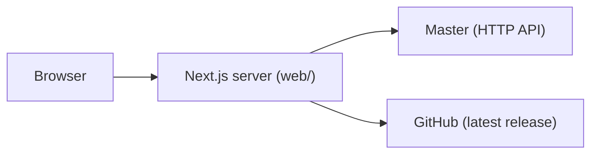
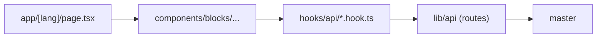

# R-Type web site

The web site of R-Type: it presents the game, lets a player download it, shows
the servers and their games, the leaderboard and the wiki. It is a Next.js
program of its own, in `web/`, beside the C++ game and the **master**, the
program that keeps the list of servers and the scores.



The browser only ever talks to the Next.js server. The Next.js server calls
the master and GitHub itself, so the master needs no CORS and the address of
the master is never sent to the browser. The routes of the master the site
reads are listed in [docs: Master](../docs/src/content/docs/master.md).

## Contents

1. [Getting started](#getting-started)
2. [The libraries](#the-libraries)
3. [Layout of the folder](#layout-of-the-folder)
4. [Pages, languages and routing](#pages-languages-and-routing)
5. [How data reaches a page](#how-data-reaches-a-page)
6. [Components](#components)
7. [Styling](#styling)
8. [Animations](#animations)
9. [Tests, lint and CI](#tests-lint-and-ci)
10. [Where does a new thing go?](#where-does-a-new-thing-go)

## Getting started

```bash
cd web
bun install
bun run dev        # http://localhost:3000
```

The site works with no master: the pages that read it show an empty state or
examples (see [A silent master](#a-silent-master)). To see real data, start a
master and tell the site where it is:

```bash
./r-type_server --mode master -p 8081      # from the root of the repository
echo 'MASTER_URL=http://localhost:8081' > web/.env.local
```

| Command                           | Does                                                                                  |
| --------------------------------- | ------------------------------------------------------------------------------------- |
| `bun run dev`                     | Next.js in development, with hot reload                                               |
| `bun run build` / `bun run start` | production build, then the production server                                          |
| `bun run lint`                    | Biome: lint and formatting check (`bun run lint:fix` fixes, `bun run format` formats) |
| `bun run typecheck`               | `next typegen` (types of the routes), then `tsc --noEmit`                             |
| `bun run test`                    | Vitest, once                                                                          |

| Variable            | Default                 | Role                                                             |
| ------------------- | ----------------------- | ---------------------------------------------------------------- |
| `MASTER_URL`        | `http://localhost:8080` | where the Next.js server reaches the master                      |
| `GITHUB_REPOSITORY` | `nique-epi/R-Type`      | the repository whose latest release the download page reads      |
| `GITHUB_TOKEN`      | none                    | raises the GitHub API limit from 60 requests an hour per address |

The variables are read and checked once, in [`src/config/env.config.ts`](src/config/env.config.ts),
which `next.config.ts` runs at start: a wrong value stops the site with a
message. Server code reads them through
[`src/config/server-env.ts`](src/config/server-env.ts), which only the server
may import. [`.env.example`](.env.example) lists them; `.env*` files are never
committed.

## The libraries

| Library                                                        | Role                                                                                          | Where to look                                                                                                                            |
| -------------------------------------------------------------- | --------------------------------------------------------------------------------------------- | ---------------------------------------------------------------------------------------------------------------------------------------- |
| **Next.js 16** (App Router)                                    | pages, routing, server rendering, fonts, the redirect by language                             | `src/app/`, `src/proxy.ts`, `next.config.ts`                                                                                             |
| **React 19** with the **React Compiler**                       | components; the compiler memoizes, so there is no `useMemo` or `useCallback` to write by hand | `next.config.ts` (`reactCompiler: true`)                                                                                                 |
| **TypeScript** (strict, `noUncheckedIndexedAccess`)            | types; the alias `@/` means `src/`                                                            | `tsconfig.json`                                                                                                                          |
| **Tailwind CSS 4**                                             | styling through utility classes; the design tokens live in the CSS, not in a config file      | [`src/styles/globals.css`](src/styles/globals.css)                                                                                       |
| **class-variance-authority** (`cva`) and **`cn`**              | the variants of a component, and the merge of class names                                     | `src/components/primitives/`, [`src/lib/utils.ts`](src/lib/utils.ts)                                                                     |
| **GSAP** with **`@gsap/react`** and its `ScrollTrigger` plugin | every animation driven by code                                                                | [`src/lib/gsap/index.ts`](src/lib/gsap/index.ts), [`src/hooks/use-motion.ts`](src/hooks/use-motion.ts)                                   |
| **Lenis**                                                      | the smooth scroll of the whole page                                                           | [`src/components/motion/smooth-scroll.tsx`](src/components/motion/smooth-scroll.tsx)                                                     |
| **StPageFlip** (`page-flip`)                                   | the page that turns in the bestiary                                                           | [`src/components/wiki/bestiary-book.tsx`](src/components/wiki/bestiary-book.tsx), [`src/types/page-flip.d.ts`](src/types/page-flip.d.ts) |
| **zod**                                                        | the shape of what the master and the environment send, checked at run time                    | `src/lib/api/schemas/`, `src/config/env.config.ts`                                                                                       |
| **@better-fetch/fetch**                                        | the typed client of the master                                                                | [`src/lib/api/clients/master/`](src/lib/api/clients/master/index.ts)                                                                     |
| **lucide-react**                                               | icons                                                                                         | `src/components/primitives/icons/`                                                                                                       |
| **server-only**                                                | makes the build fail if a client component imports a server module                            | the top of every file in `src/hooks/api/`, `src/lib/api/`, `src/config/server-env.ts`                                                    |
| **Biome**                                                      | linter and formatter (single quotes, two spaces, organized imports)                           | `biome.json`                                                                                                                             |
| **Vitest**, **Testing Library**, **jsdom**                     | the tests                                                                                     | `vitest.config.mts`, `src/test/`                                                                                                         |
| **bun**                                                        | installs the packages and runs the scripts (`packageManager` in `package.json`)               | `bun.lock`                                                                                                                               |

`components.json` is the configuration of **shadcn**: the site follows its
conventions (a `primitives/` folder of small components, `cva` variants, a
`cn` helper), but the components are written by hand for the pixel style of the
game, and no Radix package is installed.

## Layout of the folder

```text
web/
├── public/            images served as they are (sprite sheets of the game, the sky)
├── src/
│   ├── app/[lang]/    the pages, one folder per route
│   ├── components/    everything that is drawn (see Components)
│   ├── hooks/         React hooks: reading the master (api/), motion, fullscreen, scroll lock
│   ├── i18n/          the words of the site in each language, and the formatting of numbers and dates
│   ├── lib/           plain TypeScript with no JSX: the API client, GitHub, GSAP, the domain of R-Type
│   ├── config/        the environment variables
│   ├── styles/        globals.css (tokens, utilities) and the pixel fonts
│   ├── test/          the helpers every test shares
│   ├── types/         declarations for packages that ship no types
│   └── proxy.ts       sends `/servers` to `/en/servers` or `/fr/servers`
├── next.config.ts   biome.json   components.json   vitest.config.mts   tsconfig.json
└── package.json   bun.lock   .env.example
```

A test sits **beside the file it tests** (`ranking-view.ts`, `ranking-view.test.ts`).

### `src/lib/`: no JSX

| Folder or file                       | Holds                                                                                                                                                                                                          |
| ------------------------------------ | -------------------------------------------------------------------------------------------------------------------------------------------------------------------------------------------------------------- |
| [`lib/api/`](src/lib/api/)           | the client of the master: `clients/` (the fetch client and its list of routes), `schemas/` (zod), `routes/` (one function per route), `helpers/` (error mapping). One entry point: `api` in `lib/api/index.ts` |
| [`lib/github/`](src/lib/github/)     | the latest GitHub release: reading it, finding the installer of the reader's system, the install steps                                                                                                         |
| [`lib/gsap/`](src/lib/gsap/index.ts) | GSAP, registered once, and the media query of reduced motion                                                                                                                                                   |
| [`lib/rtype/`](src/lib/rtype/)       | what the site knows of the game: servers and their seats, players, palettes, the ranking choice, the team, the example servers                                                                                 |
| `lib/site-paths.ts`                  | the path of each page in each language (`pathOf(locale, 'ranking')`)                                                                                                                                           |
| `lib/fonts.ts`                       | the three fonts, loaded once                                                                                                                                                                                   |
| `lib/shortcuts.ts`                   | `runShortcut()`: the keys of a screen of the game (Q, E, F, Escape...)                                                                                                                                         |
| `lib/breakpoints.ts`, `lib/utils.ts` | the wide-screen query, the `cn` helper                                                                                                                                                                         |

## Pages, languages and routing

Every page lives under `app/[lang]/`, `lang` being `fr` (the default) or `en`.

| Route                      | File                                  | Reads                                                                  |
| -------------------------- | ------------------------------------- | ---------------------------------------------------------------------- |
| `/`                        | `app/[lang]/page.tsx`                 | the servers with free seats, the latest release                        |
| `/download`                | `download/page.tsx`                   | the latest release (GitHub)                                            |
| `/servers`                 | `servers/page.tsx`                    | the servers, their games and their ping (the sector map)               |
| `/servers/[id]`            | `servers/[id]/page.tsx`               | one server, its games and its last 100 samples                         |
| `/leaderboard`             | `leaderboard/page.tsx`                | the leaderboard; the scope and filters are in the query of the address |
| `/wiki`, `/wiki/[section]` | `wiki/`                               | nothing; `/wiki` redirects to the first article                        |
| `/team`                    | `team/page.tsx`                       | nothing                                                                |
| anything else              | `[...rest]/page.tsx`, `not-found.tsx` | a 404 drawn inside the layout of the site                              |

- **The language.** [`src/proxy.ts`](src/proxy.ts) redirects a path with no language to the one the browser prefers (`Accept-Language`), French when none matches. [`app/[lang]/layout.tsx`](src/app/[lang]/layout.tsx) sets `<html lang>`, the fonts and the shell of the site.
- **The shell.** [`components/blocks/shell/site-shell.tsx`](src/components/blocks/shell/site-shell.tsx): the announcement bar, the header and its menu, the page, and the smooth scroll.
- **The paths** are never written by hand: `pathOf()`, `serverPathOf()` and `wikiPathOf()` in [`lib/site-paths.ts`](src/lib/site-paths.ts).
- **A page is thin**: it reads `params` and the query, then hands them to a _block_ (see [Components](#components)).

### The words (`src/i18n/`)

There are two kinds of text, both typed so a language that misses a line fails to compile:

| What                                                                          | Where                                                                                                                                                                | Used by                     |
| ----------------------------------------------------------------------------- | -------------------------------------------------------------------------------------------------------------------------------------------------------------------- | --------------------------- |
| **The words of the components** (labels of a table, of a button, of a screen) | `i18n/dictionaries/fr.ts`, `en.ts`; the type is `Dictionary` in [`i18n/dictionary.ts`](src/i18n/dictionary.ts), assembled from the label type each component exports | `getDictionary(lang)`       |
| **The words of the pages** (titles, ledes, paragraphs)                        | `i18n/dictionaries/fr-pages.ts`, `en-pages.ts`; the type is `PageCopy`, the shape of the French copy ([`i18n/page-copy.ts`](src/i18n/page-copy.ts))                  | `getDictionary(lang).pages` |

To add a language, add it to `LOCALES` in [`i18n/locales.ts`](src/i18n/locales.ts) and write its two dictionaries.
The files `format*.ts` format counts, dates, sizes and durations for a language, and `format-nodes.tsx` puts React nodes inside a sentence (`{file}` becomes a `<strong>`).

## How data reaches a page

All the reading happens **on the server**, in the same order for every page:



| Step                          | Does                                                                                                                                                                               | Example                                                                                                                                       |
| ----------------------------- | ---------------------------------------------------------------------------------------------------------------------------------------------------------------------------------- | --------------------------------------------------------------------------------------------------------------------------------------------- |
| **Page**                      | reads `params` and `searchParams`, picks the block                                                                                                                                 | [`app/[lang]/leaderboard/page.tsx`](src/app/[lang]/leaderboard/page.tsx)                                                                      |
| **Block**                     | an async server component: asks the hooks for the data, composes the components, hands the data down as props                                                                      | [`components/blocks/ranking/ranking-blocks.tsx`](src/components/blocks/ranking/ranking-blocks.tsx)                                            |
| **Hook** (`hooks/api/`)       | turns the answer of a route into what the page shows, memoized per request with React `cache()`                                                                                    | [`hooks/api/master/leaderboard.hook.ts`](src/hooks/api/master/leaderboard.hook.ts), [`servers.hook.ts`](src/hooks/api/master/servers.hook.ts) |
| **Route** (`lib/api/routes/`) | one function per route of the master; returns `{ data, error: null }` or `{ data: null, error: code }`, **never throws**                                                           | [`getLeaderboard.ts`](src/lib/api/routes/leaderboard/getLeaderboard.ts)                                                                       |
| **Client and schema**         | the typed list of the routes (`clients/master/endpoints/`) and the zod shape of each answer (`schemas/master/`): an answer that does not match the schema is an error, not a crash | [`clients/master/index.ts`](src/lib/api/clients/master/index.ts)                                                                              |

The client has a 5 second timeout, so a master that hangs cannot hold a page.
Errors are mapped to a short list of codes (`BAD_REQUEST`, `NOT_FOUND`,
`ERR_API_FETCH_FAILED`...) in [`lib/api/helpers/errors/`](src/lib/api/helpers/errors/index.ts).

### A silent master

A hook never lets a failed read reach the page as an exception:

| Page                      | When the master does not answer                                                                                              |
| ------------------------- | ---------------------------------------------------------------------------------------------------------------------------- |
| servers, sector map, home | the example servers of [`lib/rtype/sample-servers.ts`](src/lib/rtype/sample-servers.ts), and the page says they are examples |
| leaderboard               | an empty list and the line « The master does not answer »; the _Server_ tab is disabled, since there is no server to read    |
| a server sheet            | the page of an unknown server (404), or a waiting notice for a server created and not registered yet                         |

### The leaderboard: the state lives in the address

The scope and the filters are in the query (`/leaderboard?scope=server&server=7&difficulty=hard&pilots=3`).
`rankingChoiceOf()` in [`lib/rtype/ranking-view.ts`](src/lib/rtype/ranking-view.ts) reads it (a wrong value falls back to
the first visit), the block reads the master for that choice, and a click on a tab or a filter
([`ranking-section.tsx`](src/components/ranking/ranking-section.tsx)) only changes the address with `router.push`:
the server then reads the master again. So a leaderboard can be shared by its link.

### Other server reads

- **GitHub**: [`lib/github/latest-release.ts`](src/lib/github/latest-release.ts) reads the latest release, kept 10 minutes by Next.js (`revalidate`), with a timeout.
- **Pages that always ask again**: the home, the servers and the leaderboard call `await connection()`, so they are rendered at each request, not at build time.
- **Pages that follow the master**: [`AutoRefresh`](src/components/layout/auto-refresh.tsx) (`router.refresh()` on an interval) makes the page read its data again without a reload: every 15 s for the map and the home page, 10 s for the sheet of a server, 30 s for the leaderboard. What the reader picked in a client component (a star, a filter) stays; a tab that is not on screen waits and reads again when it is shown. Each refresh costs the master the reads of the page, so the intervals are constants of that file.

## Components

`src/components/` is split by **how reusable** a folder is, from the most
general to the most specific:

| Folder                                                         | Holds                                                                                                                   | Knows about the master?    |
| -------------------------------------------------------------- | ----------------------------------------------------------------------------------------------------------------------- | -------------------------- |
| [`primitives/`](src/components/primitives/)                    | the small building blocks of the design system: buttons, text, panels, tabs, dialogs, badges, layout containers         | no                         |
| [`game/`](src/components/game/)                                | the look of the game client, in the page: `GameScreen` and the pieces that draw on it                                   | no                         |
| [`sprites/`](src/components/sprites/)                          | drawing a frame of a sprite sheet of the game                                                                           | no                         |
| [`sky/`](src/components/sky/)                                  | the night sky: the layers of stars, the planet                                                                          | no                         |
| [`motion/`](src/components/motion/)                            | the animation wrappers (see [Animations](#animations))                                                                  | no                         |
| [`layout/`](src/components/layout/)                            | the header, the menu, the announcement bar, the hero and the body of an inner page                                      | no                         |
| `download/`, `home/`, `ranking/`, `servers/`, `team/`, `wiki/` | the components of one page: each takes its **data and words as props**                                                  | no                         |
| [`blocks/`](src/components/blocks/)                            | one folder per page; each block is an **async server component** that reads the data and assembles the components above | **yes**, through the hooks |

**The rule:** a component outside `blocks/` never calls the master. It takes
its data and its words as props, so it can be tested alone and reused. Only
a block reads the data, then hands it down.

### `primitives/`

Hand-written, in the style of shadcn. Each is a function with `cva` variants
and a `data-slot` attribute, and merges the class names it is given with `cn()`.

| Folder      | Components                                                                                         |
| ----------- | -------------------------------------------------------------------------------------------------- |
| `actions/`  | `Button` (outline or solid pill; a link when given an `href`), `Action`, `ArrowLink`, `IconButton` |
| `layout/`   | `Container`, `Section`, `PageMain`                                                                 |
| `text/`     | `Heading`, `Eyebrow`, `Lede` (typography), `Keycap`, `CodeBlock`                                   |
| `surfaces/` | `Panel`, `Table`, `Dialog`                                                                         |
| `status/`   | `StatusBadge`, `Notice`, `ProgressBar`, `Stat`, `Tag`                                              |
| `inputs/`   | `Tabs`                                                                                             |
| `icons/`    | `Triangle`, `PixelIcon`, `SideMarker`                                                              |

### `game/`: the screens of the game, in the page

The client of the game draws a **480 × 270** picture at ×2. The site reproduces
that with [`GameScreen`](src/components/game/game-screen.tsx): a **960 × 540**
canvas whose children are laid out in pixels of the game, and that scales
down to the width it is given (`fittingScale()`). It takes the focus, so the keys of the game work.

| Component                                   | Role                                                                                                                                                                                     |
| ------------------------------------------- | ---------------------------------------------------------------------------------------------------------------------------------------------------------------------------------------- |
| `GameScreen`                                | the 960 × 540 canvas; options `fitHeight` (also fit the height), `upscale` (grow past 960 × 540, for the fullscreen leaderboard) and `settle` (tilts flat as it scrolls into the middle) |
| `GameText`                                  | text in the pixel fonts, in pixels of the game                                                                                                                                           |
| `GameChip`                                  | a button with its key (`FILTER [F]`)                                                                                                                                                     |
| `CutFrame`, `ScreenCorners`                 | the cut-corner frames of the screens                                                                                                                                                     |
| `ScreenDialog`, `PlayerSlots`, `PlayButton` | a dialog over the screen, the four seats of a game, the PLAY button                                                                                                                      |

The screens built on it are [`ranking/ranking-screen.tsx`](src/components/ranking/ranking-screen.tsx)
(the leaderboard) and [`servers/sector-map/`](src/components/servers/sector-map/sector-map.tsx) (the map of the servers).

### `sprites/`

[`Sprite`](src/components/sprites/sprite.tsx) draws one frame of a sprite sheet
of the game at a **whole** scale (so no pixel blurs), and can play the frames
to its right. The sheets (`public/sprites/`) are copies of the files of the
game (`assets/sprites/`); [`sheets.ts`](src/components/sprites/sheets.ts)
lists each sheet with its size, and the frame of each ship and enemy.
`Ship`, `Enemy`, `Professor` and `Logo` are `Sprite`s with the right sheet and frame.
To add an enemy: copy its sheet to `public/sprites/mobs/`, add it to `SHEETS`
and `ENEMY_KINDS` in `sheets.ts`, and write its name and text in the two
`*-pages.ts` dictionaries (the bestiary and the home page then show it).

### `sky/`

[`StarLayers`](src/components/sky/star-layers.tsx) is the moving sky: three
pictures of stars (`public/sky/stars-*.png`) that drift left at three speeds,
the same ones as the game. It fills its positioned parent. A page that wants
the sky behind all of it, as the leaderboard and the download page do, wraps
its content in `relative isolate` and puts `<StarLayers className="-z-10" />`
first.

## Styling

Everything is in [`src/styles/globals.css`](src/styles/globals.css) (Tailwind 4: the tokens are CSS, not a config file):

- **Colors** (`@theme`): the palette of the game (`sky`, `ink`, `star-white`, `hud-cyan`, `edge-blue`, `player-*`...), usable as `bg-sky`, `text-pale-blue`. The names shadcn expects (`background`, `primary`...) point to them.
- **Fonts**: _Press Start 2P_ for titles and the pixel look (`font-pixel`), _Silkscreen_ for small captions (`font-small`) and _IBM Plex Mono_ for reading (`font-body`). They are loaded once in [`lib/fonts.ts`](src/lib/fonts.ts); the two pixel fonts are the ones the game uses.
- **Breakpoint**: `md` is **861 px** (`53.8125rem`), where the layouts of the mockup stop stacking. `lib/breakpoints.ts` mirrors it for scripts.
- **Utilities written for the site**: `pixelated` (crisp pixels), `small-caps`, `cut-*` and `cut-top-*` (cut corners), `text-outline-ink`, `row-link`, `starfield` (a night sky in CSS, for a box too small for `StarLayers`) and `newsprint` (the paper of the bestiary).
- **Sprite animation** keyframes: see [Animations](#animations).

## Animations

Three kinds of animation, each with one home:

| Kind                                                                          | Tool                      | Where                                                                                    |
| ----------------------------------------------------------------------------- | ------------------------- | ---------------------------------------------------------------------------------------- |
| Animations written in code: reveal on scroll, parallax, counters, hero, stars | **GSAP**                  | `lib/gsap/`, `hooks/use-motion.ts`, `components/motion/`, and the components named below |
| Frames of a sprite sheet                                                      | **CSS** `@keyframes`      | `components/sprites/sprite.tsx`, `@keyframes sprite-frames` in `globals.css`             |
| The smooth scroll, and the page that turns                                    | **Lenis**, **StPageFlip** | `components/motion/smooth-scroll.tsx`, `components/wiki/bestiary-book.tsx`               |

### The one rule: reduced motion

A reader whose system asks for **reduced motion** (`prefers-reduced-motion: reduce`) gets every element in its final place, still: no animation runs, no smooth scroll, no turning page. This is not left to each component:

- [`lib/gsap/index.ts`](src/lib/gsap/index.ts) registers `useGSAP` and `ScrollTrigger` **once**, and exports `MOTION_ALLOWED`, the media query. **Every component imports GSAP from `@/lib/gsap`, never from `gsap`.**
- [`hooks/use-motion.ts`](src/hooks/use-motion.ts): **`useMotion(() => { ... }, { scope, dependencies, query })`** is the way to animate. It wraps `useGSAP()` (which reverts the animation when the component goes) and runs the function **only when motion is allowed**. `scope` limits the selectors you write to the descendants of an element, `dependencies` reruns it when a value changes, `query` adds a media query such as a wide screen. `motionAllowed()` answers the same question for an animation that an event handler starts later.
- The markup is always written in its **final** state, and the animation goes _from_ somewhere (`gsap.from`, `gsap.fromTo`): without script or without motion, the page is complete.

### The wrappers in `components/motion/`

| Component      | Does                                                                                                                                  | File                                                           |
| -------------- | ------------------------------------------------------------------------------------------------------------------------------------- | -------------------------------------------------------------- |
| `Reveal`       | its children rise into view as they scroll in, staggered; `PageBody` uses it for every inner page                                     | [`reveal.tsx`](src/components/motion/reveal.tsx)               |
| `Parallax`     | drifts against the scroll, as if deeper than the page                                                                                 | [`parallax.tsx`](src/components/motion/parallax.tsx)           |
| `Float`        | hovers up and down for as long as it is on the page                                                                                   | [`float.tsx`](src/components/motion/float.tsx)                 |
| `CountUp`      | a number that climbs from 0 to its value; the page renders the real value, so it reads right to a screen reader                       | [`count-up.tsx`](src/components/motion/count-up.tsx)           |
| `TypeIn`       | a line that writes itself in, in whole steps, like the HUD of the game                                                                | [`type-in.tsx`](src/components/motion/type-in.tsx)             |
| `SmoothScroll` | the smooth scroll (Lenis), driven by the GSAP ticker so `ScrollTrigger` reads the position the page draws; mounted once, in the shell | [`smooth-scroll.tsx`](src/components/motion/smooth-scroll.tsx) |

[`hooks/use-scroll-lock.ts`](src/hooks/use-scroll-lock.ts) stops the page from scrolling under a dialog, with Lenis when it runs and the native scroll otherwise.

### Animations inside components

| What                                                                                                                                    | File                                                                                                                                                               |
| --------------------------------------------------------------------------------------------------------------------------------------- | ------------------------------------------------------------------------------------------------------------------------------------------------------------------ |
| The hero of the home page: the logo, the ships, the planet that crosses the screen                                                      | [`components/home/home-hero.tsx`](src/components/home/home-hero.tsx)                                                                                               |
| The hero of an inner page: the title rises and fades while the sky and the planet drift at their own depth (a scrubbed `ScrollTrigger`) | [`components/layout/page-hero.tsx`](src/components/layout/page-hero.tsx)                                                                                           |
| The sky: each layer of stars is a tween that never ends, at the speed of the game                                                       | [`components/sky/star-layers.tsx`](src/components/sky/star-layers.tsx)                                                                                             |
| A screen of the game that tilts flat as it scrolls to the middle (`settle`)                                                             | [`components/game/game-screen.tsx`](src/components/game/game-screen.tsx)                                                                                           |
| The leaderboard: the title drops, the flags fall, the rows slide in and their scores count up                                           | [`components/ranking/ranking-screen.tsx`](src/components/ranking/ranking-screen.tsx)                                                                               |
| The strip of Bydos on the home page                                                                                                     | [`components/home/bydo-parade.tsx`](src/components/home/bydo-parade.tsx), [`gallery-strip.tsx`](src/components/home/gallery-strip.tsx)                             |
| The menu that opens, the download button and its art, the sector map, the chart of a server                                             | `layout/site-menu.tsx`, `download/download-panel.tsx`, `download/download-art.tsx`, `servers/sector-map/sector-map.tsx`, `servers/samples-chart/samples-chart.tsx` |
| **The page that turns**                                                                                                                 | [`components/wiki/bestiary-book.tsx`](src/components/wiki/bestiary-book.tsx)                                                                                       |

### Frames of a sprite

`<Sprite animation={{ frames, seconds }} />` sets two CSS variables and plays the
`sprite-frames` keyframes of `globals.css`, stepping through the frames to the right of the first one. A `@media (prefers-reduced-motion: reduce)` rule stops it.

### The page that turns (bestiary)

The bestiary is a book of two pages whose leaves turn like paper, with the
**StPageFlip** library (`page-flip`): it folds the page along a line, shows the
back of the page and shades the fold. A reader can drag a corner, or use the
buttons or the contents. The file explains its own constraints; in short:

- StPageFlip **moves** the elements it is given into its own, which React would then lose. So React draws the pages once, hidden, and the book is built from **copies** of them (`cloneNode`). A click on the contents is heard on the book itself (`data-turn-to`), so the copies need no handler.
- The library resizes the pages to a fixed ratio, not to their content. Each page is drawn at 420 × 460 and **scaled** to the width the library gives it (`--page-scale`, set on an inner element because the library rewrites the `style` of the page).
- The book is one page below a width of about 680 px (the library's _portrait_ mode), two pages above it; a `ResizeObserver` tells the library when its container changes.
- The package ships no types: the few members the site uses are declared in [`src/types/page-flip.d.ts`](src/types/page-flip.d.ts).
- The paper look is the `newsprint` utility of `globals.css`.

### Adding an animation

1. A wrapper that exists (`Reveal`, `Parallax`, `Float`, `CountUp`, `TypeIn`)? Use it, with no new code.
2. Otherwise, in a client component (`'use client'`), write the animation in `useMotion(() => { gsap.from(...) }, { scope: ref })`, with the markup in its final state.
3. Import `gsap` from `@/lib/gsap`, never from `gsap`.
4. A scroll-driven animation uses `ScrollTrigger`, also from `@/lib/gsap`.
5. Check the page with _reduce motion_ turned on in your system: everything must be there, in place.

## Tests, lint and CI

- **Vitest** with **jsdom** and **Testing Library**. The shared helpers are in [`src/test/`](src/test/): `responses.ts` (`answer(status, body)` builds a `Response`, `listedServer()` a server as the master lists it), `match-media.ts` and `resize-observer.ts` (browser APIs jsdom lacks), `cleanup.ts`, and `server-only.ts` (`vitest.config.mts` aliases the `server-only` package to it so server modules can be tested).
- **What is tested**: the routes of the API (the URL they call, the answer they return, the error code of a refusal, an answer that breaks the schema), the hooks (with `fetch` stubbed by `vi.stubGlobal`), the pure logic of `lib/` and `i18n/`, and the components that hold logic. The test env sets `MASTER_URL=http://master.test:8080`.
- **Biome** checks and formats (`bun run lint`). The CI refuses a file it would change.
- **CI** ([`.github/workflows/web.yaml`](../.github/workflows/web.yaml)): install with a frozen lockfile, `lint`, `typecheck`, `test`, `build`. All four must pass.

## Where does a new thing go?

| You want to...                                 | Put it in                                                                                                                                                                      |
| ---------------------------------------------- | ------------------------------------------------------------------------------------------------------------------------------------------------------------------------------ |
| add a page                                     | `app/[lang]/<route>/page.tsx` (thin), a block in `components/blocks/<page>/`, a path in `lib/site-paths.ts`, its words in the two `*-pages.ts` dictionaries                    |
| read a new route of the master                 | the shape in `lib/api/schemas/master/`, the route in `lib/api/clients/master/endpoints/`, a function in `lib/api/routes/<group>/` with its test, a hook in `hooks/api/master/` |
| add a small reusable piece (a button, a badge) | `components/primitives/<kind>/`, with `cva` variants and `cn()`                                                                                                                |
| draw something of the game client              | `components/game/` (on a `GameScreen`) or `components/sprites/`                                                                                                                |
| add a component of a page                      | `components/<page>/`: it takes its data and words as props                                                                                                                     |
| add a word                                     | the label type of the component, then `i18n/dictionaries/fr.ts` and `en.ts` (or `*-pages.ts` for a page)                                                                       |
| add a color or a utility                       | `src/styles/globals.css`                                                                                                                                                       |
| animate something                              | [Adding an animation](#adding-an-animation)                                                                                                                                    |
| add an environment variable                    | `src/config/env.config.ts` (zod), `.env.example`, this README                                                                                                                  |
